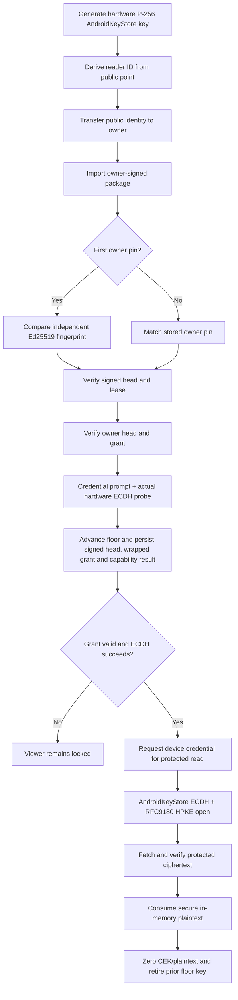

# ADR: Android owner-approved device enrollment V2

- Status: implemented as a bounded Android client slice; physical-device validation remains required
- Date: 2026-11-23
- Scope: Android app/core only; no server endpoint or Root.ark ZK1 protocol change

## Context

The Android client previously had no production `TrustedContentGrantProvider`. Protected text therefore stayed locked, while the existing owner-pinned JVM admission helpers accepted a caller-provided reader identifier and raw CEK bytes. Those helpers did not prove possession of a per-installation private key, did not wrap the CEK to that installation, and did not demonstrate Android hardware backing.

This ADR defines the V2 enrollment slice that connects an independently approved owner grant to the Android protected-content viewer. It does not claim that the wider Android sync client, offline metadata, or write/hydration flows are complete.

## Decisions

1. **Installation identity.** V2 owner-signed enrollment requires Android 13 / API 33 or newer: Android provides the required Java `Ed25519` signature provider only at API 33+, even though P-256 AndroidKeyStore key agreement begins at API 31. The app creates one non-exportable `secp256r1` ECDH key under `AndroidKeyStore`, with `PURPOSE_AGREE_KEY`, device-credential authentication required, a 30-second authentication window, and a generated-key origin. The key is accepted only when `KeyInfo` reports `TRUSTED_ENVIRONMENT` or `STRONGBOX`, secure-hardware authentication enforcement, and the expected purpose/authentication policy. After verifying the signed owner head, enrollment probes an actual AndroidKeyStore ECDH operation against the public P-256 generator point before the floor AES operation consumes the credential window. The local store records a capability bit and the production provider remains disabled unless both the grant and this operation succeed; a failed probe does not prevent persistence of a valid revocation head. API 29–32, software-backed keys, missing secure device credentials, and unsupported ECDH providers fail closed. There is no RSA or software recipient-key fallback.

2. **Canonical device identity.** The reader ID is `p256:` followed by lowercase hex SHA-256 of the canonical 65-byte SEC1 uncompressed P-256 public point (`04 || X || Y`). The ID is recomputed from the public key at every admission. A package's reader ID or a caller-supplied string cannot override it. The public point is shown for transfer to the owner; the private scalar never leaves AndroidKeyStore.

3. **Independent owner pin.** The owner public key is Ed25519 SPKI. On first import, the UI displays its SHA-256 fingerprint and requires the user to compare and enter the fingerprint received through a channel independent of the package and server. To compare it in another app on the same phone, the UI may retain only the signed, HPKE-wrapped package and public installation identity in RAM for up to five minutes of monotonic elapsed time; any background transition clears the login and plaintext, and continuing requires reauthentication with the exact same server origin/account plus fresh AndroidKeyStore public-key binding. Expired, changed or missing trust clears this pending import. The package cannot establish its own trust anchor. The stored pin is bound to HTTPS origin, account, derived reader ID, owner public-key digest, and the last accepted owner revision/digest. Later packages must use the same owner key. The server login and sync responses never supply or replace this pin.

4. **Owner assertions and lease.** The imported package contains a V2 owner-signed revocation head and one owner-signed read grant. Both use Ed25519. The head binds origin, account, reader ID, revision, sorted revocations, issue/expiry times, and a digest of its canonical content. The grant binds origin, account, reader ID, owner revision/digest, object, file, version, compartment, key epoch, signer device and public key, CEK digest, nonce, lease, HPKE suite, encapsulated key, and wrapped CEK. Head and grant leases are each at most five minutes; future issue times have a 30-second tolerance. A valid signed revocation head is advanced into the hardware floor even when its grant is revoked or invalid, so an older package cannot remain usable after the revocation update is imported.

5. **CEK delivery.** The grant uses RFC 9180 base mode with `DHKEM(P-256, HKDF-SHA256)`, `HKDF-SHA256`, and `AES-256-GCM`. The 32-byte CEK is wrapped to the installation public key. The canonical grant context, including reader ID, owner revision/digest, object/file/version/compartment/key epoch, signer, nonce, lease, suite, and HPKE `enc`, is included in both HPKE `info` and AEAD AAD. The owner signature covers the complete grant including `enc` and wrapped ciphertext. There is no raw-CEK import path in the Android app/provider; the legacy V1 raw-CEK primitive is internal to `core` and retained only for existing core regression tests.

6. **Hardware floor and rollback.** The existing `OwnerOfflineFloorStore` provides the locked, authenticated per-operation floor record. The Android adapter creates a new AES-256-GCM AndroidKeyStore key for each floor use. Its alias records owner revision, owner digest, observed wall-clock time, and a per-time sequence; aliases are outside app-file backup. A process and cross-process descriptor-bound index lock serializes alias selection, floor rotation, imports, and protected reads. Each operation writes a new floor under the new key while holding the index lock and the floor file lock through protected fetch, signature verification, decryption, and plaintext consumption. On import, a non-authoritative candidate containing the public pin and owner-signed wrapped package is durably staged under this index lock **before** creating the high-water alias. The stage never grants CEK access. A newer stage blocks protected reads until the matching signed enrollment has been durably committed and the stage removed under the same lock. After a durable seal, Activity cancellation cannot skip that enrollment save. Old aliases and floor files are retired only after both the floor seal and enrollment save; an interrupted seal is treated conservatively as potentially durable even when its callback was not reached. A crash or failed save can leave the stage and high-water alias ahead of the last active enrollment; protected access remains **fail-closed** and the user must reauthenticate and reimport a current owner-signed package. Automatic reconstruction/rollback from an unverified stage is intentionally prohibited. A restored older floor file cannot authenticate under the latest alias; a lower owner revision, conflicting digest, lower observed time, or replayed alias index is rejected. Missing/corrupt hardware alias state, or a failed per-operation floor write/lock validation, fails closed.

7. **User presence.** Before import or protected-content use, the Activity requests the device credential through the system keyguard. Both the ECDH identity key and floor AES keys require device-credential authentication enforced by secure hardware. Devices without a secure credential cannot enroll or open protected content. The app does not accept a server login as user-presence evidence.

8. **Persistence and plaintext.** Only the public pin and owner-signed package (including encrypted CEK bytes) are stored under `noBackupFilesDir`. The owner package contains no private key or plaintext CEK. The CEK is unwrapped only inside the floor-locked callback, held in memory for the protected fetch/decrypt/consume operation, and zeroed in `finally`. Decrypted text remains in the existing secure in-memory preview and is cleared when closed/backgrounded. No offline plaintext file, database row, or backup is created.

9. **Transfer and server boundary.** The user copies the derived public identity to the owner, receives the signed package out of band, and imports it through Android's document picker. The fingerprint is independently confirmed on first use. No server endpoint is invented or called. The Node fixture generator is test-only under `android/core/src/test/resources`; it receives ephemeral test private keys and CEK over stdin, emits only public/signed package data, and stores no secrets.

## Admission flow

## Threat model and limits

- Protects against a copied owner package, copied reader ID, different installation key, modified/forged owner assertions, stale/revoked owner heads, app-file backup/restore of an older floor, and use of software-backed keys.
- The device identity is tied to a non-exportable AndroidKeyStore key and the hardware floor uses revision/time/sequence aliases as an OS-keystore high-water mark. This is not a defense against a fully compromised/rooted OS, malicious system firmware, or an attacker able to delete/replace AndroidKeyStore state itself.
- Wall-clock time is used for the five-minute lease. A backward clock move below the last accepted hardware alias time fails closed; an untrusted clock can still cause denial of service.
- A grant is scoped to one object and the exact owner head. A newer revocation is learned only after a fresh owner package is imported; offline devices cannot learn remote revocations while disconnected. The five-minute lease bounds, but does not eliminate, that exposure.
- The implementation requires actual AndroidKeyStore P-256 ECDH, Android API 33+ Ed25519, and secure-hardware authentication support. A successful JVM test or APK build does not prove that a particular device's TEE/StrongBox supports the requested key agreement. Runtime `KeyInfo` and provider checks fail closed when it does not; the stored capability flag is set only after a successful device-authenticated ECDH probe. Physical API 33+ device testing is still required before claiming hardware compatibility.
- This slice does not implement owner-side production tooling, server APIs, offline plaintext persistence, sync writes, WorkManager hydration, or a full recovery workflow. Interrupted floor/enrollment commits require explicit reimport; no automatic recovery or hardware rollback is claimed. The Node code is a deterministic test-vector builder only.

## Verification

The test suite exercises Node-to-Kotlin RFC 9180 interoperability, deterministic public-package generation without private-key/CEK output, reader-key substitution, owner signature failure, stale lease, signed revocation, floor restart/rollback, software-key refusal, and viewer lock state without a fresh owner grant. AndroidKeyStore behavior still requires a physical device with API 31+ and hardware ECDH support.
