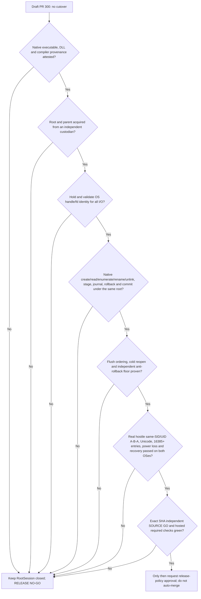

# Issue #66 / PR #300 — native root custody execution gates

**Status: RELEASE NO-GO.** This is an execution and evidence map, not
permission to enable recovery, merge PR #300, deploy, or change `Root/main`.
RootSession remains unconditionally unavailable for production. The local
feature-denial seam in `sync-client/rootark-sync-native-root-session-contract.js`
is an intentional security boundary, not a test workaround.

## Required sequence

The arrows are **conjunctive gates**, not alternative tests. A positive lab
proof does not unlock the next gate without its own source-backed evidence.

## Current bounded milestones

| Milestone | Evidence and what it means | Remaining gap |
| --- | --- | --- |
| Cooperative Files On-Demand root marker | A held marker descriptor rejects FIFO, symlink, hardlink, invalid bytes, concurrent growth and downgrade in tested clients. `O_NONBLOCK` avoids FIFO blocking. | The same SID can delete/replace/rollback the marker and its ancestors; it is not independently monotonic. |
| Linux staged genesis reader | Root/trash/head descriptors are retained through Linux `/proc/self/fd` traversal, enumeration and bounded head reads; successful real ext4 required-v2 recovery with 16,385 legitimate entries. | Initial root lookup, procfs trust, mount/ancestor attacks, destructive mutations, and independent custody remain open. |
| Native N-API page streaming (lab only) | `openat2` and held `DIR*` support 64-name raw-Buffer pages. Exactly 16,385 seeded entries plus Unicode, alias and invalid UTF-8 names are compared by full bytewise namespace; A→B→A retains the original directory. Native stress writes require explicit extra opt-in. | Parent remains writable by same UID; no owner-authorized production root, cold reacquisition, attested binary, journal or commit. |
| Native fixed-leaf staging and publication (lab only) | New `stageProof`/`publishProof` rehearse exclusive held-dirfd stage, fixed PREPARED journal, file/directory fsync, `renameat2(RENAME_NOREPLACE)` and exclusive COMMITTED marker. A rebinding to B does not redirect a publication on pinned A; a colliding foreign destination stays intact and a separate same-UID writer's pre-commit corruption is rejected. | The canaries/journal are not owner-signed or independent, and a same-UID writer may race between syscalls. No trusted `unlinkat`, production journal, rollback, cold reopen, monotonic floor or power-cut proof. |
| Linux required-v2 ledger read and bounded names | `54067c2d` uses held nofollow root/ledger descriptors, procfd-relative enumeration and bounded 8 KiB record reads. A physical WSL/ext4 test reproduced foreign-ledger enumeration RED before this change and passed after it. `77e1736b` streams ledger names with an explicit 32,769-entry ceiling instead of allocating an unbounded `readdir` array; Windows and WSL focused tests passed. | These are legacy read-hardening gates, **not** independent root trust. Initial acquisition, same-UID A→B→A, Windows journal writes/promotion and POSIX path-based stage/rename/cleanup remain unsafe under the full adversary. No full product native recovery or external monotonic floor. |
| Linux legacy ledger PREPARE/COMMIT and retirement hardening | `0f80974a` pins Linux root/ledger descriptors for record writes, HEAD replacement and fsync. Before the fix, a physical same-UID directory swap wrote PREPARE/COMMIT/HEAD to an attacker directory; after the fix, PREPARE/COMMIT swap cases passed. `5e927dc5` anchors archive retirement to the original read inode and unlinks through its held dirfd; a physical pre-fix test intercepted an attempted foreign unlink through a substituted archive symlink. The initial archive test had a P2 false-green in its interceptor; `c5d56592` now resolves physical parents for both procfd and pathname unlinks and requires exact invalid-snapshot denial. Both focused malicious and legitimate cases passed on WSL/ext4; the exact test child received bounded independent SOURCE GO. | This is **only legacy Linux path containment**, not trusted native recovery. Same-UID A→B→A, leaf substitutions between identity check and unlink, protected parent custody, independent rollback floor, stage/genesis promotion, Windows native handles, powercut/durability and hosted CodeQL are unresolved. |
| Linux legacy genesis creation/publication and archive cold-fence | `cc7daca6` pins nofollow root/trash/ledger FDs for staged genesis creation, enforces exclusive hard-link publication (no overwrite of foreign `head.json`), verifies inode/content identity and flushes both directories; physical WSL adversarial and legitimate recovery tests passed. `b3b5e591` prevents a cold open from ignoring orphan archives after a full checkpoint; original parent was **RED** (accepted orphan) and child **GREEN**. `d5805da8` adds a real hard-exit + new-process denial test; `7ff6dade` tightens that test to compare the exact archived PREPARE and all record names/bytes, not merely nonempty directory contents. | These are **bounded cooperative Linux recovery fences**, not independent custody. The exclusive link creates a two-name crash window that intentionally fails closed rather than automatically resolving. Same-UID A→B→A, protected parent and owner-signed floor, native remove/stage/publish in Windows, independent rollback witness, powercut and formal CodeQL final-SHA evidence remain open. |
| Windows legacy archive cold-open and genesis non-overwrite | `e2297926`: Windows archive cold-open RED (accepted orphan), then 3 PASS Windows + 2 PASS WSL and one genuine subprocess-exit/new-process PASS per platform. `1b4fc52f`: Windows genesis rename RED overwrote a competing head; exclusive NTFS hard-link publication then 3 PASS Windows, 1 PASS Windows after-link process exit, 2 PASS WSL regression. | These are cooperative pathname compatibility fences only. Hostile same-SID root/ancestor/leaf rebinding, independent ACL custody, native NTFS/CFAPI handles, monotonic rollback floor, directory powercut and Windows 10 release gate remain unproven. |
| Windows bounded held genesis source | `88a88b68`: replaces the residual pathname `readFile` of the staged genesis with a retained file handle, size-limited 8193-byte read, pre/post fstat and pathname checks, retained FD through exclusive link; Windows positive staged read, genuine 8193-byte growth at the held-open boundary, competing head and hard-exit tests passed. | The initial path still lacks protected same-SID custody; held source bytes and same-inode checks do not supply owner-signed root authority, cold NTFS durability, CFAPI or powercut proof. |
| Windows legacy archive-retirement identity | `76a838de`: retains the Windows ledger's dev+ino across read, validates that the directory being renamed and the archive before each unlink match that inode. A real NTFS substitution at rename caused the old code to **attempt** a foreign unlink (intercepted before destruction); the corrected code passed two adversarial swaps, including one after rename just before cleanup, plus legitimate checkpoint/crash recovery and a real two-process hard-exit. | Protection applies to observed swap windows **only**: Windows Node path-based unlink can still race against a hostile same-SID A→B→A after the last check. Independent NTFS RootDirectory/ACL custody, atomic identity-bound removal, powercut durability, rollback floor and native CFAPI remain NO-GO. |
| Windows and Linux held-ledger record-leaf identity | `c2e8e9b4` binds each Windows PREPARE/COMMIT/HEAD record's original validated BigIntStats to the later archive cleanup, rejecting a changed inode/version before unlink. `61669b06` does the same for Linux using bytes and BigIntStats from the exact held record FD, checking the original directory-relative leaf before `unlink`. On both OSes, the old code physically attempted a foreign COMMIT unlink (intercepted without destruction), while each child passed real adversarial COMMIT/PREPARE/HEAD substitution and legitimate recovery checks. Both exact code SHAs received bounded SOURCE GO and were fast-forwarded locally. | **Neither filesystem provides an atomic unlink of the verified inode using these Node pathname APIs.** Hostile same-SID/UID A→B→A or replacement immediately after the final leaf check remains unsafe without independent root/parent custody or verified native deletion. No production authorization, rollback witness or powercut proof. |
| Genesis exclusive *stage* and post-publication stage-leaf retirement (Windows+Linux legacy) | `afa4cb5e` replaces destructive temporary→reserved-genesis `rename` with no-replace `link` and fail-closed two-name crash semantics; parent `c9be3dc7` physically attempted a foreign-stage overwrite on both platforms (**RED**, intercepted). Initial `afa4` SOURCE NO-GO found a stale crash hook and unsafe failed-temp cleanup; `022e5c46` fixes both, leaves error-path .tmp evidence inert and received narrow SOURCE GO. `a18d2cce` is the clean rebased follow-up: it rechecks the original linked stage leaf just before final unlink on NTFS and the held-trash dirfd on Linux. Parent physical RED on both OSes caught would-be foreign stage unlinks; exact composed Windows+WSL five focused tests each passed. Both reviewed code deltas are integrated locally, not remotely. | Successful temporary/stage unlink remains **name-based and non-atomic** under same-UID/SID writable ancestors. There is no trusted native RootSession, independently owned parent, stable cold-restart custody, owner-signed antirollback floor, CFAPI release guarantee or powercut proof. SOURCE GO is strictly for cooperative legacy fences, not production/adversarial-root recovery. |
| Root-owned ext4 read-only fixture | Ordinary UID writers cannot mutate the existing root-owned marker/leaf; retained descriptor and fresh-process reads were tested. | Cannot authorize writable recovery; root provisioning, device/issuer trust and monotonic floor are not established. |
| Windows / NTFS / CFAPI (Win11 exercised; Windows 10 unproven) | Windows Node22 CFAPI and recovery compatibility tests are available; the Windows read-handle laboratory proves narrow original-byte continuity. Prior physical host evidence includes Windows 11 Pro build 26300, **not** a verified Windows 10 CFAPI release gate. | Windows 10 end-to-end physical validation, same-SID native NTFS handle-bound acquisition, writes, rename, unlink, directory durability, CFAPI image/DLL custody and powercut proof are absent. |
| Windows exact opened-inode removal after hostile leaf replacement (lab only) | `9302e3da` extends the opt-in NTFS `NtCreateFile(RootDirectory)` proof: after opening a fixed leaf HANDLE, the lab physically moves the original inode and creates different same-name files inside the held A and the pathname-replacement B. `SetFileInformationByHandle(FileDispositionInfo)` removes **only the original opened inode**, keeping both foreign files intact. Windows Node22 NTFS 2 PASS, WSL 2 expected SKIP. | Adversarial order is deterministic within one same-SID process, not a concurrent external writer. Initial root acquisition and test fixture pathname setup remain untrusted. No independently protected ancestor, production Windows RootSession removeEntry, Windows 10/CFAPI, monotonic rollback or powercut proof. Linux `unlinkat` by name remains non-atomic against writable same-UID parent. |
| Native deletion admission contract (still fail-closed) | `74ff83b4` requires Windows `SetFileInformationByHandle` on the originally opened file HANDLE and independently trusted ancestry. POSIX `unlinkat` now explicitly requires independent same-UID writer exclusion on the parent and ancestors. Frozen guards reject `stat→unlink` as identity authority. Contract RED before guards, then Windows Node22 **8 PASS** and WSL Node22 **8 PASS**, with bounded independent SOURCE GO. | This is a declarative native API requirement, **not** a loaded production implementation. No external root custodian, antirollback floor, powercut validation or Windows 10/CFAPI release authority exists. `RootSession` remains unconditionally unavailable. |
| Failed metadata publication and legacy-name compatibility fences | `a36e4ec1` removes unsafe failure-path `rm(temp)`/`unlink(temp)` in operational snapshot/HEAD and journal writes: physical Windows NTFS and WSL/ext4 RED proved would-be foreign-temp deletion (intercepted before destruction), then focused GREEN. Initial SOURCE NO-GO: broad new temp prefix exclusion could hide a previously tracked user filename and create false missing-file reconciliation. `ff41222e` protects historical root names before signed operations and supports root-local custom metadata paths; `ddc8484f` extends the historical fence to **nested** names that the portable validator newly reserves; `bcc47828` adds a direct already-open `_reconcileLocal` regression. Both scanners exclude inert orphan state files, and tests confirm legitimate cold recovery with debris. | Names formerly legal in historical snapshots now require an explicit **fail-closed migration**; they are not silently deleted. Failed temp files intentionally remain as untrusted evidence, with no unverified cleanup/GC, and can exhaust space over time. Successful journal/snapshot rename and other mutable-name cleanup remain unsafe under hostile same UID/SID without protected ancestor custody. No production root session, powercut, CFAPI or rollback authorization. |
| Linux post-rename metadata durability and cold replay | `d1a3e47f` proves (in injected post-successful-rename parent directory `FileHandle.sync` EIO schedules) the snapshot v2, PREPARE HEAD and journal replay paths; `0d969b4b` adds physical completed-v2 checkpoint plus **a separate Node22 cold process**; `02600fbe` closes peer-found false-green (only one directory CREATE allowed) and false-red (await subprocess `close`). `3458a440` fixes a new **RED**: after an actual v2 snapshot rename and injected fsync EIO, legacy code resumed `_reconcileLocal`; now `invalid_snapshot` aborts the entire pass before signed reconciliation and retains original EIO cause. Composed Node22 WSL ext4 **6 PASS** and Windows NTFS focused nonregression **5 PASS**. | EIO is injected into a real opened directory handle's `sync` method, **not** an actual kernel fsync/hardware power failure. Earlier reopen checks were separate objects; only the final checkpoint test used a truly separate OS process. This is legacy cooperation, not same-UID/SID identity-bound remove, independent custody, signed rollback witness or a release GO. |
| Four formal CodeQL filesystem-race root causes and physical marker rebound | On old remote `d3a91c92`: marker `lstat`→pathname `readFile`, held trash then pathname `opendir`, test fixture `stat`→pathname `readFile`, and privileged owner test `lstat`→pathname marker `readFile`. Local held-FD marker/genesis and test-file handles address these specific reopen races without suppression. Child `9fe36d47` physically swapped equal-byte marker inodes and failed old remote Windows+WSL RED, while held-FD local passed; independent SOURCE GO. Child `23a0746e` removes an analogous stat/read-by-name from the proof itself, Windows+WSL focused 3 PASS each; SOURCE GO. | These are bounded local source fixes, not a hosted CodeQL PASS for the unpublished SHA; protected parent acquisition, same-SID/UID ABA, owner-signed rollback floor and native root authority remain absent. |
| Inbound authenticated payload publication failure | Parent `9fe36d47` attempted to delete a physically substituted foreign temporary after injected rename EIO (Windows/WSL RED, interceptor saved bytes). `a5cab02a` removes both unsafe inbound/MOVE `rm(temp)` sites and uses exclusive inert reserved names. Its first peer review found P2 `EXDEV` on nested mount targets; `da06918a` stages in the target directory, preserves normal/move recovery and handles nested regular-file orphans in required-v2 cold scan. Second peer review returned narrow cumulative GO. Previous full FOD suite: Windows Node22 39 PASS/1 SKIP, WSL Node22 40 PASS; follow-up nested required-v2 1 PASS each platform and focused FOD 3 PASS each. | No physical nested bind-mount cross-device test and no crash injected during inbound write; `rename` remains name-based under hostile same UID/SID. Orphan accumulation requires separately authorized custody-safe cleanup; source tests, synthetic errors and cold hard-exit are not powercut evidence. |
| W3 opened-inode native publication (Linux lab, NOT RootSession) | Child `29ccf0da` retains the exact exclusive stage FD through publication. An unprivileged `linkat` from kernel procfd into the pinned held directory creates the destination with atomic no-replace semantics; foreign same-byte source substitution and EEXIST retry were both physical RED on the parent, GREEN in the child. A native-internal late stage-name replacement after the preflight also proved that the published destination remained the ORIGINAL opened inode. WSL Node22/ext4 W3+contract 23 PASS/3 SKIP; Windows Node22 RootSession contract 8 PASS; SOURCE GO. Later local laboratory child `03b65966` adds a separate **opt-in** O_TMPFILE stage (without O_EXCL), retained FD and no-replace linkat, producing a final `nlink=1` inode with **no stage pathname to retire**. Real WSL Node22/ext4 RED before anonymous staging, then **27 PASS/3 SKIP** W3+contract, including foreign destination collision and separate child process hard exits both before link and after directory fsync but before COMMIT. Windows RootSession contract 8 PASS. | The older visible-stage mode deliberately leaves two names with nlink=2 (generic read denies it), while the anonymous mode has nlink1 and is readable in the LAB; neither is product-root custody. Before link, a hard-exit leaves PREPARED with no recoverable unnamed payload; after link/before COMMIT it leaves published bytes plus PREPARED but no COMMIT, which must not authorize replay. No independent same-UID/SID writer isolation, trusted cold reacquisition, signed monotonic checkpoint, production NTFS equivalent, CFAPI or powercut proof. The newer candidate needs exact independent SOURCE approval before FF/push. |
| FOD absent-destination publish race — unresolved P2 | On published `ca1d24e0`, `publishInboundPayload` (engine ~758-770) calls replace-capable `rename(temp,target)` after a separate target preflight (`_apply` ~3792 and ~3828). An isolated RED test physically plants a distinct foreign destination inode with `wx` at the real publish boundary; both Windows Node22/NTFS and WSL Node22/ext4 observed the unsafe rename attempt. Destruction was intercepted; foreign bytes remained intact. | Not fixed by the published temp-cleanup/EXDEV patches. Atomic no-replace target publication must be joined to held-inode stage identity and custody-safe retirement without leaking aliases. JS `exists`/`lstat` checks alone remain TOCTOU, while `link`+unsafe unlink would merely move the destructive race; leave production authorization fail-closed until a proven native custodian exists. RED is isolated and not an integrated passing test. |
| Hosted CI and CodeQL: current stacked-base mismatch | The reviewed chain was published once by normal fast-forward from `d3a91c92` to `ca1d24e0`; PR #300 is still OPEN/Draft and `Root/main` was not changed. GitHub shows zero Actions runs and zero check-runs on `ca1d24e0` at this checkpoint. The **current PR base** is `cdx/issue66-picker-pin-integration-prime-20261107` (`5bac9e8e`); its `.github/workflows/codeql.yml` and `security-regression.yml` allow `Root/main` or `cdx/zk65-split-pr*` but not the current base, so the previous hosted CodeQL failure on `d3a91c92` does not establish the new SHA's result. | Getting a fresh hosted CodeQL check requires an explicitly authorized change to the stack-base workflow trigger or PR-base routing, not a redundant push of identical HEAD or a head-only workflow edit. Do not mark CodeQL formally cleared. Retargeting/altering upstream without approval would change the stack scope. |

The four remote CodeQL HIGH annotations were recorded at `rootark-sync-engine.js`
old lines 77 and 706–707, and two issue-66 tests. Local held-marker,
held-genesis, held-ledger and test-handle changes address narrower code paths,
but **formal CodeQL still reads FAILURE** on `d3a91c92`; none of the local
SHAs received a new hosted evaluation. A read-only independent review also
confirmed that adding `unlinkat(dirfd, leaf)` to a same-UID-writable laboratory
root would remain unsafe: a hostile process can replace `leaf` after an
inode/content check and before name-based unlink. No such destructive
implementation was integrated.

## Next implementation milestones (ordered; not yet authorized for production)

1. **Independent parent and root authority.** Establish a protected owner
   service or OS custodian whose writable namespace and rollback witness
   cannot be mutated by the untrusted sync principal. Bind a signed owner
   scope/digest to a protected root identity. Prove cold reacquisition and
   concurrent-writer exclusion. A `0700` same-UID directory, a random token,
   a JS lock, and a pre-open pathname hash are insufficient.
2. **Complete native transaction API.** Implement and review the contract's
   `openRootFromTrustedParent`, `openChildDirectory`, `enumerateDirectory`,
   `openContainedFile`, `readOpenedFile`, `createExclusiveFile`,
   `renameNoReplace`, `removeEntry`, `syncOpenedFile`, `syncDirectory`,
   `reacquireRoot`, `commitDurableRecovery` and `close` under the same pinned
   root. On Linux use native `openat2` with `RESOLVE_BENEATH`,
   `RESOLVE_NO_SYMLINKS`, `RESOLVE_NO_XDEV`, `renameat2(RENAME_NOREPLACE)`,
   `unlinkat` and directory/file `fsync`. On Windows use independently
   protected NTFS ancestors, `NtCreateFile` relative to `RootDirectory`,
   held HANDLE enumeration, stable file/volume IDs and proven flush ordering.
3. **Durable recovery protocol.** Stage and journal on trusted descriptors,
   verify signed owner policy, commit only after ordered durable markers and
   independent monotonic floor promotion; fail closed on indeterminate
   commit/replay. Cover per-phase crash, process restart and real powercut.
4. **Physical adversarial matrix.** Run competing processes with the **same**
   UID/SID, real A→B→A during every operation, symlink/reparse, mount/bind,
   hardlink/Unicode/raw POSIX naming, 16,385+ legitimate records,
   forbidden collisions and under-load cold reopen; prove there is no
   foreign-file deletion, cross-root replay or false-green cleanup.
5. **Supply-chain, independent review and release.** Attest exact native
   binaries, loaded DLLs, compiler and image provenance. Obtain independent
   SOURCE GO for the exact integrated SHA and formal hosted CodeQL/mandatory
   CI success. Separately request the PR's merge/deploy/cutover policy.

## Operational guardrails

All work for this checkpoint is in isolated worktrees and may be
fast-forwarded **locally** only after an independent SOURCE GO. No push,
remote merge, deploy, cutover, force-push, `Root/main` mutation, root-owned
fixture cleanup, or privileged reprovisioning was authorized in this round.
Use local Windows Node22/NTFS and Ubuntu WSL Node22/ext4 tests before a
future authorized GitHub Actions run to conserve metered Actions minutes.
