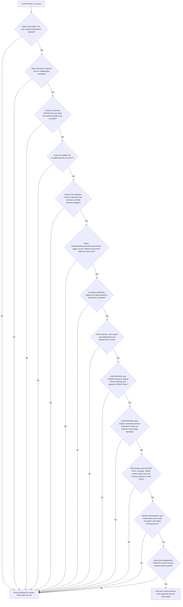

# Issue #66 / PR #300 — native root custody execution gates

**Status: RELEASE NO-GO.** This is an execution and evidence map, not
permission to enable recovery, merge PR #300, deploy, or change `Root/main`.
RootSession remains unconditionally unavailable for production. The local
feature-denial seam in `sync-client/rootark-sync-native-root-session-contract.js`
is an intentional security boundary, not a test workaround.

## Required sequence

The arrows are **conjunctive gates**, not alternative tests. A positive lab
proof does not unlock the next gate without its own source-backed evidence.

## Current bounded milestones

| Milestone | Evidence and what it means | Remaining gap |
| --- | --- | --- |
| Cooperative Files On-Demand root marker | A held marker descriptor rejects FIFO, symlink, hardlink, invalid bytes, concurrent growth and downgrade in tested clients. `O_NONBLOCK` avoids FIFO blocking. | The same SID can delete/replace/rollback the marker and its ancestors; it is not independently monotonic. |
| Linux staged genesis reader | Root/trash/head descriptors are retained through Linux `/proc/self/fd` traversal, enumeration and bounded head reads; successful real ext4 required-v2 recovery with 16,385 legitimate entries. | Initial root lookup, procfs trust, mount/ancestor attacks, destructive mutations, and independent custody remain open. |
| Native N-API page streaming (lab only) | `openat2` and held `DIR*` support 64-name raw-Buffer pages. Exactly 16,385 seeded entries plus Unicode, alias and invalid UTF-8 names are compared by full bytewise namespace; A→B→A retains the original directory. Native stress writes require explicit extra opt-in. | Parent remains writable by same UID; no owner-authorized production root, cold reacquisition, attested binary, journal or commit. |
| Native fixed-leaf staging and publication (lab only) | New `stageProof`/`publishProof` rehearse exclusive held-dirfd stage, fixed PREPARED journal, file/directory fsync, `renameat2(RENAME_NOREPLACE)` and exclusive COMMITTED marker. A rebinding to B does not redirect a publication on pinned A; a colliding foreign destination stays intact and a separate same-UID writer's pre-commit corruption is rejected. | The canaries/journal are not owner-signed or independent, and a same-UID writer may race between syscalls. No trusted `unlinkat`, production journal, rollback, cold reopen, monotonic floor or power-cut proof. |
| Linux required-v2 ledger read and bounded names | `54067c2d` uses held nofollow root/ledger descriptors, procfd-relative enumeration and bounded 8 KiB record reads. A physical WSL/ext4 test reproduced foreign-ledger enumeration RED before this change and passed after it. `77e1736b` streams ledger names with an explicit 32,769-entry ceiling instead of allocating an unbounded `readdir` array; Windows and WSL focused tests passed. | These are legacy read-hardening gates, **not** independent root trust. Initial acquisition, same-UID A→B→A, Windows journal writes/promotion and POSIX path-based stage/rename/cleanup remain unsafe under the full adversary. No full product native recovery or external monotonic floor. |
| Linux legacy ledger PREPARE/COMMIT and retirement hardening | `0f80974a` pins Linux root/ledger descriptors for record writes, HEAD replacement and fsync. Before the fix, a physical same-UID directory swap wrote PREPARE/COMMIT/HEAD to an attacker directory; after the fix, PREPARE/COMMIT swap cases passed. `5e927dc5` anchors archive retirement to the original read inode and unlinks through its held dirfd; a physical pre-fix test intercepted an attempted foreign unlink through a substituted archive symlink. The initial archive test had a P2 false-green in its interceptor; `c5d56592` now resolves physical parents for both procfd and pathname unlinks and requires exact invalid-snapshot denial. Both focused malicious and legitimate cases passed on WSL/ext4; the exact test child received bounded independent SOURCE GO. | This is **only legacy Linux path containment**, not trusted native recovery. Same-UID A→B→A, leaf substitutions between identity check and unlink, protected parent custody, independent rollback floor, stage/genesis promotion, Windows native handles, powercut/durability and hosted CodeQL are unresolved. |
| Linux legacy genesis creation/publication and archive cold-fence | `cc7daca6` pins nofollow root/trash/ledger FDs for staged genesis creation, enforces exclusive hard-link publication (no overwrite of foreign `head.json`), verifies inode/content identity and flushes both directories; physical WSL adversarial and legitimate recovery tests passed. `b3b5e591` prevents a cold open from ignoring orphan archives after a full checkpoint; original parent was **RED** (accepted orphan) and child **GREEN**. `d5805da8` adds a real hard-exit + new-process denial test; `7ff6dade` tightens that test to compare the exact archived PREPARE and all record names/bytes, not merely nonempty directory contents. | These are **bounded cooperative Linux recovery fences**, not independent custody. The exclusive link creates a two-name crash window that intentionally fails closed rather than automatically resolving. Same-UID A→B→A, protected parent and owner-signed floor, native remove/stage/publish in Windows, independent rollback witness, powercut and formal CodeQL final-SHA evidence remain open. |
| Windows legacy archive cold-open and genesis non-overwrite | `e2297926`: Windows archive cold-open RED (accepted orphan), then 3 PASS Windows + 2 PASS WSL and one genuine subprocess-exit/new-process PASS per platform. `1b4fc52f`: Windows genesis rename RED overwrote a competing head; exclusive NTFS hard-link publication then 3 PASS Windows, 1 PASS Windows after-link process exit, 2 PASS WSL regression. | These are cooperative pathname compatibility fences only. Hostile same-SID root/ancestor/leaf rebinding, independent ACL custody, native NTFS/CFAPI handles, monotonic rollback floor, directory powercut and Windows 10 release gate remain unproven. |
| Windows bounded held genesis source | `88a88b68`: replaces the residual pathname `readFile` of the staged genesis with a retained file handle, size-limited 8193-byte read, pre/post fstat and pathname checks, retained FD through exclusive link; Windows positive staged read, genuine 8193-byte growth at the held-open boundary, competing head and hard-exit tests passed. | The initial path still lacks protected same-SID custody; held source bytes and same-inode checks do not supply owner-signed root authority, cold NTFS durability, CFAPI or powercut proof. |
| Windows legacy archive-retirement identity | `76a838de`: retains the Windows ledger's dev+ino across read, validates that the directory being renamed and the archive before each unlink match that inode. A real NTFS substitution at rename caused the old code to **attempt** a foreign unlink (intercepted before destruction); the corrected code passed two adversarial swaps, including one after rename just before cleanup, plus legitimate checkpoint/crash recovery and a real two-process hard-exit. | Protection applies to observed swap windows **only**: Windows Node path-based unlink can still race against a hostile same-SID A→B→A after the last check. Independent NTFS RootDirectory/ACL custody, atomic identity-bound removal, powercut durability, rollback floor and native CFAPI remain NO-GO. |
| Windows and Linux held-ledger record-leaf identity | `c2e8e9b4` binds each Windows PREPARE/COMMIT/HEAD record's original validated BigIntStats to the later archive cleanup, rejecting a changed inode/version before unlink. `61669b06` does the same for Linux using bytes and BigIntStats from the exact held record FD, checking the original directory-relative leaf before `unlink`. On both OSes, the old code physically attempted a foreign COMMIT unlink (intercepted without destruction), while each child passed real adversarial COMMIT/PREPARE/HEAD substitution and legitimate recovery checks. Both exact code SHAs received bounded SOURCE GO and were fast-forwarded locally. | **Neither filesystem provides an atomic unlink of the verified inode using these Node pathname APIs.** Hostile same-SID/UID A→B→A or replacement immediately after the final leaf check remains unsafe without independent root/parent custody or verified native deletion. No production authorization, rollback witness or powercut proof. |
| Genesis exclusive *stage* and post-publication stage-leaf retirement (Windows+Linux legacy) | `afa4cb5e` replaces destructive temporary→reserved-genesis `rename` with no-replace `link` and fail-closed two-name crash semantics; parent `c9be3dc7` physically attempted a foreign-stage overwrite on both platforms (**RED**, intercepted). Initial `afa4` SOURCE NO-GO found a stale crash hook and unsafe failed-temp cleanup; `022e5c46` fixes both, leaves error-path .tmp evidence inert and received narrow SOURCE GO. `a18d2cce` is the clean rebased follow-up: it rechecks the original linked stage leaf just before final unlink on NTFS and the held-trash dirfd on Linux. Parent physical RED on both OSes caught would-be foreign stage unlinks; exact composed Windows+WSL five focused tests each passed. Both reviewed code deltas are integrated locally, not remotely. | Successful temporary/stage unlink remains **name-based and non-atomic** under same-UID/SID writable ancestors. There is no trusted native RootSession, independently owned parent, stable cold-restart custody, owner-signed antirollback floor, CFAPI release guarantee or powercut proof. SOURCE GO is strictly for cooperative legacy fences, not production/adversarial-root recovery. |
| Root-owned ext4 read-only fixture | Ordinary UID writers cannot mutate the existing root-owned marker/leaf; retained descriptor and fresh-process reads were tested. | Cannot authorize writable recovery; root provisioning, device/issuer trust and monotonic floor are not established. |
| Windows / NTFS / CFAPI (Win11 exercised; Windows 10 unproven) | Windows Node22 CFAPI and recovery compatibility tests are available; the Windows read-handle laboratory proves narrow original-byte continuity. Prior physical host evidence includes Windows 11 Pro build 26300, **not** a verified Windows 10 CFAPI release gate. | Windows 10 end-to-end physical validation, same-SID native NTFS handle-bound acquisition, writes, rename, unlink, directory durability, CFAPI image/DLL custody and powercut proof are absent. |
| Windows exact opened-inode removal after hostile leaf replacement (lab only) | `9302e3da` extends the opt-in NTFS `NtCreateFile(RootDirectory)` proof: after opening a fixed leaf HANDLE, the lab physically moves the original inode and creates different same-name files inside the held A and the pathname-replacement B. `SetFileInformationByHandle(FileDispositionInfo)` removes **only the original opened inode**, keeping both foreign files intact. Windows Node22 NTFS 2 PASS, WSL 2 expected SKIP. | Adversarial order is deterministic within one same-SID process, not a concurrent external writer. Initial root acquisition and test fixture pathname setup remain untrusted. No independently protected ancestor, production Windows RootSession removeEntry, Windows 10/CFAPI, monotonic rollback or powercut proof. Linux `unlinkat` by name remains non-atomic against writable same-UID parent. |
| Native deletion admission contract (still fail-closed) | `74ff83b4` requires Windows `SetFileInformationByHandle` on the originally opened file HANDLE and independently trusted ancestry. POSIX `unlinkat` now explicitly requires independent same-UID writer exclusion on the parent and ancestors. Frozen guards reject `stat→unlink` as identity authority. Contract RED before guards, then Windows Node22 **8 PASS** and WSL Node22 **8 PASS**, with bounded independent SOURCE GO. | This is a declarative native API requirement, **not** a loaded production implementation. No external root custodian, antirollback floor, powercut validation or Windows 10/CFAPI release authority exists. `RootSession` remains unconditionally unavailable. |
| Failed metadata publication and legacy-name compatibility fences | `a36e4ec1` removes unsafe failure-path `rm(temp)`/`unlink(temp)` in operational snapshot/HEAD and journal writes: physical Windows NTFS and WSL/ext4 RED proved would-be foreign-temp deletion (intercepted before destruction), then focused GREEN. Initial SOURCE NO-GO: broad new temp prefix exclusion could hide a previously tracked user filename and create false missing-file reconciliation. `ff41222e` protects historical root names before signed operations and supports root-local custom metadata paths; `ddc8484f` extends the historical fence to **nested** names that the portable validator newly reserves; `bcc47828` adds a direct already-open `_reconcileLocal` regression. Both scanners exclude inert orphan state files, and tests confirm legitimate cold recovery with debris. | Names formerly legal in historical snapshots now require an explicit **fail-closed migration**; they are not silently deleted. Failed temp files intentionally remain as untrusted evidence, with no unverified cleanup/GC, and can exhaust space over time. Successful journal/snapshot rename and other mutable-name cleanup remain unsafe under hostile same UID/SID without protected ancestor custody. No production root session, powercut, CFAPI or rollback authorization. |
| Linux post-rename metadata durability and cold replay | `d1a3e47f` proves (in injected post-successful-rename parent directory `FileHandle.sync` EIO schedules) the snapshot v2, PREPARE HEAD and journal replay paths; `0d969b4b` adds physical completed-v2 checkpoint plus **a separate Node22 cold process**; `02600fbe` closes peer-found false-green (only one directory CREATE allowed) and false-red (await subprocess `close`). `3458a440` fixes a new **RED**: after an actual v2 snapshot rename and injected fsync EIO, legacy code resumed `_reconcileLocal`; now `invalid_snapshot` aborts the entire pass before signed reconciliation and retains original EIO cause. Composed Node22 WSL ext4 **6 PASS** and Windows NTFS focused nonregression **5 PASS**. | EIO is injected into a real opened directory handle's `sync` method, **not** an actual kernel fsync/hardware power failure. Earlier reopen checks were separate objects; only the final checkpoint test used a truly separate OS process. This is legacy cooperation, not same-UID/SID identity-bound remove, independent custody, signed rollback witness or a release GO. |
| Four formal CodeQL filesystem-race root causes and physical marker rebound | On old remote `d3a91c92`: marker `lstat`→pathname `readFile`, held trash then pathname `opendir`, test fixture `stat`→pathname `readFile`, and privileged owner test `lstat`→pathname marker `readFile`. Local held-FD marker/genesis and test-file handles address these specific reopen races without suppression. Child `9fe36d47` physically swapped equal-byte marker inodes and failed old remote Windows+WSL RED, while held-FD local passed; independent SOURCE GO. Child `23a0746e` removes an analogous stat/read-by-name from the proof itself, Windows+WSL focused 3 PASS each; SOURCE GO. | These are bounded local source fixes, not a hosted CodeQL PASS for the unpublished SHA; protected parent acquisition, same-SID/UID ABA, owner-signed rollback floor and native root authority remain absent. |
| Inbound authenticated payload publication failure | Parent `9fe36d47` attempted to delete a physically substituted foreign temporary after injected rename EIO (Windows/WSL RED, interceptor saved bytes). `a5cab02a` removes both unsafe inbound/MOVE `rm(temp)` sites and uses exclusive inert reserved names. Its first peer review found P2 `EXDEV` on nested mount targets; `da06918a` stages in the target directory, preserves normal/move recovery and handles nested regular-file orphans in required-v2 cold scan. Second peer review returned narrow cumulative GO. Previous full FOD suite: Windows Node22 39 PASS/1 SKIP, WSL Node22 40 PASS; follow-up nested required-v2 1 PASS each platform and focused FOD 3 PASS each. | No physical nested bind-mount cross-device test and no crash injected during inbound write; `rename` remains name-based under hostile same UID/SID. Orphan accumulation requires separately authorized custody-safe cleanup; source tests, synthetic errors and cold hard-exit are not powercut evidence. |
| W3 opened-inode native publication (Linux lab, NOT RootSession) | Child `29ccf0da` retains the exact exclusive stage FD through publication. An unprivileged `linkat` from kernel procfd into the pinned held directory creates the destination with atomic no-replace semantics; foreign same-byte source substitution and EEXIST retry were both physical RED on the parent, GREEN in the child. A native-internal late stage-name replacement after the preflight also proved that the published destination remained the ORIGINAL opened inode. WSL Node22/ext4 W3+contract 23 PASS/3 SKIP; Windows Node22 RootSession contract 8 PASS; SOURCE GO. Later local laboratory child `03b65966` adds a separate **opt-in** O_TMPFILE stage (without O_EXCL), retained FD and no-replace linkat, producing a final `nlink=1` inode with **no stage pathname to retire**. Real WSL Node22/ext4 RED before anonymous staging, then **27 PASS/3 SKIP** W3+contract, including foreign destination collision, a separate Node process.exit(74) before link and native _exit(73) after directory fsync but before COMMIT. Windows RootSession contract 8 PASS. | The older visible-stage mode deliberately leaves two names with nlink=2 (generic read denies it), while the anonymous mode has nlink1 and is readable in the LAB; neither is product-root custody. Before link, an orderly child-process exit leaves PREPARED with no recoverable unnamed payload; after link/before COMMIT it leaves published bytes plus PREPARED but no COMMIT, which must not authorize replay. No independent same-UID/SID writer isolation, trusted cold reacquisition, signed monotonic checkpoint, production NTFS equivalent, CFAPI or powercut proof. The newer candidate needs exact independent SOURCE approval before FF/push. |
| FOD absent-destination publish race — unresolved P2 | On published `ca1d24e0`, `publishInboundPayload` (engine ~758-770) calls replace-capable `rename(temp,target)` after a separate target preflight (`_apply` ~3792 and ~3828). An isolated RED test physically plants a distinct foreign destination inode with `wx` at the real publish boundary; both Windows Node22/NTFS and WSL Node22/ext4 observed the unsafe rename attempt. Destruction was intercepted; foreign bytes remained intact. | Not fixed by the published temp-cleanup/EXDEV patches. Atomic no-replace target publication must be joined to held-inode stage identity and custody-safe retirement without leaking aliases. JS `exists`/`lstat` checks alone remain TOCTOU, while `link`+unsafe unlink would merely move the destructive race; leave production authorization fail-closed until a proven native custodian exists. RED is isolated and not an integrated passing test. |
| Hosted CI and CodeQL: current stacked-base mismatch | The reviewed chain was published once by normal fast-forward from `d3a91c92` to `ca1d24e0`; PR #300 is still OPEN/Draft and `Root/main` was not changed. GitHub shows zero Actions runs and zero check-runs on `ca1d24e0` at this checkpoint. The **current PR base** is `cdx/issue66-picker-pin-integration-prime-20261107` (`5bac9e8e`); its `.github/workflows/codeql.yml` and `security-regression.yml` allow `Root/main` or `cdx/zk65-split-pr*` but not the current base, so the previous hosted CodeQL failure on `d3a91c92` does not establish the new SHA's result. | Getting a fresh hosted CodeQL check requires an explicitly authorized change to the stack-base workflow trigger or PR-base routing, not a redundant push of identical HEAD or a head-only workflow edit. Do not mark CodeQL formally cleared. Retargeting/altering upstream without approval would change the stack scope. |

The four remote CodeQL HIGH annotations were recorded at `rootark-sync-engine.js`
old lines 77 and 706–707, and two issue-66 tests. Local held-marker,
held-genesis, held-ledger and test-handle changes address narrower code paths,
but **formal CodeQL still reads FAILURE** on `d3a91c92`; none of the local
SHAs received a new hosted evaluation. A read-only independent review also
confirmed that adding `unlinkat(dirfd, leaf)` to a same-UID-writable laboratory
root would remain unsafe: a hostile process can replace `leaf` after an
inode/content check and before name-based unlink. No such destructive
implementation was integrated.

## Next implementation milestones (ordered; not yet authorized for production)

1. **Independent parent and root authority.** Establish a protected owner
   service or OS custodian whose writable namespace and rollback witness
   cannot be mutated by the untrusted sync principal. Bind a signed owner
   scope/digest to a protected root identity. Prove cold reacquisition and
   concurrent-writer exclusion. A `0700` same-UID directory, a random token,
   a JS lock, and a pre-open pathname hash are insufficient.
2. **Complete native transaction API.** Implement and review the contract's
   `openRootFromTrustedParent`, `openChildDirectory`, `enumerateDirectory`,
   `openContainedFile`, `readOpenedFile`, `createExclusiveFile`,
   `renameNoReplace`, `removeEntry`, `syncOpenedFile`, `syncDirectory`,
   `reacquireRoot`, `commitDurableRecovery` and `close` under the same pinned
   root. On Linux use native `openat2` with `RESOLVE_BENEATH`,
   `RESOLVE_NO_SYMLINKS`, `RESOLVE_NO_XDEV`, `renameat2(RENAME_NOREPLACE)`,
   `unlinkat` and directory/file `fsync`. On Windows use independently
   protected NTFS ancestors, `NtCreateFile` relative to `RootDirectory`,
   held HANDLE enumeration, stable file/volume IDs and proven flush ordering.
3. **Durable recovery protocol.** Stage and journal on trusted descriptors,
   verify signed owner policy, commit only after ordered durable markers and
   independent monotonic floor promotion; fail closed on indeterminate
   commit/replay. Cover per-phase crash, process restart and real powercut.
4. **Physical adversarial matrix.** Run competing processes with the **same**
   UID/SID, real A→B→A during every operation, symlink/reparse, mount/bind,
   hardlink/Unicode/raw POSIX naming, 16,385+ legitimate records,
   forbidden collisions and under-load cold reopen; prove there is no
   foreign-file deletion, cross-root replay or false-green cleanup.
5. **Supply-chain, independent review and release.** Attest exact native
   binaries, loaded DLLs, compiler and image provenance. Obtain independent
   SOURCE GO for the exact integrated SHA and formal hosted CodeQL/mandatory
   CI success. Separately request the PR's merge/deploy/cutover policy.

## Operational guardrails

All work for this checkpoint is in isolated worktrees and may be
fast-forwarded **locally** only after an independent SOURCE GO. No push,
remote merge, deploy, cutover, force-push, `Root/main` mutation, root-owned
fixture cleanup, or privileged reprovisioning was authorized in this round.
Use local Windows Node22/NTFS and Ubuntu WSL Node22/ext4 tests before a
future authorized GitHub Actions run to conserve metered Actions minutes.

## 2026-11-10 W26 — Windows NTFS source-HANDLE no-replace publication (laboratory only)

The Linux W3 `O_TMPFILE`/held-FD lab is **not** a Windows backend. The new
Windows W26 opt-in laboratory candidate (`0cc48337` + `d221765d`) instead
uses `NtCreateFile` with `RootDirectory` and `FILE_CREATE` to hold the
original staged file HANDLE, writes and calls `FlushFileBuffers`, then uses
`NtSetInformationFile(FileRenameInformation, ReplaceIfExists=FALSE)` relative
to the same held directory HANDLE. No `stat→rename` admission or source
pathname unlink is treated as atomic authority. Unlike Linux's original
two-hardlink lab, successful native rename retires the source name without
creating another hardlink alias. This is still only a fixed-leaf disposable
fixture in LocalAppData, not a Windows production RootSession.

Physical Windows Node22/NTFS: **5 PASS** for normal original-inode publish,
exact `STATUS_OBJECT_NAME_COLLISION (0xC0000035)` with foreign destination
intact, late equal-byte foreign stage substitution leaving the original
opened HANDLE as the published inode, and replacement of the original root
path **before** opening the staged child (retained root A receives the
publication while replacement B remains intact). Disabled and populated
scratch cases reject without mutation. Combined Windows RootSession
contract: **8 PASS**. WSL Node22: **5 expected SKIP** for Windows-only lab.
No 16,385-record stress was repeated. These experiments were sequential
physical substitutions in user-owned scratch, not simultaneous hostile
processes, and `ROOT_SWAP` does not prove renaming a directory while its
child HANDLE is open. The collision code, original `FileIdInfo` and foreign
bytes were checked, not merely a generic nonzero native error.

**Outstanding gates:** the normal operational SyncEngine FOD path still
uses replace-capable pathname rename and has an isolated Windows/WSL RED;
W26 cannot be connected without independently trusted root/ancestor
custody, same-SID writer exclusion, safe PREPARE/COMMIT and cold replay,
antirollback witness, Windows 10/CFAPI validation and real powercut.
Formal CodeQL on the current stacked PR head still lacks a triggering
base-workflow run. The new W26 candidate requires SOURCE GO of the exact
SHA before integration or publication. **Merge NO-GO; release NO-GO.**

### W26 follow-up — explicit PREPARE → native rename → COMMIT interruption windows

Local child `caa6eb52` (parent docs `827ba856`) extends the same disposable
NTFS HANDLE-only lab with a separate opt-in hard-stop flag. The positive
`TXN_COMPLETE` sequence exclusively writes/flushed `prepared.bin`, publishes
the original opened stage HANDLE without replacing the target, then
exclusively writes/flushed `commit.bin`. A PowerShell child process is killed
with native `TerminateProcess(exit=74)` **before** the rename: staged bytes
and PREPARED survive, with no published target or COMMIT. Another isolated
child is killed with `TerminateProcess(exit=73)` **after** native rename,
but before COMMIT: the original staged name is gone, published bytes and
PREPARED survive, and COMMIT is absent. The native process exit is not a
powercut; Windows NTFS directory metadata durability and cold replay remain
unproved. Physical Windows Node22 W26 **9 PASS**, with **8 PASS** for the
separate RootSession contract in the preceding regression cycle; no 16,385
seeding. Windows-only W26 tests skip on WSL. Neither the PREPARED nor the
COMMIT marker is a trusted owner-signed recovery authority; this lab has
**no recovery engine**. Exact `caa6eb52` SOURCE approval remains mandatory
before FF/push. Product FOD late-destination overwrite, external root
custody, antirollback, hosted CodeQL and Windows 10 CFAPI remain **NO-GO**.

### W26 follow-up — independent-process read-only cold phase inspection (LAB only)

An opt-in `COLD_INSPECT` process now reopens a pre-existing disposable W26
scratch under LocalAppData without staging, renaming, deleting or granting
recovery rights. Native `NtCreateFile(RootDirectory)` opens only fixed leaves
from a newly held NTFS directory HANDLE; reads are bounded to 129 bytes and
bound to the same opened file identity. `FileIdInfo`, `FileStandardInfo`
(regular file, nlink=1, size) and `FileBasicInfo` (version) are compared
before/after each read. It distinguishes PREPARED-only, published-but-NOT-
committed and COMMIT-observed phases after real child process termination,
and denies corrupt markers and a foreign hardlink. A separate
`ROOTARK_ISSUE66_W26_COLD_INSPECT_LAB=1` opt-in is mandatory.

Physical Windows Node22/NTFS: targeted cold cases **3 PASS / 0 FAIL**,
including same-SID marker corruption and an additional hardlink; the W26
suite was **12 PASS / 0 FAIL** before the final read-version comparison,
with all three new cold cases revalidated afterward. RootSession contract
Windows Node22 **8 PASS**, WSL Node22 **8 PASS**. Earlier November 9 physical
evidence and 16,385-name stress were reused, not repeated. No cold
classification authenticates the root: a same-SID writer can replace an
unsigned, byte-identical fixture; no protected root/ancestors, independent
floor, binary attestation, Windows 10 or powercut durability is proven.
**MERGE/RELEASE NO-GO** still applies independently of these results.

### 2026-11-11 — private-lock, journal and signed retry safety chain published

The PR #300 head advanced by **one normal fast-forward push** from
`e82d88606002f0da943f1fda57a604b203e9c539` to
`4d9b19bff36a2ab2e19814c6c7b8734da8e58d38` (17 linear commits).
`Root/main` remains unmodified; PR #300 remains OPEN/Draft. All new commits
have the required bielxdh3 author/committer and one Codex co-author trailer.
Two independent SOURCE reviewers found no remaining P1/P2 **within the
reviewed 17-commit scope**; that is not a production or hosted-CI approval.

The chain tightens the required-v2 private root mutation lock: every private
mutation path must hold a live physical root lock, stale AsyncLocalStorage
leases cannot outlive it, and started/unawaited or already-settled failures
cannot silently release it. Separate explicit write-hazard marks quarantine
the lock after possible `mkdir`, rename, snapshot or journal side effects,
including failures reported after a completed syscall. Cold WebDAV
translation, historical signed atomic-batch journal acknowledgements and
native-required DELETE retries now obey these negative fences. W26 adds a
**read-only, native HANDLE-relative cold-phase inspector** for lab-created
PREPARE, PUBLISHED-without-COMMIT and COMMIT states; no recovery authority is
granted by the inspector.

The final signed-outbound regression intentionally uses two **genuine Ed25519
signed** operations. A replaceable `adapter.push` getter used to mutate the
caller-owned CREATE into a valid DELETE **after** the last envelope check:
the old `8a3c44f1` failed physically on Windows Node22/NTFS and Ubuntu WSL
Node22/ext4 (the DELETE reached the disposable adapter). The new
`4d9b19bf` resolves any getter **before** its final check, validates and
detaches the exact signed operation, compares its digest to the pre-await
original, denies DELETE on that same detached object and dispatches only the
detached copy. A signed legitimate CREATE still writes a disposable fsynced
record and retains its verified authorization bytes. Physical tests of the
final code: full FOD **Windows 72 PASS, 1 POSIX-only FIFO SKIP** and **WSL
73 PASS**; targeted atomic signed batch **4 PASS** on each platform; the
new attacker/control test **1 PASS** each. W26 cold lab tests **3 PASS**
after its ABI fix, and the final published W26 implementation was also
revalidated in its complete Windows Node22/NTFS suite: **12 PASS / 0 FAIL**.
The November 9 stress proof of 16,385 entries was not rerun: these changes
did not alter that physical enumeration contract.

Hosted CodeQL on the published **code SHA** `4d9b19bf` completed SUCCESS:
run `42950460806`, `Analyze JavaScript / TypeScript` check `130293268788`
SUCCESS and separate formal `CodeQL` check `130294051622` SUCCESS. This is
exact-head code evidence, not automatically inherited by a subsequent docs
or code commit. Only these triggered checks were verified; other required
platform/release gates must be evaluated separately at their exact SHAs.

**Unclosed gates:** the operational inbound publisher still uses a
replace-capable JavaScript pathname `rename` and has an isolated adversarial
foreign-destination overwrite RED. W3/ext4 and W26/NTFS remain disposable
laboratories, not signed or independently acquired RootSession custodians.
There is no trusted protected root and entire ancestry, no independently
excluded same-UID/SID hostile writer, no owner-signed monotonic recovery
floor, no attested native product service with durable PREPARE/COMMIT and
cold-reopen authority, no real hardware power-cut proof, and no Windows 10
CFAPI release evidence (the exercised workstation was Windows 11 build
26300). Native no-replace and identity-bound deletion must never be
approximated with stat/exists→pathname rename/unlink. `RootSession` stays
unconditionally OFF. **MERGE NO-GO and RELEASE NO-GO.**

### 2026-11-11 — cold snapshot/journal inode continuity and signed directory negative gate

The next implementable follow-up hardens **cooperative cold admission** and
rejects another path-based mutation that bypassed `RootSession` denial. It
does **not** promote any JavaScript FileHandle into a native custodian.

1. **Snapshot cold read:** `SyncEngine._open()` no longer does
   `lstat(snapshot)` followed by `readFile(snapshot pathname)`. It opens the
   index with nofollow/nonblocking flags where supported, keeps the original
   file handle for its entire read, checks a regular single-link inode with
   a nonzero file ID, and compares dev/ino/size/mtime/ctime against both the
   visible name and retained file handle before/after the byte read. An
   attacker physically swapping the index to a different valid JSON file
   after the original stat was **RED on Windows Node22/NTFS and WSL
   Node22/ext4** before the change, then **GREEN** with `invalid_snapshot`.
   The original and foreign files remained physically distinguishable.
2. **Signed journal cold read:** `SyncJournal.open()` opens the journal once
   and reads from the original held handle with analogous version/identity
   comparisons. An ENOENT **after** opening is invalid rather than consent
   to create an empty journal. A failed open restores the previous in-memory
   state. Physical same-name substitution to a different valid JSON journal
   containing a forged `seen` receipt was **RED on both systems** before
   the change and **GREEN** afterward with `invalid_sync_journal`, retained
   root lock and no remote write. This protects a check/read window but
   cannot authenticate an already-foreign inode at first open or prevent
   same-UID/SID A→B→A without a protected parent and signed recovery floor.
3. **Signed directory UPDATE:** required-v2 had denied physically cached
   signed `MOVE` and `DELETE` but accepted Ed25519-authenticated directory
   `UPDATE` with a different path. That route renamed an entire cached
   subtree using legacy `fsp.rename`, despite native custody being OFF.
   A real directory with an independently fsynced child sentinel was
   accepted by the vulnerable legacy UPDATE path in RED Windows/WSL runs;
   that path calls the kernel rename. The new module-owned
   negative gate rejects **every** native-required directory UPDATE before
   journal admission, rather than testing source absence and introducing a
   second `exists → rename` TOCTOU. Both platforms now reject it with
   `root_session_native_unavailable`, leaving the original subtree, durable
   journal/snapshot bytes and remote store intact. A normal directory CREATE and
   standalone signed CREATE continue through their existing bounded paths;
   non-native legacy operation semantics were not intentionally changed.

Final material regression evidence for the above source changes:
**FOD Windows Node22/NTFS 75 PASS / 1 FIFO SKIP; WSL Node22/ext4 76 PASS**;
targeted signed atomic batch **4 PASS** on each; additional cold-journal
open/receipt/atomic-update regression groups passed together with FOD
(Windows **99 PASS / 1 SKIP**, WSL **100 PASS** before the separate directory
UPDATE denial, which does not change journal parsing). Syntax and diff
whitespace checks passed. These are real filesystem tests with controlled
same-principal substitutions and verified disk bytes, **not** verified
independent concurrent-writer exclusion or physical power interruption.

The previous exact published head was `f0d573637952b642c4c34c2f30bb5c27f2ffe6e7`
with hosted CodeQL SUCCESS. **Never transfer that verdict to this new
source commit:** independent SOURCE/evidence review and hosted CodeQL must
both be verified on the exact new published SHA before calling its code
gate green. All remaining W3/W26 product-integration, native no-replace,
same-SID/UID writer exclusion, protected ancestors, owner-signed monotonic
floor, Windows 10 CFAPI, power-cut and mandatory release checks remain
independent **NO-GO** gates. No release or merge authorization follows.

### 2026-11-11 — bounded cold metadata reads and directory UPDATE proof

The subsequently published `271a7727` (direct child of `79a0da11`) fixed a
test-only held-inode canary, but GitHub's **formal** CodeQL check
`130311529941` on run `42955874978` was **FAILURE** even though the
`Analyze JavaScript / TypeScript` job `130310716545` completed SUCCESS.
The branch alert was **#515, `js/file-system-race`** at the physical signed
directory UPDATE test's later `open(sentinel)`; its original creation had
already recorded `fstat` of the same path. Do not call this SHA CodeQL-green.

The next isolated code candidate `17eebd8232621644d91bce6be85bbc79b2667af1`
retains the original exclusive `wx+` sentinel FileHandle across the signed
negative UPDATE. It reads at an explicit offset on that **same** handle and
rechecks its original dev/ino/size, plus the name's currently visible inode.
It also counts attempted directory renames **before the syscall**: a Windows
sharing or EBUSY failure cannot supply an accidental false-green denial.
The old post-validation reopen is gone without CodeQL suppression.

The same candidate removes two unlimited `FileHandle.readFile()` calls from
cold required-v2 snapshot and signed journal admission. The reader now uses
bounded positional reads from the originally opened inode, with a maximum of
the `fstat` size plus one extra byte to detect post-check growth and a
separate **256 MiB per-control-file resource ceiling**. Changed size,
version, inode or excessive input fails closed; it does not manufacture
recovery authority. Actual same-inode sparse expansion after the initial
inspection was **RED on the preceding source** (two tests per platform,
unbounded method observed) and **GREEN** on the candidate with no unbounded
read. That ceiling is a deliberate availability boundary: larger historical
metadata files require a separately reviewed migration/read policy rather
than bypassing the safety limit.

Physical candidate evidence: Windows Node22/NTFS FOD **77 PASS, 1 FIFO SKIP**;
Ubuntu WSL Node22/ext4 FOD **78 PASS**; cold growth/negative UPDATE targeted
**3 PASS each**; Phase16 cold restart/eviction targeted **4 PASS each**.
No 16,385-record enumeration stress was repeated because the mutation
concerns control-file consumption, not namespace enumeration or native
publisher behavior. The candidate requires exact-SHA independent SOURCE
review before integration and fast-forward, and **formal hosted CodeQL must
be reevaluated on the subsequently published exact final HEAD**, not borrowed
from its parent. These changes cannot remove the known replace-capable
inbound pathname rename, grant independent root/ancestor custody, prove
same-UID/SID writer isolation, monotonic signed rollback protection,
Windows 10 CFAPI, hardware power-cut durability, or native product
PREPARE/COMMIT recovery. **MERGE NO-GO; RELEASE NO-GO; RootSession OFF.**

### 2026-11-11 — external-process no-replace collision probes (W26/NTFS and W3/ext4)

The published baseline `63dec688a6218e6b60a19b8b7fe3063d00977fa0`
passed formal CodeQL (`42958828896`, separate `CodeQL` check
`130321352433` SUCCESS and Analyze `130320252919` SUCCESS). The additional
external-writer tests below are a **new unpublished candidate** and must
receive their own exact-SHA SOURCE review and hosted CodeQL after publication.

The Windows W26 opt-in HANDLE lab now has a strictly separate
`ROOTARK_ISSUE66_W26_EXTERNAL_WRITER_LAB=1` switch for `EXTERNAL_COLLISION`.
An actual second Node process, inheriting the same Windows SID, waits until
the PowerShell/C# native publisher has acquired its directory and original
stage HANDLEs. The child then **exclusively creates, writes, fsyncs and
closes** a foreign `published.bin`, and acknowledges the completed physical
write before the publisher calls native `NtSetInformationFile` with
`ReplaceIfExists=FALSE`. The syscall returns exact NTFS
`STATUS_OBJECT_NAME_COLLISION (0xC0000035)`; the retained original stage and
distinct foreign destination inodes and bytes remain unchanged. The test
checks both inodes through their own opened file descriptors, and the opt-in
denial test confirms no held directory is created with the switch off.
**Windows 11/Node22/NTFS full W26 suite: 14 PASS / 0 FAIL.**

On Ubuntu WSL Node22/ext4, an actual separate **same-UID** Node child creates
and fsyncs the destination after W3 has staged its original retained inode.
The native `linkat` from the original opened stage FD returns the expected
`NATIVE_TXN_NO_REPLACE_CONFLICT`; retained stage and foreign FDs retain
distinct inode identities, bytes and version after the attempt. This is a
deterministic separate-process adversarial interleaving: the child finishes
writing before the native link. **W3 full non-stress suite: 20 PASS / 0 FAIL,
3 expected SKIP.** The 16,385-record stress and privileged bind-mount
fixture were not rerun, since neither native primitive was changed.

These are **laboratory no-overwrite proofs, not same-SID/UID exclusion**.
Each process still shares a writable test principal and the initial ancestor
lookup is not independently authenticated; the probes neither prove
unbounded live contention/A→B→A under every syscall nor supply a trusted
publisher, permanent signed PREPARE/COMMIT, monotonic recovery witness,
Windows 10 CFAPI, power-cut durability or cold independent root reacquisition.
The actual SyncEngine inbound path still has replace-capable pathname rename.
The native experiments remain **LAB_ONLY_NO_GO**, RootSession stays OFF,
and **MERGE/RELEASE remain NO-GO**.

### 2026-11-11 — cold journal bootstrap: no replace-capable publication

A new local required-v2 regression found a separate **first-open journal
bootstrap** race. The old `readHeldJournal()` correctly rejected a previously
rebound journal inode, but its `ENOENT` branch called `durableWrite()`: the
ordinary temp-to-final `rename()` can overwrite a foreign journal created by
a same-principal writer **after the missing-file observation**. A physical
fixture created and fsynced a foreign journal inode at that exact point and
intercepted the would-be replace-capable rename *before destruction*. The
previous source was **RED on Windows/NTFS and Ubuntu WSL/ext4**.

The replacement cold-only initializer now creates the final journal leaf
with `O_CREAT | O_EXCL | O_NOFOLLOW`, writes and fsyncs the originally opened
inode, checks its `fstat` identity/version against the current name, and
syncs the directory where supported. An occupied name fails
`invalid_sync_journal` rather than replacing its owner; the root lock remains
quarantined. If initialization is interrupted, incomplete control-file bytes
must reject cold reopen rather than invent signed receipt authority. Normal
subsequent journal updates still use their existing fsynced atomic-update
path. **GREEN**: focused regression **1 PASS** each on Windows Node22/NTFS
and WSL Node22/ext4; combined FOD + journal open/temp/update suites
**Windows 100 PASS / 2 SKIP**, **WSL 102 PASS / 0 SKIP**.

This is a negative single-leaf collision fence, **not** independent custody
of the root and ancestors, hostile same-SID/UID isolation, antirollback,
power-cut recovery, a general no-replace implementation or an authorization
to activate `RootSession`. The precise new SHA requires independent SOURCE
review and hosted CodeQL after safe publication. **MERGE/RELEASE NO-GO.**

### 2026-11-11 — original PREPARE and COMMIT custody rehearsals, bounded signed floor

This work combines three **non-production** source paths. None connects to
`SyncEngine` as a trusted `RootSession`; its native recovery activation point
continues to reject unconditionally. The public branch previously stood at
`81fe58c2bcaf46856f1e03c6eb2636a67f1a8511`. All new results below
must be reviewed again at the **exact integrated SHA** and subjected to its
own hosted CodeQL/mandatory CI, not inherited from baseline `81fe58c2`.

**W3/Linux Node22/ext4:** source commits `a457dd3361038981a163ea07c521c10af53cdae3`
and `d6594fdf16e4be55aa0c6e4934c77a68291bbab7` retain both the original
staged inode FD and the exclusive, fsynced PREPARE journal FD. The native
publisher now checks original-vs-current journal `dev/ino`, regular-file
type, link count, exact PREPARE bytes and a version pinned **after initial
fsync** (`mtime/ctime`, including nanoseconds), with an additional native
fd-relative identity/version check after no-replace publication and before
writing COMMIT. Physical RED on the parent: a second same-UID process
substituted a different journal inode with equal bytes and the old code
committed. The first candidate was SOURCE **NO-GO** for missing same-inode
version checks and a post-link swap window; both received follow-up code,
new physical tests and independent **SOURCE GO for the bounded laboratory
scope** at `d6594fdf`. Windows-style `exists->rename` is not emulated;
Linux publication remains `linkat` from the original retained inode under
held ext4 directory FD. WSL Node22 W3 full non-stress suite:
**24 PASS / 3 expected SKIP / 0 FAIL**. The two additional tests exercise
named and anonymous `O_TMPFILE`: a separate process changes and restores
the **same** journal inode (version must still fail), and an opt-in
kernel-level journal rebind **after** publication must deny COMMIT. A
published-without-COMMIT inode stays visible and nonauthorizing. These
rechecks cannot eliminate the last-check-to-COMMIT race for an active writer
with the same UID: only independent parent custody can do that.

**W26/Windows Node22/NTFS:** source commit
`77f02bd2327de9275e42da71d3c24f46a934719b` binds the native
PREPARED_V2 and COMMITTED_V2 marker bytes to the **original** native
`FILE_ID_INFO` (volume serial and 128-bit FileId) of the held root and
opened stage. Its new-process cold inspector opens each leaf relative to a
held native directory HANDLE, verifies bounded bytes and original native
File IDs, and denies even if a hostile same-SID writer replaces the
published inode with a **different FileId containing identical bytes**.
The previous source returned a false `COMMIT_OBSERVED` on that real attack;
the child denies and retains both original/foreign inodes. Physical full
W26 suite **15 PASS / 0 FAIL**; independent **SOURCE GO** for this limited
source. `PREPARED_ONLY`, `PUBLISHED_NO_COMMIT` and `COMMIT_OBSERVED` are
read-only laboratory classifications, not a signed native replay permit.
Native no-overwrite uses NTFS `NtSetInformationFile` with
`ReplaceIfExists=FALSE`, never a JavaScript pathname rename.

**Owner/witness/floor reference verifier:** isolated candidate
`2ada620d91f2a4380a59083eb9dc86083ec016ab`, followed by input-budget
hardening `548fb526192694965da9c7e2bcd29edd638d2670` and
`cdeeba5c5917410151be12634cde2bf51354bba4`, with final intrinsic
Buffer length and strict UTF-8 fix `71b07b2ef0033733327323358f9a4f083ad40a15`
(rebased `baa9c27c`), verifies separately
signed Ed25519 owner provisioning, current root-commit witness and
monotonic floor (distinct keys), a fresh nonce in both independent
receipts, exact scope/root digest/epoch/sequence/physical file identity,
and PREPARE/COMMIT digests. It returns **only a frozen nonauthorizing
observation** (`authorizesIo:false`, `authorizesReplay:false`). The
reference accepts **canonical byte buffers of at most 8192 bytes before
JSON parsing**; no arbitrary JS-object descriptor enumeration is allowed.
Valid but stale floor, nonce replay, incomplete COMMIT, oversized or
noncanonical bytes, malformed keys, and a real same-byte foreign inode
are rejected. Lab verification test **1 PASS on Windows Node22/NTFS and
1 PASS on WSL Node22/ext4**; signers and physical readback are test-owned,
not remotely or OS-independently attested. An initial witness implementation
had SOURCE **NO-GO** for unbounded enumeration before its claimed budget;
later commits replace that interface. This verifier is NOT wired as a
product authority and cannot make a local writable journal monotonic.

**Concrete unblock requirements:** provision a separately protected native
service **and all ancestor directories** under a distinct OS principal;
prove user-token access denial by a second hostile process, not by checking
ACL bits alone. On Linux this entails a root/independent-UID-owned helper
with credential-verified AF_UNIX and `openat2`/`renameat2` under retained
dirfds; on Windows an independently installed service identity, protected
DACLs over the full ancestor chain and HANDLE-relative NTFS operations
must exclude the interactive SID. This Windows session is not running as
SYSTEM, and no independently installed Windows service or production Linux
custodian was provisioned or exercised. An opt-in root-owned WSL **test
fixture** is now physically exercised below, but is not a deployed,
independently attested service. After provisioning, a separate current owner-signed
monotonic witness store and challenge must bind cold PREPARE/COMMIT,
physical inode/root identity, original bytes, replay floor and exact
principal to trusted persistence beyond writable sync files. Do not
equate an in-process N-API addon, 0700 same-UID fixture or test-generated
signing keys with such an authority.

Additional external release requirements still include genuine Windows 10
CFAPI hydration/OS callback validation, real hardware power-loss durability
and recovery, supply-chain attestation, same-SID/UID hostile concurrent
A-B-A/mount/reparse pressure under an independent service, and all hosted
Windows/Ubuntu mandatory release gates at the exact published SHA.
The operational `SyncEngine` inbound publisher still has a replace-capable
JavaScript pathname `rename`; W3/W26 do **not** make it safe merely by
existing in the repository. **MERGE NO-GO; RELEASE NO-GO; RootSession OFF.**

### 2026-11-11 — cross-platform native integration, new-process ext4 cold custody, and distinct-UID isolation proof

The previously isolated W3, W26 and witness lines were integrated **after**
the published `91c4e75c` cold journal bootstrap without resetting or
replacing their original commits/worktrees. The combined native/witness
commit chain is `a0b293d1` → `eaf7cb18` → `476b0362` → `8889188c` →
`a50bfeb1` → `40061a7d` → `baa9c27c` → `50c3b9c3`.
This preserves the source-to-integrated SHA provenance, the real NTFS
`NtSetInformationFile` no-replace publisher, and the separately signed
owner/witness/floor **nonauthorizing** reference. The resulting integrated
HEAD `50c3b9c32f3e82369427545a9d7860fea1db1549` received two bounded
independent SOURCE GO reports with zero new P1/P2. Physical exact-tree
tests: Windows Node22 NTFS W26+signed witness **16 PASS / 0 FAIL**, WSL
Node22 ext4 W3+signed witness **25 PASS / 3 expected SKIP / 0 FAIL**.

The next source commit `7da2fd9578d97413a15a9b4752a51f12a4882bef`
implements a further **Linux-only opt-in native laboratory** milestone.
W3 PREPARE now stores and retains an exclusively created, fsynced native
`PREPARED_ID_V2` sidecar with the held directory's `st_dev/st_ino` and
original staged inode `st_dev/st_ino`, and verifies its ORIGINAL held FD,
namespace occupant and file version both before no-replace `linkat` and
after publication before COMMIT. `cold_inspector.c` runs in a **new native
OS process** and walks an explicitly fixed sandbox suffix below passwd
HOME using `openat2` with `RESOLVE_BENEATH`, `NO_SYMLINKS`, `NO_XDEV`.
It reads bounded marker bytes from held FDs, compares inode/version and
current name, checks the original sidecar's exact canonical IDs, and returns
only `PREPARED_ONLY`, `PUBLISHED_NO_COMMIT`, `COMMIT_OBSERVED` or denial.
There is **no cold replay** and no native authority emitted by this inspector.

Physical RED→GREEN on WSL/ext4: a parent without the native identity sidecar
failed the new cold phase proof (missing original inode ID), then the new
native commit passed; an original cold inspector accepted the same inode's
`COMMITTED_V1` prefix followed by `\0FOREIGN` (**RED**), then the corrected
bounded byte comparisons and NUL rejection passed (**GREEN**). A second
real same-UID process parked the original PREPARE identity sidecar and
installed a **distinct byte-identical inode**; native publication denied
before creating COMMIT, and both original and foreign FDs/bytes survived.
Another physical child exited with code 75 **after fsynced PREPARE but
before sidecar**; a new inspector denied the torn transaction. A native
post-link `_exit(73)` produced `PUBLISHED_NO_COMMIT`, never COMMIT. An
independent same-byte foreign **published** inode with an intact COMMIT also
caused cold denial. WSL Node22/ext4 complete W3+signed-witness non-stress
run at `7da2fd95`: **31 PASS / 3 expected SKIP / 0 FAIL**; test-only
stress 16,385+ entries was not repeated.

Additionally an explicitly gated **privileged WSL test process** created a
genuine root-owned ext4 fixture under `/root` (`0700` for both protected
test ancestors and final directory), held the original descriptors,
published an anonymous `O_TMPFILE` stage no-replace, and verified cold
COMMIT as root. A separate real OS child dropped to UID/EUID **1000** via
`runuser` and attempted **read**, **exclusive create**, **overwrite**,
**rename ancestor**, and **create symlink** at both PREPARE and committed
phases: **all five operations per phase were denied by the kernel with
`EACCES`/`EPERM`**. WSL22 root-principal isolated test **1 PASS**. This
establishes distinct-UID isolation in a disposable root-owned **laboratory
root**, not a persistent trusted service; it does **not** exclude a host
administrator, separately privileged process or the same UID as the
custodian. The Windows same-SID isolation gate is still outstanding.

These are closer physical proofs of a coherent native transaction, but
**none** independently attests the native executable, protects persistent
all-ancestor custody through reboot, verifies a current remote monotonic
operator floor, supplies a production RootSession or eliminates arbitrary
hostile same-UID TOCTOU while the root is writable by that principal. The
Linux sidecar contains native inode numbers but is **not signed**; a writer
with the custodian's privileges can forge it. No real hardware powercut,
Windows 10 CFAPI callback, native Windows installed service or exact-head
hosted mandatory release matrix has been proven by these lab results.
`sync-client/rootark-sync-engine.js` still contains the legacy inbound
replace-capable pathname `rename`; it is **not** made production-safe by
these experiments. **MERGE NO-GO; RELEASE NO-GO; RootSession OFF**.

**Independent P2 resolved — named-stage cold replay classification.** The
initial `7da2fd95` inspector correctly classified anonymous `O_TMPFILE`
publication but conservatively rejected *every* successful **named-stage**
publication because `linkat` retains the original stage pathname and the
published name as two hardlinks to one inode. This was a **SOURCE NO-GO**
from an independent reviewer, despite no false COMMIT. Follow-up source
`3f26295b` now requires the opened stage and published file to match the
**same original** dev/ino and PREPARE sidecar, and requires `st_nlink==2`
on both descriptors. Anonymous stages still require no stage pathname and
exactly one published hardlink. An extraneous third alias, a same-byte
foreign stage inode, or a changed FileId fails closed; no unlink/cleanup
is performed. The native bridge also provides a **separately opted-in
named-stage post-link `_exit(73)`**, allowing a second process to observe
`PUBLISHED_NO_COMMIT` through the exact retained original two-link inode.
The preceding inspector returned status 41 for a real valid named COMMIT
(physical **RED**); the corrected inspector returned `COMMIT_OBSERVED`
on the same scenario and denied a byte-identical foreign alias (**GREEN**).
Three focused named-stage tests **3 PASS** on WSL22/ext4. New combined
physical W3+signed-witness suite **34 PASS / 3 expected SKIP / 0 FAIL**;
distinct-principal root-owned ext4 kernel isolation **1 PASS**. The
isolated RED worktree and its fixtures remain preserved. All classifications
remain `LAB_ONLY_NO_GO`, including successful named two-link COMMIT, until
an independent custodian can safely retire the stage and enforce a signed
monotonic cold floor. Native W3/W26 experiments are **not** imported by
the operational publisher. **MERGE/RELEASE NO-GO, RootSession OFF.**

**Second independent P2 resolved — original publication-mode binding.**
The follow-up reviewer identified a distinct cold attack on the preceding
`87f2bd04` state: after a successful named-stage COMMIT, a same-UID writer
could remove the original stage name. Its published inode then changed
from `nlink=2` to `nlink=1`, while PREPARE sidecar and COMMIT marker bytes
remained intact. The old inspector inferred the **anonymous** modality
from the missing stage name and incorrectly returned `COMMIT_OBSERVED`.
That was reproduced on real WSL/ext4 with an opened original inode,
the actual `unlink` of the disposable named stage and the original
intact COMMIT: previous code **RED** (`status=0`, expected deny 41).

Source `ab4a91a0863140017d95e625c2719e5c979b8cfd` now persists a
one-byte **`N` (named) or `A` (anonymous)** original publication mode
alongside the root/stage `st_dev/st_ino` in the exclusively created,
fsynced PREPARE identity sidecar. The native current-session publisher
retains and validates the original sidecar inode/bytes/version across
publication, and the separate cold process compares exact canonical
sidecar bytes and enforces the **original mode**, never the mode inferred
from a mutable leaf. Named mode requires the original stage name and
published inode with the correct `nlink=2` topology; anonymous mode
requires stage absent and published `nlink=1`. The former false COMMIT
now returns 41; correct named and anonymous COMMITs remain valid *lab
classifications only*. The privileged fixture's test name was corrected
to accurately describe a **different-UID** writer, not same-UID exclusion.

Focused physical regression **GREEN 2 PASS** for named mode and actual
alias removal; full WSL Node22/ext4 W3+signed witness **35 PASS / 3
expected SKIP / 0 FAIL**; root-owned distinct-UID adversarial lab
**1 PASS**. Both original RED worktrees, prior SHAs and all test fixtures
were kept. The PREPARE `N/A` byte is **not an independent signature**;
a same-UID writer with access to the entire unprotected test namespace
could forge the sidecar and other markers. Only a differently owned
persisted custodian, owner-signed external monotonic floor and sealed
root/ancestor identities can make this authoritative. **No native
RootSession activation, no merge/deploy/cutover, RELEASE NO-GO**.
