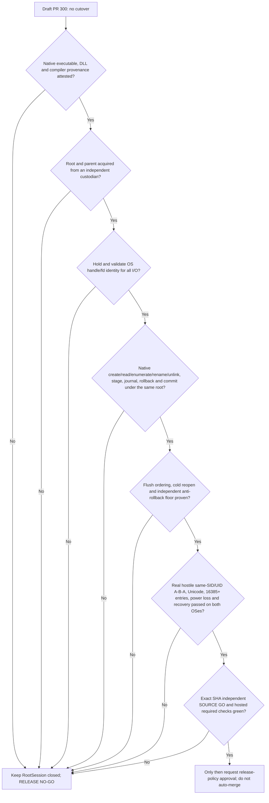

# Issue #66 / PR #300 — native root custody execution gates

**Status: RELEASE NO-GO.** This is an execution and evidence map, not
permission to enable recovery, merge PR #300, deploy, or change `Root/main`.
RootSession remains unconditionally unavailable for production. The local
feature-denial seam in `sync-client/rootark-sync-native-root-session-contract.js`
is an intentional security boundary, not a test workaround.

## Required sequence

The arrows are **conjunctive gates**, not alternative tests. A positive lab
proof does not unlock the next gate without its own source-backed evidence.

## Current bounded milestones

| Milestone | Evidence and what it means | Remaining gap |
| --- | --- | --- |
| Cooperative Files On-Demand root marker | A held marker descriptor rejects FIFO, symlink, hardlink, invalid bytes, concurrent growth and downgrade in tested clients. `O_NONBLOCK` avoids FIFO blocking. | The same SID can delete/replace/rollback the marker and its ancestors; it is not independently monotonic. |
| Linux staged genesis reader | Root/trash/head descriptors are retained through Linux `/proc/self/fd` traversal, enumeration and bounded head reads; successful real ext4 required-v2 recovery with 16,385 legitimate entries. | Initial root lookup, procfs trust, mount/ancestor attacks, destructive mutations, and independent custody remain open. |
| Native N-API page streaming (lab only) | `openat2` and held `DIR*` support 64-name raw-Buffer pages. Exactly 16,385 seeded entries plus Unicode, alias and invalid UTF-8 names are compared by full bytewise namespace; A→B→A retains the original directory. Native stress writes require explicit extra opt-in. | Parent remains writable by same UID; no owner-authorized production root, cold reacquisition, attested binary, journal or commit. |
| Root-owned ext4 read-only fixture | Ordinary UID writers cannot mutate the existing root-owned marker/leaf; retained descriptor and fresh-process reads were tested. | Cannot authorize writable recovery; root provisioning, device/issuer trust and monotonic floor are not established. |
| Windows 10 / NTFS / CFAPI | Windows Node22 CFAPI and recovery compatibility tests are available; Windows read-handle laboratory proves narrow original-byte continuity. | Same-SID native NTFS handle-bound acquisition, writes, rename, unlink, directory durability, CFAPI image/DLL custody and powercut proof are absent. |
| Hosted CI and CodeQL | Published Draft HEAD `d3a91c92` had functional checks green but formal CodeQL failed with filesystem-race alerts. Local fixes are not a hosted result. | No further PR push is authorized in this round; formal CodeQL must rerun on an eventually authorized final SHA. |

## Next implementation milestones (ordered; not yet authorized for production)

1. **Independent parent and root authority.** Establish a protected owner
   service or OS custodian whose writable namespace and rollback witness
   cannot be mutated by the untrusted sync principal. Bind a signed owner
   scope/digest to a protected root identity. Prove cold reacquisition and
   concurrent-writer exclusion. A `0700` same-UID directory, a random token,
   a JS lock, and a pre-open pathname hash are insufficient.
2. **Complete native transaction API.** Implement and review the contract's
   `openRootFromTrustedParent`, `openChildDirectory`, `enumerateDirectory`,
   `openContainedFile`, `readOpenedFile`, `createExclusiveFile`,
   `renameNoReplace`, `removeEntry`, `syncOpenedFile`, `syncDirectory`,
   `reacquireRoot`, `commitDurableRecovery` and `close` under the same pinned
   root. On Linux use native `openat2` with `RESOLVE_BENEATH`,
   `RESOLVE_NO_SYMLINKS`, `RESOLVE_NO_XDEV`, `renameat2(RENAME_NOREPLACE)`,
   `unlinkat` and directory/file `fsync`. On Windows use independently
   protected NTFS ancestors, `NtCreateFile` relative to `RootDirectory`,
   held HANDLE enumeration, stable file/volume IDs and proven flush ordering.
3. **Durable recovery protocol.** Stage and journal on trusted descriptors,
   verify signed owner policy, commit only after ordered durable markers and
   independent monotonic floor promotion; fail closed on indeterminate
   commit/replay. Cover per-phase crash, process restart and real powercut.
4. **Physical adversarial matrix.** Run competing processes with the **same**
   UID/SID, real A→B→A during every operation, symlink/reparse, mount/bind,
   hardlink/Unicode/raw POSIX naming, 16,385+ legitimate records,
   forbidden collisions and under-load cold reopen; prove there is no
   foreign-file deletion, cross-root replay or false-green cleanup.
5. **Supply-chain, independent review and release.** Attest exact native
   binaries, loaded DLLs, compiler and image provenance. Obtain independent
   SOURCE GO for the exact integrated SHA and formal hosted CodeQL/mandatory
   CI success. Separately request the PR's merge/deploy/cutover policy.

## Operational guardrails

All work for this checkpoint is in isolated worktrees and may be
fast-forwarded **locally** only after an independent SOURCE GO. No push,
remote merge, deploy, cutover, force-push, `Root/main` mutation, root-owned
fixture cleanup, or privileged reprovisioning was authorized in this round.
Use local Windows Node22/NTFS and Ubuntu WSL Node22/ext4 tests before a
future authorized GitHub Actions run to conserve metered Actions minutes.
