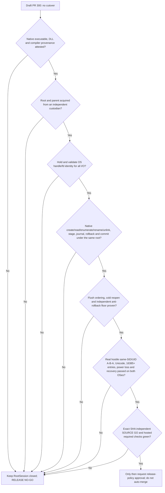

# Issue #66 / PR #300 — native root custody execution gates

**Status: RELEASE NO-GO.** This is an execution and evidence map, not
permission to enable recovery, merge PR #300, deploy, or change `Root/main`.
RootSession remains unconditionally unavailable for production. The local
feature-denial seam in `sync-client/rootark-sync-native-root-session-contract.js`
is an intentional security boundary, not a test workaround.

## Required sequence

The arrows are **conjunctive gates**, not alternative tests. A positive lab
proof does not unlock the next gate without its own source-backed evidence.

## Current bounded milestones

| Milestone | Evidence and what it means | Remaining gap |
| --- | --- | --- |
| Cooperative Files On-Demand root marker | A held marker descriptor rejects FIFO, symlink, hardlink, invalid bytes, concurrent growth and downgrade in tested clients. `O_NONBLOCK` avoids FIFO blocking. | The same SID can delete/replace/rollback the marker and its ancestors; it is not independently monotonic. |
| Linux staged genesis reader | Root/trash/head descriptors are retained through Linux `/proc/self/fd` traversal, enumeration and bounded head reads; successful real ext4 required-v2 recovery with 16,385 legitimate entries. | Initial root lookup, procfs trust, mount/ancestor attacks, destructive mutations, and independent custody remain open. |
| Native N-API page streaming (lab only) | `openat2` and held `DIR*` support 64-name raw-Buffer pages. Exactly 16,385 seeded entries plus Unicode, alias and invalid UTF-8 names are compared by full bytewise namespace; A→B→A retains the original directory. Native stress writes require explicit extra opt-in. | Parent remains writable by same UID; no owner-authorized production root, cold reacquisition, attested binary, journal or commit. |
| Native fixed-leaf staging and publication (lab only) | New `stageProof`/`publishProof` rehearse exclusive held-dirfd stage, fixed PREPARED journal, file/directory fsync, `renameat2(RENAME_NOREPLACE)` and exclusive COMMITTED marker. A rebinding to B does not redirect a publication on pinned A; a colliding foreign destination stays intact and a separate same-UID writer's pre-commit corruption is rejected. | The canaries/journal are not owner-signed or independent, and a same-UID writer may race between syscalls. No trusted `unlinkat`, production journal, rollback, cold reopen, monotonic floor or power-cut proof. |
| Linux required-v2 ledger read and bounded names | `54067c2d` uses held nofollow root/ledger descriptors, procfd-relative enumeration and bounded 8 KiB record reads. A physical WSL/ext4 test reproduced foreign-ledger enumeration RED before this change and passed after it. `77e1736b` streams ledger names with an explicit 32,769-entry ceiling instead of allocating an unbounded `readdir` array; Windows and WSL focused tests passed. | These are legacy read-hardening gates, **not** independent root trust. Initial acquisition, same-UID A→B→A, Windows journal writes/promotion and POSIX path-based stage/rename/cleanup remain unsafe under the full adversary. No full product native recovery or external monotonic floor. |
| Linux legacy ledger PREPARE/COMMIT and retirement hardening | `0f80974a` pins Linux root/ledger descriptors for record writes, HEAD replacement and fsync. Before the fix, a physical same-UID directory swap wrote PREPARE/COMMIT/HEAD to an attacker directory; after the fix, PREPARE/COMMIT swap cases passed. `5e927dc5` anchors archive retirement to the original read inode and unlinks through its held dirfd; a physical pre-fix test intercepted an attempted foreign unlink through a substituted archive symlink. The initial archive test had a P2 false-green in its interceptor; `c5d56592` now resolves physical parents for both procfd and pathname unlinks and requires exact invalid-snapshot denial. Both focused malicious and legitimate cases passed on WSL/ext4; the exact test child received bounded independent SOURCE GO. | This is **only legacy Linux path containment**, not trusted native recovery. Same-UID A→B→A, leaf substitutions between identity check and unlink, protected parent custody, independent rollback floor, stage/genesis promotion, Windows native handles, powercut/durability and hosted CodeQL are unresolved. |
| Linux legacy genesis creation/publication and archive cold-fence | `cc7daca6` pins nofollow root/trash/ledger FDs for staged genesis creation, enforces exclusive hard-link publication (no overwrite of foreign `head.json`), verifies inode/content identity and flushes both directories; physical WSL adversarial and legitimate recovery tests passed. `b3b5e591` prevents a cold open from ignoring orphan archives after a full checkpoint; original parent was **RED** (accepted orphan) and child **GREEN**. `d5805da8` adds a real hard-exit + new-process denial test; `7ff6dade` tightens that test to compare the exact archived PREPARE and all record names/bytes, not merely nonempty directory contents. | These are **bounded cooperative Linux recovery fences**, not independent custody. The exclusive link creates a two-name crash window that intentionally fails closed rather than automatically resolving. Same-UID A→B→A, protected parent and owner-signed floor, native remove/stage/publish in Windows, independent rollback witness, powercut and formal CodeQL final-SHA evidence remain open. |
| Windows legacy archive cold-open and genesis non-overwrite | `e2297926`: Windows archive cold-open RED (accepted orphan), then 3 PASS Windows + 2 PASS WSL and one genuine subprocess-exit/new-process PASS per platform. `1b4fc52f`: Windows genesis rename RED overwrote a competing head; exclusive NTFS hard-link publication then 3 PASS Windows, 1 PASS Windows after-link process exit, 2 PASS WSL regression. | These are cooperative pathname compatibility fences only. Hostile same-SID root/ancestor/leaf rebinding, independent ACL custody, native NTFS/CFAPI handles, monotonic rollback floor, directory powercut and Windows 10 release gate remain unproven. |
| Windows bounded held genesis source | `88a88b68`: replaces the residual pathname `readFile` of the staged genesis with a retained file handle, size-limited 8193-byte read, pre/post fstat and pathname checks, retained FD through exclusive link; Windows positive staged read, genuine 8193-byte growth at the held-open boundary, competing head and hard-exit tests passed. | The initial path still lacks protected same-SID custody; held source bytes and same-inode checks do not supply owner-signed root authority, cold NTFS durability, CFAPI or powercut proof. |
| Windows legacy archive-retirement identity | `76a838de`: retains the Windows ledger's dev+ino across read, validates that the directory being renamed and the archive before each unlink match that inode. A real NTFS substitution at rename caused the old code to **attempt** a foreign unlink (intercepted before destruction); the corrected code passed two adversarial swaps, including one after rename just before cleanup, plus legitimate checkpoint/crash recovery and a real two-process hard-exit. | Protection applies to observed swap windows **only**: Windows Node path-based unlink can still race against a hostile same-SID A→B→A after the last check. Independent NTFS RootDirectory/ACL custody, atomic identity-bound removal, powercut durability, rollback floor and native CFAPI remain NO-GO. |
| Windows and Linux held-ledger record-leaf identity | `c2e8e9b4` binds each Windows PREPARE/COMMIT/HEAD record's original validated BigIntStats to the later archive cleanup, rejecting a changed inode/version before unlink. `61669b06` does the same for Linux using bytes and BigIntStats from the exact held record FD, checking the original directory-relative leaf before `unlink`. On both OSes, the old code physically attempted a foreign COMMIT unlink (intercepted without destruction), while each child passed real adversarial COMMIT/PREPARE/HEAD substitution and legitimate recovery checks. Both exact code SHAs received bounded SOURCE GO and were fast-forwarded locally. | **Neither filesystem provides an atomic unlink of the verified inode using these Node pathname APIs.** Hostile same-SID/UID A→B→A or replacement immediately after the final leaf check remains unsafe without independent root/parent custody or verified native deletion. No production authorization, rollback witness or powercut proof. |
| Root-owned ext4 read-only fixture | Ordinary UID writers cannot mutate the existing root-owned marker/leaf; retained descriptor and fresh-process reads were tested. | Cannot authorize writable recovery; root provisioning, device/issuer trust and monotonic floor are not established. |
| Windows / NTFS / CFAPI (Win11 exercised; Windows 10 unproven) | Windows Node22 CFAPI and recovery compatibility tests are available; the Windows read-handle laboratory proves narrow original-byte continuity. Prior physical host evidence includes Windows 11 Pro build 26300, **not** a verified Windows 10 CFAPI release gate. | Windows 10 end-to-end physical validation, same-SID native NTFS handle-bound acquisition, writes, rename, unlink, directory durability, CFAPI image/DLL custody and powercut proof are absent. |
| Hosted CI and CodeQL | Published Draft HEAD `d3a91c92` had functional checks green but formal CodeQL failed with filesystem-race alerts. Local fixes are not a hosted result. | No further PR push is authorized in this round; formal CodeQL must rerun on an eventually authorized final SHA. |

The four remote CodeQL HIGH annotations were recorded at `rootark-sync-engine.js`
old lines 77 and 706–707, and two issue-66 tests. Local held-marker,
held-genesis, held-ledger and test-handle changes address narrower code paths,
but **formal CodeQL still reads FAILURE** on `d3a91c92`; none of the local
SHAs received a new hosted evaluation. A read-only independent review also
confirmed that adding `unlinkat(dirfd, leaf)` to a same-UID-writable laboratory
root would remain unsafe: a hostile process can replace `leaf` after an
inode/content check and before name-based unlink. No such destructive
implementation was integrated.

## Next implementation milestones (ordered; not yet authorized for production)

1. **Independent parent and root authority.** Establish a protected owner
   service or OS custodian whose writable namespace and rollback witness
   cannot be mutated by the untrusted sync principal. Bind a signed owner
   scope/digest to a protected root identity. Prove cold reacquisition and
   concurrent-writer exclusion. A `0700` same-UID directory, a random token,
   a JS lock, and a pre-open pathname hash are insufficient.
2. **Complete native transaction API.** Implement and review the contract's
   `openRootFromTrustedParent`, `openChildDirectory`, `enumerateDirectory`,
   `openContainedFile`, `readOpenedFile`, `createExclusiveFile`,
   `renameNoReplace`, `removeEntry`, `syncOpenedFile`, `syncDirectory`,
   `reacquireRoot`, `commitDurableRecovery` and `close` under the same pinned
   root. On Linux use native `openat2` with `RESOLVE_BENEATH`,
   `RESOLVE_NO_SYMLINKS`, `RESOLVE_NO_XDEV`, `renameat2(RENAME_NOREPLACE)`,
   `unlinkat` and directory/file `fsync`. On Windows use independently
   protected NTFS ancestors, `NtCreateFile` relative to `RootDirectory`,
   held HANDLE enumeration, stable file/volume IDs and proven flush ordering.
3. **Durable recovery protocol.** Stage and journal on trusted descriptors,
   verify signed owner policy, commit only after ordered durable markers and
   independent monotonic floor promotion; fail closed on indeterminate
   commit/replay. Cover per-phase crash, process restart and real powercut.
4. **Physical adversarial matrix.** Run competing processes with the **same**
   UID/SID, real A→B→A during every operation, symlink/reparse, mount/bind,
   hardlink/Unicode/raw POSIX naming, 16,385+ legitimate records,
   forbidden collisions and under-load cold reopen; prove there is no
   foreign-file deletion, cross-root replay or false-green cleanup.
5. **Supply-chain, independent review and release.** Attest exact native
   binaries, loaded DLLs, compiler and image provenance. Obtain independent
   SOURCE GO for the exact integrated SHA and formal hosted CodeQL/mandatory
   CI success. Separately request the PR's merge/deploy/cutover policy.

## Operational guardrails

All work for this checkpoint is in isolated worktrees and may be
fast-forwarded **locally** only after an independent SOURCE GO. No push,
remote merge, deploy, cutover, force-push, `Root/main` mutation, root-owned
fixture cleanup, or privileged reprovisioning was authorized in this round.
Use local Windows Node22/NTFS and Ubuntu WSL Node22/ext4 tests before a
future authorized GitHub Actions run to conserve metered Actions minutes.
