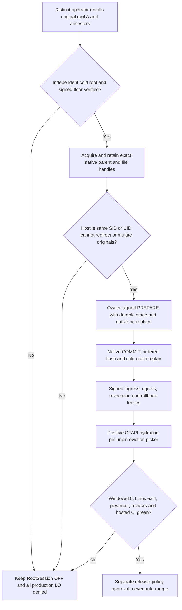

# Root.ark — execution mission and release boundary

**Verified local checkpoint:** 2026-11-12. **MERGE NO-GO / RELEASE NO-GO.**
This is an execution ledger, not a deployment or authorization document.
Use the exact per-PR HEAD, source and check results rather than inheriting
an ancestor's green test, an experimental test's success, or a review on a
different SHA.

## Four separate proof planes

1. **LAB:** a native kernel syscall, held HANDLE/dirfd, genuine Ed25519 or
   AES-GCM and a bounded physical RED→GREEN can prove exactly the tested
   behavior. This grants **zero** production I/O authority.
2. **Native product:** operational Windows CFAPI hydration/pin/unpin/eviction,
   selective picker and Linux recovery need an original independently
   enrolled root A **and every ancestor**, acquired before untrusted mutable
   names; retained original OS identities; hostile same SID/UID writer
   exclusion; atomic source-bound no-replace and no unsafe pathname fallback.
3. **Independent custody:** a separately administered **100% self-hosted**
   operator must supply signed owner/current/root enrollment and an external
   monotonic anti-rollback floor. Local dual SQLite DEV-OFF files cannot
   substitute for this custody.
4. **Merge/release:** two independent SOURCE/evidence GO opinions for the
   exact composed SHA, physical Windows/Node22/NTFS and Linux/Node22/ext4
   acceptance, hosted CodeQL/GHAS and canonical matrix green, Windows **10**
   real CFAPI and real powercut/durable replay. None of these may be inferred
   from process.exit, Windows 11, skipped tests or a previous SHA.

## Current workstreams

| Workstream | Narrow evidence | Remaining blockers |
| --- | --- | --- |
| #298 / Issue #67 | Local `5eca8be` has two SOURCE GO for a narrow lab-only CodeQL scope/test fix, Windows 18 PASS/1 SKIP. Published `e209a6ee` had 25 HIGH CodeQL check annotations (24 intentionally vulnerable labs, one controlled-restore test). | Exact-child CI, WSL/ext4 and production held-identity controls |
| #300 / Issue #66 | Published `c928d894`; composite local `f5cd2e63` integrates prior W21/W31 native labs, docs and W37 signed positive LAB with a separate same-SID colliding writer. Windows combined W21/W31/FOD: 17 PASS/1 SKIP. | Two independent SOURCE GO for composite, product CFAPI/root A, Linux and CI. W26 had timing failures in broader runs |
| #301 / Issue #65 security | Published `e1ca644b`; local `f5b666e2` corrected 13 RED→GREEN Ed25519 getter/callback/replay cases and independently reran 44 focused + 9 issuer tests Windows. | Only one peer SOURCE GO reported; WSL/CI and trusted external authority absent |
| #302 / Issue #65 custodian | Published `e0af8397`; local `7baea943` has two bounded SOURCE GO and Windows 62 PASS/4 SKIP. | DEV-OFF, WSL, off-host distinct operator, same-host rollback and root trust |
| #306 / boot | Published `b13b29f9` OPEN/non-Draft, eight applicable hosted checks green. | No approving review confirmed; do not auto-merge |

Issue #65 is CLOSED at GitHub, #66 and #67 remain OPEN; issue state
does not override any technical release gate. The default remote
`Root/main` was last confirmed as
`202146bb73ca8577a0a4017c4556cb8b1e9588a6`.

## Required native product dependency chain

The arrows represent mandatory, conjunctive gates. For actual product
activation, **all** native handles, ancestors, executable provenance,
operator credentials and independent monotonic evidence must remain valid
through the transaction. Ordinary `lstat -> rename/link/unlink`, a plain
same-SID fixture or a locally held FileId do **not** supply that guarantee.

## Operational restrictions

- Work only in new detached worktrees on `E:\servidor\.worktrees`; preserve
  untracked/staged historical evidence and other active workers.
- New commits: author and committer `bielxdh3 <bielxdh3@gmail.com>`,
  exactly one `Co-authored-by: Codex <codex@openai.com>` trailer.
- Fast-forward pushes are conditionally authorized **only after** exact-SHA
  tests, two SOURCE reviews and ancestry verification; no force push,
  Draft removal, PR merge, deployment, production cutover or `Root/main`
  change. Keep #228 untouched.
- Never pass an unsupported LAB as production CFAPI; do not replace positive
  pin/picker tests with expected denial simply to make CI green.
- WSL was unavailable in this checkpoint. Do not kill other processes or
  claim Linux physical PASS without an exact responsive ext4 run.

See `docs/roadmap/issue-66-pr300-native-custody-gates.md` for detailed
evidence and native gate ordering, and `docs/plan-tree.md` for the wider
project dependency plan.
