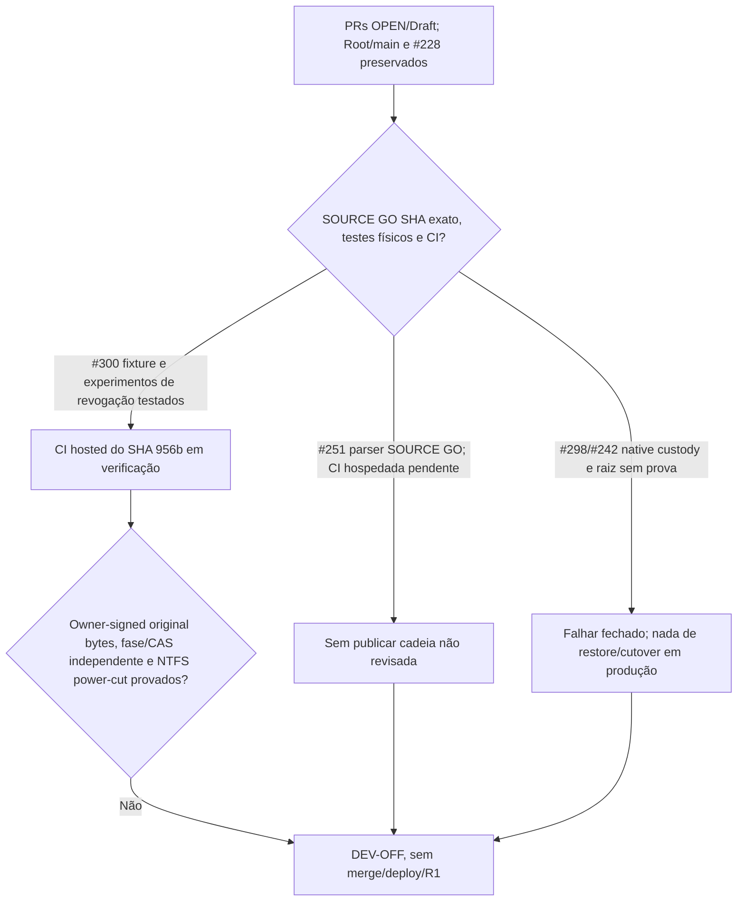

# Root.ark — Main Execution Mission (2026-11-05)

Status: **ACTIVE**. Owner approved starting immediately on 2026-11-05 (America/Porto_Velho). This is an execution ledger, **not** release/deploy authorization.

## Objective
Complete relevant Root.ark security and reliability work first, then the remaining useful product roadmap, carrying forward exact-HEAD evidence rather than restarting old work. Favor real, reproducible defects, minimal dependencies and proportional tests; avoid hypothetical edge-case blockers and scope drift.

## Prioritized flow

1. **Security foundation:** [#203](https://github.com/bielxdh3/Root.ark/issues/203) current-HEAD triage with real reproduction and narrowly scoped fixes -> README R2 hardened execution/production profile -> [#94](https://github.com/bielxdh3/Root.ark/issues/94) confirm topology and only add shared/edge rate limiting if multi-process deployment actually requires it.
2. **Integrity and recovery:** [#67](https://github.com/bielxdh3/Root.ark/issues/67) protected snapshots and recovery + README R3 restore evidence + README R5 independently test each used external adapter -> README R1 independent key custody, external durability, configuration and authorized ZK-1 cutover certification. None of this grants deployment automatically.
3. **Core product:** [#68](https://github.com/bielxdh3/Root.ark/issues/68) capability-based sharing -> [#66](https://github.com/bielxdh3/Root.ark/issues/66) Files On-Demand and selective sync.
4. **Nonblocking later work:** [#63](https://github.com/bielxdh3/Root.ark/issues/63) advanced protected search; [#64](https://github.com/bielxdh3/Root.ark/issues/64) native Android; [#242](https://github.com/bielxdh3/Root.ark/issues/242) PrivyDrop/PairDrop/Magic Wormhole feasibility. README R4 scanner and suspicious-file isolation stays a real obligation, scheduled according to demonstrated risk after foundation work.

**Explicitly removed from scope:** README R6 integration into BielOS/BLS and any Virki integration. Do not manufacture an integration task. The former 60/20/20 agent allocation was a one-off and is revoked.

## Mission execution contract

- On every new task, read the current skills and instructions (Superpowers, PONYTAIL, UI-UX-PRO-MAX only when applicable), the current linked issue, actual source, test evidence and current HEAD. Consult available AI Memory to avoid rework, but source and GitHub state win over historical notes.
- One coherent bounded goal at a time, worktrees in E:, no modifications to other worktrees or user data, no force push/rebase/reset/clean. Split independently executable work only when it *reduces* total time; no fixed agent allocation.
- Reproduce actionable issues (TDD RED/GREEN for behavior changes), implement the smallest safe fix, use no unnecessary dependencies, run meaningful affected tests plus one appropriate final gate, independently review relevant high-risk changes, verify exact-head CI before claiming green.
- Do not chase improbable security narratives without real plausible preconditions, exploitability and consequence; do not hide confirmed vulnerabilities either. Preserve ZK, auth, ACL, storage, restore, users and history.
- Record precise issue/PR/branch/SHA/tests/blockers after each completed step. No deploy, activation, destructive migration or global ZK cutover without explicit permission. Merge only through authorized protected normal merge after genuine gates.

## Starting snapshot — verify on resumption

- GitHub `Root/main` = `ea0445df8ccd8f17da2c70572786d298491fd2c2` (#250); #249 also merged; #65 closed/completed.
- Open issues: #63, #64, #66, #67, #68, #94, #203, #242. No open PRs at time of inspection.
- **First implementation focus: #203**, based on *current* source and evidence, not blindly treating October findings as live.

## Progress ledger

- **2026-11-05 — Plan initiated.** Initial SHA and live issue/PR states verified through GitHub. Work on #203 not yet certified; no vulnerability or test result claimed from this plan alone.
- **2026-11-05 — #203 resumed:** code/test/source and prior issue comments reviewed. #207/#220/#223 already cover the primary old findings; outstanding are bounded performance, advisory and deployment-specific acceptance. Recorded [source-only checkpoint](https://github.com/bielxdh3/Root.ark/issues/203#issuecomment-6675814775) in #203; no repeated implementation or unverified closure. Fresh local worktree was unexpectedly dirty on checkout and preserved without edits; tests not run in this checkpoint. README obsolete integration milestone replaced and mission cross-linked in draft PR #251.
- **2026-11-06 — Worktree reconciled and wave 1 published:** global Git `core.worktree` was stale; using the exact `GIT_WORK_TREE` showed zero tracked changes, without any cleanup/reset or ACL bypass. First-wave draft [PR #252](https://github.com/bielxdh3/Root.ark/pull/252), exact `9d72a7114ce235e87e9fcb98a786229129c731e3`, fixes fail-open typos/empty setting of `UPLOAD_CHUNK_RATE_LIMIT_STORE` and documents single-process R2. Regression RED/GREEN 6/6, independent review led to the empty-mode fix, hosted Ubuntu/Windows/CodeQL/dependencies all PASS. [#94 checkpoint](https://github.com/bielxdh3/Root.ark/issues/94#issuecomment-6676138477), [#203 checkpoint](https://github.com/bielxdh3/Root.ark/issues/203#issuecomment-6676138837); both remain open for bounded acceptance.
- **2026-11-06 — Ransomware recovery transport published:** draft [PR #253](https://github.com/bielxdh3/Root.ark/pull/253), exact `5afe47dceaad3cb29f09406aa306c67127f801e8`, exposes authorized retained Sync v1 ciphertext history, including post-delete. RED 404 → GREEN 39/39 #67 tests, independent source review GO without P1/P2, hosted Ubuntu/Windows/PG18/Android/Kotlin/CodeQL/dependencies all PASS. [#67 checkpoint](https://github.com/bielxdh3/Root.ark/issues/67#issuecomment-6676276296). Not a finished ransomware recovery system.
- **2026-11-06 — R3 local verification:** [recovery and adapter evidence](validation/2026-11-06-rootark-recovery-and-adapters.md): 28/28 fake-cloud backup, 125/131 transaction-boundary (6 platform skips), 64/65 provider/quorum tests (1 POSIX skip), 39/39 Sync v1 recovery plus hosted checks. R3 local engineering evidence recorded; R5 independent review and R1 external production/custody certification remain OPEN. No merge or deployment performed.
- **2026-11-06 — R5 independent review:** local/S3/Drive/WebDAV adapter source and tests reviewed independently: 59 PASS, 2 platform SKIP, no concrete P1/P2. [Evidence](validation/2026-11-06-rootark-recovery-and-adapters.md) distinguishes real verified source behavior from untested physical provider/owner ingress. R5 broad external acceptance and R1 remain OPEN. No server secrets used, no merge or deploy.
- **2026-11-06 — First four waves advanced, not released:** [live PR/checkpoint matrix](validation/2026-11-06-rootark-wave-execution-status.md) covers draft #251–#259 with exact SHAs, practical RED/GREEN, independent review and strict remaining acceptance. Issues #203 and #94 now carry current status **above** their historical checklists; #63, #64, #67, #68 and #242 received public evidence comments. #66 was further corrected after two independently reproduced 10k-library performance NO-GOs, using bounded metadata caching and fast explicit 507 on overflow rather than an unbounded persistent index. No merge, deploy, broad rewrite, added runtime service or unauthorized ZK activation.
- **2026-11-06 — R4 current-baseline acceptance:** independent scanner/quarantine source review and 5/5 focused ClamAV tests PASS. Existing production startup rejects absent/disabled unsafe scanner configuration, tests cover offline scan fail-closed in simple/chunked/WebDAV paths. Three local quarantine restore fixtures were **BLOCKED** by the real host Windows ACL guard (no bypass), not counted as successful. [R4 evidence](validation/2026-11-06-rootark-recovery-and-adapters.md#r4--already-merged-upload-scanner-and-suspicious-file-isolation-controls) supports the source-level README checkbox; live daemon/volume acceptance remains R1, not a new source bug. No deployment.
- **2026-11-06 — R2 reviewed source profile certified:** first-wave [PR #252](https://github.com/bielxdh3/Root.ark/pull/252) `909f760e53965a29f6b66b09b09cc7ceebf4dd3f` passed 6/6 rate-store regressions, independent final review GO, hosted Node22/CodeQL/dependency/security jobs SUCCESS. README R2 marks the reviewed single-process hardening/documentation *engineering* milestone complete; external ingress/process-count/custody acceptance remains R1, not a fabricated production deployment.
- **2026-11-06 — #242 research PoC independently reviewed:** [#259](https://github.com/bielxdh3/Root.ark/pull/259) now `adc71158586e9c3927f4b92615d92389e3b7de0a`, stacked on #254, reproduced then corrected real Edge empty-frame memory growth and unbounded diagnostics. Independent reviewer reran 4/4 broker tests plus real Edge 1:N SHA256 and 256 malformed frames/257 text events, **GO for isolated research only**; no TURN/Android/product identity, no merge or deployment. [Evidence](validation/2026-11-06-rootark-wave-execution-status.md).
- **2026-11-06 — #260 / #261 follow-through:** [draft #260](https://github.com/bielxdh3/Root.ark/pull/260) CLI owner read-only history is stacked on #253, TDD 3/3 and 55/55 regressions; independent reviewer GO, no historical signature assertion or restore action. [draft #261](https://github.com/bielxdh3/Root.ark/pull/261) native Android read-only metadata list is stacked on #258, 11/11 local contracts and actual hosted Java17/SDK35 Android compile plus focused Windows/Ubuntu PASS; independent final review pending. Both remain feature slices, no merge/deploy.
- **2026-11-06 — #255 realistic two-tenant pagination contention:** independent reviewer reproduced positive-cache A(200)/B(200) alternation requiring a full shared-store parse each page even for one small user; worker implementing limited multi-tenant positive index cache, without new dependencies. #256 passed independent HTTP authorization review but one Windows mandatory release-gate test failed while Ubuntu and full canonical Windows passed; diagnosing exact test before claiming complete CI. See [live matrix](validation/2026-11-06-rootark-wave-execution-status.md).
- **2026-11-06 — #255 last-head independent GO:** corrected with forward commit `3ccf955874271546b61ecac09d77227612d330fe`, holding two bounded positive indexes (32 MiB each / 64 MiB aggregate) plus the separate small negative-marker LRU. Independent reviewer reran 8 real alternating two-tenant page requests: two durable reads, rather than eight; 45+8 independent tests PASS with one Windows skip. Authorization, ZK locks, size bounds and external-writer invalidation preserved, no new dependencies or suppression. Hosted exact-SHA CI remains separate. [Evidence matrix](validation/2026-11-06-rootark-wave-execution-status.md).
- **2026-11-06 — #261 Android protocol compatibility corrected:** independent reviewer reproduced native list failure for protocol-valid 300-char names (512 max), corrected via new draft HEAD `34da03e3d70d739320c3e26ad993dc45e59aba23` with actual authenticated signed server fixture, local 12/12 GREEN, hosted targeted SDK35 `:app:assembleDebug`/Kotlin/Ubuntu/Windows 3/3 SUCCESS; full Security Regression manually dispatched on that exact SHA, not yet claimed complete. Final independent re-review pending. [Evidence matrix](validation/2026-11-06-rootark-wave-execution-status.md).
- **2026-11-06 — #261 final-head independent GO:** strict READ-ONLY reviewer re-ran 12/12 focused Node tests and verified valid 300/512 metadata without dropping sibling rows, `listFiles` permission, HTTPS no-redirect, 1 MiB / 128-object admission, no token/ciphertext rendering and session wipe on background. No P1/P2 at exact `34da03e3`. Full Security Regression Windows gates and real-device E2E still separately unverified; no merge/deploy.
- **2026-11-06 — #260 exact-SHA hosted final PASS:** [Security Regression run 42219198114](https://github.com/bielxdh3/Root.ark/actions/runs/42219198114) on `dcf7c1283524451cbd9530776347472d447f6268` completed SUCCESS across Ubuntu Node 22, Windows mandatory release gates, Windows complete canonical and aggregator. Independent review GO; limited to metadata-only, unverified owner history browse; no signed historical restore, merge or deploy.
- **2026-11-06 — #258 final CI PASS:** native login/TOTP launcher draft PR #258 exact `5ce3b37c983d4e17cc6ac74daca9af1183630307` completed hosted Security Regression Ubuntu/Windows, CodeQL and Dependency Review SUCCESS in addition to SDK35/Kotlin focused compilation and independent source GO. This does not certify runtime on a physical Android device or complete #64; no merge/deploy.
- **2026-11-06 — R5 source-level review reconciled:** the independently reviewed implemented Local/S3/Google Drive/WebDAV adapters cover all currently supported physical-provider paths. README marks source-level R5 checked; 82 PASS/2 platform SKIP simulated checks and no demonstrated P1/P2. **R1 remains unchecked** for actual operator, custody, network/TLS and live-provider durability; no operational access or deploy was performed.
- **2026-11-06 — #256 mandatory Windows rerun PASS:** initial single failure in unchanged `test/auth-security.test.js` was triaged, but hidden hosted error did not prove its root cause. The **same HEAD `e721d67923654bf77eff7bbeea76069c42f29940`** rerun [42211409927 attempt 2](https://github.com/bielxdh3/Root.ark/actions/runs/42211409927) finished SUCCESS including mandatory Windows gate, Windows canonical and Ubuntu. Independent share authorization race review GO, CodeQL/Dependency Review PASS, 29/29 local HTTP tests; no unrelated code change, merge or deployment.
- **2026-11-06 — pairwise no-checkout Git integration preflight:** `git merge-tree --write-tree` of exact published #252+#256, #253+#255 and #252+#255 SHAs reported zero textual conflicts; `merge-base --is-ancestor` proved the correct #253→#260, #258→#261 and #254→#259 stacks. This did **not** combine or run the cross-PR source, change a branch or authorize merge. [Status matrix](validation/2026-11-06-rootark-wave-execution-status.md) documents the full-combined-suite gate still outstanding.
- **2026-11-06 — final hosted Security Regression completion:** exact PR #255 `3ccf9558` run 42221105043, #256 `e721d679` rerun 42211409927 attempt 2 and #261 `34da03e3` run 42222823579 all completed **SUCCESS** including Ubuntu/Windows mandatory/canonical. The separate GHAS CodeQL app check for #255 remains **FAILURE** against unchanged baseline `setOwnRecord`; no verified exploitable new path, no suppression, no false claim of full approval. [Status matrix](validation/2026-11-06-rootark-wave-execution-status.md).
- **2026-11-06 — real cross-PR virtual integration tests:** [91/91 focused regressions](validation/2026-11-06-rootark-cross-pr-virtual-tree.md) PASS on exact-source virtual trees #253+#255 and #252+#256, covering both pairs of concurrently modified modules. No merge commit, checkout change, branch modification or deploy; tests supplement future combined hosted CI and separate R1 custody/durability acceptance.
- **2026-11-06 — #68 additional scope review stopped correctly:** clean independent worktree reviewed live legacy file/folder share scope and JSON/SQLite permission gates after #256; no new reproducible cross-resource/operation bug found, so no speculative code/PR. Remaining folder/object-set, recipient/upload/list and protected key/version/compartment capabilities require an explicit ZK authorization design. [#68 checkpoint](https://github.com/bielxdh3/Root.ark/issues/68#issuecomment-6687203637); no merge/deploy.
- **2026-11-06 — Real historical restore #67 implemented, not merely listed:** [draft #262](https://github.com/bielxdh3/Root.ark/pull/262) is stacked on #260, exact `e39df0239b4986b5887c19b07d392cb87d4df7dc`. Signed fresh CAS revision restores retained AES-GCM bytes on the client after DELETE, preserving old versions. Independently reproduced local edit/staging race, equal-size mtime-preserving edit and crash after staging before materialization; fixed with no-replace materialization, staged-file SHA256 and fail-closed pending-dispatch guard. Windows Node24 **14/14** focused, hosted four focused checks SUCCESS, independent final reviewer **GO** for exact HEAD. Full manual Security Regression [42255918483](https://github.com/bielxdh3/Root.ark/actions/runs/42255918483) still in progress at this record. Crash with missing local content blocks remote dispatch and preserves pending ciphertext/trash for explicit repair; do not claim autonomous recovery or R1 external custody.
- **2026-11-06 — Substantive Files On-Demand #66 draft:** [#263](https://github.com/bielxdh3/Root.ark/pull/263), stacked on #255, exact `cfc6266c3d6bca03eb2ef2adb819d167d61eb003`: lazy client materialization with metadata-only remote browse and selective state; real P2 of competing remote CREATE to one path reproduced and corrected by existing server writer-lock atomic tenant/path collision gate. Deterministic signed-store concurrency RED/GREEN, 58 focused PASS/1 SKIP; hosted four focused checks SUCCESS. Independent final review still required; native OS placeholder/provider and external operational acceptance remain out of scope, not falsely marked done.
- **2026-11-06 — Scoped capability sharing #68 draft:** [#265](https://github.com/bielxdh3/Root.ark/pull/265), stacked on #256, exact `65544779858262a55c582afb24affdaf2fd951a1`: owner-authenticated scoped local-file capabilities with expiry/quotas/revocation and JSON/SQLite HTTP coverage. A concrete after-open descriptor swap P2 was RED HTTP 200 and corrected forward to HTTP 404; **6/6** scoped HTTP plus **29/29** permissions PASS. Full CI and independent final review pending; protected recipient key transport and ZK sharing remain incomplete.
- **2026-11-06 — Protected local search #63 draft:** [#264](https://github.com/bielxdh3/Root.ark/pull/264), stacked on #257, exact `b973f6829f7ac7c584f25242ce49637d6319641e`: owner/CAS-bound encrypted IndexedDB index with local filter and UI wiring. Reviewer reproduced P2 where storage quota denied search despite independently verified catalog; test-first fix returns authenticated ephemeral matches but still rejects revoked/stale/tampered state. **15/15** Node24/real Edge focused PASS, hosted final full run and independent re-review pending. No plaintext server-side index.
- **2026-11-06 — Android/P2P functional slices:** native [#267](https://github.com/bielxdh3/Root.ark/pull/267) `4823ecf8734c1228b950330e12833aa8150e66fb`, stacked on #261, validates signed ZK ciphertext envelopes and decrypts AES-GCM with explicitly supplied trusted device/epoch inputs in Kotlin core; hosted Java17/SDK35 + Ubuntu/Windows focused **3/3 SUCCESS**, but no trusted physical Android credential provisioning, runtime device test or complete file UI. [#266](https://github.com/bielxdh3/Root.ark/pull/266) `51c321507d3ece257f19d144c46e25ffb28cbb25`, stacked on #259, adds owner-authenticated/recipient-bound experimental WebRTC exchange; independent reviewer **GO**, 9/9 broker and real Edge consenting multi-client transfer, still no TURN or product storage integration. Both drafts, no merge/deploy.
- **2026-11-06 — #255 GHAS attribution resolved:** GitHub Advanced Security alert #483 `js/remote-property-injection` on `Object.defineProperty(record, key, ...)` is identical in protected `Root/main`; real magic-name/tenant and serialization tests show own data properties and no prototype mutation. The repository owner **dismissed this one alert as `false positive` at 15:47:27 UTC**, with explicit technical evidence, keeping the CodeQL rule enabled. The historical GHAS failed check is still a historical red run, not a newly green scan. No code suppression, bracket-assignment downgrade, history rewrite or speculative redesign.

## Continued implementation checkpoint — 2026-11-06 (later, still draft-only)

- **#67 recovery and operator action:** [#262](https://github.com/bielxdh3/Root.ark/pull/262) `e39df0239b4986b5887c19b07d392cb87d4df7dc` completed its full [Security Regression 42255918483](https://github.com/bielxdh3/Root.ark/actions/runs/42255918483) **SUCCESS**. New draft [#271](https://github.com/bielxdh3/Root.ark/pull/271) `59c6caa0e0f8d1a6dc680873430ac4962b48880f`, stacked on #262, provides a real `resume --credentials-stdin` client for protected burst pauses after account password/optional 2FA re-authentication, with private stdin, no credential echo, strict device/response checks and non-destructive retry. TDD RED/Windows Node24 **6/6** tests GREEN, independent **GO**, four hosted focused checks **SUCCESS**. Its full [Security Regression 42272623332](https://github.com/bielxdh3/Root.ark/actions/runs/42272623332) was still in progress at this checkpoint. The declared device ID is not independent cryptographic identity proof; the server password/2FA remains the trust boundary. No off-host R1 proof.
- **#66/#67 safe future composition:** [#263](https://github.com/bielxdh3/Root.ark/pull/263) latest `d5da6c47d130d7f80710676fa98d4bfd4aa70bff` adds portable case-insensitive remote pathname collision fencing and tombstone handling; independent **GO**, four hosted focused checks **SUCCESS**. The virtual no-branch integration #271 + #263 preserved signed restore's local materialization/historical hash guard and Files On-Demand's atomic CREATE/inventory guard, combined CLI `resume/history/restore/browse/hydrate/evict`, and passed **47/47 focused tests** on Windows Node24. Two engine/CLI conflicts were resolved only in separate disposable scratch, never merged into a protected branch. Native OS placeholders and externally certified durability remain unimplemented.
- **#63 protected search:** [#264](https://github.com/bielxdh3/Root.ark/pull/264) `b973f6829f7ac7c584f25242ce49637d6319641e` received independent final **GO**, preserving authenticated ephemeral search when IndexedDB writes fail without trusting stale/revoked catalogs. Existing Node24/real Edge **15/15** focused evidence stands; no plaintext remote index.
- **#68 owner-signed protected sharing:** legacy scope draft [#265](https://github.com/bielxdh3/Root.ark/pull/265) latest `a403e77e793aa44dcfc092356338480ea0c6e271`; protected ZK recipient draft [#270](https://github.com/bielxdh3/Root.ark/pull/270) forward-fixed to `8a877aaa9caff540daffdc6a6d5f58e1c6534206`. Independent reviewer demonstrated a conditional signed-expiry mismatch P2 on earlier #270 SHA and test-first fix now rechecks persisted vs Ed25519-signed expiry, revocation and fresh clock at final response gate. Real HTTP adversarial RED HTTP 200 → GREEN HTTP 403, focused PG18 hosted **SUCCESS**, legacy affected suites serial **35/35** PASS. Independent final re-review of the new #270 SHA remains pending. Protected recipient CEK delivery and operator key custody remain separate acceptance.
- **#64 Android parsing:** [#268](https://github.com/bielxdh3/Root.ark/pull/268) authenticates HTTPS ciphertext GET but had an independently confirmed P2: AOSP `JSONObject(JSONTokener)` silently overwrites duplicate JSON properties and permits lenient syntax (desktop unit parser differs). New isolated stacked draft [#272](https://github.com/bielxdh3/Root.ark/pull/272) `5a5ec688da4990760e24ee566fc4257b09689328` installs a bounded dependency-free strict RFC8259/unique-key gate before AOSP parsing, with nested/escaped alias duplicate and real GET fixture regressions; hosted Ubuntu, Windows and Java17/SDK35 focused checks **3/3 SUCCESS**, independent strict READ-ONLY source reviewer **GO** on the exact SHA with zero P1/P2. Physical Android/emulator runtime proof remains separate; no trusted Keystore/device CEK grant has been added.
- **#242 P2P:** [#269](https://github.com/bielxdh3/Root.ark/pull/269) `3e5b248e4f7f6be840c6633cf3196186b2ae3f77`, stacked on authenticated sessions #266, supports bounded 32 MiB WebRTC browser transfer with consent, cancel, frame/offset and SHA-256 verification; Node **12/12**, real Edge transfer/cancel/adversarial tests, hosted two jobs **SUCCESS**, independent **GO** for research scope only. No verified integration with production storage or TURN/cross-NAT and no complete native Android.

All work above remains in **draft PRs**, with no merge, deploy, Ready, physical cutover or destructive work. The original unresolved product issues and operational R1 remain open; future integration must combine and validate their exact final source trees before any separately authorized protected merge.

## Further verified implementation checkpoint — 2026-11-06 (draft-only)

- **#63 actual protected search selection:** new draft [#274](https://github.com/bielxdh3/Root.ark/pull/274) `9d73f3764db62c143f5f636cb021e5533a4e7d2f`, stacked on #264. Verified browser catalog results now provide a CSP-safe local object-ID selection using `textContent`, with live session/CSRF/catalog-anchor checks and rejection of detached or stale actions. No protected I/O or authorization is conferred by clicking. Node24/real Edge **16/16** focused PASS, hosted [PG18 42287105760](https://github.com/bielxdh3/Root.ark/actions/runs/42287105760) SUCCESS and independent final exact-SHA **GO**. Full [Security Regression 42287850654](https://github.com/bielxdh3/Root.ark/actions/runs/42287850654) was still running at this checkpoint. #264 base full [run 42257233488 attempt 2](https://github.com/bielxdh3/Root.ark/actions/runs/42257233488) also remains unverified: previous Windows mandatory failure was in unchanged backup/restore transaction tests; do not misattribute or silently waive it.
- **#64 metadata pagination and locked native content UX:** [#273](https://github.com/bielxdh3/Root.ark/pull/273) `52cfb5b1c9d299ad0ab4535acef9aa040b14844a`, stacked on #261 as a sibling to #272, adds native metadata-only 64-item inventory pages with bounded cursor, 401 logout/403 deny/409 restart; exact hosted JDK17/SDK35 + Ubuntu/Windows **3/3 SUCCESS** and independent READ-ONLY **GO**. Disposable virtual #272+#273 source required resolving only `ServerOrigin.kt` and `android/README.md`, passed **15/15** Node24/real signed HTTP tests, but **combined Kotlin compilation was not run** and #255 server remains a separate dependency. New draft [#275](https://github.com/bielxdh3/Root.ark/pull/275) `4a772a509ab8535cc65be82c3ea0c961c435b3b8`, stacked on #272, adds a locked-by-default protected-content UI and a strictly externally gated Ed25519/AES-GCM text preview path (64 KiB, strict UTF-8, lifecycle/secret cleanup). It is **not enabled by an invented trusted CEK/device grant**. TDD/focused Node **7/7**, [hosted focused run 42288976324](https://github.com/bielxdh3/Root.ark/actions/runs/42288976324) **3/3 SUCCESS** including JDK17/SDK35 `:app:assembleDebug`, and strict independent exact-SHA **GO** (no P1/P2). Device/emulator and real grant provisioning remain open.
- **#68 signed recipient redemption:** [#270](https://github.com/bielxdh3/Root.ark/pull/270) `8a877aaa9caff540daffdc6a6d5f58e1c6534206` received independent final read-only **GO** after expiry race repair. Follow-on draft [#276](https://github.com/bielxdh3/Root.ark/pull/276) `b89be853af3b4b9e49a7640af18e052d1f17c59d`, stacked on #270, returns existing owner-signed CBOR grant proof and provides a recipient client that requires independently verified current roster/head/CAS and a local signing identity before authenticated ciphertext download. It does **not** authorize plaintext release or prove durable custody/server revocation. Focused real HTTP/recipient tests **10/10 PASS**, hosted [PG18 42288130051](https://github.com/bielxdh3/Root.ark/actions/runs/42288130051) SUCCESS; strict independent exact-SHA **GO** (no P1/P2). [Full Security Regression 42288224341](https://github.com/bielxdh3/Root.ark/actions/runs/42288224341) for #276 and [42285807045](https://github.com/bielxdh3/Root.ark/actions/runs/42285807045) for #270 were both still in progress.
- **#242 actual opt-in app/session integration:** [#277](https://github.com/bielxdh3/Root.ark/pull/277) currently `1dea1a02b7304709061eff5be484c7c9f14368bd`, stacked on #269, adds a **development/test-only**, default-off `/p2p/` integration with real Root.ark login, CSRF, live `listFiles`, recipient-bound single-use invitations, session-version revocation, user consent and bounded 32 MiB WebRTC transfer without file plaintext traversing the server. Earlier HEAD `19c1ffc8` had an independently reproduced **NO-GO P2**: one authenticated user could create all 16 orphan rooms before WS join and starve other users for five minutes. Same-PR forward commit `1dea1a02` added per-owner prejoin limits and shorter orphan expiry: deterministic RED 16 accepted -> GREEN 2 accepted/14 denied with another authenticated user still admitted. Independently rerun protocol **6/6** plus real HTTP **3/3**, with 15-second orphan/5-minute joined TTL and revocation; implementer Edge tests and **7/7 exact-SHA hosted focused checks SUCCESS**. Independent final READ-ONLY re-review on `1dea1a02` **GO**, no reproducible remaining P1/P2. No production flag, TURN/NAT guarantees, protected-object ACL/CEK grant or storage sync is claimed. [Issue checkpoint](https://github.com/bielxdh3/Root.ark/issues/242#issuecomment-6695319341).
- **#66 durable device-local pin policy:** [#278](https://github.com/bielxdh3/Root.ark/pull/278) reviewed HEAD `fc54f9f13933f6d293708006488512352a3e54f3`, stacked on verified #263, adds opt-in `pin/unpin/status` CLI with signed AEAD hydration, durable local object/file/path retention, local eviction and accidental remote-DELETE fences and safe same-identity MOVE. TDD/focused **7/7** Windows Node24/Ubuntu Node22, broader initial Windows **74 PASS/1 SKIP**, and final-head **4/4 hosted focused checks SUCCESS**. **However, independent reviewer37 issued NO-GO for three concrete P2 on this HEAD:** (1) legacy POSIX case-distinct files can both be pinned despite portable casefold collision, poisoning the snapshot on restart; (2) a post-rename directory `fsync` failure while unpinning may leave disk unpinned despite command failure, enabling later eviction; (3) a signed MOVE of a *different* object into a pinned destination may overwrite local bytes and poison restart. Implementer was assigned to fix all three FORWARD in the SAME draft with WSL real signed/EIO/adversarial tests; subsequent new SHA and independent re-review remain required. Native Windows placeholder/provider and R1 custody are not claimed, no merge/deploy.
- **#67 trusted read-only recovery preview:** [#279](https://github.com/bielxdh3/Root.ark/pull/279) current `905cd452f4ba81172f65808663b33f6c41d55828`, stacked on #271, adds `previewHistoricalRestore` using the signed retained-version/current head/pinned device/local clean preflight before any mutation. It checks all retained signatures, selected/current AEAD, live authorization and strict external history evidence, and returns bounded metadata only; no signed outbox or local rewrite. CLI intentionally fails closed without externally injected custody rather than inventing a trusted provider. Windows Node24 **20/20** focused existing restore + preview tests PASS, new focused CI workflow added, hosted checks and independent final exact-SHA P1/P2 review pending. This is not a physical recovery/custody or restore execution certificate.
- **Cross-feature compatibility without integration:** No-branch virtual #263+#270 tree passed **19/19** Windows Node24 focused tests. A second disposable combination of #271+#263+#270 passed **39/39** focused tests (signed historical restore, burst resume, encrypted history, inventory/hydration and owner-signed ciphertext grants). Incorporating the new #276 recipient client in a separate scratch #271+#263+#276 passed **40/40**, including authenticated CBOR grant redemption. A further isolated overlay of #274 encrypted browser search into that combined tree passed **37/37** tests across Node24, real Edge CSP, protected catalog selection/delta, Files On-Demand, burst resume and ZK recipient grants. These are real combined-source tests **not** GitHub-hosted combined-tree CI, merge authorization or external physical acceptance. An unrelated full local backup/restore run in a scratch **without** `node_modules` produced eight module-not-found failures; after preparing dependency access, those eight targeted cases passed **8/8**. Do not conflate that local fixture setup with #264 hosted Windows failure.

All new work remains OPEN/DRAFT. `Root/main` and deployed services were not changed by these checkpoints. Product Issues #63/#64/#66/#67/#68/#242 and operator-owned R1 acceptance stay OPEN until end-to-end behavior, real provider/device/custody evidence and separately authorized protected integration are proved; no Ready, merge, deploy or global ZK activation.

## Latest corrected functional heads — 2026-11-06 (still draft-only)

- **#66:** [draft #278](https://github.com/bielxdh3/Root.ark/pull/278) advanced from reviewer **NO-GO** `fc54f9f1` to exact `32799bbff5731188ebc7426f37babd77974a8a7e`. The three reproduced P2 are fixed forward: POSIX legacy case-fold alias collision rejected *before pin persistence*; a failed post-rename directory `fsync` on unpin triggers durable compensating retention or leaves a fail-closed operator-recovery lock; and signed foreign CREATE/UPDATE/MOVE operations cannot replace a different pinned file before journal or filesystem mutation. Real WSL Node22 **11/11** targeted, Windows Node24 **76 PASS/4 SKIP**, hosted final **4/4 SUCCESS**. A fresh disposable semantic integration of #271+#263+#276+#274+#278-fixed passed **69 PASS/3 SKIP**, including previously RED Linux alias, foreign MOVE and post-rename error cases. **Independent final security re-review of `32799bbf` has not yet returned GO.** [Issue #66 checkpoint](https://github.com/bielxdh3/Root.ark/issues/66#issuecomment-6696343991). Native OS placeholders and off-host R1 remain missing.
- **#67:** [draft #279](https://github.com/bielxdh3/Root.ark/pull/279) advanced from reviewer **NO-GO** `905cd452` to exact `eb418139b10a39f142dec9d2a41dcb87ae93a12c` via additive forward commits, without editing its original worker worktree. The earlier preflight could recreate an absent `.rootark-sync-journal.json` and report `ready:true`. New `withReadOnlyRoot` joins the in-process writer queue **without** creating a process writer lock, checks pre-existing regular journal/snapshot files before and after asynchronous authority reads, calls `SyncJournal.open({requireExisting:true})` so ENOENT never recreates evidence, and denies changed disk identities. TDD original P2 RED -> four focused adversarial GREEN, existing signed restore/history/preview **28/28**, journal/Phase16 **58 PASS/1 SKIP**, hosted exact final **6/6 SUCCESS**. It is an *advisory read-only preview*, not a production witness. **Independent final P1/P2 re-review of `eb418139` remains pending.** [Issue #67 checkpoint](https://github.com/bielxdh3/Root.ark/issues/67#issuecomment-6696353591).
- **#63:** new draft [#280](https://github.com/bielxdh3/Root.ark/pull/280) `f84c850ad1fdc39fe4049a989dc1e34860386ee5`, stacked on #274, connects a verified encrypted local search selection (object ID + revision) to an explicit authenticated signed ciphertext GET with owner/witness/CAS and SHA-256 rechecked before and after retrieval. Content remains sealed and downloaded locally, without automatic plaintext release; real Edge CSP, signed two-device HTTP and tampering negatives, focused **17/17** Node/Edge, hosted PostgreSQL18 **SUCCESS**. New-SHA independent review pending. [Issue #63 checkpoint](https://github.com/bielxdh3/Root.ark/issues/63#issuecomment-6696361369).
- **#64:** new draft [#281](https://github.com/bielxdh3/Root.ark/pull/281) `1192d10e69dc510aa8fe3d34716ff5a448ed9195`, stacked on #275, semantically integrates the sibling #273 native 64-record/128-KiB authenticated metadata pager with #275's strict-JSON, externally trusted-grant-gated protected viewer. Real signed #255 server fixture paginated 130 rows as **64/64/2** with permission, stale-cursor and tenant negative tests. Focused hosted **3/3 SUCCESS**, including Java17/SDK35 Gradle core/app tests and `assembleDebug`. No physical Android runtime or provisioned CEK/Keystore proof, and independent review of #281 remains pending. [Issue #64 checkpoint](https://github.com/bielxdh3/Root.ark/issues/64#issuecomment-6696369969).
- **Completed hosted regressions, without merge:** #264 Windows retry [42257233488](https://github.com/bielxdh3/Root.ark/actions/runs/42257233488) **SUCCESS**; #270 [42285807045](https://github.com/bielxdh3/Root.ark/actions/runs/42285807045) **SUCCESS**; #274 [42287850654](https://github.com/bielxdh3/Root.ark/actions/runs/42287850654) **SUCCESS**; #276 [42288224341](https://github.com/bielxdh3/Root.ark/actions/runs/42288224341) **SUCCESS**, including their Windows mandatory and canonical jobs. These successes do not approve the later independent PR stacks or external provider custody.

All current PRs remain **OPEN/DRAFT**. Final independent security review of #278–#281, source integration where required, real Android device trust, native Windows placeholders, product P2P/TURN and external R1 acceptance are distinct unresolved gates. No merge, deployment, Ready, destructive cleanup or global ZK switch is authorized or claimed.

## Follow-on functional engineering status — 2026-11-06 (newer than checkpoints above)

The older dated snapshots above are retained as audit history; this section supersedes their *then-pending* review and SHA status without rewriting earlier evidence.

- **#66 pin correctness:** [#278](https://github.com/bielxdh3/Root.ark/pull/278) now `5e1c79b24c66955d7c11d3550f7fdba85e9a464a`, after reproducing/fixing another signed ancestor-directory CREATE/UPDATE/MOVE/DELETE P2 that could remove pinned descendants. New guard runs before journal observation/stage; the previous casefold alias, unpin fsync compensation and foreign overwrite fixes remain intact. Real signed TDD 8 RED -> 8 GREEN; Windows Node24 39 PASS/3 platform SKIP, WSL Node22 24 PASS; hosted 4/4 and independent exact-SHA reviewer GO. A separately stacked manual Windows metadata picker/real signed hydrate [#286](https://github.com/bielxdh3/Root.ark/pull/286) `7f6a54080941a57685d212feb9aef95ba381ae0e` has Windows PS/real Node HTTP Unicode/tamper tests 7/7 and parent regression 35 PASS/3 SKIP. Its full hosted/review gates are separately pending. This is **not** a native Cloud Files API placeholder provider or proof on Windows 10 hardware.
- **#67 real recovery preflight:** [#279](https://github.com/bielxdh3/Root.ark/pull/279) now `d4bd393789ae42934a1fbea8550d1bc84eed5bae` after a further reproducible CLI bootstrap P2: between preview preflight and ordinary `SyncEngine.open()`, lost journal evidence could be recreated under a writer lock. `open({readOnly:true})` now uses the protected existing-state-only path; TDD 2 RED -> 2 GREEN, combined 90 PASS/1 Windows FIFO SKIP, hosted 6/6 and independent reviewer GO. New draft [#283](https://github.com/bielxdh3/Root.ark/pull/283) `eb33ee2a6a5dfbaf8a40f594e97c3c6c699624fc` adds 1–32-object verified signed history, current head, local overwrite/alias and current grant **advisory** plan with second-pass checks; TDD 5 RED and 10 new GREEN, Windows focused 45/45, hosted 6/6 and independent final GO. It returns `atomic:false`/`requiresFreshRestoreCheck:true`; actual signed restore still runs per object with new authority and is **not** a transactional batch or R1 custody certificate.
- **#68 recipient functionality:** [#282](https://github.com/bielxdh3/Root.ark/pull/282) `8b1e6f8274d655e27205836b15bb85d09cef2e3c` stacked on #276 opens authenticated protected ciphertext with owner-authorized recipient HPKE file CEK and AES-GCM on a local device, binding tenant/object/revision/digest/epoch and rechecking issuer/recipient roster after crypto. Adversarial owner/recipient tests 3/3 plus HTTP 2/2 PASS, hosted PG18 SUCCESS and strict read-only reviewer GO **only for DEV-OFF scope**. Independent owner-approved key discovery/custody, live post-egress grant revocation and Android enrollment remain explicit prerequisites; no plaintext is sent to the server.
- **#63 protected owner preview:** [#280](https://github.com/bielxdh3/Root.ark/pull/280) `f84c850ad1fdc39fe4049a989dc1e34860386ee5` and Android [#281](https://github.com/bielxdh3/Root.ark/pull/281) `1192d10e69dc510aa8fe3d34716ff5a448ed9195` each received independent exact-SHA GO after focused hosted PG18 and 3/3 Kotlin/Ubuntu/Windows respectively. New browser text preview [#285](https://github.com/bielxdh3/Root.ark/pull/285) `6e4cc682e052583198a54cb86b22657320137175` uses explicit separately owner-pinned offline 32-byte CEK, signed GET/AEAD verification, bounded 64-KiB strict-UTF8 `textContent` display and logout/change cleanup; local real Edge/Node 10/10, signed HTTP 12/12, independent GO, hosted PG18 SUCCESS. Its separate full Security Regression [42304438530](https://github.com/bielxdh3/Root.ark/actions/runs/42304438530) was still running at the checkpoint. No automatic CEK provenance or production decryption authority is claimed.
- **#64 Android remaining gate:** #281 compiles and its locked grant-gated viewer is independently approved, but there is no owner-approved independently pinned native device enrollment/CEK provider endpoint or physical device proof. `MainActivity.independentlyProvisionedGrantProvider()` correctly remains null; neither server-owned device registration nor fabricated imported timestamps constitute independent trust. Android release acceptance stays open.
- **#242 app-integrated ciphertext P2P:** [#284](https://github.com/bielxdh3/Root.ark/pull/284) `baf186f0e0cf2a5b351c90cc783663e8a9394ab6` stacks on approved #277 and adds dev/test-only authenticated file-bound owner/recipient private ACL and SHA256 transfer in a real app. Windows broker/app and Edge test fixtures PASS; hosted exact 4/4 SUCCESS. **Independent NO-GO found two new P2 despite green CI**: a remote peer can send arbitrary text control frames into a bound ciphertext room; and repeated synchronous full 32-MiB file hashing from signaling can block unrelated requests. Both require forward RED/GREEN repairs and final independent re-review; hosted success is not approval. TURN, cross-NAT, independently signed ZK object grant and production release remain absent.

- **Subsequent #284 correction and new P2:** [#284](https://github.com/bielxdh3/Root.ark/pull/284) `cd14fe9b868354545b357c553315270205a1f372` repaired both earlier P2 (ciphertext-room text ingress and synchronous 32-MiB hash stalls), with real Edge, 12/12 signed focused tests and hosted [42308360329](https://github.com/bielxdh3/Root.ark/actions/runs/42308360329) **4/4 SUCCESS**. However independent exact-SHA reviewer found another reproducible **NO-GO P2**: a delayed `joined` event from a replaced WebSocket can reset the current ciphertext room binding while leaving its room ID active, re-enabling plaintext/foreign offers. Forward stale-socket guard and RED/GREEN + new-SHA review are required; CI green is not final approval.
- **Subsequent #286 correction and CI warning:** [#286](https://github.com/bielxdh3/Root.ark/pull/286) now `df87638a3aff1ab04a8598f2f3eaa10e2e00c7d3`; two P2 in PowerShell/CLI path parsing and relative workroot were fixed with real signed Windows PS5.1/Node/HTTP **10/10 PASS**. Full Security Regression [42307280107](https://github.com/bielxdh3/Root.ark/actions/runs/42307280107) had Ubuntu and Windows canonical failures; investigation found Ubuntu WebDAV Basic TOTP `ECONNRESET` and a canonical Windows test process ending with no assertion failure after a long stall. Root causes and Windows mandatory gate were not certified. No GO/merge or claim of CFAPI provider.
- **Subsequent #64 offline metadata slice:** [#287](https://github.com/bielxdh3/Root.ark/pull/287) `ac033fa9e622d226d26ecc8d8cf4f68bd92b7309` stacks on #281 and caches at most eight contiguous pages/512 inventory records in the current Android login session, cleared on lifecycle/auth/stale changes. Real signed HTTP/Node **15/15**, hosted [42307692223](https://github.com/bielxdh3/Root.ark/actions/runs/42307692223) **3/3 SUCCESS** incl. JDK17/SDK35, and strict independent exact-SHA P1/P2 review **GO**. No persistent/offline signed ciphertext, trusted Android CEK/Keystore, emulator or device certification.
- **#66 native Windows placeholder gate:** real host queried by an independent engineer identifies as **Windows 11 build 26300**, not a Windows 10 machine; cldapi.dll and CldFlt are present, but real Windows 10 open→CFAPI FETCH_DATA→signed verified hydrate could not be tested. Existing Sync v2 CLI materializes into absent paths and rejects untracked existing placeholder targets, so Out-GridView/manual #286 cannot be called a native CFAPI provider. No speculative code or false platform claim was published.

- **Subsequent #67 controlled historical batch execution:** [#288](https://github.com/bielxdh3/Root.ark/pull/288) `e4175e203d3088aa3c6d0ed6dbc1c28250bcc539` executes bounded 1–32-object restoration from #283 with *fresh per-object* signed custody/head/grant/epoch/AEAD/clean local checks and explicit partial progress. New 9/9 WSL Node22 and 48/48 integrated cases and hosted exact-SHA 6/6 PASS. **Nevertheless an independent reviewer gave NO-GO for two concrete P2**: zero/partial final progress after crash before fsync can permanently block resume, and auth/local pre-enqueue denial can mark a never-dispatched mutation indeterminate. Forward fixes are underway in the same Draft; no security GO until new exact SHA and review. This is genuine non-atomic execution, **not** globally atomic, whole-batch rollback, independently certified R1 restoration or production cutover.
- **New #63 protected content search:** [draft #289](https://github.com/bielxdh3/Root.ark/pull/289) `e9328efcdcf398b5814e276d8937a2e006ed7a43` stacks on #285 with DEV-OFF local literal search over up to eight explicitly owner-pinned protected revisions. Fresh signed GET per revision, current owner/CAS/grant and AES-GCM/strict UTF-8 (64 KiB/160-char excerpt), no query/plaintext/CEK egress, no partial tampered results. TDD RED→GREEN 4/4 new, preview 3/3, signed two-device HTTP 2/2, real Edge CSP 1/1; independent P1/P2 **GO**, [PG18 42312428136](https://github.com/bielxdh3/Root.ark/actions/runs/42312428136) SUCCESS and exact-SHA [full Security Regression 42312552266](https://github.com/bielxdh3/Root.ark/actions/runs/42312552266) **4/4 SUCCESS** including Windows mandatory/canonical/Ubuntu. No automatic trusted CEK enrollment, general persistent full-text search or production R1.
- **New #68 owner-issued portable recipient offer:** [draft #290](https://github.com/bielxdh3/Root.ark/pull/290) `a724d37981461ce49570732a9992bfac8ace520d`, stacked on exact #282 HEAD branch, integrates an owner-held HPKE CEK offer with independently pinned issuer and recipient keys, signed grant/object/revision/epoch, fresh roster/head checks around crypto and final expiry. Two reproduced P2 (recipient-signed fake issuer ACK; late expired envelope) corrected forward, real HPKE, HTTP/Node TDD and strict independent P1/P2 **GO**. [PG18 42313461676](https://github.com/bielxdh3/Root.ark/actions/runs/42313461676) **SUCCESS**, a 100-ms timing failure in an inherited provider test passed same-SHA [focused retry 42313822797](https://github.com/bielxdh3/Root.ark/actions/runs/42313822797) **3/3**, exact-SHA [full Security Regression 42313509254](https://github.com/bielxdh3/Root.ark/actions/runs/42313509254) **4/4 SUCCESS**. DEV-OFF; no independent signed server ACK issuance, R1 physical custody or proven revocation after egress.
- **Latest #67 batch executor correction, reviewed and checked:** [#288](https://github.com/bielxdh3/Root.ark/pull/288) forward HEAD `737304bf7681b3d0175164d96150292eac23ae86` (base #283). Three reproduced crash/restart flaws fixed: incomplete initial progress, never-enqueued intent falsely indeterminate, creator-temp hardlink crash with valid nlink=2. It verifies exactly one matching owner-private same-inode alias and complete plan/scope/journal before durable cleanup, rejects foreign links and conservatively blocks uncertain dispatch. Signed WSL 54/54 and Windows hardlink 2/2 PASS (author), strict independent P1/P2 **GO**, hosted [Win/Ubuntu historical restore 42314039674](https://github.com/bielxdh3/Root.ark/actions/runs/42314039674), [PG18 42314039660](https://github.com/bielxdh3/Root.ark/actions/runs/42314039660), [WebDAV/Android 42314040140](https://github.com/bielxdh3/Root.ark/actions/runs/42314040140) **6/6 SUCCESS**. Non-atomic and not physically certified R1.
- **Latest #242 review boundary:** [#284](https://github.com/bielxdh3/Root.ark/pull/284) `cceb6aafdb057d7bf3b46fb70036c4585f23cef2` corrected previously reported stale old-WebSocket `joined` event and passed hosted 4/4, but an independent re-review reproduced **two more NO-GO P2**: an awaited `sendText` digest can route old plaintext to a newer ciphertext-only room, and an older overlapping `createRoom` response can override the most recent protected room intent. A new isolated author is implementing narrow room-epoch/intent rechecks with Node VM and real Edge TDD; no security GO or release claim on `cceb6aaf`.
- **Latest #66/#242/#64 implementation awaiting independent new-SHA review:** #66 side-effect-free out-of-scope pin preflight before remote journal observation, new clean local `df59cd1c901a71834bb464b04e8c691520dad7b6` above prior `7ac5ccb5` (Windows 50 PASS/3 POSIX skip; WSL 27/27, signed denial/restart test RED→GREEN). #242 room/socket/peer snapshot and monotonic room-intent guards, **local unpushed** `9c96babeb6085168dbc15c9522041d8b22c3fe22` above #284 `cceb6aaf`, Node VM 17/17, signed HTTP 5/5, real Edge passed. #64 Android session-only one-packet ciphertext AES-GCM/Keystore noBackup cache (not trusted release), branch `453d5ffb54ca27eddd7839b0e8b23b286bfbc7d8` above #287, hosted [42315628112](https://github.com/bielxdh3/Root.ark/actions/runs/42315628112) Android JDK17/SDK35 + Windows/Ubuntu **3/3 SUCCESS**. **None of these three commits inherits an old reviewer GO, and no new Draft or forward #284 push is authorized without independent exact-SHA review.**

**Cross-branch integration limitation:** The prior isolated #271+#263+#276+#274+#278 code composition was a virtual focused test, not a PR or hosted combined tree. A subsequent attempt to combine #278/#279 Sync v2 with #280 ZK1 signed catalog was blocked correctly: no owner-signed cross-protocol account/object/revision/digest/epoch mapping, and conflicting engine/CLI modifications. Do not fabricate a successful integrated ZK release or weaken current proofs to create one.

**#251 CI caveat:** Documentary mission ledger `3c6787253bb125846ca6443c4da4ea9b037f9200` had an initial Windows mandatory failure during Edge `offlineStage=cdp-port`, but [Security Regression 42298783456 attempt 2](https://github.com/bielxdh3/Root.ark/actions/runs/42298783456) finished **SUCCESS**, including Ubuntu and Windows canonical/mandatory. That success belongs to this unchanged published SHA, not to any later documentation commit.

These are reviewable functional **drafts**, not issue closure or authorized protected merge. `Root/main` remains `ea0445df8ccd8f17da2c70572786d298491fd2c2`; no deployment, Ready, physical operator R1 verification or global ZK cutover occurred.

## 2026-11-07 — independently reviewed follow-on drafts (supersedes provisional gates above)

- [#284](https://github.com/bielxdh3/Root.ark/pull/284) exact `9c96babeb6085168dbc15c9522041d8b22c3fe22`: previous two independently reproduced async room P2 corrected forward; independent read-only GO, Node 17/17, signed HTTP 5/5, real Edge and hosted [42326583493](https://github.com/bielxdh3/Root.ark/actions/runs/42326583493) **4/4 SUCCESS**. Experimental legacy-ACL-bound ciphertext WebRTC only; no owner-signed ZK grant or TURN.
- [#291](https://github.com/bielxdh3/Root.ark/pull/291) exact `453d5ffb54ca27eddd7839b0e8b23b286bfbc7d8`: independently reviewed GO, session-bound AndroidKeyStore AES-GCM **ciphertext staging**, hosted [42326524417](https://github.com/bielxdh3/Root.ark/actions/runs/42326524417) **3/3 SUCCESS**. No validated Android physical hardware/CEK enrollment or offline authorized plaintext.
- [#292](https://github.com/bielxdh3/Root.ark/pull/292) exact `df59cd1c901a71834bb464b04e8c691520dad7b6`: independent GO, P2 out-of-scope pinned MOVE journal preObserve denial RED->GREEN, Windows blob-exact peer 24 PASS / 3 POSIX SKIP, hosted focused **4/4 SUCCESS**; [full Security Regression 42326795784](https://github.com/bielxdh3/Root.ark/actions/runs/42326795784) remained in progress when documented. New OPEN/DRAFT on #278; no CFAPI native placeholder or physical R1.

The published `Root/main` is unchanged. No merges, Ready, deployment, global ZK cutover, issue closures or invented owner-independent custodian. The cross-stack signed owner mapping and external R1 remain separate gates; R1 does not block independent feature development.

## 2026-11-07 — subsequent reproduced P2 fixes and usable functional drafts

The prior exact-SHA GO entries describe the earlier review *at those SHAs*, not permanent approval. Fresh independent review reproduced another P2 on #284 `9c96bab` (an old unbound DataChannel could send text or complete an accepted file after protected-room creation intent while HTTP was pending), despite 4/4 hosted. [#284](https://github.com/bielxdh3/Root.ark/pull/284) was repaired **forward-only** on the same Draft at `859adf0b0c234d5cafb71dff5c87e4588fbca2b7`: original RED 3, new GREEN 7/7 VM races, Node 21/21, real signed Edge, independent P1/P2 **GO** and [hosted WebRTC 42328826882](https://github.com/bielxdh3/Root.ark/actions/runs/42328826882) **4/4 SUCCESS**. The experiment still lacks owner-signed ZK object grant, TURN/cross-NAT acceptance and production release.

Fresh independent review also reproduced a #291 `453d5ffb` P2 despite earlier GO/3/3 hosted: re-capturing the identical signed ciphertext threw a replay error interpreted by the Android UI as corruption, wiping a still-valid local cache and Keystore. A new local forward candidate `68a3fc0a54a1e014876a86fa00e0977ff83f9dd3` tests typed exact-duplicate handling with cached AEAD inspection, retaining only truly identical valid ciphertext; altered same-revision bytes, corrupted storage and revoked/failed HTTP continue fail-closed. Author's Node **12/12** and Kotlin/JUnit **17/17** PASS. It was pushed by forward-only fast-forward to the same Draft #291 after **independent exact-SHA P1/P2 GO** (reviewers reproduced the old P2; changed duplicate/corrupt/owner/revoke cases remain fail-closed). [Hosted focused 42329455067](https://github.com/bielxdh3/Root.ark/actions/runs/42329455067) **3/3 SUCCESS** on the new exact SHA; physical Android, independent trusted enrollment/CEK remain absent.

- **#63 actual larger protected search:** [Draft #293](https://github.com/bielxdh3/Root.ark/pull/293) `4ea7f7cd4430af9967a39410065f73259ed9ef87` on exact #289, up to 64 independently owner-selected pinned revisions in windows of ≤8, fresh per-revision signed GET/grant/CAS/epoch/AEAD and lazy CEK erasure, explicit progress/cancellation, no partial unverified matches. RED 4→GREEN Node/real Edge 9/9, preview 3/3; independent strict read-only P1/P2 **GO**. [PG18 42328498934](https://github.com/bielxdh3/Root.ark/actions/runs/42328498934) SUCCESS, full [Security Regression 42328562537](https://github.com/bielxdh3/Root.ark/actions/runs/42328562537) separately dispatched; no complete real 64-entry FileList UI test or automatic trusted key enrollment.
- **#68 actual owner→recipient workflow:** [Draft #294](https://github.com/bielxdh3/Root.ark/pull/294) `d2cc72ec76a05180c0d1b421ec4559b6b4d077d7` on exact #290 exports an existing owner-issued portable offer and redeems via real signed HTTP with previously trusted issuer/recipient keys, grants, revocation/expiry checks and HPKE/AEAD. Windows Node24 owner-offline signed HTTP/SQLite 2/2 + CLI guards 2/2, WSL Node22 guards 2/2, independent strict read-only **GO**. [PG18 42328695433](https://github.com/bielxdh3/Root.ark/actions/runs/42328695433) SUCCESS; full [Security Regression 42328729476](https://github.com/bielxdh3/Root.ark/actions/runs/42328729476) separate. CLI does not provision owner/recipient trusted keys or certify R1 custody/post-egress revocation.
- **#66 pinned journal gate:** [Draft #292](https://github.com/bielxdh3/Root.ark/pull/292) `df59cd1c901a71834bb464b04e8c691520dad7b6` on #278, independent P1/P2 **GO** after real signed denial/restart coverage (24 PASS, 3 POSIX SKIP); hosted PG18 and focused **SUCCESS**, full [Security Regression 42326795784](https://github.com/bielxdh3/Root.ark/actions/runs/42326795784) separately dispatched. This is a pin/journal correctness advance, **not** native Windows CFAPI Files On-Demand.
- **#251 publication:** mission/README/roadmap reconciliation [Draft #251](https://github.com/bielxdh3/Root.ark/pull/251) was advanced to `ef8468acee3c38cdc204ee72d9e6ab592aa67acf`; [full Security Regression 42327876825](https://github.com/bielxdh3/Root.ark/actions/runs/42327876825) belongs only to that documented SHA, not this subsequent note.

**Boot and issue closure remain OPEN:** #63/#64/#66/#67/#68/#242 are not fully released/integrated on `Root/main`; #203/#94 deployment topology and R2/R5 acceptance still require concrete operator evidence, and R1 owner-independent key custody, TLS/external durability and signed SyncV2↔ZK1 identity/revision/digest/epoch mapping are not available. Windows 10 native CFAPI, real Android hardware enrollment and TURN also remain unverified. Do not close issues, merge, deploy, mark Ready, rewrite history or infer a globally working ZK cutover from unrelated Draft CIs.

**New CI investigation, not approval:** the first [#294 full Security Regression 42328729476](https://github.com/bielxdh3/Root.ark/actions/runs/42328729476) Windows canonical job exited nonzero after a 195-second TAP-output stall (165 TAP results, **zero reported assertion failures**) at about 300 seconds. This is a **FAILED CI gate**, not evidence of source correctness or a confirmed new code defect; the same-SHA diagnosis/rerun must be separated from #294's independently reviewed focused owner/recipient HTTP and PG18 successes. The prior owner-dismissed #255 GHAS CodeQL finding #483 (js/remote-property-injection) remains a reviewed existing baseline, not grounds for artificial suppression or an unrelated security rewrite.

## 2026-11-07 live dependency graph

**Historical snapshot:** the facts below were captured before the later 13:02 UTC refresh and are preserved as earlier evidence. For subsequent PR heads, CI and the committed successor to virtual tree `677e4d4c`, use the [dated update below](#2026-11-07-1302-utc-dependency-update).

This is a **new snapshot**, not a retroactive change to the dated GO/NO-GO evidence above. GitHub reported [Root/main](https://github.com/bielxdh3/Root.ark/tree/Root/main) at ea0445df8ccd8f17da2c70572786d298491fd2c2 and **46 OPEN PRs**: the first read counted 28 Ready/18 Draft; a same-day refresh counted **30 Ready for review / 16 Draft** because #293 and #294 advanced to Ready (their SHAs stayed unchanged). All original 28 Ready remain untouched. Issues [#63](https://github.com/bielxdh3/Root.ark/issues/63), [#64](https://github.com/bielxdh3/Root.ark/issues/64), [#66](https://github.com/bielxdh3/Root.ark/issues/66), [#67](https://github.com/bielxdh3/Root.ark/issues/67), [#68](https://github.com/bielxdh3/Root.ark/issues/68), [#242](https://github.com/bielxdh3/Root.ark/issues/242), [#94](https://github.com/bielxdh3/Root.ark/issues/94) and [#203](https://github.com/bielxdh3/Root.ark/issues/203) remained OPEN. **Ready means the GitHub review state; it does not mean merge approved, production ready or externally certified.**

~~~mermaid
flowchart LR
  P66["#292 df59cd1c READY: #66 pin/journal"] --> I66["#295 0b395611 DRAFT: #66 picker + pin integrated in one PR"]
  P67["#283 eb33ee2a READY: #67 signed recovery plan"] --> I67["#288 737304bf READY: bounded restore executor"]
  I66 --> V["Virtual tree 677e4d4c: #66 + #67 scratch composition, NOT published"]
  I67 --> V
  P68["#294 d2cc72ec READY: #68 portable offer"] --> I68["#296 23124120 DRAFT: DEV-OFF fixed 1-8 object redemption"]
  S63["#293 4ea7f7cd READY: #63 64-revision local search"]
  S64["#291 68a3fc0a READY: #64 Android ciphertext staging"]
  S242["#284 859adf0b READY: #242 experimental WebRTC"]
  V -. "requires independent combined tests and explicit authority bridge" .-> G["BLOCKED R1 / SyncV2-to-ZK1 identity and custody"]
  I66 -. "native provider absent" .-> CF["BLOCKED Windows 10 CFAPI"]
  S64 -. "device trust absent" .-> AND["BLOCKED physical Android enrollment"]
  S242 -. "network gate absent" .-> TURN["BLOCKED production TURN"]
~~~

The arrows denote a **reviewed feature dependency or proposed scratch composition**, not deployment or a merged topology. The isolated #295 stack combines [#292](https://github.com/bielxdh3/Root.ark/pull/292) and the reviewed manual verified picker [#286](https://github.com/bielxdh3/Root.ark/pull/286): exact #295 **0b39561164074c83efe31b37b57ae088c379c826**, independently reviewed GO with 34 Windows focused passes/3 POSIX skips, four focused hosted checks SUCCESS; it is **Draft**, not a native Cloud Files API provider. [#288](https://github.com/bielxdh3/Root.ark/pull/288) stays Ready at **737304bf7681b3d0175164d96150292eac23ae86** and does actual non-atomic 1–32-object signed restore after per-object checks. The Git object **677e4d4c** exists and is a tree, but the combined #288 + #295 source is **scratch only**; no verified current combined test result, independent GO, new branch, PR or release CI is attributed to it. It must never be committed as though it were a merged release.

**Separate current #68 dependency:** [#294](https://github.com/bielxdh3/Root.ark/pull/294) READY exact **d2cc72ec76a05180c0d1b421ec4559b6b4d077d7** precedes [#296](https://github.com/bielxdh3/Root.ark/pull/296) DRAFT exact **2312412018042b3978078b1362d3d113e6a2a319**. The latter accepts 1–8 genuine existing owner-issued offers, preflights independent signed context and private paths, and reports partial completion without atomic rollback. Its exact-SHA peer review and 5/5 focused local checks passed; neither PR provisions custody, owner keys, recipient enrollment or post-egress plaintext revocation. [#293](https://github.com/bielxdh3/Root.ark/pull/293) READY **4ea7f7cd4430af9967a39410065f73259ed9ef87** implements bounded 64-revision selected local search, not automatic CEK provenance. #291 and #284 remain reviewed feature slices with the physical Android and cross-NAT/TURN limits above.

| Current exact source | Security Regression run | GitHub result at checkpoint |
| --- | --- | --- |
| [#251](https://github.com/bielxdh3/Root.ark/pull/251) DRAFT a4f327f2749bf1bc3065e38d337c9a8a2dbfe81b | [42329893711 attempt 2](https://github.com/bielxdh3/Root.ark/actions/runs/42329893711) | Ubuntu + mandatory Windows SUCCESS; canonical Windows IN PROGRESS. No all-green claim. |
| [#293](https://github.com/bielxdh3/Root.ark/pull/293) READY 4ea7f7cd4430af9967a39410065f73259ed9ef87 | [42328562537 attempt 2](https://github.com/bielxdh3/Root.ark/actions/runs/42328562537) | Completed SUCCESS: Ubuntu, Windows mandatory, Windows canonical and aggregator. |
| [#294](https://github.com/bielxdh3/Root.ark/pull/294) READY d2cc72ec76a05180c0d1b421ec4559b6b4d077d7 | [42328729476 attempt 2](https://github.com/bielxdh3/Root.ark/actions/runs/42328729476) | Completed SUCCESS: Ubuntu, Windows mandatory, Windows canonical and aggregator. Initial failure above is historical attempt 1. |
| [#295](https://github.com/bielxdh3/Root.ark/pull/295) DRAFT 0b39561164074c83efe31b37b57ae088c379c826 | [42368335353 attempt 1](https://github.com/bielxdh3/Root.ark/actions/runs/42368335353) | Completed FAILURE: Ubuntu SUCCESS, canonical Windows SUCCESS, mandatory Windows FAILURE (aggregator FAILURE). Root cause not yet established. |
| [#296](https://github.com/bielxdh3/Root.ark/pull/296) DRAFT 2312412018042b3978078b1362d3d113e6a2a319 | [42370102210 attempt 1](https://github.com/bielxdh3/Root.ark/actions/runs/42370102210) | Ubuntu SUCCESS; Windows mandatory and canonical IN PROGRESS. |

**Execution next:** finish triage of the failing/in-progress Windows jobs without inventing a source defect; run independent combined #66/#67 RED/GREEN and exact-tree validation before integration or review of any result; resolve real owner-signed SyncV2↔ZK1 account/object/revision/digest/epoch mapping; obtain off-host R1 custody, TLS, provider durability, Windows 10 CFAPI, physical Android trust and TURN only through their separate verified gates. None of these statuses changes the 28 existing Ready PRs or authorizes merge, deployment, cutover or issue closure.

## 2026-11-07 13:02 UTC dependency update

This **later GitHub snapshot** supersedes the earlier 46-PR/30-Ready/16-Draft count for current planning without rewriting that historical observation. At verification GitHub showed **49 OPEN: 30 Ready for review and 19 Draft**, with [Root/main](https://github.com/bielxdh3/Root.ark/tree/Root/main) still at `ea0445df8ccd8f17da2c70572786d298491fd2c2`. The counts may change again. [#294](https://github.com/bielxdh3/Root.ark/pull/294) returned to Draft on a genuine reviewer P2 (zero-byte CLI); newly created [#299](https://github.com/bielxdh3/Root.ark/pull/299) was already Ready for review. Ready does **not** mean approved to merge, released or production certified.

~~~mermaid
flowchart LR
  A66["#292 Ready: #66 pin/journal"] --> B66["#295 Draft 5bac9e8e: picker plus Edge fix"]
  B66 --> C67["#298 Draft c47d2dbb: committed #66 plus #67"]
  A67["#288 Ready: #67 signed historical restore"] --> C67
  B66 --> C300["#300 Draft 9f3e3ffa: CFAPI read-only probe"]
  A68["#294 Draft d2cc72ec: zero-byte CLI P2"] --> B68["#296 Draft 14f7dc6e: bounded redemption"]
  A63["#293 Ready: #63 64-revision selected search"] --> V["Virtual d327552b: #63 plus #68 cross tests pending"]
  B68 --> V
  A242["#284 Ready: #242 experimental WebRTC"] --> B242["#299 Ready 71784ed0: experimental P2P"]
  C67 -.-> R1["BLOCKED: owner-signed SyncV2/ZK10 bridge and external R1 custody"]
  C300 -.-> W10["BLOCKED: native Windows 10 provider proof"]
  A64["#291 Ready: Android ciphertext session"] -.-> P64["Unpublished Android 4a3db203: two P2 findings"]
  B242 -.-> TURN["BLOCKED: production TURN/cross-NAT"]
~~~

The arrows show **source dependencies and review blockers**, never deployed connections. The earlier `677e4d4c69fe3a839ac437e733323cfd9dda82f9` virtual **tree** is now the exact tree of linear commit `c47d2dbb55202630f228dd84b64bfa0edddd1b6a`, parent `0b39561164074c83efe31b37b57ae088c379c826`, published on [Draft #298](https://github.com/bielxdh3/Root.ark/pull/298). A bounded independent **source review GO** on that exact SHA does not cover full hosted CI, real physical platform acceptance or R1 custody. [#295](https://github.com/bielxdh3/Root.ark/pull/295) advanced to `5bac9e8e20656634c83cccefbaf7b5450b02a273`, and separate child [#300](https://github.com/bielxdh3/Root.ark/pull/300) is a read-only native CFAPI preflight only. [#296](https://github.com/bielxdh3/Root.ark/pull/296) advanced to `14f7dc6e241eb39ecad194daa1cf37b9ff45205b`; its owner/recipient offer path and #294's independent P2 still need separate closure. Experimental #299 is not proven production TURN.

| PR / artifact at 13:02 UTC | State and exact evidence | Remaining gate |
| --- | --- | --- |
| [#251](https://github.com/bielxdh3/Root.ark/pull/251) `a4f327f2749bf1bc3065e38d337c9a8a2dbfe81b` | DRAFT; [Security Regression 42329893711 attempt 2](https://github.com/bielxdh3/Root.ark/actions/runs/42329893711) completed **SUCCESS** on that exact existing head | This later documentation commit requires its own verification before push |
| [#294](https://github.com/bielxdh3/Root.ark/pull/294) `d2cc72ec` / [#296](https://github.com/bielxdh3/Root.ark/pull/296) `14f7dc6e` | Both DRAFT; #294 old full regression success remains SHA-scoped; #296 updated head not inferred green | Zero-byte CLI P2; custody and owner/recipient provisioning |
| [#295](https://github.com/bielxdh3/Root.ark/pull/295) `5bac9e8e` / [#300](https://github.com/bielxdh3/Root.ark/pull/300) `9f3e3ffa` | Both DRAFT; #295 [42374437851](https://github.com/bielxdh3/Root.ark/actions/runs/42374437851) **IN PROGRESS** when checked; #300 read-only native probe | No all-green inference; Windows 10 physical provider absent |
| [#298](https://github.com/bielxdh3/Root.ark/pull/298) `c47d2dbb` / [#299](https://github.com/bielxdh3/Root.ark/pull/299) `71784ed0` | #298 DRAFT, source tree verified `677e4d4c`; #299 READY for review as experimental P2P | No deployed #66/#67 joint system; TURN/cross-NAT unproven |
| Local-only `4a3db203`, `dddee9b8`, virtual `d327552b` | Android offline grant and SyncV2↔ZK10 map each have **two independent P2s**; #63+#68 virtual composition cross tests pending | No publication of these local candidates or acceptance of independent R1 custody |

**Production NO-GO remains:** separately operated monotonic floor/owner-approved genesis, independently pinned issuer and actual TLS custody, owner-signed object/identity/epoch/digest mapping, real Windows 10 CFAPI provider, physical Android enrollment/CEK and production TURN are not demonstrated. Do not infer a globally working zero-knowledge cutover from the Git tree, Draft PRs or scoped successful tests.

## 2026-11-07 13:06 UTC review-blocker update

The 13:02 UTC graph and **49 OPEN / 30 Ready / 19 Draft** count are preserved as an intermediate snapshot. A new GitHub check returned **49 OPEN / 26 Ready / 23 Draft** at 13:06 UTC. [#278](https://github.com/bielxdh3/Root.ark/pull/278) exact `5e1c79b2` (**one independent P1 and three P2**), [#288](https://github.com/bielxdh3/Root.ark/pull/288) exact `737304bf` (**one P1, two P2**) and [#284](https://github.com/bielxdh3/Root.ark/pull/284) exact `859adf0b` (**three P2**) were returned to Draft. [#294](https://github.com/bielxdh3/Root.ark/pull/294) exact `d2cc72ec` remains Draft with a separately found zero-byte CLI P2; [#299](https://github.com/bielxdh3/Root.ark/pull/299) exact `71784ed0` also returned to Draft because its #284 ancestor has unresolved P2s. These are external **peer-reported** findings, not issues reproduced by this document author.

~~~mermaid
flowchart LR
  U278["#278 DRAFT: P1 plus three P2"] --> I295["#295 DRAFT: 5bac9e8e integration"]
  I295 --> I298["#298 DRAFT: c47d2dbb joint source"]
  U288["#288 DRAFT: P1 plus two P2"] --> I298
  U284["#284 DRAFT: three P2"] --> I299["#299 DRAFT: 71784ed0 dependent P2P"]
  U294["#294 DRAFT: zero-byte CLI P2"] --> I296["#296 DRAFT: 14f7dc6e child"]
  I298 -.-> R["Blocked: ancestor P1, owner signed bridge, external R1"]
  I299 -.-> T["Blocked: production TURN and cross-NAT"]
  I295 -.-> W["Blocked: physical Windows 10 CFAPI"]
~~~

Review of commit `c47d2dbb` was **bounded source GO** before the newer #288 P1 was reported. That earlier GO is **not** approval to merge #298 or an override of the ancestor finding; investigate and repair the parent, then independently re-review the dependent stack. The #251 [Security Regression 42329893711](https://github.com/bielxdh3/Root.ark/actions/runs/42329893711) SUCCESS still refers only to `a4f327f2`; #295 [42374437851](https://github.com/bielxdh3/Root.ark/actions/runs/42374437851) was in progress at the prior check. No new all-green CI is asserted here. The local Android `4a3db203` and SyncV2↔ZK10 mapping `dddee9b8` still carry two independent P2s each, and R1 custody, physical Android/Windows 10 and TURN remain unverified.
## 2026-11-07 consolidated execution checkpoint

The [2026-11-07 status ledger](validation/2026-11-07-rootark-wave-execution-status.md) and [time-stamped PR #251 checkpoint](https://github.com/bielxdh3/Root.ark/pull/251#issuecomment-6708652569) supersede earlier **current-state counts** without replacing historical SHA-level evidence. At verification: `Root/main` was `d5fbc110944a5437dbd5e9175f39dd97f5e433bc`, five merges had actually landed, and **47 PRs were still open (20 Ready / 27 Draft)**. The 39 reviewed PR dependency edges include ten divergent ancestry relationships, so mergeability is not proof that a child carries its parent's latest source.

**Historical policy only:** an earlier session considered conditional GitHub merges after independent exact-SHA GO, every mandatory hosted gate GREEN and verified main composition. **The current 2026-11-07 instruction supersedes that conditional policy: no GitHub PR merge is authorized in this work round, even after all checks pass.** No deploy, cutover, force, destructive rewrite or direct Root/main edit is authorized. #257 source-reviewed protected search was promoted to Ready; no new merge was performed in this checkpoint. #254 remains a research-only Draft per its issue-specific restriction.

Remaining hard blockers, tracked in the linked ledger, include selected/excluded pinned-path case aliases on #66/#67, independent native CFAPI callback completion, an admission-cost DoS in experimental WebRTC room creation, #288 CodeQL high race annotation, external monotonic R1 custody, physical Android/Windows10 and real TURN/cross-NAT. Earlier green tests are explicitly not considered approvals for these uncovered cases.
## 2026-11-07 published integration follow-up

The linked [November 7 validation ledger](validation/2026-11-07-rootark-wave-execution-status.md#later-verified-publication-and-ci-update--2026-11-07) records **real** forward-only publication in existing Draft PRs: #293 `d03cfd1e` (#63+#68), #298 `4fddeefb` (#66+#67), and #300 `03cac3a9` (CFAPI deny-only). All have scoped independent source GO plus relevant Windows/Ubuntu tests; hosted new-head CI and operational/physical gates remain separately pending. #257 became Ready only, not merged. The previous issue242 child cap fix `29c2459` and first CodeQL restore fix `cb454f16` each received a **new** peer P2 NO-GO and are not published; successor local commits require independent exact-SHA GO. No deploy, cutover or new merge has occurred in this update.

## 2026-11-07 18:23 UTC — source, forensic and publication checkpoint

The [timestamped validation ledger](validation/2026-11-07-rootark-wave-execution-status.md) records the later **47 OPEN / 19 Ready / 28 Draft** Github snapshot at remote `Root/main` `d5fbc110944a5437dbd5e9175f39dd97f5e433bc`, five prior GitHub merges only, and exact new published Draft commits [#299 `5064dfa0`](https://github.com/bielxdh3/Root.ark/pull/299) and [#306 `b13b29f9`](https://github.com/bielxdh3/Root.ark/pull/306). #299's two-parent source merge restores the #284 ancestry while preserving its tested lab source tree; **this is a branch commit, not a GitHub merge to Root/main**. #306 adds source-reviewed bounded TAP nested/child diagnostics without proving the original main Windows canonical `exit=1` root cause. #63 Unicode/ALL TERMS with #68 in-flight revocation is composed locally as `eaabb9db`, **not published** at this snapshot; independent component review and actual Windows/Ubuntu Node22 focused tests are distinguished from pending integrated peer and hosted gates. #64 Android floor-lock liveness, #288 CodeQL FD-first restore, Windows10 CFAPI, real TURN, global complete backup corpus and off-host R1 remain gated. The nine accidentally overwritten untracked Android files in the separate recovery-journal worktree have no proven original-byte recovery and remain read-only forensic evidence. No direct main mutation, deploy, production cutover, artificial issue closure or new GitHub merge occurred.

## 2026-11-07 22:44 UTC — publicação posterior e correção de evidência

O [ledger de validação](validation/2026-11-07-rootark-wave-execution-status.md) mantém o snapshot de 18:23 UTC como histórico e registra a publicação posterior do merge `eaabb9db` no PR #293 **OPEN/Draft**; PR #306 permanece **OPEN/Draft** em `b13b29f9`. A correção factual do CI main registra que **ambos** os jobs Windows canonical e syntax/tests já haviam **falhado** antes do snapshot (16:34:36 e 18:09:07 UTC), enquanto Ubuntu full, Windows mandatory, CodeQL e Dependency Review foram **SUCCESS**. As falhas mantêm o main **NO-GO**. Nenhum teste local ou publicação de branch equivale a aceite hospedado, custódia externa R1, Ready, merge no GitHub ou deploy.

## 2026-11-07 23:37 UTC — fluxograma de execução e bloqueios

Novo corte **somente de estado**, sem reescrever os snapshots de 18:23 e 22:44 UTC. O [checkpoint de dependências](validation/2026-11-07-rootark-wave-execution-status.md) fixa os HEADs do GitHub e os gates. A cadeia histórica #231 → #232 → #233 → #234 → #235 → #236 foi **MERGED em 2026-11-04**, antes desta missão; os **cinco merges desta missão** (#252, #253, #255, #256, #258) são outra contagem. O #228 foi **CLOSED UNMERGED** pelo proprietário em 2026-11-02 e permanece intocado.

~~~mermaid
flowchart TD
  H["04/11: #231 → #232 → #233 → #234 → #235 → #236 MERGED (histórico)"]
  M["Root/main d5fbc110: cinco merges desta missão, #252 #253 #255 #256 #258"]
  D["OPEN/Draft: #284 (CodeQL GREEN), #291 #293 #298 #299 #302"]
  T["OPEN/Draft #288: TOCTOU Windows residual"]
  R["OPEN/Ready #306: ainda não merged"]
  P{"Peer GO no SHA exato, hosted CI GREEN e main verificada?"}
  WAIT["NO-GO merge: main Windows canonical e syntax/tests FAILED"]
  ELIG["Apenas elegível à avaliação de merge normal; revalidar composição"]
  EXT["R1 externo pendente: inventário original assinado, versões/CEK, custódia monotônica off-host, signer/issuer, cold Windows 120s"]
  CUT{"R1 físico comprovado e cutover autorizado?"}
  HOLD["Sem cutover ou deploy"]
  AUTH["Revisar aprovação operacional específica"]
  H --> M
  M --> D & T & R
  D & T & R --> P
  P -->|Não| WAIT
  P -->|Sim| ELIG
  EXT --> CUT
  CUT -->|Não| HOLD
  CUT -->|Sim| AUTH
~~~

Os ramos de merge de PR e de cutover são **gates distintos**; nenhum ramo positivo significa que a ação foi executada. #251 permanece OPEN/Draft no HEAD 7796bba1, com conflitos preexistentes em README.md e docs/plan-tree.md; nenhum desses arquivos foi alterado neste checkpoint.

**Regra operacional vigente:** por instrução posterior do proprietário, nenhum merge de PR ou deploy é permitido nesta rodada, mesmo com `Peer GO` e CI integralmente verdes. O ramo `ELIG` representa apenas um candidato tecnicamente avaliável em futura decisão específica, não uma autorização de merge. A cadeia histórica #231→#236 e os cinco merges antigos são fatos passados, não operações desta rodada.

## 2026-11-07 23:47 UTC — correção de CI e publicação posterior

A [atualização temporal do ledger](validation/2026-11-07-rootark-wave-execution-status.md#correção-e-atualização-posterior--2026-11-07-2347-utc) corrige o **P2 documental** do checkpoint 23:37: o [CodeQL de #284](https://github.com/bielxdh3/Root.ark/actions/runs/42425618613) já havia concluído **SUCCESS às 23:34:02 UTC**, e JS Analyze às **23:34:08 UTC**; o Security Regression completo segue pendente. Depois do checkpoint, [#299](https://github.com/bielxdh3/Root.ark/pull/299) publicou o merge de dois pais `43a2af02` (reunindo #284 `45a91a6a` e a fonte `d9eeb5fd`, peer33 GO), e [#302](https://github.com/bielxdh3/Root.ark/pull/302) avançou para `0f2000fe` (peer13 GO, ainda **DEV-OFF**). Ambos permanecem OPEN/Draft. Main Windows canonical/syntax continua RED; nenhum merge em Root/main, cutover ou R1 físico foi certificado.

## 2026-11-08 01:01 UTC — publicações Draft, novos NO-GO e dependências

O [ledger posterior](validation/2026-11-07-rootark-wave-execution-status.md#corte-pós-handoff--2026-11-08-0101-utc) documenta resultados **posteriores** aos snapshots de 07/11, sem reescrevê-los. Após revisão independente do SHA exato, [#251](https://github.com/bielxdh3/Root.ark/pull/251) publicou somente documentação em `b51ce11dcf49694475a7ecebbd837670dab2afe6` e [#298](https://github.com/bielxdh3/Root.ark/pull/298) publicou o fixture de ACL de quarentena em `df3dbaef3d0bd1cb8683ded66cada67bdf0dee9e`. Ambos continuam **OPEN/Draft**. O full hosted Security Regression para #298 foi despachado no SHA exato [run 42431780149](https://github.com/bielxdh3/Root.ark/actions/runs/42431780149), ainda em execução neste corte; os três fluxos hospedados focados já concluíram SUCCESS.

O [#293](https://github.com/bielxdh3/Root.ark/pull/293) `eaabb9db` inclui *ancestralmente* o ALL TERMS/Unicode `3b273c32` e os testes de revogação concorrente `673ad3a4`, com Security Regression hospedado SUCCESS; não duplicar esses commits. O [#300](https://github.com/bielxdh3/Root.ark/pull/300) `03cac3a9` concluiu o rerun hospedado attempt 2 SUCCESS, mas CFAPI positivo em Windows 10 permanece **bloqueado**.

Em #284 e #299, os jobs Windows canonical hospedados falharam no **mesmo teste real**, `mutation during pinned hashing cannot inherit signed object fingerprint` (arquivo `test/issue-242-p2p-ciphertext-fd-race.test.js`, `ERR_ASSERTION`); #284 teve ainda falha de teste Edge offline no gate obrigatório. A tentativa local de duplo hashing `f2f24684` recebeu revisão independente **NO-GO P2**: mutação de mesmo tamanho logo após a segunda leitura ainda exporta hash antigo e dobra custo de leitura no sweeper. **Não publicada**. Um Edge offline focado local passou, mas não anula o hosted RED. TURN/cross-NAT real continua ausente.

Em #65, o [#302](https://github.com/bielxdh3/Root.ark/pull/302) publicado `0f2000fe` teve Security Regression hospedado SUCCESS, mas não prova R1 independente. O patch local pós-assinatura `4d0d904a` recebeu **NO-GO P2** independente: edição concorrente de SQLite entre as leituras anchor/main permite atestação `CURRENT` divergente. O candidato local `41d3b6fc` serializa a assinatura sob duas reservas `BEGIN IMMEDIATE` e foi testado em Windows/Ubuntu; aguarda peer do SHA exato. O candidato separado `bf15f7ca` bloqueia assinatura após expiração do lease e também aguarda integração/revisão. Nenhum deles foi publicado neste corte.

~~~mermaid
flowchart LR
  MAIN["Root/main d5fbc110: imutável nesta rodada"]
  READY["#306 Ready, NÃO merged"]
  DOCS["#251 b51ce11: docs publicado Draft"]
  BACK["#298 df3dbaef: ACL publicado Draft"]
  CI{"#298 hosted 42431780149 integralmente GREEN?"}
  BACKEND["Backup completo, inventário/versionamento e R1 externos ainda bloqueados"]
  SHARE["#293 eaabb9db: #63/#68 integrado, hosted GREEN"]
  P2P["#284/#299: canonical Windows FAILED; f2f P2 NO-GO"]
  ZK["#302 0f2000fe: hosted GREEN, somente DEV-OFF"]
  ZKPEER{"SQLite atômico + lease final: peer exato GO?"}
  R1["Custódia independente off-host + owner-signed preupload + prova física"]
  NO["Sem merge, deploy ou cutover"]
  MAIN --> READY & DOCS & BACK & SHARE & P2P & ZK
  BACK --> CI
  CI -->|Não/pendente| BACKEND
  CI -->|Sim| BACKEND
  ZK --> ZKPEER
  ZKPEER -->|Não/pendente| R1
  ZKPEER -->|Sim, ainda DEV-OFF| R1
  BACKEND --> NO
  R1 --> NO
  P2P --> NO
  READY --> NO
  SHARE --> NO
~~~

O desenho separa **implementado → integrado → testado → bloqueado → Ready → merged**: nenhum caminho concede automaticamente a última transição. #291 Android e #288 restore seguem sem hardware físico/TOCTOU Windows absoluto; #228 continua CLOSED/UNMERGED e intocado. A proibição atual de merge, deploy e alterações diretas em `Root/main` permanece prevalente mesmo que um check se torne verde.

## 2026-11-08 01:30 UTC — atualização operacional do fluxo

Este é um corte **posterior** ao grafo das 01:01 UTC, cuja evidência histórica permanece intacta. O [ledger do novo corte](validation/2026-11-07-rootark-wave-execution-status.md#corte-operacional-adicional--2026-11-08-0130-utc) mantém separados commit local, revisão de fonte, publicação Draft, teste hospedado e critérios físicos.

- **ZK10 #65/#302:** `23e748f61127132ef25d5269529c4c903d925df4` foi **integrado, testado Windows/Ubuntu, revisado independentemente no SHA exato e publicado em Draft**. Juntou reservas SQLite de ambos os stores em assinatura/leitura do piso e expiração monotônica mesmo com recuo de relógio. O [hosted Security Regression 42434051637](https://github.com/bielxdh3/Root.ark/actions/runs/42434051637) está **pendente** neste corte. Um novo caso de reentrância instrumentada revelou retorno indevido de `CURRENT` após poison interno: o candidato local forward-only `7ca680b4` passou testes, mas **não foi publicado nem revisado independentemente**. R1 off-host continua **bloqueada**.
- **Backup #67/#298:** o [hosted Security Regression 42431780149](https://github.com/bielxdh3/Root.ark/actions/runs/42431780149) do HEAD `df3dbaef` registrou **Ubuntu SUCCESS / Windows mandatory FAILURE** no teste `upload-security.test.js`, caso 9, durante `Upload security boundary`; Windows canonical ainda estava em execução. O mesmo teste isolado passou no Windows local, sem prova de causa para a diferença. **Não Ready.**
- **Compartilhamento #68/#293:** embora o SHA `eaabb9db` possua hosted SUCCESS, revisão independente encontrou **P2**: revoke pode confirmar HTTP 200 enquanto uma resposta de ciphertext previamente admitida permanece em egress. Um novo teste de socket/backpressure e a correção de drain estão em desenvolvimento isolado, sem publicação e sem alegar cancelamento de bytes que já chegaram ao cliente.
- **P2P #242/#299:** o candidato de duplo hashing `f2f24684` continua **SOURCE NO-GO P2** por janela de mutação após segunda leitura e amplificação do I/O; sem publicação. A solução requer snapshot imutável/fencing efetivo, não um número arbitrário de releituras.

~~~mermaid
flowchart TD
  A["#302 23e748f6: integrado / peer GO / Draft publicado"] --> B{"Hosted full 42434051637 SUCCESS?"}
  B -->|Pendente ou não| C["Não Ready; corrigir gates"]
  B -->|Sim| D{"R1 externa e owner-signed pré-upload comprovadas?"}
  D -->|Não| E["DEV-OFF: bloqueado para cutover"]
  F["#298 df3dbaef: Ubuntu GREEN / Windows mandatory RED"] --> G["Upload ordinal 9: causa em investigação"]
  H["#293 eaabb9db: hosted GREEN"] --> I["#68 revogação durante egress: P2"]
  J["#299 43a2af: Windows canonical RED"] --> K["Snapshot/Fencing: P2 e TURN físico ausentes"]
  C --> L["Nenhum merge / deploy / Root/main"]
  E --> L
  G --> L
  I --> L
  K --> L
~~~

## 2026-11-08 03:05 UTC — reconciliação posterior de HEADs e CI hospedado

Este **novo corte** atualiza apenas estados comprovados após 01:30 UTC; não reescreve o significado dos snapshots anteriores. Consulta literal ao remoto manteve `Root/main` em `d5fbc110944a5437dbd5e9175f39dd97f5e433bc`. O [ledger do corte](validation/2026-11-07-rootark-wave-execution-status.md#reconciliação-hospedada--2026-11-08-0305-utc) separa revisão de fonte, execução local, CI hospedado e bloqueios físicos.

- **#251:** documentação já publicada em Draft no HEAD `21c938e3f2ca7a864fb0e1089f5c4494b4270bfc`, peer12 SOURCE GO exato. Conflitos preexistentes em `README.md`/`docs/plan-tree.md` não foram resolvidos nem alterados por esta atualização.
- **#67/#298:** `5ab3dfe9edd58b55085c1ea7f80ffd1776c1595a` publicado em Draft e revisado por peer28 SOURCE GO. O [Security Regression 42435622100](https://github.com/bielxdh3/Root.ark/actions/runs/42435622100) **COMPLETED/SUCCESS**, inclusive Ubuntu, Windows canonical, Windows mandatory e agregador. O run anterior `42431780149` no SHA `df3dbaef` falhou no teste de upload sob concorrência: o sucesso do HEAD atual não prova a causa nem elimina a possibilidade de intermitência futura. Recovery completo, conta inteira e R1 off-host seguem abertos.
- **#65/#302:** `7ca680b4fe853f84fac9e113ecb123105fe33718` publicado em Draft, com revisão independente peer43 SOURCE GO e [Security Regression 42434733471](https://github.com/bielxdh3/Root.ark/actions/runs/42434733471) **COMPLETED/SUCCESS** em todos os quatro gates, além do PostgreSQL18 focado. Continua **DEV-OFF**, não prova custódia física independente, piso global off-host, inventário completo ou preupload owner-signed original.
- **#63/#68/#293:** `0918ffa9e97076d36cede0d03ea5e8b4678e7906` publicado em Draft após testes e peer33/45 SOURCE GO de escopo limitado (um processo/store). O [Security Regression 42435409628](https://github.com/bielxdh3/Root.ark/actions/runs/42435409628) **COMPLETED/FAILURE**: Ubuntu e Windows canonical **SUCCESS**, Windows mandatory **FAILURE** no passo de release gate, agregador downstream **FAILURE**. Nenhum status Ready; investigar a asserção concreta, não ampliar timeouts sem causa.
- **#300:** docs de readiness CFAPI `f77cf6396fda42b6b9730751e27390db598a02db` publicados em Draft e revisados, mas sem novo full hosted confirmado para esse SHA; o run verde antigo corresponde a `03cac3a9`. Provider positivo nativo Windows10 não foi implementado. **#284/#299** continuam bloqueados por mutação de ciphertext após a última leitura FD; `f2f24684` é SOURCE NO-GO. **#64** não tem teste Android físico; **#242** não possui TURN/cross-NAT provisionado.

~~~mermaid
flowchart LR
  MAIN["Root/main d5fbc110: sem alteração"]
  DOC["#251 21c938e3: Draft docs, peer GO"]
  B["#298 5ab3dfe9: Draft, hosted SUCCESS"]
  Z["#302 7ca680b4: Draft DEV-OFF, hosted SUCCESS"]
  S["#293 0918ffa9: Draft, Windows mandatory FAILED"]
  P["#284/#299: ciphertext mutável, Windows canonical FAILED"]
  EXT["R1 independente, recovery global, CFAPI positivo, Android físico, TURN reais: NO-GO"]
  G{"Todos os gates do SHA exato + peer + dependências?"}
  NO["Sem merge, deploy ou cutover nesta rodada"]
  MAIN --> DOC & B & Z & S & P
  B & Z & S & P --> G
  G -->|Não / insuficiente| EXT
  G -->|Sim, apenas elegibilidade futura| NO
  DOC --> NO
  EXT --> NO
~~~

`Implementado`, `integrado`, `testado`, `bloqueado`, `Ready` e `merged` não são sinônimos. Mesmo CI integralmente verde para um SHA não concede autoridade externa, não sana um P2 reconhecido e **não autoriza merge ou deploy**. PR #228 permanece intocado, e nenhum cutover da ZK10 foi autorizado.

## 2026-11-08 03:57 UTC — execução, segurança P2P e novas evidências

Este addendum é **posterior** ao corte 03:05 UTC e não altera retrospectivamente aqueles HEADs, jobs ou estados. `Root/main` remoto continua `d5fbc110944a5437dbd5e9175f39dd97f5e433bc`; PR #228 continua intocado. O [ledger detalhado deste corte](validation/2026-11-07-rootark-wave-execution-status.md#execução-e-gates--2026-11-08-0357-utc) separa source review, CI e limites externos.

- **#67/#298 — publicado Draft:** forward-only `5ab3dfe9 → 6760cb69 → 2ce260d9 → bf2dc700e7a37af381b81bd42dd4b1ec1965b232`, peer28 **SOURCE GO do SHA final**, Windows/Ubuntu Node22 focados, sem merge. `BACKUP_INCLUDE_UPLOADS=false` também exclui uploads cloud e marca `cloud_complete=false`; diagnóstico do teste usa apenas etapas fixas sanitizadas, não stderr/stack raw. PostgreSQL18 focado do novo SHA **SUCCESS**; [Security Regression 42444205015](https://github.com/bielxdh3/Root.ark/actions/runs/42444205015) estava **in_progress** neste corte: Ubuntu full **FAILURE às 03:56:47 UTC** em `test/backup-restore-transaction-boundary.test.js` (provider reconciliation não persistida; causa ainda sob investigação), Windows canonical e Windows mandatory **in_progress**. Não declarar hosted GO para `bf2dc`, nem atribuir falha ao delta cloud sem prova ou omitir a intermitência anterior de upload sob concorrência.
- **#63/#293 — integrado apenas localmente:** `6b1ededd` corrige colisão de estado de fixtures Windows por porta loopback reciclada, com peer12 SOURCE GO; `c653834c` pagina índice cifrado/assinado (até 4096 revisões em páginas de 100), corrige o P2 de callback antigo apagando consulta nova, peer45 SOURCE GO. Integração de dois pais `d8e78231a1514a1d87571ed8db5ffbdf5588f62f` permanece **LOCAL, não publicada**. Regressão hosted anterior #293 `0918ffa9` é real (Windows mandatory FAILED). Teste adicional `legacy-sync-private-config` mostrou limites de processo sob carga e está em diagnóstico, não mascarar timeout nem afirmar correção da causa hospedada antes de novo CI.
- **#68/#293 — DEV-OFF ainda em revisão:** duas instâncias/processos Node usando o **mesmo SQLite** demonstraram revoke ACK prematuro com egress pendente. Commit local `2f92e465` introduziu leases SQLite atômicos, mas peer33 encontrou P2 de `SQLITE_BUSY` mapeado 403 sem tombstone e P2 de liberação antecipada do lease após transporte HTTP parcialmente escrito. Correção forward **local** `b23b2ccc7bb7249af8996f375209e8fb2e735eeb` passou TDD Win22/WSL22 (6/6 cross-store por plataforma, 2/2 HTTP assinados por plataforma), **aguarda peer exato e integração**. Mesmo SQLite físico não prova multi-host/off-host R1 nem retirada de bytes já transmitidos.
- **#242/#284/#299 — SOURCE NO-GO P2 duplo:** `f2f2468459899a1bcd45ad95ec61ea6ab43e070a` **não foi publicado**. O hash pode ficar obsoleto após a última leitura/lstat com escrita tardia no mesmo inode; repetir leitura não torna arquivo imutável. O sweeper de 1s pode efetuar até `16 salas × 4 membros × 32 MiB = 2048 MiB` de hash por ciclo no código publicado, e até 4096 MiB na proposta duplo-read rejeitada, além de ações WebSocket. Experimento de round-robin uma sala/s reduziu custo mas **foi rejeitado sem commit** por atrasar revogação até 16–20s com DataChannel direto ainda transmitindo. Exigidos: ciphertext versionado realmente imutável e owner-signed, serialização de **todos** os writers e ACL, snapshot transacional all-party, orçamento global de I/O fail-closed e testes Win22/WSL/RTC; native share-deny-write apenas no servidor não controla RTCDataChannel no navegador. Signaling protegido atual já nega sem `authorizeSignalSnapshot`; não é P2P bound funcional.
- **#64/#291 — sem promoção física:** candidato local `a4f1da97` baseado em ancestry obsoleta recebeu **SOURCE NO-GO P2** de deadlock por `@Synchronized` durante CEK callback; não publicar/cherry-pick. O Draft #291 remoto `6d1c3ffff29eba26fd79f293662398b54a0895f0` já contém solução superior `advanceAndUse` com `FileLock` persistente, limpeza da CEK antes do release e teste de liveness da mesma instância. Continua sem validação Android físico/hardware-backed Keystore.
- **#65/#302, #66/#300 e TURN:** #302 `7ca680b4` full hosted SUCCESS mas apenas floor/custodian **DEV-OFF** local; faltam custódia R1 independente off-host, digest original-byte owner-signed antes de upload e inventário global. #300 `f77cf639` documenta CFAPI positivo, não o implementa; Windows10 físico não validado. TURN/STUN/TLS e cross-NAT reais não provisionados. Recovery integral multiobjeto/multiversão/ZIP/jobs e ransomware shield seguem abertos.

**Regra operacional mantida:** implementação → integração → testes reais → revisão independente do **SHA exato** → push fast-forward apenas no Draft → CI hospedado → atualização factual do fluxograma. `SOURCE GO`, TDD local, `Security Regression SUCCESS`, `Ready` e autoridade física são marcos distintos. **Não executar PR merge, deploy, cutover nem modificar `Root/main` ou PR #228.**

## 2026-11-08 04:50 UTC — correção do CI, revisões integradas e CFAPI

Este é um **novo corte de status**, sem reescrever os fatos observados às 03:57 UTC. `Root/main` segue `d5fbc110944a5437dbd5e9175f39dd97f5e433bc`, e o PR #228 não foi tocado. O [ledger com os SHAs e gates](validation/2026-11-07-rootark-wave-execution-status.md#reconciliação-de-integrações--2026-11-08-0450-utc) distingue publicação, fonte local e testes hospedados.

- **#298 / #67 — duas falhas hospedadas identificadas, fonte ainda local:** o remoto Draft continua `bf2dc700`. No run [42444205015](https://github.com/bielxdh3/Root.ark/actions/runs/42444205015), Ubuntu full e Windows canonical falharam no **mesmo** teste `successful migrations before listener acknowledgement preserve the restore barrier and provider queue across restart`. O log Windows do job `128619610379` registra ordinal 272 e SHA-256 truncados `6cd12cfa4f2cd9a055e49821` (caminho `test/backup-restore-transaction-boundary.test.js`) e `6e4a51e7c837d1ce7dfba288` (nome da asserção), reproduzidos calculando o hash do texto literal. A fixture antiga usava `BACKUP_INCLUDE_UPLOADS=false`, contradizendo a expectativa de reconciliação cloud pendente; correção test-only `febffba8` usa `true` apenas naquele caso. Em paralelo, S3 agora rejeita páginas sem `IsTruncated` booleano, inclusive inventário unbounded; o fake preflight antigo precisava devolver `IsTruncated:false`. Merge local `fbc1e615` + filho test-only **`069c76fa7d3283166ab61a89e6da8496ba821548`**: Windows Node22 104 PASS/1 SKIP, Ubuntu Node22 ext4 105 PASS, mais migração focada 1 PASS em cada SO. **Ainda sem peer GO do SHA final, sem push nem hosted desse SHA**. Windows mandatory do *run antigo* estava em progresso às 04:47 UTC, não verde.
- **#293 / #63 + #68 — teste integrado verde, segurança ainda NO-GO:** merge local `cd2ed41644529f321071bc86ae66be8c918a1fb2` (11 caminhos, dois pais) passou Windows Node22 **33 PASS / 7 SKIP** e Ubuntu Node22 **39 PASS / 1 SKIP**, `--test-concurrency=2`, sintaxe e dependências. Porém peer45 deu **SOURCE NO-GO P2**: após `finish/close` real, `releaseEgress` pode encontrar `SQLITE_BUSY` num writer WAL concorrente e abandonar definitivamente o tracker local, deixando lease durável órfão e `revokeAndDrain` retornando 503 mesmo após a liberação do banco. Reproduzido em HTTP + duas conexões SQLite reais, Windows e WSL. **Não publicar `cd2ed`**; corrigir com prova de terminal e reconciliação limitada, sem TTL que libere lease não comprovado.
- **#300 / #66 — novo commit publicado somente como mock DEV-OFF:** `b70e242fa0673b50a448a8e776bcb87c37b51561` foi publicado por push normal no Draft #300 após peer33 SOURCE GO exato, Windows Node22 **25 PASS**, Ubuntu Node22 **22 PASS / 3 SKIP** e MSVC/SDK26100 nativo. Apenas demonstra formato/bounds do ABI `TRANSFER_DATA` em C++ de teste; **não** executa `CfRegisterSyncRoot`, `CfConnectSyncRoot`, `CfExecute` ou hidratação física. [Security Regression 42448354634](https://github.com/bielxdh3/Root.ark/actions/runs/42448354634) disparado uma vez, **sem resultado final neste corte**.
- **#242 / #299 — mitigação interina LOCAL sem P2P protegido:** `95aec7c40855b6d21cd81955bdc7c3ea2409b221` exige duas capacidades confiáveis fornecidas na construção do broker **antes** de calcular hash/admitir sala bound. A integração real não as fornece; portanto recusa bound de forma fail-closed e não aloca sala/hash caro, preservando unbound manual 1:N. Windows e WSL Node22 **78/78 broker**, HTTP assinado **5/5 cada**, Edge real PASS; peer exato ainda pendente. Presença de callback não prova custódia owner-signed, bytes imutáveis, writer serializado ou RTCDataChannel cutoff. `f2f24684` e round-robin rejeitados continuam proibidos.
- **Externos não resolvidos:** Android #64 sem aparelho/Keystore físico; #65 sem custodiante R1 independente off-host, provenance owner-signed original pré-upload e completude global; #66 sem CFAPI positivo Windows10 físico; #67 sem recuperação completa de conta/ZIP/jobs/multiversão e shield operacional; #68 sem quorum multi-host nem revogação de bytes já transmitidos; #242 sem TURN/STUN/TLS/cross-NAT e autoridade transacional de signaling. Não promover DEV-OFF ou teste de mock para `Ready` funcional.

~~~mermaid
flowchart TD
  MAIN["Root/main d5fbc110 inalterada"]
  B["#298 069c LOCAL: Windows/Ubuntu correções verificadas; peer pendente"]
  S["#293 cd2 LOCAL: testes PASS; P2 SQLite lease NO-GO"]
  C["#300 b70 publicado Draft: ABI mock peer GO; CI pendente"]
  P["#299 95aec LOCAL: bound fail-closed; peer pendente"]
  EXT["R1 off-host / Android real / CFAPI positivo / TURN real: sem prova"]
  G{"Peer SHA exato e CI obrigatório completo?"}
  HOLD["Bloqueado / Draft: não declarar Ready"]
  DONE["Apenas elegibilidade futura: sem merge ou deploy"]
  MAIN --> B & S & C & P & EXT
  B & S & C & P & EXT --> G
  G -->|Não| HOLD
  G -->|Sim, com autoridade externa separada| DONE
~~~

**Política vigente:** nenhum merge de PR, deploy, cutover, force push, reset destrutivo ou edição de `Root/main`/PR #228. Preservar worktrees e o histórico de cada revisão.

## 2026-11-08 05:47 UTC — fluxograma de dependências e bloqueios de liberação

**Novo corte** (consultas Git/GitHub 05:42–05:47 UTC). Os snapshots 03:57 e 04:50 UTC acima ficam preservados. O [ledger detalhado](validation/2026-11-07-rootark-wave-execution-status.md) identifica HEADs, testes e gates. `Root/main` continua em `d5fbc110944a5437dbd5e9175f39dd97f5e433bc`, com Windows canonical e syntax/tests **FAILED** no run `42380131258`. GitHub: **47 OPEN = 20 Ready / 27 Draft**. [#251](https://github.com/bielxdh3/Root.ark/pull/251) **Draft** `f0f4400a`, com conflitos antigos em `README.md`/`docs/plan-tree.md`. [#228](https://github.com/bielxdh3/Root.ark/pull/228) **CLOSED, não merged**, intocado.

A cadeia de dependência #231→#232→#233→#234→#235→#236 foi **MERGED historicamente em 2026-11-04**, antes desta missão. Isso não certifica custódia independente, recuperação total ou prontidão operacional. R1 ainda requer assinatura pelo owner do digest dos **bytes originais antes do upload**, identidade e versão assinadas, inventário de conta inteira e todas as versões, custódia **independente off-host** com piso monotônico resistente a rollback, revogação e recuperação física comprovadas.

~~~mermaid
flowchart TD
  A["#231 MERGED histórico: contratos criptográficos, wire e trust"]
  B["#232 MERGED histórico: objetos cifrados, catálogo e histórico assinado"]
  C["#233 MERGED histórico: S3, Drive, WebDAV e readback"]
  D["#234 MERGED histórico: CAS, witness, PostgreSQL e fences"]
  E["#235 MERGED histórico: navegador protegido e sync fence"]
  F["#236 MERGED histórico: recuperação, backup e migração"]
  A --> B --> C --> D --> E --> F
  F --> G{"R1: todas as evidências externas verificadas?"}
  OWNER["Owner-signed original-byte pre-upload; signer, versão e revogação"] --> G
  CUST["Custódia independente off-host, quorum, piso monotônico antirollback"] --> G
  BACK["#67 / #298: ZIP, jobs, conta inteira, todas as versões restauráveis"] --> G
  PHYS["Android físico, CFAPI Windows10, TURN cross-NAT e testes reais"] --> G
  CI["Peer GO no SHA exato, CI hospedado integral e autorização específica"] --> G
  G -->|"Não: estado atual"| HOLD["BLOQUEADO: DEV-OFF / Draft / sem cutover"]
  G -->|"Sim em decisão futura"| NEXT["Apenas candidato a aprovação futura; não liberado automaticamente"]
~~~

**Estados sem ambiguidade:** `planejado` = desenho/critério; `objeto local` = commit não publicado; `publicado Draft` = HEAD remoto sem aprovação global; `Ready` = estado do PR sem merge; `bloqueado` = gate vermelho ou evidência ausente; `liberado` = produção expressamente autorizada (**nenhum** neste corte).

Os principais bloqueios desta consulta: [#298](https://github.com/bielxdh3/Root.ark/pull/298) `bf2dc700` **Draft**, [run 42444205015](https://github.com/bielxdh3/Root.ark/actions/runs/42444205015) **FAILURE**, local `4310bca9` **SOURCE NO-GO** por duplicidade de chave lógica Drive; [#293](https://github.com/bielxdh3/Root.ark/pull/293) `0918ffa9` **Draft**, local `2ede5aca` **SOURCE NO-GO** por espera síncrona SQLite de ~5 s; [#299](https://github.com/bielxdh3/Root.ark/pull/299) `95aec7c4` **Draft**, fail-closed DEV-OFF e Windows canonical **FAILED** no [run 42448666487](https://github.com/bielxdh3/Root.ark/actions/runs/42448666487); [#300](https://github.com/bielxdh3/Root.ark/pull/300) `b70e242f` **Draft**, Ubuntu full **FAILED** no [run 42448354634](https://github.com/bielxdh3/Root.ark/actions/runs/42448354634). Correções de outros workers ainda não verificadas **não** são dadas como concluídas.

#284 `45a91a6a` continua Draft com CodeQL formal verde e Windows canonical/mandatory vermelho; #288 `ea3f8467` mantém ressalva de reparse ativo Windows, apesar dos checks estáticos. #291 `6d1c3fff` tem JVM/hosted verde sem Android físico; #302 `7ca680b4` tem gates DEV-OFF verdes sem custódia R1 externa. [#306](https://github.com/bielxdh3/Root.ark/pull/306) `b13b29f9` está **Ready, não merged**. Nenhum estado deste fluxograma autoriza PR merge, deploy, cutover, alterações de `Root/main`, `README.md`, `docs/plan-tree.md` ou PR #228 nesta rodada.

## 2026-11-08 05:54 UTC — prova exata do P2 Windows #299

**Adendo posterior** ao corte 05:47 UTC, sem alterar seu estado histórico: o [ledger forense do mesmo horário](validation/2026-11-07-rootark-wave-execution-status.md) identifica **duas** regressões hospedadas no mesmo HEAD [#299 `95aec7c40855b6d21cd81955bdc7c3ea2409b221`](https://github.com/bielxdh3/Root.ark/pull/299), ainda **OPEN/Draft**. Nos runs [`42448670330`](https://github.com/bielxdh3/Root.ark/actions/runs/42448670330) e [`42448666487`](https://github.com/bielxdh3/Root.ark/actions/runs/42448666487), os jobs Windows canonical `128632976336` e `128632966859` terminaram **FAILURE** com o mesmo `ERR_ASSERTION` no índice TAP **551**. O `testPathSha256` `d4b3f1af3bf676b364ca223f` corresponde ao SHA-256/24 do caminho `test/issue-242-p2p-ciphertext-fd-race.test.js`; `nameSha256` `cfd4a608f6cac314f87ffe1c` corresponde ao SHA-256/24 do nome exato `mutation during pinned hashing cannot inherit signed object fingerprint`, ambos verificados independentemente contra o título existente no HEAD publicado. Portanto não é falha Windows genérica: **a regressão conhecida de integridade de ciphertext mutável permanece RED**.

Em ambos os runs, Ubuntu Node22 full **SUCCESS**. No `42448670330`, Windows mandatory **SUCCESS**, mas Windows syntax/tests **FAILURE** e o workflow **FAILURE**; no `42448666487`, Windows mandatory ainda estava **IN_PROGRESS** na consulta, e o workflow não havia terminado. WebRTC focado, CodeQL e Dependency Review **SUCCESS** não sanam a asserção de integridade. #299 **não é Ready**, não comprova binding owner-signed de bytes imutáveis e não autoriza P2P protegido, merge, TURN/cross-NAT ou deploy. `Root/main` permanece `d5fbc110`; os remotos #293 `0918ffa9` e #298 `bf2dc700` não mudaram nessa verificação. Peer e correção nova precisam de evidência no SHA exato, sem reclassificar workers ainda pendentes.

## 2026-11-08 06:21 UTC — publicações Draft e quatro novos gates hospedados

**Adendo posterior à prova 05:54 UTC:** consulta direta GitHub entre 06:19 e 06:21 UTC confirma [#251](https://github.com/bielxdh3/Root.ark/pull/251) `c2407eb421834c0bcd731d0abce40f78669197e2`, [#300](https://github.com/bielxdh3/Root.ark/pull/300) `db1da22aa91ce1dc0ba16302a12fc598e3692de4`, [#298](https://github.com/bielxdh3/Root.ark/pull/298) `8d289b12878ac10df43cd5979c03e1dec5bc3b13` e [#293](https://github.com/bielxdh3/Root.ark/pull/293) `ae055ea7d81f1e8c0c9fd03a0f84be6e5c5098dd` **OPEN/Draft** e publicados por fast-forward normal. A coordenação reportou SOURCE GO independente dos SHA finais e testes focados Windows/WSL Node22 das frentes executáveis; #251 teve revisão de documentação. Nenhum desses relatos equivale a hosted GO, Ready ou autorização de merge.

Às **06:21:16 UTC**, os respectivos [Security Regression #251 run 42453711160](https://github.com/bielxdh3/Root.ark/actions/runs/42453711160), [#300 run 42453669090](https://github.com/bielxdh3/Root.ark/actions/runs/42453669090), [#298 run 42454069026](https://github.com/bielxdh3/Root.ark/actions/runs/42454069026) e [#293 run 42454073192](https://github.com/bielxdh3/Root.ark/actions/runs/42454073192) estavam todos **IN_PROGRESS**, sem conclusão global. Ubuntu full já era SUCCESS apenas nos runs #251 e #300; Windows canonical e mandatory permaneciam em progresso nos quatro. O [ledger](validation/2026-11-07-rootark-wave-execution-status.md) fixa os quatro HEADs e o status de cada job nesse horário.

**Bloqueios preservados:** #66 local `18e60e3` recebeu SOURCE **NO-GO P2**: após migração da exclusão casefold, um arquivo confidencial local **já existente, dirty e excluído** teve seus bytes originais restaurados por revert; depois do restart, a evicção foi ignorada e o arquivo permaneceu **local e tracked**. Não foi demonstrado novo ingresso, upload nem DELETE remoto; correção nova pendente. #299 `95aec7c4` continua Draft com as duas falhas Windows canonical no mesmo teste FD-mutation SHA-identificado, e sem autoridade nativa de versão imutável owner-signed, snapshot ACL serializado ou prova física de TURN/cross-NAT. #63 e #67 seguem em exploração, sem certificação de busca/histórico completo ou backup/recovery de conta inteira; #65 ainda não possui custódia R1 independente off-host e piso monotônico auditado. CodeQL formal e Dependency Review dos novos SHA **não foram certificados** por esses quatro dispatches (gatilhos de PR dependem da base); sem presumir check ausente como verde.

`Root/main` continua `d5fbc110944a5437dbd5e9175f39dd97f5e433bc`; #228 segue **CLOSED/unmerged** e intocado. #251 permanece Draft com conflitos anteriores `README.md`/`docs/plan-tree.md`. Os fluxogramas e cortes prévios descrevem a observação de sua época; este novo corte não os reclassifica. Nenhum PR foi tornado Ready, merged ou deployed por esta atualização.

## 2026-11-08 17:27 UTC — adendo de HEADs publicados, CI exato e bloqueios ainda abertos

**Corte novo, não retroativo:** consultas diretas `gh api` a PRs, runs e jobs entre **17:26:49 e 17:27:30 UTC**. Todos os cinco PRs abaixo estão **OPEN/Draft**, `merged=false`. Os resultados são específicos do SHA e do instante consultado, não equivalem a liberação funcional. [Matriz de jobs e grafo de dependências](validation/2026-11-07-rootark-wave-execution-status.md#corte-live-de-heads-gates-e-revisões--2026-11-08-1727-utc).

| Draft / frente | HEAD remoto exato publicado | Gate hospedado neste corte |
| --- | --- | --- |
| [#251](https://github.com/bielxdh3/Root.ark/pull/251), missão documental | `61a15c976978688678b2585b1b29f65513e1c722` | [Security Regression 42499337058](https://github.com/bielxdh3/Root.ark/actions/runs/42499337058) **SUCCESS** (Ubuntu, Windows canonical, mandatory e syntax); [CodeQL](https://github.com/bielxdh3/Root.ark/actions/runs/42499337054) e [Dependency Review](https://github.com/bielxdh3/Root.ark/actions/runs/42499337041) **SUCCESS**. |
| [#293](https://github.com/bielxdh3/Root.ark/pull/293), #63 + #68 | `7fd56190e25cdebe3961f37f6be755812fa1cece` | [Security Regression 42503430711](https://github.com/bielxdh3/Root.ark/actions/runs/42503430711) **IN_PROGRESS**: Ubuntu **SUCCESS**, Windows canonical/mandatory **IN_PROGRESS**; [PG18 42503377775](https://github.com/bielxdh3/Root.ark/actions/runs/42503377775) **SUCCESS**. Sem afirmar CodeQL/Dependency Review para este SHA. |
| [#298](https://github.com/bielxdh3/Root.ark/pull/298), #67 backup/recovery | `8d289b12878ac10df43cd5979c03e1dec5bc3b13` | [Security Regression 42454069026](https://github.com/bielxdh3/Root.ark/actions/runs/42454069026) **SUCCESS** nos quatro jobs; PG18, Provider/Android e Historical Recovery Preview **SUCCESS** em workflows próprios; não inferir CodeQL/Dependency Review inexistentes neste conjunto de runs. |
| [#300](https://github.com/bielxdh3/Root.ark/pull/300), #66 sync/CFAPI | `adf6118795a6fdf40de3fe3d5718555999ce3f9b` | [Security Regression 42504086629](https://github.com/bielxdh3/Root.ark/actions/runs/42504086629) **IN_PROGRESS**: Ubuntu **SUCCESS**, Windows canonical/mandatory **IN_PROGRESS**; CodeQL, Dependency Review, PG18 e Provider/Android **SUCCESS**. |
| [#302](https://github.com/bielxdh3/Root.ark/pull/302), #65 ZK10 | `b02fabd4737f177da3e20f67fdcdbd437361ce38` | [Security Regression 42502889420](https://github.com/bielxdh3/Root.ark/actions/runs/42502889420) **IN_PROGRESS**: Ubuntu **SUCCESS**, Windows canonical/mandatory **IN_PROGRESS**; CodeQL, Dependency Review e PG18 **SUCCESS**. |

**Origem de `Root/main` e #251:** [`Root/main`](https://github.com/bielxdh3/Root.ark/tree/Root/main) permaneceu `d5fbc110944a5437dbd5e9175f39dd97f5e433bc`. O commit **#251 `61a15c`** tem pais `b81aa2c222240f69d1eaf610d4c5c22d47703083` e o próprio `d5fbc110`: integração de **main na branch Draft**, não merge do PR em main. [#228](https://github.com/bielxdh3/Root.ark/pull/228) segue **CLOSED/unmerged**, sem alteração nesta tarefa.

**SOURCE e testes não são o gate de release:** o HEAD #300 `adf61187` recebeu revisão independente **SOURCE GO P1/P2** do integrado, preservando `db1` e o código #66 revisado; isso não faz os Windows hospedados pendentes virarem verdes. O #68 test-only `a6823fe1` tinha SOURCE GO, mas seu [run antigo 42500609271](https://github.com/bielxdh3/Root.ark/actions/runs/42500609271) falhou em Ubuntu e Windows canonical (helper descoberto isoladamente pelo `node --test`); a correção test-only `7fd56190` foi publicada depois, e o CI **deste novo SHA** ainda não havia acabado. Para #63, o candidato **somente LOCAL `11a9d6decfc2fe70fccd664f0dd4e211223ad1dd`** está **SOURCE NO-GO**: corrida entre `clear` e append pré-contexto e primeira página de busca em plaintext após `clear`; W5 trabalha em filho corretivo. Para #67, **somente LOCAL `2fc7a3da0afcd1e3da9a9857c2b32f9463e1af7a`** está **SOURCE NO-GO**: troca NTFS case-only durante rollback ainda permite TOCTOU de preimagem; W8 trabalha em correção. Não confundir nenhum desses objetos locais com os HEADs remotos.

**Escala #300 medida, sem promoção a P2 de liberação:** `SyncEngine._evictLocal()` grava o snapshot JSON integral antes e depois de cada evicção e mais uma vez ao fim do lote. Benchmark **descartável com `persistSnapshot`/fsync reais, etapa de evicção simulada**: 160 arquivos = **321 gravações / 14,34 MiB / 1,79 s** Windows Node22; 640 = **1.281 gravações / 227,85 MiB / 10,34 s**, sob lock exclusivo; WSL 0,82 s versus 4,62 s. É evidência de serialização **O(N²)** e risco de disponibilidade, **não** prova de quebra do release gate de 120 s, startup Windows ou da execução assinada real para 640 itens; a otimização de enumeração física não torna o sistema integralmente linear. Nenhum checkpoint crash-safe pode ser removido sem substituição durável testada.

**R1 e dependências físicas permanecem bloqueados:** #302 implementa **negação DEV-OFF** no ingresso legacy `/upload` e `/upload-chunk` com strict ZK10 quando falta autoridade independente; não fornece signer owner-signed do digest dos bytes originais pré-upload, nem `authorizesIo` ou custódia independente off-host com piso monotônico. Também seguem **não comprovados** restore integral/versões #67, CFAPI positivo em **Windows 10 real**, provisionamento/Keystore em **Android físico**, TURN/cross-NAT funcional e aprovação operacional externa. Não declarar READY global, não executar merge, deploy, cutover nem tocar em `Root/main` ou #228; preservar os cortes, os desenhos e o roadmap anteriores como histórico.

## 2026-11-08 22:42 UTC — checkpoint de continuidade, SHA e fluxo

O [checkpoint auditável de 22:42 UTC](validation/2026-11-08-rootark-mission-2242-utc.md) acrescenta a matriz de cinco PRs OPEN/Draft (#251, #293, #298, #300 e #302), commits publicados, resultados hospedados dos SHAs exatos, TDD/peer GO e NO-GOs locais, além de um fluxograma de gates atualizado. Registra explicitamente o P1 no ledger de exclusões #66, o rollback NTFS P2 #67, a falha CodeQL formal dos PRs #298/#300/#302 e a ausência das provas externas R1. Preservar os cortes anteriores como histórico; nenhuma alteração a Root/main, #228, merge, deploy ou cutover é autorizada por este checkpoint.

## 2026-11-08 23:19 UTC — corte pós-ledger #300 e revisão ZK10

O [checkpoint de execução de 23:19 UTC](validation/2026-11-08-rootark-mission-2319-utc.md) atualiza os cinco HEADs Draft, o fluxograma de dependências, as falhas hospedadas CodeQL/runner, e distingue o P1 do ledger #66 **corrigido e publicado no #300 `3d0f687c`** de **dois P2 ainda abertos**: o travamento de startup após crash pré-PREPARE nesse SHA publicado e o batching de admissões **NO-GO, não publicado**. Nenhum deles autoriza afrouxar o fail-closed anti-DELETE. Documenta também o bloqueio NTFS do #67 e a ausência de owner-signed original-byte e custódia off-host R1. Uma publicação posterior ao corte avançou apenas a branch Draft #302 ao SHA `ce3d7ec4`, com SOURCE GO e Win/WSL Node22 3/3; o CodeQL hospedado desse novo SHA foi confirmado **SUCCESS posteriormente**, não retroativamente no corte 23:19. Root/main, #228, merge, deploy e cutover permanecem intocados.

## 2026-11-09 03:34 UTC — corte de continuidade da missão (checagem posterior 03:43 UTC)

**Novo snapshot, sem reescrever os cortes anteriores.** Consultas de HEADs e checks ao GitHub entre ~03:38 e 03:43 UTC de 09/11/2026. A [matriz de evidências do mesmo corte](validation/2026-11-07-rootark-wave-execution-status.md#corte-de-continuidade--2026-11-09-0334-utc) separa CI publicada, revisão de fonte local, bloqueios e requisitos físicos. `Root/main` permanece literalmente `d5fbc110944a5437dbd5e9175f39dd97f5e433bc`; [#228](https://github.com/bielxdh3/Root.ark/pull/228) **CLOSED / não merged**. Nenhum PR desta missão foi merged ou deployed neste corte.

| PR e estado GitHub | HEAD remoto no corte | Checks concluídos do SHA (SUCCESS / FAILURE / SKIPPED) |
| --- | --- | --- |
| [#251](https://github.com/bielxdh3/Root.ark/pull/251) **OPEN/Draft** | `1e2338ac0b5e633c285a12dea74379fa78c5ddef` | **7 / 0 / 1**; Ubuntu Node22 full SUCCESS no [run 42535876790](https://github.com/bielxdh3/Root.ark/actions/runs/42535876790). |
| [#293](https://github.com/bielxdh3/Root.ark/pull/293) **OPEN/Draft** | `f9b604047c0634dccedcd99c8ae00f7f3fff075c` | **4 / 0 / 1**. |
| [#298](https://github.com/bielxdh3/Root.ark/pull/298) **OPEN/Draft** | `fa18f4f12ec2f5e6e34ad8216c8170d406898962` | **8 / 1 / 1**: CodeQL formal **FAILURE**, apesar dos outros SUCCESS. |
| [#300](https://github.com/bielxdh3/Root.ark/pull/300) **OPEN/Draft** | `5c56b93adb6cf1a853550e32d163e3942432c7a6` | **7 / 0 / 1**; CI não prova CFAPI positivo em Windows 10 real. |
| [#302](https://github.com/bielxdh3/Root.ark/pull/302) **OPEN/Draft** | `ce3d7ec4675a32455d844b60166ca32f627d3aca` | **8 / 0 / 1** em consulta direta dos nove check-runs. |
| [#306](https://github.com/bielxdh3/Root.ark/pull/306) **OPEN/Ready**, não merged | `b13b29f9662d5f9036431e53235b9cdc132f0944` | **8 / 0 / 1**; Ready não é autorização de merge. |

**CI histórica #251, não repetir sem causa nova:** o job Ubuntu `128889060941` do HEAD antigo `d911e4f5` recebeu sinal de **shutdown do runner** durante testes em 08/11 às 22:53:23 UTC; seu check marcou FAILURE/`The operation was canceled`, e o [workflow 42532338633](https://github.com/bielxdh3/Root.ark/actions/runs/42532338633) terminou CANCELLED. A anotação sobre migração `ubuntu-latest`/Ubuntu 26 é NOTICE, não falha de teste. O HEAD atual `1e2338ac` já concluiu Ubuntu full SUCCESS; **nenhum rerun foi executado**.

**SOURCE não é release:** a correção ACL CFAPI local `adf61187 → ec396ddc → 174d313d` tem **SOURCE GO P1/P2** do conjunto de dois arquivos e MSVC nativo `/W4 /WX` 3/3 Windows; `174d313d` já é ancestral do HEAD #300 `5c56b93a`, com os blobs idênticos. O binário é somente preflight de handle/ACL: **não** registra sync-root, hidrata, conecta ou transfere arquivos, e **não** comprova Windows 10 físico. Revisões independentes reportadas dos fixes #293/#298/#302 não superam CodeQL RED nem pendências de produto.

**Bloqueios ativos:** #66 mantém candidatos locais `d9c66` e `354b` **NO-GO P2** (admissões/fsync e testemunho durável), o caso de startup v1 com mais de **16.384** entradas em `.rootark-trash` (`269f`) e correção local parcial `3b517` ainda dependente de peer; não afrouxar fail-closed anti-DELETE. #67 mantém **NO-GO de perda de dados** em rollback nativo NTFS e recuperação incompleta de ZIP/jobs/versões/conta inteira. #65/R1 ainda carece de digest original pré-upload **assinado pelo owner**, inventário global, custódia **independente off-host** e piso monotônico antirollback. Android físico/Keystore, TURN/cross-NAT real, CFAPI Windows 10 positivo e autorização operacional permanecem ausentes.

~~~mermaid
flowchart TD
  D["Draft #251 / #293 / #298 / #300 / #302; #306 Ready não merged"]
  CI["Checks SHA exato: #298 CodeQL formal RED"]
  REC["#66/#67: fsync, crash, rollback NTFS e recovery NO-GO"]
  EXT["R1 off-host owner-signed; Windows10 CFAPI; Android físico; TURN real"]
  G{"Peer exato + CI integral + autoridade física e aprovação?"}
  HOLD["BLOQUEADO: sem merge, deploy ou cutover"]
  D --> G
  CI --> G
  REC --> G
  EXT --> G
  G -->|"Não: estado atual"| HOLD
~~~

**Regra mantida:** preservar históricos e worktrees; commits locais de documentação exigem novo peer antes de eventual push normal fast-forward. **Não executar push, merge, deploy, cutover, force push nem editar `Root/main`, `README.md`, `docs/plan-tree.md` ou #228.**

## 2026-11-09 04:20 UTC — pós-407497, publicação Draft e gates ainda abertos

**Corte adicional, não retroativo** ao checkpoint de 03:34 UTC. Consultas literais `git ls-remote`, `gh pr view/checks` e `gh api` ao GitHub em **09/11/2026, ~04:20 UTC**, por HEAD exato. O [ledger da mesma coleta](validation/2026-11-07-rootark-wave-execution-status.md#corte-pós-407497--2026-11-09-0420-utc) registra checks e limites de prova. `Root/main` permanece `d5fbc110944a5437dbd5e9175f39dd97f5e433bc`; [#228](https://github.com/bielxdh3/Root.ark/pull/228) **CLOSED/unmerged**.

| PR | HEAD publicado e estado | Checks do SHA na consulta (SUCCESS / FAILURE / SKIPPED / em andamento) |
| --- | --- | --- |
| [#251](https://github.com/bielxdh3/Root.ark/pull/251) | **OPEN/Draft** `d75e0cbf7081da061b507697616c87056be29ba3` | **4 / 0 / 1 / 2**. [Security Regression 42558781088](https://github.com/bielxdh3/Root.ark/actions/runs/42558781088) **IN_PROGRESS**: Ubuntu Node22 full **SUCCESS**; Windows canonical e mandatory **IN_PROGRESS**; Analyze JS, CodeQL e Dependency Review **SUCCESS**. |
| [#293](https://github.com/bielxdh3/Root.ark/pull/293) | **OPEN/Draft** `f9b604047c0634dccedcd99c8ae00f7f3fff075c` | **4 / 0 / 1 / 0** na rollup observada; revisões SOURCE GO reportadas, sem autoridade externa. |
| [#298](https://github.com/bielxdh3/Root.ark/pull/298) | **OPEN/Draft** `fa18f4f12ec2f5e6e34ad8216c8170d406898962` | **8 / 1 / 1 / 0**. **CodeQL formal FAILURE** com duas anotações HIGH reais; gates verdes não anulam o bloqueio. |
| [#300](https://github.com/bielxdh3/Root.ark/pull/300) | **OPEN/Draft** `407497b75e1a0316242371f3f33641f042b69d79` | **7 / 0 / 1 / 0** nos checks focados; CodeQL, Dependency Review, PG18 e Provider/Android **SUCCESS**. **Nenhum Security Regression completo desse SHA apareceu na consulta**, portanto não afirmar hosted full GO. |
| [#302](https://github.com/bielxdh3/Root.ark/pull/302) | **OPEN/Draft** `ce3d7ec4675a32455d844b60166ca32f627d3aca` | **4 / 0 / 1 / 0** na rollup de PR observada; SOURCE GO e checks adicionais anteriores não provam R1 off-host. |
| [#306](https://github.com/bielxdh3/Root.ark/pull/306) | **OPEN/Ready** `b13b29f9662d5f9036431e53235b9cdc132f0944` | **8 / 0 / 1 / 0**, **não merged**. |

**#300 / #66 — publicação recente com limites explícitos:** quatro commits posteriores a `5c56b93a` estão agora publicados no Draft #300, terminando em `407497b7`. A coordenação registra **duas revisões independentes SOURCE GO do SHA exato** (worker15/worker18), **Windows Node22 62 PASS / 6 SKIP** e **WSL ext4 68 PASS**, além de escopo ampliado **Windows 53 PASS / 4 SKIP** e **WSL 54 PASS / 3 SKIP**. Esses são **relatos locais de validação**, não Security Regression hospedado completo nem prova de durabilidade após power-cut NTFS. Em modo **required-v2**, `.rootark-trash` com mais de **16.384 entradas** ainda retorna **`invalid_snapshot` fail-closed**, exigindo recuperação manual; não declarar disponibilidade/recovery automático universal.

**#298 / #67 — bloqueio real, não um falso alerta:** duas anotações GHAS/CodeQL HIGH no HEAD `fa18f4` (`sync-client/rootark-sync-engine.js:401–402` e `:2604`). A coordenação reporta exploração de troca de ancestrais física NTFS/WSL em testes 3/3 por ambiente e **rollback no-clobber DATA LOSS NO-GO**. Não liberar restauração destrutiva, não suprimir CodeQL para promover #298; exigir prova de contenção nativa de handles e rollback seguro. #65/R1 continua sem digest dos bytes originais assinado pelo owner antes do upload, custodiante independente off-host e piso monotônico; Windows 10 CFAPI positivo, Android físico/Keystore e TURN/cross-NAT seguem sem demonstração.

~~~mermaid
flowchart TD
  A["#251 Draft d75e: Windows hosted em progresso"]
  B["#300 Draft 407497: focused GREEN; required-v2 >16k manual recovery"]
  C["#298 Draft fa18: CodeQL HIGH + NTFS rollback NO-GO"]
  D["#293/#302 Draft reviewed; #306 Ready não merged"]
  E["R1 owner-signed/off-host; Win10 CFAPI; Android/TURN físico ausentes"]
  G{"CI exato integral, peer, segurança e autoridade externa?"}
  NO["NÃO: sem merge, deploy nem cutover"]
  A --> G
  B --> G
  C --> G
  D --> G
  E --> G
  G -->|"Bloqueios presentes"| NO
~~~

**Disciplina de publicação:** este adendo pertence apenas à branch documental #251, preserva todos os snapshots passados e requer **peer independente do novo commit local antes de qualquer push fast-forward pelo prime**. Nenhum merge, deploy, cutover, edição de `Root/main`/#228 ou promoção a READY funcional está autorizado.

## 2026-11-09 05:00 UTC — native containment experiment, admission ABA and open hosted gates

**Incremental snapshot, not a revision of earlier observations.** The exact source and hosted evidence through the 05:00 UTC collection is recorded in [the corresponding validation matrix](validation/2026-11-07-rootark-wave-execution-status.md#checkpoint-native-source-and-hosted-gates--2026-11-09-0500-utc). GitHub still reports all five priority PRs **OPEN/Draft**, literal `Root/main=d5fbc110944a5437dbd5e9175f39dd97f5e433bc`, and #228 **CLOSED/unmerged**. No merge, production deployment, ZK10/R1 cutover, force push or main alteration occurred.

| PR | Published SHA as observed | Verified progress versus remaining gate |
| --- | --- | --- |
| [#251](https://github.com/bielxdh3/Root.ark/pull/251) | `a483641e6d2b5fd5ce7604f1c9a65116e606c09b` | Append-only checkpoint, independent scoped document SOURCE GO, FF publication. [Hosted full 42562208232](https://github.com/bielxdh3/Root.ark/actions/runs/42562208232) remains **IN_PROGRESS** with Ubuntu Node22 SUCCESS; Windows canonical/mandatory pending. |
| [#293](https://github.com/bielxdh3/Root.ark/pull/293) | `f9b604047c0634dccedcd99c8ae00f7f3fff075c` | Reviewed fixes preserved. [Hosted full 42561877204](https://github.com/bielxdh3/Root.ark/actions/runs/42561877204) **IN_PROGRESS** with Ubuntu SUCCESS and both Windows jobs pending; no regression established against this exact source. |
| [#298](https://github.com/bielxdh3/Root.ark/pull/298) | `b586ac3597f06aa1d8f91c62dc45e3a12a3123b7` | Fast-forward **only two new inert native experiment/test files**, after independent worker20 **SOURCE GO limited to the standalone handle-relative helper** and prime MSVC `/W4 /WX` **Windows Node22 on E: NTFS 10/10 PASS**. Formal CodeQL on this same SHA still **FAILURE**, at engine `:401-402` and `:2604`; production JS restore is **NO-GO**. [Full hosted 42564258448](https://github.com/bielxdh3/Root.ark/actions/runs/42564258448) pending. |
| [#300](https://github.com/bielxdh3/Root.ark/pull/300) | `407497b75e1a0316242371f3f33641f042b69d79` | Four fixes and two exact-SHA SOURCE GO previously published; focused hosted **7 SUCCESS/1 SKIP**, and [full 42561880440](https://github.com/bielxdh3/Root.ark/actions/runs/42561880440) still **IN_PROGRESS**, Ubuntu SUCCESS, Windows pending. Recovery required-v2 with >16,384 trash entries remains failclosed/manual. |
| [#302](https://github.com/bielxdh3/Root.ark/pull/302) | `ce3d7ec4675a32455d844b60166ca32f627d3aca` | **8 SUCCESS/1 SKIP** existing exact-SHA checks; approved source unchanged, DEV-OFF `authorizesIo:false`, R1 custody authority not present. |

**#67 / #298 — one narrow native proof, not a restore solution.** The published `b586ac35` experiments with `NtCreateFile` `RootDirectory` one component at a time, no-reparse tags, pinned `FileIdInfo` and share-denied renames/writers. It is not called from production and closes handles before returning. Separately the existing `services/restorePreimage.js:334-344` removed a *foreign concurrent inode* in an actual adversarial Windows NTFS and WSL/ext4 test; both formal HIGH alerts are real path-race blockers. Another **LOCAL ONLY** native WAL transaction prototype `91ae151d114873eefe13977e1cb1a15f390707c4` (parent `b586`, pending exact-SHA peer) passed **27 Windows Node22 real NTFS tests, 5 intentional known-gap skips** in a combined test. It reports manual recovery rather than `COMMITTED`; lacks tree restore, authenticated forward ownership, automatic crash replay and NTFS directory/powercut proof. Never connect it to destructive production rollback without those gates.

**#66 — native adversarial P1/P2 prevents publishing batch admissions.** The experimental `d9c66`→`354b`→`cd29`→`8a448` sidecar admission chain was replayed on top of #300 `407497` in a **separate unpublished worktree**; broad focused tests passed **Windows Node22 57 PASS/3 SKIP** and **WSL Ubuntu Node22 true ext4 60 PASS**. Nevertheless independent worker20 and worker11 demonstrated on real NTFS/ext4 that a concurrent directory **ABA** swap accepts a signed observation that vanishes on cold reopen (**P2**) and path-based witness `unlink` can delete an external canary under temporary symlink/junction substitution (**P1**). Two deterministic negative RED tests were retained in local-only `06e5d1ae3f40c7de3e8f2c7c800a018ed31ac058` (parent `8a448`). This chain has **SOURCE NO-GO**, **was NOT pushed**, and requires rooted handle-relative create/link/unlink or an alternative sidecar-free authenticated admission protocol. Node pathname rechecks and green functional suites cannot remove this evidence.

**#242 and physical limits.** The experimental PR #299 Windows CI failure `test/issue-242-p2p-ciphertext-fd-race.test.js` is now tied to a real stale NTFS `mtimeNs/ctimeNs` after in-place modification: a test returned the pre-write hash. A **LOCAL ONLY** two-pass hashing mitigation `a54018ad7dcf8bff2deb73a0caf1781ebaa0b533` passed focused Win/WSL tests, but an adversarial write **after** its second read still causes false acceptance; no unqualified security GO or push. #65 R1 remains off without genuine pre-upload owner-signed original-byte digests, complete multi-version inventory, independent off-host monotonic custody; native Windows 10 CFAPI positive, Android real Keystore/TEE and TURN/cross-NAT/physical powercut remain unproven.

~~~mermaid
flowchart TD
  A["Draft published: #251 a483, #293 f9b, #298 b586, #300 407497, #302 ce3d"]
  B["#298 CodeQL HIGH + concurrent restore data loss; native WAL research only"]
  C["#66 sidecar P1 external unlink + P2 lost observation; source NO-GO"]
  D["#242 NTFS stale timestamp mutation; mitigation incomplete"]
  E["R1 off-host custody, Win10/Android/TURN and NTFS powercut proof absent"]
  G{"Exact-SHA peer + hosted full CI + trustworthy custody and physical recovery?"}
  H["NO: keep Draft, DEV-OFF; no merge/deploy/cutover"]
  A --> G
  B --> G
  C --> G
  D --> G
  E --> G
  G -->|"Gates still open"| H
~~~

**Release rule:** isolated source tests or SOURCE GO for a read-only helper are not a full product safety proof. Preserve signed history, the experimental negative tests, all worktrees and the prior roadmap; only new reviewed fast-forward child commits may be published, with no `Root/main` or #228 modifications.

## 2026-11-09 — checkpoint incremental de segurança, CI e bloqueios (após 07:00 UTC)

Este checkpoint **não** substitui as evidências históricas nem equivale a autorização de release. GitHub confirmou `Root/main=d5fbc110944a5437dbd5e9175f39dd97f5e433bc`, todos os PRs prioritários OPEN/Draft e #228 CLOSED/unmerged. Não houve merge, deploy, cutover, force push nem alteração de `Root/main`.

| Frente | SHA publicado confirmado | Evidência atual e fronteira ainda bloqueada |
| --- | --- | --- |
| #251 — roadmap/CI | `1a30a69b9c482c8a984fd46e5f58845c3b44abda` | [Full hosted 42565505791](https://github.com/bielxdh3/Root.ark/actions/runs/42565505791) FAILURE: Windows canonical registrou um processo de teste de `backup-restore-transaction-boundary.test.js` com exit 1 (hash de módulo, não nome de asserção); o mesmo arquivo passou 126 PASS/5 SKIP em execução NTFS isolada. A cadeia **LOCAL NÃO PUBLICADA** `e34747f7`→`5bacf646`→`0b66394127689dae2bb5c820265c277515ddb982` melhora somente a telemetria TAP, com RED→GREEN contra mistura de metadados após YAML, 9/9 Win Node22 NTFS e 9/9 WSL Node22/ext4. SOURCE GO independente de `0b663941` foi confirmado para o parser isolado; nova CI e resultado completo do módulo Windows ainda são gates. |
| #293 — #63/#68 | `f9b604047c0634dccedcd99c8ae00f7f3fff075c` | [Full hosted 42561877204](https://github.com/bielxdh3/Root.ark/actions/runs/42561877204) SUCCESS; os fixes de leases SQLite WAL e Edge one-shot já revisados permanecem intactos. |
| #298 — #67 | `b586ac3597f06aa1d8f91c62dc45e3a12a3123b7` | Helper de abertura Windows relativa por handles aprovado **somente como laboratório inerte**; CodeQL formal com 2 HIGH permanece vermelho em `sync-client/rootark-sync-engine.js:401-402,2604`. Testes negativos reais E:NTFS e WSL/ext4 reproduzem **OPEN+READ de inode externo** por junction/symlink de ancestral; `services/restorePreimage.js` ainda admite clobber concorrente. Experimentos locais `a9abf89d`, `83cdcb57` e `270dc4d6` mostram que assinatura de estado reconstruído não prova a transição forward original, e `openat2`/dirfd móvel não fixa sozinho raiz física. Não publicar solução de produção sem nativo, owner/phase witness e manual crash recovery íntegros. |
| #300 — #66 | `956b2515d3f5262b2bf8c6044be2bfd2db72dc9e` | FF sobre `f645438e` preserva replay Ed25519 CREATE/DELETE com `observations=[]`: callback obrigatório de política/revogação roda na fila mesmo sem novo journal write. Peer SOURCE GO **somente ao experimento inerte**; testes 37/37 Win22 E: NTFS e 37/37 WSL/ext4. Novo fix de fixture DACL do proprietário (`.NET Directory.SetAccessControl` sem `Get-Acl`/`Set-Acl`/SACL) recebeu SOURCE GO independente, 12/12 Win22 e 7 PASS/5 SKIP WSL. [Hosted full 42578257642](https://github.com/bielxdh3/Root.ark/actions/runs/42578257642) iniciou; status definitivo ainda pendente. Corridas ABA de root/sidecar, journal requerido com lixo >16.384 e NTFS power-cut **não** foram autorizadas. |
| #302 — #65 | `ce3d7ec4675a32455d844b60166ca32f627d3aca` | 8 SUCCESS/1 SKIP hosted já verificados; histórico assinado, checks de S3 e provas DEV-OFF preservados. ZK10 segue `authorizesIo:false`, sem digest previamente assinado de bytes originais por proprietário real, inventário completo ZIP/jobs/versões, custódia independente off-host e piso monotônico antirollback; **R1 NO-GO**. |
| #291/#64 e #299/#242 | `6d1c3ffff29eba26fd79f293662398b54a0895f0` e `95aec7c40855b6d21cd81955bdc7c3ea2409b221` | Android grant-origin `548c91af` é candidato LOCAL SOURCE GO, mas nenhum teste Kotlin/JVM ou aparelho Keystore/TEE comprovado. Em #242 NTFS aceitou digest anterior após modificação mantendo timestamps; o duplo hash `a54018ad` ainda perde corrida após a última leitura. WebRTC cross-NAT/TURN e custódia de bytes seguem NO-GO. |

**Critério constante:** sucesso de testes e SOURCE GO delimitado de helpers não prova autorização de IO, recuperação diante de power-cut, hardware Windows 10/Android nem release de #63/#65/#66/#67/#68. Preservar worktrees, dados e fixtures RED, sem reinicializações destrutivas.

## 2026-11-09 — verificação adicional 11:20 UTC (apêndice, sem release)

Este registro é posterior ao snapshot de 07:18 UTC e **preserva os estados históricos anteriores**. GitHub confirmou [Root/main](https://github.com/bielxdh3/Root.ark/tree/Root/main) = **d5fbc110944a5437dbd5e9175f39dd97f5e433bc**; [PR #228](https://github.com/bielxdh3/Root.ark/pull/228) continua CLOSED/unmerged. Os PRs mencionados permanecem OPEN/Draft. Não houve autorização de merge, deploy, R1 ou cutover.

| Frente | HEAD remoto confirmado | CI / parecer e bloqueio |
| --- | --- | --- |
| [#251](https://github.com/bielxdh3/Root.ark/pull/251) | **b6a2210300b42c5c1b273a57df7a0a1217371230** | Parser 0b663941 teve SOURCE GO exato e b6 corrigiu Mermaid de peer. [Security Regression 42579917598](https://github.com/bielxdh3/Root.ark/actions/runs/42579917598) e [42579942427](https://github.com/bielxdh3/Root.ark/actions/runs/42579942427) **SUCCESS** no b6, checks 12 SUCCESS/1 SKIP. [Falha anterior 42565505791](https://github.com/bielxdh3/Root.ark/actions/runs/42565505791) pertence ao SHA antigo 1a30, sem implicar falha no b6. |
| [#293](https://github.com/bielxdh3/Root.ark/pull/293) | **f9b604047c0634dccedcd99c8ae00f7f3fff075c** | [Full hosted 42561877204](https://github.com/bielxdh3/Root.ark/actions/runs/42561877204) **SUCCESS**. |
| [#300](https://github.com/bielxdh3/Root.ark/pull/300) | **956b2515d3f5262b2bf8c6044be2bfd2db72dc9e** | [Security Regression 42578257642](https://github.com/bielxdh3/Root.ark/actions/runs/42578257642) **SUCCESS**, porém [CodeQL formal 129031320469](https://github.com/bielxdh3/Root.ark/runs/129031320469) **FAILURE**, uncontrolled absolute path na fixture test/issue-66-cfapi-acl-preflight-native.test.js:19. Ancestral f645438e demonstrou replay Ed25519 CREATE/DELETE observations=[] com beforeCommit obrigatório na revogação (37/37 Win22 NTFS e WSL22 ext4), SOURCE GO **apenas inerte**. Filho de fixture 956b teve peer GO delimitado. Candidato local **5edc275 NÃO PUBLICADO** recebeu peer25 SOURCE NO-GO por INTERACTIVE S-1-5-4 ainda gravável em ACL e vcvars multilinha sem sanitização. Sem novo peer do SHA corretivo. |
| [#298](https://github.com/bielxdh3/Root.ark/pull/298) | **b586ac3597f06aa1d8f91c62dc45e3a12a3123b7** | [Full hosted 42564258448](https://github.com/bielxdh3/Root.ark/actions/runs/42564258448) **SUCCESS**, [CodeQL formal 128986757972](https://github.com/bielxdh3/Root.ark/runs/128986757972) **FAILURE**, dois HIGH. NTFS/ext4 demonstraram OPEN+READ fora da raiz após junction/symlink; services/restorePreimage.js ainda pode remover inode externo. Labs a9abf89d/83cdcb57 sem GO operacional. |
| [#299](https://github.com/bielxdh3/Root.ark/pull/299) | **95aec7c40855b6d21cd81955bdc7c3ea2409b221** | [Security Regression 42448670330](https://github.com/bielxdh3/Root.ark/actions/runs/42448670330) **FAILURE** em Windows canonical; callbacks, imutabilidade de ciphertext e races aguardam correção/revisão. |
| [#291 Android](https://github.com/bielxdh3/Root.ark/pull/291) / [#302 ZK10](https://github.com/bielxdh3/Root.ark/pull/302) | **6d1c3ffff29eba26fd79f293662398b54a0895f0** / **ce3d7ec4675a32455d844b60166ca32f627d3aca** | #64 candidato local 548c91af sem prova Kotlin/JVM por toolchain ausente, Android físico/Keystore sem verificação; #302 8 SUCCESS/1 SKIP hosted, mas DEV-OFF authorizesIo:false e R1 NO-GO. |

~~~mermaid
flowchart TD
  A["PRs Draft, main protegido e #228 CLOSED"] --> B{"Gates do SHA exato?"}
  B -->|"#251 e #293 hosted verde"| C["Somente evidência de engenharia"]
  B -->|"#300 e #298 CodeQL vermelho; #299 Windows vermelho"| D["Corrigir e revisar SHA novo"]
  B -->|"#64 hardware e #302 R1 pendentes"| E["DEV-OFF, custódia não autorizadora"]
  C --> F["Sem merge/deploy/cutover"]
  D --> F
  E --> F
~~~

**Fronteiras independentes:** assinatura owner de bytes originais pré-upload, histórico ZIP/jobs/versões integral, custódia off-host com piso monotônico e fase/CAS, Windows10 CFAPI positivo, Android Keystore/TEE, TURN/cross-NAT e prova NTFS power-cut. SOURCE GO ou CI verde não certificam operação. Preservar todas as worktrees e evidências RED.

**Plataforma verificada no host (09/11):** Windows 11 Pro 64-bit, build 26300, E: NTFS fixo saudável e Node 22.23.3. Os jobs hospedados são Windows Server 2022; isto não comprova CFAPI positivo em Windows 10 nem teste NTFS de power-cut.

## 2026-11-09 11:42 UTC — atualização pós-publicação #298/#299 e gates da CI (apêndice)

Este é um **novo corte temporal**, posterior ao de 11:20 UTC; nenhum trecho histórico, inclusive grafos Mermaid, foi substituído. A API GitHub confirmou Root/main **d5fbc110944a5437dbd5e9175f39dd97f5e433bc**, PR #228 **CLOSED/unmerged**, e #251/#298/#299/#300 **OPEN/Draft**. Os resultados abaixo foram verificados no HEAD indicado; testes de laboratório não são prova operacional.

| Frente | Publicação e revisão comprovada | CI hospedada em 11:42 UTC / limitações |
| --- | --- | --- |
| [#251 — missão e telemetria](https://github.com/bielxdh3/Root.ark/pull/251) | **6c8c37dcd4c3e26c32710e4b5ba3f12740e735f0**, forward publicado sobre b6a22103; dois documentos append-only, peer documental independente exigido na cadeia anterior. | [Security Regression 42609474638](https://github.com/bielxdh3/Root.ark/actions/runs/42609474638): Ubuntu full **SUCCESS**; Windows mandatory e canonical **IN PROGRESS**, portanto workflow ainda **não GREEN**. [CodeQL formal](https://github.com/bielxdh3/Root.ark/runs/129134620566) **SUCCESS** e outros checks focados verificados. |
| [#299 — P2P experiment-only](https://github.com/bielxdh3/Root.ark/pull/299) | **196b6fa25823e227e639fd500d05cf67eb387306** publicado FF após peer W12 **SOURCE GO delimitado** para callback e snapshot de descritores primitivos/imutáveis antes de enviar sala; correção de ret-read via Proxy. Testes reportados Win11 NTFS Node22 **127/127 PASS**, WSL Ubuntu ext4 Node22 **127/127 PASS**. | [Security Regression 42609616817](https://github.com/bielxdh3/Root.ark/actions/runs/42609616817): Ubuntu full **FAILURE**; Windows canonical/mandatory **IN PROGRESS**. [CodeQL formal](https://github.com/bielxdh3/Root.ark/runs/129135599953) **SUCCESS**. Logs do job Ubuntu indisponíveis enquanto o workflow executa; causa não atribuída. **RTC produção NO-GO**: custódia owner-signed/ACL atômica/DataChannel cutoff, TURN/cross-NAT seguem sem comprovação. |
| [#298 — recuperação histórica](https://github.com/bielxdh3/Root.ark/pull/298) | **b98f0cf1a57a9d7ded16ceb3c0269e898f57d096** publicado FF, filho de b586ac35. Novo helper native bounded root-held read é **laboratório inerte**. Prime reportou revisão independente e MSVC /W4 /WX em Win11 NTFS Node22 **7/7 PASS**, Linux g++ -Werror em WSL ext4 Node22 **7/7 PASS**; não se trata de mutação/restauração integrada. | [Security Regression 42610501034](https://github.com/bielxdh3/Root.ark/actions/runs/42610501034) **IN PROGRESS** (Ubuntu/Windows ainda executando). [CodeQL formal](https://github.com/bielxdh3/Root.ark/runs/129138133888) **FAILURE**: dois HIGH de TOCTOU em JS de produção permanecem, sem custódia confiável de raiz; histórico/rollback **NO-GO operacional**. |
| [#300 — CFAPI/ACL](https://github.com/bielxdh3/Root.ark/pull/300) | Remoto permanece **956b2515d3f5262b2bf8c6044be2bfd2db72dc9e** OPEN/Draft; [Security Regression 42578257642](https://github.com/bielxdh3/Root.ark/actions/runs/42578257642) SUCCESS, mas [CodeQL formal](https://github.com/bielxdh3/Root.ark/runs/129031320469) **FAILURE** (1 finding). | Candidato **LOCAL não publicado** 5edc275 → 609564fa: P1 de ACE Delete permitido a ancestral não confiável reproduzido independentemente em NTFS. Incluir Delete na máscara de risco falha fechado mas quebra **4/13** casos Windows NTFS legítimos (9 PASS/4 FAIL). Sem leases nativos de diretório/parent mantidos pelo kernel e compatibilidade comprovada, **SOURCE NO-GO / não publicar**. |

**Fronteiras mantidas:** ZK10 segue DEV-OFF com owner-signed original-byte digest, custódia independente monotônica off-host e inventário histórico/ZIP/jobs incompletos. Há prova apenas em Windows 11 NTFS local e Windows Server 2022 hosted nos casos citados; Windows 10 físico com CFAPI positivo e durabilidade NTFS power-cut continuam **não testados**. Não houve merge, deploy, cutover, force push ou alteração de Root/main/#228. Novo commit documental deverá receber peer independente do SHA exato antes de FF; não confundir SOURCE GO experimental com autorização de release.

## 2026-11-09 12:46 UTC — evidências pós-FF #298/#299 e custódia nativa (checkpoint incremental)

- **#251:** commit documental `27f793d03ccdafa4cc8967e8e9234eb793d93233` publicado após SOURCE GO independente W20. Security Regression do SHA: Ubuntu full, CodeQL formal, PostgreSQL 18 e Dependency Review **SUCCESS**; Windows Node22 canonical e mandatory ainda **IN PROGRESS**, desde 12:06 UTC. Não alegar full GREEN.
- **#298:** branch draft avançou por fast-forward `b98f0cf1` → `b412ff378202feb90c70c5a100f7a8f2b683a08e`. Peer W35 **SOURCE GO limitado à descoberta do laboratório**: Windows11 E:NTFS Node22 e WSL Ubuntu ext4 Node22 3 PASS/1 SKIP explícito sem opt-in, e 10 PASS/0 SKIP com helper nativo compilado. Nenhum bypass dos testes nativos deve contar como aprovação; GHAS CodeQL formal continua **FAILURE (2 HIGH TOCTOU no JS)**, e `restorePreimage.js` ainda pode apagar inode estrangeiro sob corrida. Pesquisa W9 `7aeb6547` continua local/NO-GO operacional.
- **#299:** branch draft avançou por fast-forward `196b6fa` → `6748579b` → **`580b39b7094dfd18ba5afc32872251a996b10df1`**. Peer W12 SOURCE GO do scheduler ACK-after-quiescence; W38 GO independente do delta test-only final. Prime Win11 E:NTFS Node22: 4 PASS/2 SKIP; W36 reportou quatro repetições Windows e cinco WSL ext4 verdes. A nova Security Regression do SHA encontra-se **IN PROGRESS**; a CI vermelha do SHA anterior não foi reaproveitada. Retenção failclosed permanece para POST remoto de resultado incerto, e P2P/RTC produção **NO-GO**.
- **#300:** remoto ainda `956b2515d3f5262b2bf8c6044be2bfd2db72dc9e`, full Security Regression anterior SUCCESS e CodeQL formal **1 HIGH**. Laboratório NTFS atomic scratch `96f7de90a1e71cba7d1e2454493098db98a39b2e` (W31) demonstra `NtCreateFile(FILE_CREATE)` owner-only desde o nascimento, mas não comprova trusted volume/toolchain bootstrap: **NO-GO**, sem integração. Candidato LOCAL recovery `426d5e93f7b181aa8c055eb59b33f46c8f61cb3a` recuperou hard crash required-v2 com 16.385 trash em teste real Windows11 NTFS/WSL ext4; **peer adversarial ABA em andamento**, não aprovado/publicado. Candidato ACL `609564fa` continua NO-GO por ACE `DELETE` hostil nos ancestrais; não remover essa recusa.

**Limites não promovidos:** #228 CLOSED/unmerged; Root/main `d5fbc110944a5437dbd5e9175f39dd97f5e433bc` intacta. ZK10/R1 DEV-OFF sem owner-signed original-byte ingress, piso off-host monotônico ou inventário integral ZIP/jobs/versões; Android #64 sem JDK17/SDK35/TEE físico; Windows10 CFAPI positivo, TURN/cross-NAT e power-cut NTFS físico não demonstrados. Nenhum merge, deploy, cutover nem force push autorizado. Esta nota não transforma laboratórios ou source GO parcial em release GO.

## 2026-11-09 12:48 UTC — novo P1 confirmado na recuperação required-v2 (>16.384)

Após o checkpoint anterior de 12:46 UTC, um peer independente W39 comprovou **SOURCE NO-GO P1** do candidato **LOCAL, não publicado** `426d5e93f7b181aa8c055eb59b33f46c8f61cb3a`: em WSL Ubuntu Node22/ext4, durante varredura de `.rootark-trash`, um bind mount transitório em namespace privado troca a visão usada por `fsp.opendir(trash)` para B limpo, enquanto o handle `O_DIRECTORY` e a raiz originalmente validada permanecem em A. A tem a marca genuína de genesis e um alias casefold proibido; B só tem a marca canônica. O unmount restaura A antes dos `lstat` finais, que não detectam a troca: o processo aceita `requiredOnDisk:false` indevidamente. Prova TDD independente `W39_ABA_PROOF ... result=FALSE_ACCEPT`; nenhuma operação DELETE assinada demonstrada. O teste normal com 16.385 entradas permanece GREEN, mas **não autoriza fast-forward**. É necessária enumeração/leitura estritamente pelo mesmo handle de diretório/raiz custodiada, sem pathname alternativo ou aceitar provas parciais.

Além disso, peer W41 classificou o laboratório nativo NTFS `96f7de90a1e71cba7d1e2454493098db98a39b2e` como **SOURCE NO-GO operacional**: FILE_CREATE atômico com DACL restritiva demonstrado em NTFS, mas identidade owner/volume/compilador não atestada externamente, outros SIDs e grants privilegiados não provados; o verificador aceita ACEs SYSTEM/Admin e não certifica DACL estritamente owner-only sob todas as condições. Esse laboratório e `98f41206` permanecem fora da produção. PR #300 remoto continua `956b2515`, CodeQL formal **1 HIGH**; não relaxar `DELETE` de ancestrais para contornar testes.

## 2026-11-09 12:51 UTC — observação recorrente de revisão incremental automatizada

O owner confirmou que o bot Antigravity emitirá revisões incrementais periodicamente e determinou verificar seus comentários durante a missão. Primeiro comentário conferido na API do GitHub: [PR #299 / comentário 6740406813](https://github.com/bielxdh3/Root.ark/pull/299#issuecomment-6740406813), criado em 2026-11-09 12:46:33 UTC, marker `antigravity-incremental-review-v1`, SHA exato `580b39b7094dfd18ba5afc32872251a996b10df1`, modelo `gemini-4-argon-medium`. Não encontrou P0/P1/P2 acionável **no diff incremental**, sem alegação de revisão do programa inteiro. A cada novo SHA/checkpoint, verificar comentários e status associados ao SHA; investigar alertas concretos antes da próxima publicação. Revisão automatizada é evidência auxiliar e **não substitui SOURCE GO independente, testes reais Windows/WSL, CodeQL formal ou CI hospedada**, nem libera merge, deploy ou cutover.

## 2026-11-09 14:09 UTC — rodada de integridade, CI e custódia física (sem release GO)

- **#251 (roadmap)**: publicado OPEN/Draft `094036e332e7e38ff47bc5c77fe144e26ac9e3bd`. CI exata: Ubuntu Node22 full SUCCESS, Windows Node22 canonical SUCCESS, Windows mandatory release SUCCESS, CodeQL SUCCESS, PostgreSQL18 SUCCESS e dependency-review SUCCESS. O teste Edge físico de arquivo CBOR v2 assinado falhou na execução isolada W20 (`EDGE_V2_TIMEOUT_provision`), apesar do hosted canonical SUCCESS; W48 obteve 5 PASS originais e laboratório diagnóstico local `2d2943f15ace5ca2f8be1f3e41010ff0ce282805`, sem causa raiz demonstrada. Não confundir verde hospedado com prova de ausência de intermitência. PR #228 permanece CLOSED/unmerged; `Root/main` permanece `d5fbc110944a5437dbd5e9175f39dd97f5e433bc`.
- **#298/#67 (TOCTOU/rollback)**: publicado OPEN/Draft `b412ff378202feb90c70c5a100f7a8f2b683a08e`, somente correção de descoberta do laboratório após peer. CodeQL formal continua FAILURE com **2 HIGH** de troca de ancestrais. Red real Win NTFS/WSL ext4 em rollback `services/restorePreimage.js` comprova risco de excluir inode concorrente; W40 `f8b9ffbf` permanece local/NO-GO, sem justificativa para suprimir CodeQL ou aceitar correção `lstat` pathname-only.
- **#299/#242 (WebDAV/ACK/P2P)**: FF publicado OPEN/Draft `f2bc6f8ae8cf342b40d56b7dffe5750575cfd980`, test-only `realtime-webdav-crash-consistency`: W12 independente SOURCE GO, Prime WSL Ubuntu Node22 true ext4 16/16 isolado e WebDAV + ACK concorrentes 18/18 PASS, Windows Node22 E:NTFS adversarial foreign listener 1/1 PASS. No SHA **f2bc** a CI hospedada Ubuntu Node22 full e CodeQL são SUCCESS; Windows canonical/mandatory ainda IN PROGRESS na leitura do checkpoint. O SHA anterior `580b39b7` havia falhado no Ubuntu WebDAV e no Windows `test/issue-242-p2p-ciphertext-fd-race.test.js` por mutação durante hash. W47 `e33e72f5` reproduziu RED pós-último-`lstat` com escritor físico e RED durante o hash com escritor físico, mas a indistinguibilidade de metadados do segundo cenário foi modelada: mantém P2P produção **NO-GO**, sem tratar double hash/timestamps como custódia.
- **#300/#66 (recovery/native custody)**: remoto ainda OPEN/Draft `956b2515d3f5262b2bf8c6044be2bfd2db72dc9e`: full Ubuntu/Windows Security Regression SUCCESS, CodeQL formal **1 HIGH**. O candidato LOCAL `426d5e93` recupera >16.384 entradas legítimas em cenário sem ataque, mas tem P1 real de bind-mount ABA em `fsp.opendir(path)` e segue **NO-GO**. O leitor POSIX local `0f8c85d3` (W45) tem peer SOURCE GO restrito ao laboratório: fdopendir/openat2 no mesmo diretório e rejeição conservadora de nomes não ASCII; Win NTFS local `990c5d21` (W46) passou 6/6 físicos com NtQueryDirectoryFile no handle original e peer SOURCE GO igualmente restrito. Laboratórios `98f41206`/`96f7de90` continuam fora de produção. Faltam raiz/owner/compilador atestados, independent custody, replay/journal completos, teste de power-cut e equivalentes Windows/POSIX integrados. Não aceitar ACE `DELETE` hostil.
- **#302/#65 (ZK10 R1)**: FF publicado OPEN/Draft `5e852c149257588fa3700b32f418ef8efdb38cf6`, test-only com HTTP Ed25519+SQLite: 17/17 PASS Win11 E:NTFS Node22 e 17/17 PASS Ubuntu ext4 Node22. Legacy Sync estrito sob DEV-OFF recebe 503; signed atomic batch v2 tem autoridade própria de conta/dispositivo e permanece distinto de legacy cutover, conforme contrato W101; não prova owner-issued `protected_enforced`. Hosted CodeQL e PostgreSQL18 SUCCESS no SHA, outros checks ainda incompletos. Owner-signed digest antes de upload, inventário histórico ZIP/jobs/whole-account/versões, mínimo monotônico off-host e rollback físico continuam **NO-GO**. #64 Android `548c91` permanece local sem toolchain JDK17/Gradle SDK35 nem Keystore/TEE físico.

**Revisões automáticas auditadas por SHA**: Antigravity `gemini-4-argon-medium` em PR #251 SHA `094036e3` [comentário 6740797692](https://github.com/bielxdh3/Root.ark/pull/251#issuecomment-6740797692), PR #299 SHA `f2bc6f8a` [6741614834](https://github.com/bielxdh3/Root.ark/pull/299#issuecomment-6741614834) e PR #302 SHA `5e852c14` [6741822102](https://github.com/bielxdh3/Root.ark/pull/302#issuecomment-6741822102) não apontaram P0/P1/P2 no **respectivo diff incremental**; não cobrem programa inteiro e não substituem SOURCE GO, CI, CodeQL nem testes reais. Nenhum merge/deploy/cutover/force push; todos os laboratórios NO-GO e fixtures RED preservados.