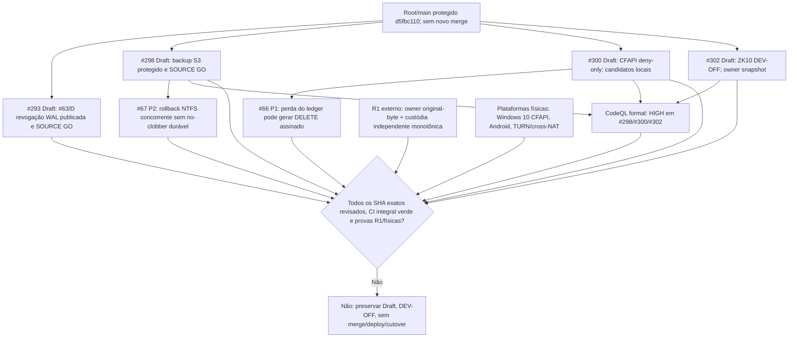

# Root.ark — missão, gates e dependências (2026-11-08 22:42 UTC)

Este é um **corte de evidências**, não uma declaração de conclusão da missão. Foi montado a partir de consultas `gh api` aos HEADs dos PRs e respectivos `check-runs`, de `git ls-remote` à branch literal `Root/main` e de resultados de testes/revisões de SHAs exatos. Cortes antigos no roadmap conservam seu valor histórico; não transferir um resultado de CI ou SOURCE GO entre commits diferentes.

## HEADs publicados e gates hospedados

| PR / escopo | HEAD em 22:42 UTC, estado | Checks do SHA exato observados | Gate vivo |
| --- | --- | --- | --- |
| [#251](https://github.com/bielxdh3/Root.ark/pull/251) / missão | `83bda6c0caf3066c9e230dbf9bc8ea28bac3143a` OPEN/Draft | 7 SUCCESS, 1 SKIPPED, 0 FAILURE, 0 pendentes | Missão não concluída; sem merge/deploy |
| [#293](https://github.com/bielxdh3/Root.ark/pull/293) / #63+#68 | `49a9adfdc2e0cb910e08275fff79265c6841262a` OPEN/Draft | 4 SUCCESS, 1 SKIPPED, 0 FAILURE, 0 pendentes | R1, índice histórico geral, aprovação e composição de produto pendentes |
| [#298](https://github.com/bielxdh3/Root.ark/pull/298) / #67 | `9595ab2e3ded5003ecf6c8242ac253e15be283d6` OPEN/Draft | 8 SUCCESS, **1 CodeQL formal FAILURE / 3 HIGH**, 1 SKIPPED, 0 pendentes | Restauração NTFS crash-safe, backup integral e CodeQL formal ainda bloqueados |
| [#300](https://github.com/bielxdh3/Root.ark/pull/300) / #66 | `adf6118795a6fdf40de3fe3d5718555999ce3f9b` OPEN/Draft | 10 SUCCESS, **1 CodeQL formal FAILURE / 1 HIGH**, 1 SKIPPED, 0 pendentes | CFAPI positivo Windows 10 real ausente; hardening/performance locais requerem gate |
| [#302](https://github.com/bielxdh3/Root.ark/pull/302) / #65 | `ac47c19c40d7093f0144533955deab0ef872ac46` OPEN/Draft | 3 SUCCESS, **1 CodeQL formal FAILURE / 1 HIGH**, 1 SKIPPED, 0 pendentes | DEV-OFF, sem owner signer original-byte e custódia independente R1 |

`Root/main` remoto exato: `d5fbc110944a5437dbd5e9175f39dd97f5e433bc`. Nenhum push, merge de PR, deploy, cutover, reset, force push ou edição dessa branch foi executado neste corte. #228 permanece intocado (fechado anteriormente sem merge). Os checks hospedados e a conclusão global de cada SHA devem ser reconsultados quando houver novo commit.

## Implementação real, revisão independente e bloqueios que não podem ser ignorados

- **#68 / #293:** `49a9adfd` recebeu SOURCE GO independente e foi publicado por fast-forward, preservando OPEN/Draft. Corrige revogação real entre processos após SQLite WAL `SQLITE_BUSY` transitório, reconciliando somente leases com término HTTP comprovado. Testes de processos/SQLite Windows Node22 13/13 e WSL Node22 13/13. A autoridade R1 externa não foi demonstrada.
- **#67 / #298:** `9595ab2e` compõe controle S3 `IfMatch`/ETag/tamanho/listagem e teste fail-closed do symlink de histórico. SOURCE GO independente do SHA integrado, Windows Node22 121 PASS/1 SKIP, WSL Node22 nativo ext4 123 PASS/0 SKIP. Há **3 HIGH formais** no CodeQL: `sync-client/rootark-sync-engine.js:401`, `:2604` e `test/issue-67-historical-restore.test.js:304`; não suprimir nem chamar verde. Rollback NTFS concorrente tem perdas de dados P2 reproduzidas: alias case-insensitive e escritor após remoção; o experimento de lease nativo 8/8 Windows22 bloqueia handles apenas durante a vida do processo e **não** comprova journal, DACL, namespace ou recuperação durável. NÃO publicar rollback parcial.
- **#65 / #302:** `ac47c19c` recebeu SOURCE GO independente e foi publicado: o mesmo snapshot imutável de payload, bytes e assinatura do owner é usado na verificação Ed25519 e no digest histórico, fechando TOCTOU com `Proxy`; Windows/WSL Node22 19/19. O teste HTTP de ingress tem HIGH formal em `test/issue-65-zk10-strict-legacy-upload-ingress.test.js:131`. O candidato local test-only `e4739455` ainda é **SOURCE NO-GO P2**: `storedSnapshot` pode seguir junction de raiz do fixture no Windows e hash de canário externo. Nada autoriza `authorizesIo=true` ou produção ZK10.
- **#66 / #300 CFAPI:** candidato local `174d313d` acrescenta pré-inspeção Win32 read-only de owner/DACL/NTFS por handle e rejeita ACE `INHERIT_ONLY`; revisão independente específica GO, Windows Node22 com compilação MSVC/SDK real 32/32. O candidato local sucessor `13d3b228` ajusta leitura de teste pós-probe para o mesmo descritor, contra HIGH formal `test/issue-66-windows-cfapi-native.test.js:50`; Windows22 7/7, ainda sujeito a peer e hospedagem. Nenhum desses commits equivale a sync-root registrado, FETCH_DATA do kernel com conteúdo verificado, execução em **Windows 10 físico**, ou cutover.
- **#66 journal:** candidato local `4692e71e` reduz persistência quadrática na etapa de exclusões; benchmark Ed25519/AEAD com 160 e 640 itens: Windows22 4,913s/20,856s e 0,089/0,357 MB de snapshots, WSL22 ext4 3,271s/10,518s. **SOURCE NO-GO P1** independente: após PREPARE e staging, se o ledger inteiro desaparecer, uma configuração de exclusão alterada pode gerar DELETE assinado no servidor; a correção exige sentinela durável fail-closed e novo TDD protegido. Descendente local `d9c66e95` agrupa admissões/ACKs de journal (7/7 novo Win22/WSL22), **não herda liberação** do pai P1. Nenhum dos dois deve ser publicado sem reparo, composição e review do SHA final.
- **R1 e aceitação física:** faltam owner-signed digest dos bytes originais *antes* de cada upload, versão/época/autorização e revogação, custódia independente off-host com piso monotônico antirollback, inventário/restauração integral de todas as versões, recuperação física segura, Android Keystore em dispositivo real, Windows 10 native CFAPI e TURN/cross-NAT funcional. Resultados de teste não substituem as provas externas.

## Fluxo de dependências vigente

**Próxima execução autorizada:** solucionar P1/P2 com RED→GREEN real, integrar apenas filhos revisados em ancestry FF, obter peer SOURCE GO do SHA integrado, enviar somente para o Draft correspondente e verificar checks hospedados do próprio SHA. Não tratar qualquer branch como Ready/liberada apenas porque um job isolado passou.
