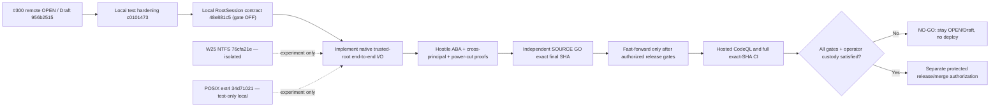

# #300 native root-custody engineering checkpoint — 2026-11-09

**Status: NOT RELEASE READY. No push, merge, deploy, cutover, or #300 Ready transition.**
This is an evidence and roadmap checkpoint; it is not a claim that the
Root.ark SyncEngine or a native Windows CFAPI provider is secure for production.

## Reconciled Git state

| Reference | Exact Git object / state |
| --- | --- |
| Published PR [#300](https://github.com/bielxdh3/Root.ark/pull/300) | `956b2515d3f5262b2bf8c6044be2bfd2db72dc9e`, OPEN/Draft |
| Published `Root/main` | `202146bb73ca8577a0a4017c4556cb8b1e9588a6`, unchanged by this work |
| Previous integrated local candidate | `c01014735a438bf27bf5e2a346af7930993b5f97` |
| Current integrated test-only contract | `48e881c5bff6e67df2a58847e7963dfd7fb5395d`, parent `c0101473` |
| Windows NTFS handle-rename lab | `76cfa21e251382ae12d23d742bb921c84c3dde00`, parent `5d5500da`, **isolated** |
| POSIX dirfd/openat2 research lab | `8e0ccba222a713e1807cb9ad9f88217b03a3d3a8`, parent `37b395bd`, **isolated** |

The `RootSession` contract commit was fast-forwarded locally only after
an independent exact-SHA SOURCE GO (P0=0/P1=0/P2=0 in its three-file
test-only scope). It has no runtime callers, never loads an addon and rejects
even `openNativeRootSession(true)` with `root_session_native_unavailable`.
It is not a recovery fix. Its 13 required native operations and independent
parent/rollback/writer-isolation guards are requirements, not implemented
OS authority or a real attestation.

## Physical evidence, keeping SHAs and scopes separate

| Exact SHA / suite | Windows Node 22, local NTFS | WSL Ubuntu Node 22, physical ext4 |
| --- | --- | --- |
| `c0101473` eight CFAPI suites | 21 PASS, 0 FAIL | 14 PASS, 7 Windows SKIP, 0 FAIL |
| `c0101473` required-v2 process-crash before PREPARE with 16,385 real trash entries | 1 PASS, 0 FAIL | 1 PASS, 0 FAIL |
| `48e881c5` same eight CFAPI suites plus RootSession-contract suite | **28 PASS, 0 FAIL** | **21 PASS, 7 Windows SKIP, 0 FAIL** |
| `76cfa21e` isolated native Windows rename/source-identity lab | Author: 5 PASS, 0 FAIL | Author: 5 expected Windows SKIP |
| `8e0ccba2` isolated POSIX native lab | Not applicable | Author: 5 PASS, 1 bind-mount SKIP, 0 FAIL |

The 16,385-entry test validates legitimate crash recovery, **not hostile
ABA**. The new `48e881c5` contract does not alter the SyncEngine or the
recovery implementation; the process-crash test above was run on its exact
parent `c0101473` and is not misattributed to another SHA.

For W25, the source-identity correction stores the original `FileIdInfo`
while its creation handle is alive, then requires that the source opened
for `NtSetInformationFile` has the same volume and file ID before rename.
Deterministic replacement of that source is rejected; independent SOURCE
review gave GO only to this specific improvement, not to first acquisition
of the scratch directory. A same-SID adversary can still substitute that
initial pathname before its trusted-handle acquisition.

The POSIX lab uses `openat2(RESOLVE_BENEATH|RESOLVE_NO_SYMLINKS|
RESOLVE_NO_XDEV)`, `fdopendir` on a retained directory fd, `renameat2`
with `RENAME_NOREPLACE`, byte-exact Unicode and streaming 16,385 entries.
The corrected child eliminates name-based `unlinkat` cleanup of a possibly
replaced entry and uses literal `/usr/bin/gcc` with a reduced environment.
Its physical test is an orderly A→B→A namespace demonstration, **not a
concurrent malicious bind-mount attack**. Real mount replacement was SKIP
because the WSL test identity lacked `CAP_SYS_ADMIN`; actual binary/toolchain
image provenance, initial root trust and concurrent writer isolation remain
unproven. Independent SOURCE review of exact `8e0ccba2` gave **GO only for
the corrected, opt-in test-only experiment** (P0=0/new P1=0/P2=0 in its
stated scope). It does not close image custody or the product-level P1 and
is not authorization to publish or enable native recovery.

## Remaining hard blockers

1. The active `sync-client/rootark-sync-engine.js` still opens leaf handles
   but separately resolves root ancestry, enumerates `.rootark-trash` by
   pathname, reads the genesis marker, scans tracked bytes and promotes
   ledger/journal/snapshot paths by name. A previous physical bind-mount
   A→B→A reproduced false clean recovery. More `lstat` snapshots do not
   constitute an atomic fix. Relevant areas: `readContainedFile` 280-326,
   `stagedEvictionGenesis` 587-655, `scanPhysicalCacheForEvictionRecovery`
   2722-2803, required-v2 checkpoint 1332-1419, and staging/rollback
   2530-2539/3267-3309.
2. A complete native `RootSession` requires acquisition and cold-reopening
   from a parent independently protected from same-principal swaps; every
   read, enumeration, stage, rename, unlink, journal and commit must remain
   bound to that session. An independent monotonic rollback authority and
   same-principal writer exclusion or immutable snapshots are also required.
   The contract currently rejects all activation.
3. Native test executable SHA-256 and a fixed System32 command path do not
   bind bytes actually executed after process launch, loader DLLs, MSVC
   compiler stages or source bytes. The POSIX lab has the same executable
   provenance limitation. Neither test-only lab establishes loader custody.
4. The **published** #300 formal CodeQL check was FAILURE (native ACL
   command-construction annotation); its later local source hardening has
   not been checked by hosted CodeQL at the exact local SHA. Windows 10
   CFAPI provider activation, hostile NTFS/reparse and power-cut durability,
   full native-root I/O integration, rollback and independent release
   SOURCE review are outstanding.

## Roadmap and decision path

**Next engineering step:** implement actual native trusted-parent acquisition,
same-object enumeration/read/rename and durable cold-reopen with a separate
writer/custody authority, then prove both successful 16,385-entry recovery
and hostile root replacement without remote signed DELETE. Keep W25 isolated,
and prohibit any production call into either experiment until source, image,
root custody and hostile-physical gates are independently satisfied.

## Later local test-only integration (after scoped peer GO)

The corrected POSIX laboratory `8e0ccba2` passed independent **SOURCE GO
strictly for an opt-in research experiment** (zero P0/new P1/P2 for its
corrected claims; no endorsement of executable-image custody or the
SyncEngine). The source was cherry-picked unchanged, with owner attribution
and a single Codex trailer, onto the documentation checkpoint:

- `67b5927632951f6788ca25a4539acec0ad5443c4`: this dated checkpoint
  on `48e881c5`;
- `418d9806`: cherry-pick of original POSIX research `37b395bd`;
- `34d7102187cc115db9222bccee385fdc15551ecd`: cherry-pick of its
  correction `8e0ccba2`.

The composite was conflict-free by `git merge-tree --write-tree`; the
exact `34d71021` source archive ran on WSL Ubuntu physical ext4, Node22,
gcc15: **5 PASS, 1 explicit bind-mount SKIP, 0 FAIL** with the opt-in lab.
On the Windows Node22/NTFS checkout of that same SHA, the CFAPI and
`RootSession` contracts ran **28 PASS, 6 Linux-lab SKIP, 0 FAIL**. The
preceding `48e881c5` integrated candidate ran **28 PASS Windows** and
**21 PASS / 7 Windows SKIP on WSL ext4** for CFAPI + RootSession. No
required-v2 engine files, production entry points, host services, cloud
accounts, or old hostile fixtures were changed by this composition.

All these commits remain **LOCAL ONLY**. The POSIX experiment being present
in a test-only source tree does not activate it and does not close any of the
earlier root/ancestor, same-principal writer, image, code-loading, cold
reopen, crash or rollback gates. Publication remains **NO-GO**.
