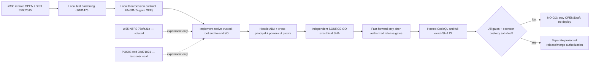

# #300 native root-custody engineering checkpoint — 2026-11-09

**Status: NOT RELEASE READY. No push, merge, deploy, cutover, or #300 Ready transition.**
This is an evidence and roadmap checkpoint; it is not a claim that the
Root.ark SyncEngine or a native Windows CFAPI provider is secure for production.

## Reconciled Git state

| Reference | Exact Git object / state |
| --- | --- |
| Published PR [#300](https://github.com/bielxdh3/Root.ark/pull/300) | `956b2515d3f5262b2bf8c6044be2bfd2db72dc9e`, OPEN/Draft |
| Published `Root/main` | `202146bb73ca8577a0a4017c4556cb8b1e9588a6`, unchanged by this work |
| Previous integrated local candidate | `c01014735a438bf27bf5e2a346af7930993b5f97` |
| Current integrated test-only contract | `48e881c5bff6e67df2a58847e7963dfd7fb5395d`, parent `c0101473` |
| Last locally fast-forwarded integrated HEAD | `a2e57ba8f451ec140e0f757f6c5f418b187260f7`, clean at the start of this continuation |
| New combined candidate with exact physical evidence (not yet fast-forwarded at checkpoint) | `b97328a9749eb7d6e08bb3910564e45faa06da16` — Windows W25, corrected N-API/owner fixtures and LF gate, **local only** |
| Windows NTFS handle-rename lab | `76cfa21e251382ae12d23d742bb921c84c3dde00`, parent `5d5500da`, **isolated** |
| POSIX dirfd/openat2 research lab | `8e0ccba222a713e1807cb9ad9f88217b03a3d3a8`, parent `37b395bd`, **isolated** |

The `RootSession` contract commit was fast-forwarded locally only after
an independent exact-SHA SOURCE GO (P0=0/P1=0/P2=0 in its three-file
test-only scope). It has no runtime callers, never loads an addon and rejects
even `openNativeRootSession(true)` with `root_session_native_unavailable`.
It is not a recovery fix. Its 13 required native operations and independent
parent/rollback/writer-isolation guards are requirements, not implemented
OS authority or a real attestation.

## Physical evidence, keeping SHAs and scopes separate

| Exact SHA / suite | Windows Node 22, local NTFS | WSL Ubuntu Node 22, physical ext4 |
| --- | --- | --- |
| `c0101473` eight CFAPI suites | 21 PASS, 0 FAIL | 14 PASS, 7 Windows SKIP, 0 FAIL |
| `c0101473` required-v2 process-crash before PREPARE with 16,385 real trash entries | 1 PASS, 0 FAIL | 1 PASS, 0 FAIL |
| `48e881c5` same eight CFAPI suites plus RootSession-contract suite | **28 PASS, 0 FAIL** | **21 PASS, 7 Windows SKIP, 0 FAIL** |
| `76cfa21e` isolated native Windows rename/source-identity lab | Author: 5 PASS, 0 FAIL | Author: 5 expected Windows SKIP |
| `8e0ccba2` isolated POSIX native lab | Not applicable | Author: 5 PASS, 1 bind-mount SKIP, 0 FAIL |

The 16,385-entry test validates legitimate crash recovery, **not hostile
ABA**. The new `48e881c5` contract does not alter the SyncEngine or the
recovery implementation; the process-crash test above was run on its exact
parent `c0101473` and is not misattributed to another SHA.

For W25, the source-identity correction stores the original `FileIdInfo`
while its creation handle is alive, then requires that the source opened
for `NtSetInformationFile` has the same volume and file ID before rename.
Deterministic replacement of that source is rejected; independent SOURCE
review gave GO only to this specific improvement, not to first acquisition
of the scratch directory. A same-SID adversary can still substitute that
initial pathname before its trusted-handle acquisition.

The POSIX lab uses `openat2(RESOLVE_BENEATH|RESOLVE_NO_SYMLINKS|
RESOLVE_NO_XDEV)`, `fdopendir` on a retained directory fd, `renameat2`
with `RENAME_NOREPLACE`, byte-exact Unicode and streaming 16,385 entries.
The corrected child eliminates name-based `unlinkat` cleanup of a possibly
replaced entry and uses literal `/usr/bin/gcc` with a reduced environment.
Its physical test is an orderly A→B→A namespace demonstration, **not a
concurrent malicious bind-mount attack**. Real mount replacement was SKIP
because the WSL test identity lacked `CAP_SYS_ADMIN`; actual binary/toolchain
image provenance, initial root trust and concurrent writer isolation remain
unproven. Independent SOURCE review of exact `8e0ccba2` gave **GO only for
the corrected, opt-in test-only experiment** (P0=0/new P1=0/P2=0 in its
stated scope). It does not close image custody or the product-level P1 and
is not authorization to publish or enable native recovery.

## Remaining hard blockers

1. The active `sync-client/rootark-sync-engine.js` still opens leaf handles
   but separately resolves root ancestry, enumerates `.rootark-trash` by
   pathname, reads the genesis marker, scans tracked bytes and promotes
   ledger/journal/snapshot paths by name. A previous physical bind-mount
   A→B→A reproduced false clean recovery. More `lstat` snapshots do not
   constitute an atomic fix. Relevant areas: `readContainedFile` 280-326,
   `stagedEvictionGenesis` 587-655, `scanPhysicalCacheForEvictionRecovery`
   2722-2803, required-v2 checkpoint 1332-1419, and staging/rollback
   2530-2539/3267-3309.
2. A complete native `RootSession` requires acquisition and cold-reopening
   from a parent independently protected from same-principal swaps; every
   read, enumeration, stage, rename, unlink, journal and commit must remain
   bound to that session. An independent monotonic rollback authority and
   same-principal writer exclusion or immutable snapshots are also required.
   The contract currently rejects all activation.
3. Native test executable SHA-256 and a fixed System32 command path do not
   bind bytes actually executed after process launch, loader DLLs, MSVC
   compiler stages or source bytes. The POSIX lab has the same executable
   provenance limitation. Neither test-only lab establishes loader custody.
4. The **published** #300 formal CodeQL check was FAILURE (native ACL
   command-construction annotation); its later local source hardening has
   not been checked by hosted CodeQL at the exact local SHA. Windows 10
   CFAPI provider activation, hostile NTFS/reparse and power-cut durability,
   full native-root I/O integration, rollback and independent release
   SOURCE review are outstanding.

## Roadmap and decision path



**Next engineering step:** implement actual native trusted-parent acquisition,
same-object enumeration/read/rename and durable cold-reopen with a separate
writer/custody authority, then prove both successful 16,385-entry recovery
and hostile root replacement without remote signed DELETE. Keep W25 non-operational,
and prohibit any production call into either experiment until source, image,
root custody and hostile-physical gates are independently satisfied.

## Later local test-only integration (after scoped peer GO)

The corrected POSIX laboratory `8e0ccba2` passed independent **SOURCE GO
strictly for an opt-in research experiment** (zero P0/new P1/P2 for its
corrected claims; no endorsement of executable-image custody or the
SyncEngine). The source was cherry-picked unchanged, with owner attribution
and a single Codex trailer, onto the documentation checkpoint:

- `67b5927632951f6788ca25a4539acec0ad5443c4`: this dated checkpoint
  on `48e881c5`;
- `418d9806`: cherry-pick of original POSIX research `37b395bd`;
- `34d7102187cc115db9222bccee385fdc15551ecd`: cherry-pick of its
  correction `8e0ccba2`.

The composite was conflict-free by `git merge-tree --write-tree`; the
exact `34d71021` source archive ran on WSL Ubuntu physical ext4, Node22,
gcc15: **5 PASS, 1 explicit bind-mount SKIP, 0 FAIL** with the opt-in lab.
On the Windows Node22/NTFS checkout of that same SHA, the CFAPI and
`RootSession` contracts ran **28 PASS, 6 Linux-lab SKIP, 0 FAIL**. The
preceding `48e881c5` integrated candidate ran **28 PASS Windows** and
**21 PASS / 7 Windows SKIP on WSL ext4** for CFAPI + RootSession. No
required-v2 engine files, production entry points, host services, cloud
accounts, or old hostile fixtures were changed by this composition.

All these commits remain **LOCAL ONLY**. The POSIX experiment being present
in a test-only source tree does not activate it and does not close any of the
earlier root/ancestor, same-principal writer, image, code-loading, cold
reopen, crash or rollback gates. Publication remains **NO-GO**.

## 2026-11-09 continuation — exact test-only combined candidate

**Security decision: NO-GO for operational recovery / release.** The following
is a bounded local research/testing integration, not a native OS trust chain.
Neither `sync-client/rootark-sync-engine.js` nor the fail-closed
`sync-client/rootark-sync-native-root-session-contract.js` was changed after
`a2e57ba8`. In particular, `openNativeRootSession(true)` still throws
`root_session_native_unavailable` and no N-API addon is imported by production.

**Combined test-source SHA with physical evidence:**
`b97328a9749eb7d6e08bb3910564e45faa06da16` (child of `844dee94`,
which itself is a local cherry-pick composition on top of `a2e57ba8`).

| Scope | Physically executed on exact `b97328a9` | Meaning |
| --- | --- | --- |
| Windows **11 Pro build 26300** / Node 22 / NTFS test harness with W25 opt-in, CFAPI tests, ACL fixtures, provenance receipts, contract and platform SKIPs | **45 PASS, 16 SKIP, 0 FAIL** | Tests native handle-relative W25 identity/rename and Unicode read, not independent first acquisition or Windows 10 compatibility |
| Ubuntu WSL/Node 22/physical ext4, POSIX labs + N-API + owner-read opt-in, Windows skips | **22 PASS, 9 SKIP, 0 FAIL** | Includes 16,385-entry dirfd enumeration, Node22 N-API and non-root writer denials under existing root-owned test fixture |
| Windows/NTFS `required-v2` process crash before PREPARE with 16,385 retained trash entries | **1 PASS, 0 FAIL** | Legitimate recovery only, NOT hostile A→B→A |
| Ubuntu WSL/ext4 same `required-v2` hard-crash scenario | **1 PASS, 0 FAIL** | Same limited meaning |

The first composite `844dee94` **failed 1 WSL test**: Windows checkout /
Git archive had emitted CRLF for the privileged POSIX validation script.
Commit `b97328a9` adds an exact `.gitattributes` LF constraint and a test
that fails on carriage returns. An independently extracted, fresh ext4
archive of `b97328a9` then passed all stated tests. Both the failure and
subsequent rerun are retained; there is no claim that the first test passed.

### Narrow SOURCE peer gates and actual threat boundaries

- W25 source `77c0b9b3` and its composite `1f659ac3` received independent
  **SOURCE GO for test-only experiments**, P0/P1/P2 new = 0. The original
  Windows source and the local cherry-pick have equal W25 file blobs. Initial
  scratch handle acquisition, same-SID in-place writers, executable image
  custody, cold power-cycle and persistent root ownership remain unproven.
- Linux N-API fix `5c6e082c` received independent **SOURCE GO only for the
  laboratory**, P0/P1/P2 new = 0. It uses private per-callback
  `napi_property_descriptor.data`, one `napi_add_env_cleanup_hook`, and no
  replaceable `napi_get/set_instance_data` slot. The physical Node22 test
  includes two active Workers, cross-token rejection and a second addon in
  the same Node environment. It still uses a same-UID-writable test parent
  and nonattested source/compiler/loaded `.node` image.
- The root-owned ext4 experiment `ada525ba` originally had a **reviewed P1**
  in its privileged shell's line-oriented `grep` check, allowing a malicious
  LF/path argument. Its child `8b778d3f` has **SOURCE GO for the narrow
  validation fix**, with exact 16-char ASCII lowercase hex suffix and
  no-root `--validate-only` negative tests. The root-owned test directory
  was created before that fix; later physical tests only read and attempt
  denied writes, and never re-executed the root script.
- **Unresolved potentially high-impact privilege/custody risk:** the root
  setup shell exists in an ordinary user-writable checkout. It must NOT be
  executed as root under a same-UID malicious-writer threat without a
  separate root-owned, source-attested acquisition/installation mechanism
  and pinned/sanitized privileged tool execution. Its fixture is read-only
  to UID1000, so it proves a narrow owner/read isolation fact, **not a
  writable Root.ark recovery service or a concurrent malicious mount swap**.
- The follow-up commit `715c7f19` removes recursive pathname teardown from
  Windows CFAPI probe tests (RED source regression before / GREEN after,
  5/5 Windows Node22). Fixtures are retained so a same-SID swap cannot
  redirect a test cleanup into a foreign tree. The test still passes a
  pathname to the read-only native CFAPI probe; no full trusted-handle
  imaging or ancestry proof is claimed.

### Formal CodeQL and independent release gates

On the **published** remote PR #300 head
`956b2515d3f5262b2bf8c6044be2bfd2db72dc9e`, GitHub still reports
the **formal CodeQL check as FAILURE** while its separate Analyze
JavaScript/TypeScript job reports SUCCESS. Three reviewer annotations were
reconciled: **#493** potential file race and **#496** generated-source
sanitization are resolved/outdated against prior published source, whereas
**#497** environment-derived shell command remains unresolved. Local code
limits executables to fixed absolute locations, removes writable `build.cmd`
execution, isolates compiler environment and checks build receipts, but
source-level improvements are **not** an equivalent of hosted CodeQL green
for `b97328a9`. No hosted check has run on this local SHA; the CLI is not
installed locally. Do not resolve #497 or mark formal security green by
inference from regular Node tests.

### Outstanding path to a real GO

1. Independently protected, authenticated root-parent acquisition on both
   OSes, including a durable root-owner policy and Windows same-SID threat;
   no user-writable shell/image or namespace may be promoted into authority.
2. End-to-end native handle/dirfd-relative `SyncEngine` recovery reads,
   streamed enumeration, journal/ledger stage/promote/commit/unlink and
   rollback. Remove the active pathname A→B→A gap, do not rely on repeated
   `lstat` snapshots.
3. Concurrent writers and malicious mount/reparse swaps in an isolated
   physical harness; 16,385 entries + Unicode/case aliases; root and
   writer identity across cold reopen; crash/power-loss ordered durability,
   anti-rollback floor and zero unauthorized signed remote DELETE.
4. A final independent P0/P1/P2 source review of the exact production SHA,
   Windows 10 CFAPI real activation/hydration evidence, and fresh hosted
   CodeQL/formal/full CI after explicitly authorized publication.

Do not merge, deploy, cut over, mark Ready or update `Root/main`. All
worktree experiments, fixture directories and previous commits are retained.

## New production-boundary change — required-v2 native recovery fail-closed

**Release decision remains NO-GO.** The subsequent isolated candidate
modifies the actual `sync-client/rootark-sync-engine.js` for the first time
since `a2e57ba8`. This is a **blocking safety fence**, not a native
implementation or a successful adversarial recovery.

- A `SyncEngine` constructed with `filesOnDemand: true` sets a non-writable
  `requireNativeRootRecovery` property; `requireNativeRootRecovery: false`
  cannot opt out of that requirement. Other callers may explicitly set
  `requireNativeRootRecovery: true` without enabling Files On-Demand.
- On cold open, a durable v2 snapshot with `evictionLedgerRequired: true`
  now fails **before path-based ledger/trash examination** with
  `root_session_native_unavailable`. A nonempty replay ledger in the strict
  mode also refuses the legacy path replay; direct calls to
  `recoverUnstartedEvictionLedger` cannot bypass the fence.
- The required-v2 snapshot is intentionally **not disarmed**, its tracked
  cache bytes remain unchanged, no fake JS `nativeRootSession` is read or
  invoked, and no remote sync adapter operation is issued by the blocked
  open. A future `openNativeRootSession` implementation returning an object
  must not silently reenable this legacy replay path.
- Ordinary v1 Files On-Demand startup and existing non-Files-On-Demand
  required-v2 behavior are unchanged by this guard. The latter remains
  **unsafe under the demonstrated hostile A→B→A threat** and must not be
  interpreted as a secure fallback. The gate does not harden non-recovery
  eviction/staging, lock acquisition, owner/DLL custody or remote DELETE.

**TDD + physical Windows Node22/NTFS validation, before final commit:**
the new regression first produced 2 failing assertions (missing strict
flag and erroneous `invalid_snapshot` fallback); after the change it passed
3/3. Files On-Demand + RootSession regressions passed 21/21, then combined
with the new three tests passed **24/24**. The non-Files-On-Demand real
hard-crash `required-v2` with **16,385** entries still passed **1/1**.
The committed candidate is
`dca741770fa71258238857b55813cee207d0fa34` (parent `9b7c3f0f`).
Its exact Git archive was extracted on native WSL ext4 `/dev/sdd` and run
with Ubuntu Node **v22.22.1**: **24/24 PASS** for Files On-Demand, the strict
native recovery gate and RootSession contract, and **1/1 PASS** for the
non-Files-On-Demand real `required-v2` crash with 16,385 entries (two
staging variants). All these tests returned exit 0. The matching Windows
Node22/NTFS results above were on the same committed source.

The published PR #300 still has formal CodeQL **FAILURE** at
`956b2515d3f5262b2bf8c6044be2bfd2db72dc9e`, and the local native-gate
code has not been pushed or assessed by hosted CI. Independent SOURCE GO of
this **product-code delta** is a separate prerequisite for advancing the
local integration. There is no proof of adversarial A→B→A safety outside the
new strict blocking branch, native first-owner authority, durable commit,
malicious same-SID writers, signed DELETE prevention or production readiness.
This does **not** authorize a push of the Draft PR or any release claim.

### Independent SOURCE NO-GO and P1 correction of the native-replay fence

The first code commit `dca741770fa71258238857b55813cee207d0fa34`
was **SOURCE NO-GO, not approved for integration**. Independent review
identified two concrete, independent P1 bypasses: (a) after constructing
the engine with `filesOnDemand:false`, JavaScript could change the mutable
`engine.filesOnDemand` to `true` while the captured strict flag stayed false;
and (b) an attacker controlling a userland engine object could override
`engine.denyUntrustedEvictionReplay` and cause the required-v2 replay to
fall into legacy pathname operations despite a strict constructor.

The next child corrects both defects without enabling native code. The
`filesOnDemand` instance property is non-writable and non-configurable,
matching the separately frozen strict native-recovery requirement. The
recovery deny function is now a **lexically private module function**,
invoked directly from both replay entrances and the direct zero-PREPARE
recovery method, not a mutable instance/prototype hook. A future native
`openNativeRootSession` return still cannot resume the legacy JS path.
The new RED tests reproduced **2 FAIL** on the reviewed defective code;
after repair the Windows Node22/NTFS Files On-Demand, native-gate and
contract suite returned **26 PASS, 0 FAIL**. The new fixture tests also
retain disposable TEMP files instead of recursively removing a pathname
that a hostile same-UID actor could swap before cleanup (peer P2 finding).

### Second SOURCE NO-GO and corrected replay-method bypass

The independent review of `ec781d512bc672bfc4ffdd248afdc5e0c3383881`
confirmed that the two original P1 bypasses were corrected, but found a
third P1: `_open()` still called the public, mutable
`this.replayEvictionLedger()`. Replacing that method on an engine instance
could bypass all checks even though the strict flag and its denial were
private. That commit was therefore **SOURCE NO-GO** for integration.

The subsequent code child `438ca5837d870930699d189908a3b7d4d2d2efff`
blocks the durable required-v2 case **inside `_open()` itself** via the
lexically private denial and calls the original replay implementation
captured when the `SyncEngine` module loaded, rather than a replaceable
instance or prototype method. A RED→GREEN regression explicitly replaces
the public replay method and tries to disarm the on-disk recovery marker;
the committed child refuses startup without writing the snapshot.

The same child adds a concrete **nonempty, valid signed PREPARE** regression
with a stale/inconsistent snapshot flag (`evictionLedgerRequired: false`).
The strict Files On-Demand replay rejects the ledger with
`root_session_native_unavailable`; the physical ledger, exact durable
snapshot bytes, signed store and absence of remote DELETE are checked.
These fixtures are retained, not removed recursively through untrusted
TEMP pathnames. The ledger-only case still has a pathname **read before
denial**, and is **not** an adversarial A→B→A success proof.

| Exact committed source | Physical validation | Result |
| --- | --- | --- |
| `438ca5837d870930699d189908a3b7d4d2d2efff` | Windows Node 22 / NTFS: native gate and RootSession contract | 14 PASS, 0 FAIL |
| same SHA from a clean Git archive on real Ubuntu WSL `/dev/sdd` ext4 | Ubuntu Node v22.22.1: same two suites | 14 PASS, 0 FAIL |
| same SHA | Windows Node 22 / NTFS: non-Files-On-Demand hard-crash `required-v2` with 16,385 trash entries | 1 PASS, 0 FAIL |
| same SHA from Git archive on WSL ext4 | Ubuntu Node v22.22.1: same hard-crash scenario | 1 PASS, 0 FAIL |

**Scope caveat:** these corrections address the three identified JavaScript
configuration/dispatch bypasses; they do not authenticate a hostile
snapshot, protect an arbitrarily compromised JavaScript runtime, establish
independent native root custody, or make older non-Files-On-Demand recovery
safe against A→B→A. This is a narrow **fail-closed production guard**, not
an operational native recovery implementation. Independent SOURCE review
of the exact final composite SHA remains mandatory before local integration.
The remote Draft PR has not been pushed; hosted CodeQL has not run on this
local child and formal CodeQL remains red on the published SHA.

### Third SOURCE NO-GO: mutable cached snapshot and replaceable open dispatcher

Independent SOURCE review of committed `438ca5837d870930699d189908a3b7d4d2d2efff`
(and its docs child `14d3ed03dd21cfe5e605c1e751cff22484088817`)
found two more in-process public-engine bypasses:

1. A strict open could first fail on a durable `required-v2` snapshot,
   leaving `this.snapshot` plus `snapshotDiskRevision` cached. After an
   in-process caller changed the mutable cached required flag to false, a
   retry skipped parsing the still-required disk snapshot because file
   metadata appeared unchanged. With no physical PREPARE, the old code
   incorrectly completed its open. A real RED regression reproduced this
   false-positive restart before the fix.
2. The normal operation lock called the replaceable `this._open()`.
   A caller controlling the instance could shadow that method to bypass
   the new lexical native-replay denial entirely. A second real RED
   regression reproduced this direct public method-dispatch bypass.

Committed child **`b50241ff178da888ba5f13ebbd69ec149c0cd082`**
(parent `14d3ed03`) forces a durable snapshot reparse on every strict
native-recovery open and uses the original `_open` implementation captured
at module initialization for normal mutation and public operation entry
points. The two regressions turned GREEN while preserving the always
closed native `RootSession`. This guard cannot defend arbitrary mutation
of all JavaScript internals by a fully compromised same-process executor;
that requires genuine native process/authority isolation.

| Exact Git source / workload | Physical host | Result |
| --- | --- | --- |
| `b50241ff178da888ba5f13ebbd69ec149c0cd082`: Files On-Demand + strict native gate + RootSession | Windows Node 22 / NTFS | **30 PASS, 0 FAIL** |
| same exact SHA, archive extracted into native `/dev/sdd` ext4 | Ubuntu WSL Node v22.22.1 / ext4 | **30 PASS, 0 FAIL** |
| same SHA: non-Files-On-Demand hard-crash before PREPARE, 16,385 legitimate retained trash entries | Windows Node 22 / NTFS | **1 PASS, 0 FAIL** |
| same SHA from Git archive: same hard-crash scenario | Ubuntu WSL Node v22.22.1 / ext4 | **1 PASS, 0 FAIL** |

The hard-crash positive path is **non-Files-On-Demand legacy behavior**, not
authorization for the strict Files On-Demand native-recovery branch. The
strict branch still rejects the documented required-v2 scenario with
`root_session_native_unavailable`, preserves its ledger/snapshot and
does not issue a remote signed DELETE. The real nonempty ledger test
continues to perform JS path-based ledger reads **before** denying replay
when a stale snapshot falsely says required=false; this does not establish
any atomic root, owner, ancestor, mounted namespace, or image custody.

The published PR #300 is still **OPEN/Draft at `956b2515`** and formal
CodeQL remains **FAILURE** on that published SHA. None of the above local
commits were pushed, and hosted CI has not assessed their exact SHAs.
Keep production native `RootSession` disabled, no merge/deploy/cutover
and no ready-for-merge claim until the missing adversarial OS-level
custody, durability, independent monotonic rollback and CodeQL gates
are actually closed. Exact-SHA independent SOURCE review is required
before even the local fast-forward of this candidate.

## Follow-up safety fence: destructive Files On-Demand eviction

**Operational/release NO-GO persists.** A follow-up source audit of the
reviewed local native-recovery gate `496e7582` confirmed a separate
destructive path **before** any recovery is needed: explicit `evictLocal`
used `_evictLocal` with `batchDurable=false`; after a remote content check,
it persisted an `evicted` marker and ran legacy pathname-based
`stageExisting` (`rename`) followed by `unlink` on the staged name. A hostile
same-SID/UID writer can replace an ancestor between those calls. The
auditor did **not** claim a physically reproduced foreign-file deletion.

Until native root ownership and handle-relative mutation are available,
the new local child rejects **all** `_evictLocal` calls on instances where
`requireNativeRootRecovery` is true, including explicit user eviction and
automatic excluded-path/batch eviction. This is a deliberate **loss of
eviction availability** in Files On-Demand, not a replacement native writer.
The denial occurs before checking paths, consulting remote records,
creating `.rootark-trash`, updating `remoteOnly`, or moving/unlinking
cached bytes. It is a module-private, non-overridable denial, and a future
successful native opener does **not** fall through to the unsafe JS route.

The previous positive test of explicit eviction was **not silently skipped**:
it now exercises the same signed remote object and real materialized cache,
then requires a rejection, unchanged physical Unicode-safe bytes,
unchanged snapshot/remote operation, no additional remote list, no trash or
eviction journal, and successful offline/restart preservation. Direct
`_evictLocal` with a forged `batchDurable=true` also has to reject.
TDD reproduced a **real RED** (unsafe eviction succeeded) before the
fence, then Windows Node22/NTFS tests passed **30/30** across Files
On-Demand, RootSession and native-recovery gate. Independent SOURCE GO
and exact final-SHA Ubuntu Node22/ext4 tests remain prerequisites before
merging this child even locally.

**Not yet solved:** other Files On-Demand mutations, hydration/remote
MOVE/DELETE, pathname-based local reconciliation, same-principal root
replacement, owner-authorized native writer, cold reopen, crash/rollback,
mapped image/DLL provenance or fully adversarial A→B→A. Tests that only
prove legitimate local recovery cannot close these P1 system gates.

### Automatic exclusion preflight — same native custody fence

The first explicit-eviction child `3756cc7ea6dc79dbea33356ada7eeb986ea1c067`
was physically tested on Windows Node22/NTFS (**30 PASS/0 FAIL**) and a
fresh exact-SHA archive on Ubuntu WSL Node22/ext4 (**30 PASS/0 FAIL**).
One uncovered automatic path remained: `_applyExcludedPaths()` could catch
the `_evictLocal()` native denial and proceed to write an exclusion failure,
retry state or remote-only intent. A new RED test used a signed remote cache
entry with Unicode content and a newly configured exclusion; `syncOnce()`
unexpectedly returned instead of rejecting before a snapshot change.

The corrective child now gates exclusion policy changes, pending evictions
and case-fold migration **before** building pending retry objects, scanning
mutable physical paths or persisting snapshot changes when native root
custody is required. An exclusion policy already applied and requiring no
work remains a no-op. The new physical Windows Node22/NTFS combined suites
returned **31 PASS, 0 FAIL**, with the exact cached Unicode bytes, snapshot
bytes, signed store and remote adapter calls unchanged after denial. This is
deliberate fail-closed behavior, **not** a native safe eviction backend.

### Mount namespace adversary — physical kernel semantics, not SyncEngine GO

An additional **manual**, explicitly root-privileged experiment was run in
an **isolated WSL Ubuntu/ext4 mount namespace** using
`wsl.exe --user root --exec /usr/bin/unshare --mount --propagation private
/bin/bash -s`. Bash source was piped through standard input instead of
executing an untrusted shell script from this repository. Preflight checked
that `/var/tmp` was root-owned (`0:1777`) on ext4 (`ef53`). A single
root-owned disposable `0700` directory was created by `mktemp -d`; two
contained directories A and B held different marker bytes.

The kernel was made to bind-mount B over A *only in the child namespace*.
Pathname `A/marker` then returned B's bytes, while **FD 3**, opened on
the original `A/marker` before the mount, continued returning A's bytes.
After unmounting the shadow, pathname A again returned A's exact bytes.
The original B contents remained untouched, and the fixture was retained.

```text
ROOTARK_BIND_NS_V1 PASS original=PINNED foreign=VISIBLE restored=ORIGINAL namespace=ISOLATED fs=EXT4 base=/var/tmp/rootark-issue66-bind-CF30mchs
PRIVATE_BIND_ABA_EXIT=0
```

**Limit of this evidence:** the mounting actor held root/CAP_SYS_ADMIN; this
does not demonstrate successful mounting by UID1000, an operational
RootSession, the `SyncEngine` reading via the original FD, safe concurrent
writers, crash-safe journal/snapshot promotion, cold reboot, trusted native
image provenance or monotonic rollback. The unprivileged bind mount test is
still a truthful SKIP. Nothing was deployed, no host-global mount was
changed, and `Root/main`/the remote Draft #300 were not modified.

**Source-review gate:** the eviction and exclusion-preflight child is kept
in its isolated worktree until a peer reviews its **exact committed SHA**;
passing these Node tests alone must not be reported as SOURCE GO, CodeQL
success or operational recovery readiness.

## 2026-11-09 evening continuation — signed DELETE and staging-source guard

**Status: ISOLATED LOCAL CANDIDATE; FULL PRODUCT/RELEASE NO-GO.** The local
base `7f2de23d7fe621538515109c4fe54021f1dfdae2` (parent `3756cc7e`,
grandparent integrated `496e7582`) contains the current-instance eviction
and automatic-exclusion fences. An independent peer reviewed the two fences
as GO only in that *narrow* sense. A second independent review of the exact
`7f2de23d` instead confirmed a **P1 source NO-GO for a broader, persistent
root-wide guarantee**: a cache originally hydrated under `filesOnDemand:true`
can be reopened by a new engine with `filesOnDemand:false`. The new instance
has no independently authenticated, immutable root-mode commitment, so its
public `evictLocal` and ordinary exclusion migration can still invoke legacy
pathname-based stage/rename/unlink. Freezing properties in the original JS
instance does not defend a second instance, and a mutable same-UID JSON
marker would not fix independent root custody. Do not promote this branch
as safe for adversarial A→B→A, or integrate as an end-to-end security fix.

The further isolated source change in
`mission-20261109-pr300-fod-delete-guard-prime` adds **bounded fail-closed
signed DELETE checks only when `requireNativeRootRecovery` is true**:

- `_reconcileLocal` rejects a missing tracked path before signing/enqueuing a
  remote DELETE; the adversarial input is a materialized Unicode cached file
  moved to another pathname on the physical filesystem, not a fake scanner.
- `translateWebDavMutation` rejects DELETE and MOVE (which may synthesize a
  destination-overwrite tombstone) before scanning and translating.
- `assertOutgoingAuthorized` rejects DELETE/tombstone both for a direct
  enqueue and before a signed operation is dispatched. `_pushPending` rejects
  previously persisted unseen DELETE/tombstone outbox records before remote
  transmission. A regression writes an old signed DELETE through a non-FOD
  engine, then reopens in FOD mode and checks it was not pushed. This does
  **not** block a downgrade to the non-FOD instance: the P1 above remains.
- Public `stageExisting(target)` now checks static source containment before
  creating trash or renaming. A real sibling external file was moved by the
  original source in the RED stage; the corrected source rejects it without
  modifying that file. This remains a pathname TOCTOU check, **not** a
  retained native root/ancestor handle or same-SID writer exclusion.

TDD on Windows Node22 observed missing expected rejection for the vanished
cache, WebDAV DELETE, and external absolute staging source. The old-outbox
test was also observed RED by temporarily disabling its two new guards in
the isolated candidate and rerunning, then restoring both guards; there is
no assertion that these behaviors were safe before the patch.

| Isolated child candidate source / actual workload | Physical result |
| --- | --- |
| FOD suite `test/issue-66-files-on-demand.test.js` / Windows Node v22.23.4, NTFS | **20 PASS / 0 FAIL / 0 SKIP** |
| Same FOD suite / WSL Ubuntu Node v22.22.1, `TMPDIR=/home/bielx` on real `/dev/sdd` ext4 (not `/tmp` tmpfs) | **20 PASS / 0 FAIL / 0 SKIP** |
| `test/phase16-sync-engine.test.js`, native recovery gate, and native RootSession contract / Windows Node22, NTFS | **53 PASS / 0 FAIL / 1 SKIP** |
| Same three adjacent suites / WSL Node22, physical ext4 fixtures | **52 PASS / 0 FAIL / 2 SKIP** |

The old durable index can be rewritten by ordinary FOD opening with an
additional empty `pendingEvictions` field before the stored-outbox denial;
the new regression compares logical `files` and `remoteOnly` plus retained
journal rather than asserting byte-identical snapshot for that case. In the
other rejection paths tests check unchanged cache/remote objects, no adapter
pushes and no new trash. The test harness uses inherited recursive cleanup
of its randomly named temporary parent, so it is *not* an adversarial
same-UID cleanup safety proof. Nothing was executed as root in this change.

**Still blocking any source-wide/production GO:** (1) mode downgrade across
engines, (2) `SyncEngine._apply` and FOD hydration via `stageExisting` and
pathname-based MOVEs/DELETEs without native ancestor custody, (3) independent
owner/root authority and held handles for all I/O, (4) hostile concurrent
writer/mount/reparse A→B→A and 16,385 entries under real native product
recovery, (5) crash/power-loss and monotonic rollback protection, (6)
trusted executable/loader images and Windows 10 CFAPI, and (7) hosted formal
CodeQL still FAILURE on remote Draft PR #300 head `956b2515`. The separate
Analyze JavaScript/TypeScript job was SUCCESS, not the formal gate. No hosted
CI has validated this isolated local SHA. `RootSession` remains disabled.

No push, merge, deploy, cutover or `Root/main` modifications were made.
SOURCE peer review of the exact eventual child SHA is required, and a peer
GO restricted to the new checks cannot override the known **P1 root-mode
downgrade** or authorize integrating the complete branch.

### Physical cross-instance root-mode downgrade reproduction (intentionally RED)

After committing the bounded guards as
`32767a66691c95d8224e553574ecf7bebd74cd93` (parent `7f2de23d`),
a **separate isolated, intentionally dirty** worktree at
`mission-20261109-pr300-crossmode-repro-prime` was detached at that exact
source SHA. Its only worktree change is one test case, named
`issue 66 P1 KNOWN RED: reopening same FOD cache as normal sync must not
authorize legacy eviction`. The test uses the existing disposable real
encrypted-object fixture, hydrates a tracked cached file with
`filesOnDemand:true`, then constructs a new engine over the **same cache
root** with `filesOnDemand:false` and invokes `evictLocal` on its tracked
path. It expects native-custody denial and retention of cached bytes.

The expected denial was **not produced** on either OS:

| Exact `32767a66` source plus isolated uncommitted RED test | Observed |
| --- | --- |
| Windows Node v22.23.4 / disposable NTFS fixture | **1 FAIL**, `Missing expected rejection: same-root mode downgrade must not grant untrusted pathname eviction` |
| Ubuntu WSL Node v22.22.1 / `TMPDIR=/home/bielx` real `/dev/sdd` ext4 | **1 FAIL**, same denial failure |

This is a **verified unresolved P1**, not an incidental test infrastructure
failure, not a GREEN test, and not a proof of a same-SID foreign-file attack.
The uncommitted reproducer and disposable-test setup are preserved; it is
deliberately not part of the passing committed regression suite. The source
code of the committed `32767a66` branch continues to be independently
reviewed only for its narrower new guards. **No publication/integration
should treat this branch as native root custody or as a safe root-wide FOD
mode invariant.**

### Follow-up bounded guard: incoming cached-file DELETE application

The next **isolated** child based on docs-reviewed `2f2644df` responds to an
independent SOURCE finding of another pathname-based destructive path:
`SyncEngine.apply()` and direct `_apply()` accepted an incoming protocol
DELETE/tombstone and called `stageExisting` on locally cached bytes without
rooted native custody. `stageExisting` source containment is lexical and
cannot withstand a hostile concurrent ancestor swap.

A new physical FOD regression first produced an explicit **RED** on Windows
Node22: `Missing expected rejection` when applying a valid encrypted DELETE
operation to a real hydrated cached file. The child then added an internal
fail-closed native-required check inside `_apply` *after normalizing the
envelope and before verify/key/decrypt/journal/staging*. Both public `apply`
and direct `_apply` now reject this DELETE/tombstone while native custody is
unavailable. The test verifies exact cached bytes, unchanged local index and
no `.rootark-trash` staging after denial. The test does **not** assert that
arbitrary remote operation signatures or disk ancestors have been trusted.

A second test covers an existing denial of `translateWebDavMutation` MOVE
before path scanning, preserving the cached file and state. A signed remote
MOVE that **is not** a DELETE still enters legacy `_apply` on hydration and
may perform unsafe pathname rename/stage; that P1 remains entirely open.

| Additional isolated child regression | Observed |
| --- | --- |
| Windows Node v22.23.4 / physical NTFS / FOD suite including 2 new tests | **22 PASS / 0 FAIL** |
| WSL Ubuntu Node v22.22.1 / `/home/bielx` ext4 / same FOD suite | **22 PASS / 0 FAIL** |
| Windows Node22 / 3 adjacent native-gate, RootSession, legacy sync suites | **53 PASS / 0 FAIL / 1 SKIP** |
| WSL Ubuntu Node22 / same 3 adjacent suites with real ext4 fixture | **52 PASS / 0 FAIL / 2 SKIP** |

The earlier **physically reproduced cross-instance FOD-root mode downgrade**
is not fixed by a per-instance `_apply` check. Neither the new guard nor
the older signed DELETE fences confer independent owner-root acquisition,
same-SID writer exclusion, native image custody, cold power-cut recovery or
rollback resistance. Do not integrate/push/release until the source-specific
review, root-wide P1 and published CodeQL gates are resolved. No merge,
deploy, cutover, or `Root/main` modifications have been made.

#### Exact-code follow-up: real 16,385-entry non-FOD recovery on both filesystems

After committing the code and FOD regressions as
`5a1b1f2112bc13bcf53eb3ed86e5fab04b23d65e`, the same exact source
was exercised again against the named physical test
`issue 66 P2: hard crash with >16384 preexisting trash entries recovers
required-v2 before PREPARE` in
`test/issue-66-eviction-empty-ledger-gap-p2.test.js`. That test creates
**16,385 separate legitimate trash files per fixture** and covers both
`staged` and `active` zero-PREPARE recovery scenarios. Both test runs
completed successfully:

- Windows Node v22.23.4 / NTFS, with `TEMP` and `TMP` directed to
  `E:\servidor\.tmp`: **1 PASS / 0 FAIL**, ~24.9s.
- Ubuntu WSL Node v22.22.1 / native `/home/bielx` ext4 on `/dev/sdd`:
  **1 PASS / 0 FAIL**, ~18.1s.

These tests are **non-Files-On-Demand legitimate required-v2 crash
recovery**; they do not provide a safe A→B→A result or authorize the
cross-instance downgrade, and they do not attest a native root writer,
hard-power-loss durability or an external monotonic floor. The deliberately
failing cross-mode reproducer remains outside the committed passing suite.

### Independent SOURCE P1 follow-up: out-of-scope signed MOVE/DELETE reconciliation

The first bounded inbound application guard was committed as
`5a1b1f2112bc13bcf53eb3ed86e5fab04b23d65e` and independently
reviewed. The peer found **another existing P1 inbound route that bypassed
that guard**: `_pullRemote` dispatches records outside `selectedPaths` to
`preflightOutOfScopeMove`/`reconcileOutOfScopeMove`, bypassing `_apply`.
A signed tombstone for an out-of-scope `metadata.path`, while retaining the
object/file identity of an in-scope materialized cache origin, reached
pathname staging/rename, or conflict relocation, without native custody.
This is a real in-process policy bypass; it is not proof of same-SID foreign
file deletion or owner-root A→B→A resistance.

In the isolated child of `5a1b1f21`, a new RED regression reproduced an
**actual missing native denial on Windows Node22** with a valid persisted
remote tombstone, selected tracked original identity, local cached bytes and
an out-of-scope tombstone pathname. The corrective guard is placed inside
`preflightOutOfScopeMove` **after** finding a matching tracked selected origin
and **before** any filesystem read, signature pre-observation or mutation.
This also protects **direct** `reconcileOutOfScopeMove()` callers, and denies
tracked-origin remote MOVE and directory reconciliation when the root requires
native custody. Pure out-of-scope remote-only changes that cannot refer to
a tracked selected origin retain their previous behavior.

Two physical tests cover an out-of-scope DELETE and an out-of-scope MOVE
with a Unicode original filename; each attempts both the public remote pull
and the direct reconciliation route, then checks the exact physical original
bytes, durable snapshot bytes and the absence of trash staging. The native
root is still unavailable by design; source provenance and protection
against hostile concurrent ancestors are **not** established.

| Additional child tests before exact-SHA peer review | Results |
| --- | --- |
| Windows Node v22.23.4 / NTFS full Files On-Demand suite | **24 PASS / 0 FAIL / 0 SKIP** |
| Ubuntu WSL Node v22.22.1 / `/home/bielx` ext4 full Files On-Demand suite | **24 PASS / 0 FAIL / 0 SKIP** |
| Windows Node22 / Phase16, native recovery gate and RootSession contract | **53 PASS / 0 FAIL / 1 SKIP** |
| Ubuntu WSL Node22 / same adjacent suites on ext4 | **52 PASS / 0 FAIL / 2 SKIP** |

This change does not repair same-root mode downgrade to a new non-FOD
`SyncEngine`, pathname-based normal MOVE/UPDATE/hydration, same-UID/SID
ancestor and native image custody, power-cut/rollback, or hosted CodeQL.
Independent SOURCE review of the eventual exact child SHA is mandatory;
these scoped test successes do **not** justify local integration, remote
push, production operation, merge or deploy.

### Follow-up laboratory: reject public in-root Files On-Demand staging

A separate child of `42289bdc` found a source-reachable legacy mutation:
the public `stageExisting()` helper could rename a materialized, contained
Files On-Demand cache file into `.rootark-trash` without a native RootSession,
independent authority or durable required-v2 PREPARE. A new Windows Node22
regression was **RED** (`Missing expected rejection`) before the fix.
The helper now rejects native-required roots **before pathname inspection**.
The revised cached-refresh test expects a native-custody denial rather than
accepting legacy pathname replacement. Windows Node22 FOD suite: **25 PASS,
0 FAIL** after the fix. This is a bounded fail-closed restriction and a
user-visible loss of legacy cached-refresh availability until native support
exists, not an implementation of safe native replacement. Internal/public
method interception, alternate `_apply` rename routes, cross-instance
non-FOD downgrade, same-SID A→B→A, cold recovery and CodeQL remain
subject to separate source review and integration gates.

### Exact local composition 5d6d76ee: independent narrow SOURCE GO

The next isolated child `d92566a10891fe0220a00bfd28736068c0b80f69`
of `42289bdc` denies direct `stageExisting()` for native-required roots
before any pathname lookup. Windows Node22 reproduced **RED** with a
materialized FOD file before the change (`Missing expected rejection`),
then the adjusted entire suite went **GREEN 25/25**. The existing cached
refresh is now deliberately unavailable pending native custody; the
physical cache bytes and durable snapshot remain unchanged on denial.

The independent worker's child `7f9fcc409e67d36dae232cc847ce531b11e8cf8d`
captured the canonical out-of-scope preflight implementation so callers
cannot shadow the public method in direct reconciliation, remote pull or
HTTP 409 conflict handling. It reproduced RED for method interception and
Proxy interception, then GREEN. Cherry-picking this reviewed delta atop
`d92566a1` required a test-only conflict resolution preserving both
families of regressions; the resulting exact composition is
**`5d6d76eed10777d1f521a75ab4be2eb1d98fa3af`**. Both commits have
author/committer `bielxdh3 <bielxdh3@gmail.com>` and exactly one Codex
coauthor trailer. No native RootSession implementation was enabled.

| Exact 5d6d76ee physical run | Result |
| --- | --- |
| Windows Node v22.23.4 on NTFS: full Files On-Demand suite | **27 PASS / 0 FAIL / 0 SKIP** |
| Ubuntu WSL Node v22.22.1 on real `/home/bielx` ext4, `git archive` exact SHA with dependencies supplied read-only via `NODE_PATH`: full FOD suite | **27 PASS / 0 FAIL / 0 SKIP** |
| Windows Node22: `issue-66-eviction-empty-ledger-gap-p2` plus `issue-66-root-session-contract` | **30 PASS / 0 FAIL / 3 SKIP** |
| Windows Node22: legitimate non-FOD hard crash and recovery with more than 16,384 trash entries, included in preceding run | **PASS** |
| Git metadata, worktree cleanliness, and `git diff --check` | **PASS** |

The first ext4 test attempt lacked several archived source directories;
after extending the test-only archive with `public`, `db` and `services`,
the same exact 5d6d76ee source passed. The source worktrees and this ext4
fixture were retained; no cleanup of adversarial fixtures was performed.
Independent **read-only exact-SHA SOURCE GO was restricted to the new
stageExisting and captured-preflight guards** (new P0/P1/P2: zero).
The integrated local worktree fast-forwarded from `496e7582` to
`5d6d76ee` and was clean. These results must not be described as
adversarial root-custody, cold-reboot, power-cut, image, rollback or
production recovery proof.

**Still NO-GO:** a different SyncEngine instance may reopen an existing
FOD root as non-FOD and reach legacy pathname eviction. Physical RED
exists on Windows Node22/NTFS and WSL Node22/ext4 for a later descendant;
the logical mode is not yet protected by an independently trusted root
authority. Existing `_apply` MOVE and replacement paths, same-SID A→B→A,
monotonic custody, complete native handles/fds, and formally hosted CodeQL
also remain unresolved. The remote PR #300 remains OPEN/Draft at
`956b2515`, with CodeQL formally failing in the last check; Root/main
remains untouched. No push, merge, deploy or cutover was performed.

### Additional fail-closed FOD MOVE preflight (isolated candidate)

Review of `_apply` found that a signed MOVE with an existing materialized
source still reached `fsp.rename(source, target)` by pathname, even though
public `stageExisting` was native-gated. A focused Windows Node22 test
reproduced **RED** (`Missing expected rejection`) for a legitimate signed
MOVE of clean cached bytes, including a direct public `apply(move)` call.
The correction denies **all FOD/native-required incoming MOVE operations**
before verification admission, journal observation or path I/O, rather than
attempting to make a pathname rename safe with repeated `lstat` checks.
It intentionally disables legacy MOVE hydration, even when a signed
recovery payload exists, until the native held-root operation is proven.
The full Windows Node22 FOD suite turned **GREEN 27 PASS / 0 FAIL** with
unchanged local bytes, durable snapshot, no trash and no destination.
This narrow guard is not root-wide same-SID custody: first-time hydration
and non-FOD reopens still have other pathname-based risks, so product
recovery and release remain **NO-GO** pending exact-SHA SOURCE review.

### Follow-up: preserve first-time signed MOVE hydration without cached rename

Independent exact-SHA SOURCE review rejected `83e047c9` (**NO-GO P1**)
because its categorical MOVE denial also blocked legitimate first-time
hydration when both the source and destination were absent, despite an
authenticated recovery payload. It also identified incomplete assertions
for journal/remote mutations (**P2**). The original 27/27 GREEN was
therefore insufficient. A focused Windows Node22 regression reproduced
**RED** with `root_session_native_unavailable` on a first-time signed
MOVE whose source had never been materialized. The corrective child
checks both the canonical destination and potential tracked/requested
source path existence **before journal admission**, denying occupied
paths but allowing first-time payload hydration. Windows Node22 full FOD
suite: **28 PASS / 0 FAIL** with cached-source rejection and first-time
positive hydration both covered. This only preserves an existing
cooperative-path behavior; absence checking is not atomic under a hostile
same-SID writer, so native rooted no-replace, authority and rollback
remain unproven. This child needs exact-SHA physical ext4 tests and
independent SOURCE review before local integration.

### Composed logical FOD mode and strict MOVE proof: af23a3f0

The exact clean, isolated candidate
`af23a3f0f9199625678a491596339cfc0ef245e1` contains the first-time
MOVE compatibility repair (`6c3c1358`), a local ever-FOD marker
(`e6517538`, rebased from `d8ae58e5`), a real Ed25519 pinned-key
positive MOVE test (`222eb211`, rebased from `843fc305`), and direct
helper + shared path namespace corrections (`af23a3f0`, rebased from
`76a02b86`). The earlier categorical MOVE parent `83e047c9` was
independently SOURCE **NO-GO** for disabling legitimate absent-source
hydration; its child preserves authenticated recovery-payload hydration
when both requested/tracked source and target are absent, while rejecting
occupied cache and destination before journal admission.

The local fixed-name `.rootark-sync-ever-fod` marker is created with
exclusive file creation, file fsync and supported parent directory fsync
before FOD operations, validated on subsequent opens, and checked before
direct conflict-recovery writes and directory pruning. The shared path
validator reserves this name against sync and WebDAV user data. Earlier
independent SOURCE **NO-GO** for the marker's direct helper bypass and
shared namespace gap was addressed by `af23a3f0`; three TDD regressions
were RED on its parent and GREEN after the correction. This is a logical
cooperative-client downgrade fence, NOT a trusted disk-backed monotonic
custody witness.

| Exact af23a3f0 source validation | Observed result |
| --- | --- |
| Windows Node22.23.4 / NTFS FOD full suite | **34 PASS / 0 FAIL / 0 SKIP** |
| Ubuntu WSL Node22.22.1 / real ext4 FOD full suite, archived exact SHA | **34 PASS / 0 FAIL / 0 SKIP** |
| Windows Node22 required-v2 hard crash with more than 16,384 legitimate non-FOD trash records | **1 PASS / 0 FAIL** |
| WSL Node22 ext4 same hard-crash non-FOD recovery | **1 PASS / 0 FAIL** |
| `git diff --check`, exact Git worktree cleanliness and Codex coauthor metadata | **PASS** |

The strict MOVE fixture proves client-side Ed25519 signed-envelope
verification using a pinned trusted device key, journal `hasSeen` and
persisted snapshot identity on reopen. It injects the signed full envelope
through the adapter while the non-protected disposable store holds the
encrypted unsigned copy. It does **not** prove protected server-side
atomic-registry admission, live revocation or production remote signing.
An independent reviewer issued bounded SOURCE GO for the exact composed
source, without endorsing native custody, cross-process physical attacker
exclusion, rollback resistance or release. No force push, merge, deploy,
Root/main mutation or RootSession enablement is authorized by these runs.

**Release NO-GO persists:** hostile same-SID/UID removal or rollback of
the local marker cannot be distinguished from a virgin root; pathname
`lstat`/`readFile` and absent-source MOVE checks are not native held-root
atomic no-follow operations. Separate process/cold boot, ancestor A→B→A,
independent monotonic authority, image/DLL provenance, power-cut and
hosted formal CodeQL remain outstanding. The PR #300 remote remains
OPEN/Draft and no deployment or cutover was performed.

### New isolated marker-handle and FIFO hardening (awaiting exact-SHA review)

The published `d3a91c92` hosted CodeQL run reported **four new high alerts**:
`sync-client/rootark-sync-engine.js` marker `lstat`/read (:77), POSIX
trash `lstat`/open (:706-707), and two test-only pathname stat/read
sites (`issue-66-files-on-demand.test.js` :625 and
`issue-66-independent-owner-posix-root.test.js` :167). Hosted functional
jobs passed; **formal CodeQL FAILED**. No hosted run of the following
unpublished fixes exists.

The marker laboratory initially replaced path-based `lstat` and
`readFile` with a retained file descriptor and `fstat`, rejecting invalid
type, unexpected link count, changes in descriptor/path identity and
contents before authorizing cooperative root mode. Independent review
then found a **P1**: opening a FIFO without a writer with `O_RDONLY`
and `O_NOFOLLOW` could block forever **before** checking file type.
Real WSL Node22 subprocess on a physical FIFO reproduced **RED**
(`ETIMEDOUT`). The correction adds Linux `O_NONBLOCK` during open,
retains post-open descriptor verification, and denies non-regular files
with `root_mode_marker_invalid`. A physical FIFO regression launches
bounded fresh Node22 subprocesses for both non-FOD and FOD paths,
confirms refusal with no snapshot creation, then exercises controlled
fixture removal, valid FOD startup, cold reopening, and legacy-mode
downgrade rejection. The bounded FIFO run on WSL with
`TMPDIR=/home/bielx` (ext4) finished **1 PASS/0 FAIL**. It does **not**
prove any protection against an untrusted actor subsequently erasing
the marker or reverting its parent.

In the same isolated worktree, a no-follow marker hardlink regression
reproduced **RED** before descriptor hardening; later Windows Node22
FOD+RootSession tests gave **43 PASS / 1 SKIP**, and the WSL Node22
counterpart gave **44 PASS / 0 SKIP**. The privileged root-owned ext4
laboratory was **2 PASS** with its *existing* fixture and unprivileged
process; no privileged provisioning script was rerun and no fixture was
deleted. The owner-marker assertion now reads from its previously
retained no-follow descriptor. These counts were obtained on the
working tree, not yet from a published/reviewed SHA. Exact final
commit, independent SOURCE review and composed CI remain required.

**Safety boundary remains:** the local marker is not an independent
monotonic custody authority, JS file handles do not provide a verified
rooted create/rename/unlink/rollback transaction, and same-SID
A→B→A, power-loss durability, independent image provenance and native
Windows CFAPI custody are still NO-GO. `RootSession` stays closed.

### Isolated Linux staged-genesis read hardening after d3a91c92

The source at `d3a91c92` validates the genesis trash directory and holds a
POSIX directory FD, but reopens `.rootark-trash` for enumeration and the head
by pathname. A physical WSL ext4 regression swaps the visible trash name for
an attacker symlink immediately before `opendir`: the parent code **RED**
observed enumeration of the attacker directory before eventually failing
closed. The proposed child instead opens the Linux root and trash with
`O_DIRECTORY|O_NOFOLLOW`, traverses via `/proc/self/fd` with both FDs
retained, enumerates all entries there, and reads the genesis marker via
another held nofollow regular-file FD with a strict 8 KiB bound and pre/post
`fstat`. There is no Linux pathname fallback if procfs is unavailable;
non-Linux POSIX staged-genesis inspection fails closed until a native
equivalent is provided. Windows retains its existing pathname validation.

WSL Ubuntu Node22.22.1 on a physically independent ext4 directory: the new
swapped-ancestry regression is **GREEN 1/1**, and the full
`issue-66-eviction-empty-ledger-gap-p2` suite is **27 PASS / 0 FAIL**, including
the 16,385-entry legitimate trash and required-v2 crash tests. Windows Node
22.23.3 on NTFS: the 16,385-entry hard-crash test is **PASS 1/1** and the
full same suite is **23 PASS / 0 FAIL / 4 POSIX SKIP**. This is
only a bounded ancestry fix for this reader, **not** initial root authority,
native `openat2` custody, proof against same-UID adversarial pre-acquisition
swaps or root rollback, or evidence that formal hosted CodeQL is green.
Release remains **NO-GO**.

### Follow-up same-UID marker growth: bounded held-FD read

The independently reviewed FIFO correction still had a concrete P2:
`FileHandle.readFile()` was called after a size-only `fstat` of the
`.rootark-sync-ever-fod` marker. A same-UID process could enlarge that
regular file between validation and read, causing an unbounded read and
allocation before the later identity/version check refused the contents.
A deterministic regression forbids any call to `FileHandle.readFile`
and instruments individual and aggregate bytes read through the fd.
The parent code was **RED** on Windows Node22 because it invoked the
forbidden unbounded API **before** physical growth was triggered. The
corrected code is **GREEN 1/1** and physically appends 256 KiB during
its first bounded fd read before rejecting the changed marker. It uses a strict
buffer of the expected literal byte length plus one sentinel byte,
using positional reads through the **same** retained handle. The
corrupted marker and unchanged durable snapshot are checked after denial.
The focused WSL Node22 test also passed **1/1** with its disposable root
on ext4. `O_NONBLOCK|O_NOFOLLOW`, descriptor/path identity checks and
partial/symlink/FIFO fail-closed behavior are retained. The separate
FIFO and concurrent-growth tests support explicit
`ROOTARK_ISSUE66_FIFO_REQUIRE_EXT4=1` to assert Node22 and the real ext4
superblock for a physical run,
without introducing an ext4 requirement in portable CI.

This is a *bounded memory and marker-admission correction*, not a
trusted monotonic root mode. Same-SID deletion/replacement, parent ABA,
image provenance, native mutation and rollback still prohibit production
`RootSession`. Exact committed SHA, broad physical validation and new
independent SOURCE review are required; no new hosted CodeQL success
or GitHub Actions run is claimed, and no push/merge/deploy is authorized.

### Local integration and paginated native laboratory, 2026-11-10

Execution gates and a literal current-state flowchart are tracked at
[`docs/roadmap/issue-66-pr300-native-custody-gates.md`](../roadmap/issue-66-pr300-native-custody-gates.md).

The last **locally integrated** HEAD was
`aed53c54fb0dcc0d93d0d20abdf6a4abeef3b549`, reached by safe
fast-forward after independent SOURCE GO for the marker FIFO and Linux
staged-genesis components and the exact source composition. Physical
exact-SHA checks: **Windows Node22/NTFS 66 PASS / 5 platform SKIP**,
**WSL Ubuntu Node22/ext4 71 PASS / 0 SKIP**, including cold FIFO denial,
legitimate 16,385-entry `required-v2` recovery, Unicode and RootSession
negative activation. None of those proves hostile same-SID root custody.

The next independent marker child `83615c1a96cdb5f9a2a90a71c5fb44675f4adad9`
fixes an identified test false-green: a concurrent append now verifies
both *per-call* and *aggregate* bytes returned by the already bounded
held descriptor, and the explicit Linux physical opt-in checks Node22
and ext4 for both FIFO and growth fixtures. Independent source review
issued **bounded SOURCE GO** with no new P0/P1/P2; physical focused
Node22 Windows/WSL tests each **1 PASS**. The earlier parent `ab91e877`
was GO only for its code delta while its test evidence still had P2.

The isolated Linux N-API laboratory chain (not imported by the product)
was `8e5cb4de` (64-name raw Buffer pages and 16,385 native-created files),
`a75eeb30` (exact invalid UTF-8 POSIX leaf + opt-in), `cc6750c4`
(native-side mandatory stress opt-in), and `0a4b2c28` (complete raw-byte
equality across all 16,389 expected names). Independent reviewers flagged
and later source-closed the P2 cases of (a) stress opt-in enforced only
in JS and (b) count/unique/endpoints allowing omitted intermediate names.
The heavy test source at exact `0a4b2c28` obtained **1 PASS** on Ubuntu
Node22/ext4, using the additional native stress opt-in. Its stable-held
`DIR*` enumerated all 16,385 generated leaf names plus three fixture
entries and one byte-`0xff` entry, once before the swap and again while
foreign B occupied A's pathname; the test then restored A without a
third enumeration. The session remained bound to original A throughout.
The broader native plus contract suite on the preceding source-equivalent
compose gave **17 PASS / 2 SKIP** (expected separate native-negative and
hostile bind-mount policy skips under stress). No claim is made that the
untrusted same-UID parent, mount namespace, cold reacquisition, journal,
rollback or commit was independently protected.

An isolated composed SHA `7ccdad3cf6fa951a9fa81895730a61fb1a17e78b`
cherry-picks the native lab chain over the marker correction (the lab
code and tests match the original reviewed child); the composition
ran **Windows Node22 FOD+RootSession 44 PASS / 1 SKIP**, **WSL Node22
FOD+RootSession 45 PASS / 0 SKIP**, and **WSL Node22 native opt-in
without expensive stress 8 PASS / 2 SKIP**. A SOURCE review of this
exact composition is required before local fast-forward. An additional
docs-only child must also pass peer SOURCE review before being integrated.

**Remote and billing:** the PR #300 upstream remains `OPEN/Draft` at
`d3a91c921c18e40d23d101958b487725e88e8d95`; the protected
`Root/main` remained `202146bb73ca8577a0a4017c4556cb8b1e9588a6`.
The hosted formal CodeQL on the remote SHA failed (four filesystem-race
annotations), while local source corrections have **not** been formally
rechecked by hosted CodeQL. No push, GitHub Actions rerun, remote merge,
deploy, cutover, or privileged root-owned fixture reprovisioning was done
for this checkpoint. Existing fixtures and worktrees were preserved.

**Product RELEASE NO-GO:** despite substantial native *laboratory*
read/enumeration/create/fsync and held-root Linux genesis progress,
independent custody outside the attacker's UID/SID, writable full
transaction APIs (`renameNoReplace`, `removeEntry`, journal, rollback,
commit), native Windows CFAPI acquisition, same-SID hostile substitution,
monotonic independent floor, power-cut/cold reopen, executable/DLL image
provenance and formal CodeQL are not proved. Keep RootSession closed.

### Fixed-leaf held-dirfd transaction rehearsal (isolated candidate)

On the reviewed `7ccdad3c` source, candidate
`f7279cb8660dfd2cd69e2f692bd42a02757cf047` adds **lab-only**
`stageProof(token)` and `publishProof(token)` to the Linux N-API experiment.
They require an additional native `ROOTARK_ISSUE66_W3_TXN_LAB=1` opt-in,
accept no JS path, fd or payload, and use four fixed canary leaf names
relative to the held A directory descriptor. The stage and fixed
PREPARED journal are created exclusively with `openat2` and fsynced;
`renameat2(RENAME_NOREPLACE)` publishes without overwrite, followed by
directory `fsync` and an exclusive COMMITTED marker. Any uncertain
flush/transition stays lab-indeterminate, without unsafe recursive cleanup.

On **real WSL Ubuntu Node22/ext4**, focused tests had **3 PASS / 0 FAIL**
for a staged A renamed under B and restored, a deliberate same-UID
destination collision preserving the foreign bytes, and a *separate*
same-UID Node process overwriting a staged canary **before** publication;
that deterministic pre-commit corruption was rejected without a COMMITTED
marker. Separate lab opt-in-negative testing passed **1/1**. The combined
N-API+RootSession contract run had **20 PASS / 0 FAIL / 3 SKIP** under
transaction opt-in, with the huge inode stress case intentionally skipped.
Windows Node22 RootSession negative contract ran **7 PASS / 0 FAIL**.

The clean isolated composition
`42b8d837879dfbce72280c36a0c22c889b4ce09a` cherry-picked the
transaction code above the reviewed roadmap checkpoint `a39d7409`.
Exact composition physical validation: **Windows Node22/NTFS FOD +
RootSession 44 PASS / 1 platform SKIP**, **WSL Node22/ext4 FOD + N-API
transaction + RootSession 58 PASS / 3 expected SKIP** (large inode stress,
separate transaction-negative test, hostile bind mount without protected
parent/CAP_SYS_ADMIN). These tests do **not** simulate a live adversary
modifying data in the same syscall window, an independent signed journal,
crash after rename before marker fsync, forced powercut, or cold authority
reacquisition. `unlinkat`, arbitrary user-path transactions, protected
owner custody and native Windows publication are *not implemented*.

Independent reviewers granted **bounded SOURCE GO** to the exact native
stage child `f7279cb8660dfd2cd69e2f692bd42a02757cf047`, the composed
SHA `42b8d837879dfbce72280c36a0c22c889b4ce09a`, and this
docs-only checkpoint `5ef996318c2c119a080983161788f8f16cdc3c60`.
The integrated local worktree fast-forwarded to `5ef99631` with no
remote publication. SOURCE GO applies only to this lab and documentation,
not a complete recovery design. Even with these GO decisions, this is a
test-only syscalls/ordering milestone:
`openNativeRootSession` and production `requireNativeRecoveryAuthority`
remain unconditionally denied. **RELEASE NO-GO**. Remote PR #300 stays
OPEN/Draft at `d3a91c92`, hosted formal CodeQL remains failed and was not
rerun to conserve GitHub Actions billing; no push/merge/deploy/cutover.

### Independent legitimate required-v2 crash check on the composed SHA

The exact code SHA `42b8d837879dfbce72280c36a0c22c889b4ce09a`
was also physically checked for the bounded **non-FOD legitimate**
`required-v2` recovery scenario with 16,385 distinct trash entries
already present before the PREPARE transition. Both `staged` and `active`
subcases are exercised within that Node test; the recovered snapshot
must clear `evictionLedgerRequired`, preserve authenticated source bytes,
and issue no signed DELETE. Observed focused Node22 results:

| Filesystem | Test | Observed |
| --- | --- | --- |
| Windows / NTFS | `issue-66-eviction-empty-ledger-gap-p2.test.js` `--test-name-pattern='hard crash with'` | 1 PASS / 0 FAIL |
| Ubuntu WSL / ext4 (`TMPDIR=/home/bielx`) | Same test and exact source SHA | 1 PASS / 0 FAIL |

The physical check uses temporary ordinary-recovery fixtures and does
**not** establish a hostile writer's ability/inability to replace root
ancestors, durable journal/rename atomicity under power loss, cold native
reacquisition, or release-worthy adversarial `required-v2` recovery.
These are independent proof gates, not extrapolations from green tests.

### 2026-11-10 continuation — ledger A→B substitution and bounded enumeration

The last known remote `#300` is still `d3a91c921c18e40d23d101958b487725e88e8d95`,
OPEN/Draft. The remote formal CodeQL gate is still **FAILURE with four HIGH
filesystem-race annotations**, despite its separate JavaScript/TypeScript
analysis and other sampled functional jobs passing. None of the local code
in this section was pushed or run in hosted CI. `Root/main` stayed at
`202146bb73ca8577a0a4017c4556cb8b1e9588a6`.

The child `54067c2d9c8b0c860e188815a38cb1d5e486cc55` of `3048365a`
implements **read-only legacy Linux ledger anchoring**, not a native
RootSession. Its exact-source independent review found zero new P0/P1/P2
**within this bounded delta** and approved local fast-forward. Linux
`openEvictionLedger` acquires a nofollow held root/ledger descriptor and
creates the fixed ledger directory relative to the root FD; recovery
enumerates the retained ledger via procfd and reads each fixed record through
a held nofollow FD with an 8 KiB maximum and pre/post identity checks.
Windows changes only the legacy directory-creation guard to nonrecursive
`mkdir`, without claiming root-relative NTFS operations.

| Test | Actual outcome |
| --- | --- |
| WSL Node22/native ext4 substituted ledger regression on the original `3048365a` | **RED**: foreign `ATTACKER_SENTINEL` was enumerated before eventual invalid-snapshot rejection |
| WSL Node22/ext4 exact `54067c2d` same regression | **1 PASS, 0 FAIL**, foreign enumeration denied; snapshot, source bytes and signed remote object preserved |
| WSL Node22/ext4 exact `54067c2d` zero-head/required-v2 focused recovery | **2 PASS, 0 FAIL** |
| Windows Node22/NTFS exact `54067c2d` focused required-v2 process crash | **1 PASS, 0 FAIL** |

The follow-up `77e1736bf0922bc4de4695c637c48338ac39bed2` replaces
unbounded `fsp.readdir` of the ledger with bounded incremental
`fsp.opendir`; it stops after the maximum 32,769 ledger names (16,384
PREPARE, 16,384 COMMIT, one head) plus one sentinel. A new WSL Node22
test was **RED** on its parent when `readdir` was forbidden, then
**GREEN 1/1** after streaming. The earlier physical A→B substitution
test was adapted to intercept either enumeration API and remained
**GREEN 1/1**. A synthetic virtual-name boundary (not 32,770 real files)
proved finite consumption: **WSL Node22/ext4 1 PASS** and **Windows Node22/
NTFS 1 PASS**; normal bounded streaming also passed **Windows 1/1**.
An independent read-only SOURCE review of the exact `77e1736b` delta
reported **bounded GO, no new P0/P1/P2**, confirming the 32,769-entry
threshold, the replacement-test interception of `opendir`, and finite
iterator close on failure. This narrow approval does not override the
known same-UID, Windows pathname or power-loss release blockers. Both
`54067c2d` and `77e1736b` were fast-forwarded into the **local**
integrated worktree, now clean at exact
`77e1736bf0922bc4de4695c637c48338ac39bed2`. The remote Draft
branch remains unchanged.
The existing exact `42b8d837` genuine 16,385-file staged+active crash
evidence was **not rerun**, as neither new commit changes that trash-reader
contract.

A separate independent read-only examination of native `removeEntry`
confirmed **NO-GO** for adding fixed-name `unlinkat` to the existing
same-UID-writable N-API laboratory: the name can be substituted between
validation and unlink, and a failed post-unlink fsync is indeterminate.
No unsafe unlink patch, privileged fixture reprovisioning or cleanup was
performed. Even with the read hardening, production journal writes,
promotion, stage/rollback and deletion remain pathname-based and cannot
protect against hostile same-UID/SID swaps. Native owner/root custody,
independent anti-rollback, image/DLL provenance, Windows CFAPI handle-bound
commit, power-loss durability and cold re-acquisition are **not proven**.

**Release decision: NO-GO.** `openNativeRootSession` stays fail-closed;
do not infer SOURCE GO for complete recovery or CodeQL clearance from
these focused local tests. No merge, deploy or cutover.

### 2026-11-10 continuation — physically adversarial ledger writes and retirement

The exact code child `0f80974ad243e772204340f8523d642a3b8f16ca`
(parent `218ef9ae`) fixes a separate, concrete **legacy Linux ledger
write redirection**. A physical WSL/Node22/ext4 regression on the parent
renamed `.rootark-sync-evictions` just before durable PREPARE creation,
then rebound its public path to an attacker-controlled directory symlink.
The old code wrote real `.prepare.json`, `.commit.json` and `head.json`
files to that foreign directory before the test's final rejection. This
was **RED**, not a hypothetical CodeQL warning. The child holds nofollow
root/ledger directory descriptors across PREPARE, HEAD update and COMMIT
and uses procfd-relative file creation, rename and fsync. It rechecks
directory **identity** (dev/ino), not immutable mtime/ctime, because its
own committed records legitimately alter directory metadata.

| Physical/local test on code `0f80974a` | Result |
| --- | --- |
| WSL Node22/ext4: foreign-path PREPARE and COMMIT substitution (separate real syscall swaps, no foreign write or signed DELETE) | **2 PASS / 0 FAIL** |
| WSL Node22/ext4: legitimate v1 genesis/crash recovery and post-v2 pre-promotion recovery | **2 PASS / 0 FAIL** |
| Windows Node22/NTFS: same two narrow legacy recovery paths | **2 PASS / 0 FAIL** |
| Node22 syntax and Git whitespace/cleanliness checks | **PASS** |

The parent-to-child regression first failed because foreign durable
records appeared. The independent peer examined the exact committed
source and issued **bounded SOURCE GO, no new P0/P1/P2**, for this
Linux-only redirection fix. The code was fast-forwarded locally;
no remote PR push or hosted workflow was requested.

The subsequent child `5e927dc55644a236b031dd71426bb93af1674755`
replaces the Linux ledger *retirement/cleanup* pathname flow with a
retained root and original ledger descriptor. The read phase now returns
the ledger's device+inode; cleanup verifies the reacquired inode,
renames relative to the held root, verifies that the archived entry
is the same original directory, then unlinks the fixed record names
relative to that original held ledger. Parent `0f80974a` **RED**
physically attempted to unlink a test-owned foreign file through
the substituted archived symlink; the regression intercepted the
deletion before any foreign bytes were destroyed. On `5e927dc5`,
the hostile case was **GREEN 1 PASS/0 FAIL**, preserving all foreign
filenames and bytes. A separate *legitimate* ext4 eviction was
**GREEN 1 PASS/0 FAIL**, with the fresh active ledger empty, no orphan
archive and no signed DELETE. Focused WSL required-v2/recovery checks
also gave **2 PASS**, and Windows legacy recovery smoke **1 PASS**.
The first independent SOURCE review found no new P1/P2 in the Linux
retirement implementation, but the follow-up test audit issued a
**P2 SOURCE NO-GO for false-green interception**: the original hook
recognized a textual archive basename, not the physical parent of a
`/proc/self/fd/N/<leaf>` unlink. The test-only child
`c5d5659261089dbf2cf87694b7c0a182196f339c` compares the
resolved physical parent against the foreign directory before any
`unlink`, and requires the precise `invalid_snapshot` archive-identity
error instead of accepting arbitrary failures. Its exact WSL Node22/ext4
hostile and positive retirement tests both passed **2 PASS/0 FAIL**.
No changes to production code were needed for this test-coverage fix.
The exact `c5d56592` test child received **bounded independent
SOURCE GO** (zero additional P0/P1/P2); the independent review
checked canonical parent resolution for both procfd and archive
pathnames, exact error matching, and preservation of foreign
bytes and signed remote objects. Both `5e927dc5` and `c5d56592`
were integrated into the clean local worktree by fast-forward.
The earlier docs-only candidate `94c941cd` was independently
SOURCE NO-GO for claiming an unqualified test GO on `5e927dc5`
before its P2 was corrected; that candidate was **not integrated**,
and this revised child records the accurate approval boundary.

Neither correction supplies a protected parent or independent monotonic
authority: same-UID/SID A→B→A, replacement of a leaf between checking
its inode and unlink, and failures of fsync or process power during
archive retirement are not proved safe for production. An indeterminate
flush may leave a retained orphan archive requiring verified operator
recovery, not silent cleanup. The staged genesis writer/promotion,
generic transaction/rollback, Windows NTFS relative-handle mutations,
native CFAPI, DLL/executable provenance, powercut/cold reacquisition
and signed owner custody remain open gates. The product's
`openNativeRootSession` and `requireNativeRecoveryAuthority` still
deny activation. The remote PR #300 remains OPEN/Draft at `d3a91c92`
with **formal CodeQL FAILURE (four HIGH on that remote SHA)**; local
fixes have not been checked by GitHub Actions, avoiding additional
metered usage.

**Product RELEASE NO-GO.** These exact-source SOURCE GOs authorize
only the reviewed local legacy hardening. No merge, deploy,
force-push, cutover, or Root/main mutation occurred.

### 2026-11-10 continuation — genesis publication and orphan archive cold replay

Local child `cc7daca67e73259baba54637f76cc452756d0775` (parent
`f67c2436`) hardens **legacy Linux** genesis staging and publication:
`createStagedEvictionGenesis` holds nofollow root and trash descriptors
while creating and syncing its head; `promoteStagedEvictionGenesis` holds
root/trash/ledger descriptors, validates the staged head and publishes
with an **exclusive hard link** rather than a pathname rename which can
overwrite a foreign `head.json`. It verifies the original inode and
both parent identities before removing the staged name. On the old
parent, physical WSL/Node22 directory replacement at the promotion
boundary **RED**: a foreign `head.json` was overwritten. The new code
rejected the substituted directory and preserved that foreign head.
The trash staging substitution also rejected the swapped path with no
foreign write. Focused physical WSL Node22/ext4 on the child recorded
**5 PASS/0 FAIL**, including adversarial staging/promotion and legitimate
hard-crash boundary regressions; the narrow Windows Node22/NTFS recovery
checks recorded **2 PASS/0 FAIL**. Previously approved 16,385-entry
physical tests were **not repeated**. A crash after the exclusive link
but before removing the staged name leaves two linked names and is
**fail-closed**, not an automatically proven recovery, because the
root/owner custody is not yet independently trusted.

The further child `b3b5e5916b54b0521d51fe1f74409e1f2fbc9bee`
(parent `cc7daca6`) closes a distinct cold-replay gap. In the
prior implementation, a crash after full checkpoint durability
(snapshot `evictionLedgerRequired=false`) and after renaming the old
ledger to `.rootark-sync-evictions-archive-*` could cause a later
`SyncEngine.open()` to ignore the orphan archive. A physical
WSL/Node22 test applied to the original parent gave **RED 1 FAIL**
(`Missing expected rejection`): cold open proceeded despite orphan
PREPARE evidence. The new Linux-only guard enumerates the held root
by FD before replay, refuses any reserved archive-name variant,
and never deletes the uncertain archive. The focused WSL/Node22 tests
of orphan denial and legitimate empty-ledger restart returned
**2 PASS/0 FAIL**. An independent SOURCE peer issued bounded GO for
`b3b5e591`; it was fast-forwarded into the local integrated worktree.

`d5805da88124cb3f380f329b01d614dfefc19c19` adds a separate
physical Node22/ext4 **real process exit (74)** after the exact archive
rename before its parent fsync, then a **new Node22 process** which must
exit 75 only for the expected `invalid_snapshot` orphan-archive denial.
This physical test returned **1 PASS/0 FAIL**. Initial independent
test review nevertheless found **P2 false-green**: the post-open check
only demanded a nonempty archive and would not detect loss of its
PREPARE record. `7ff6dade263ea9ceb9bfea03bdf671f31a208795`
corrects the test by capturing *every archived filename and file
Buffer*, including PREPARE, before the new process opens; it requires
an exact name-and-byte match afterward. The exact composed real
process test returned **1 PASS/0 FAIL** on WSL/Node22/ext4 after the
correction. The test uses disposable ext4 fixtures and explicitly
removes only the dead test process's local lock. The physical exit is
not a powercut test. Peer SOURCE review of this corrected child is
independent of the earlier P2 finding.

**Scope boundary:** Neither local genesis nor archive guard supplies
independent protected custody of the root or an owner-signed antirollback
floor. Same-UID A→B→A and same-SID NTFS races, leaf-name substitution
during unlink, crash windows between atomic filesystem steps, Windows
CFAPI handle-relative stage/publish/removal, binary/DLL provenance,
Windows 10 physical release gate, cold hardware reacquisition and
power-loss directory durability remain unproved. The product
`RootSession` stays fail-closed; none of these proofs authorize
production recovery, merge, deploy or cutover. Remote PR #300 was
last checked **OPEN/Draft at `d3a91c92`** with formal hosted
**CodeQL FAILURE (four HIGH filesystem-race annotations)**. The
corresponding local source fixes are not a hosted CodeQL PASS;
no new hosted workflow or remote push was requested to save billing.

**Product RELEASE NO-GO.** These are bounded implementation and test
milestones, and the full issue/PR mission remains incomplete.

### 2026-11-10 continuation — Windows/NTFS orphan archive and exclusive genesis

On the previously integrated parent `56b73665`, a physical Windows
Node22/NTFS archive rename followed by injected EIO after the complete
checkpoint left PREPARE evidence in an orphan archive, but the cold open
silently accepted it: **RED 1 FAIL (Missing expected rejection)**.
Child `e2297926f181acc23bfe741d845561d8e10acf18` extends the
Linux-only archive fence to Windows through streaming root enumeration,
casefolded archive names and before/after root identity checks, without
deleting the archive. Targeted Windows **3 PASS**, WSL **2 PASS**;
the separate real process exit immediately after archive rename followed
by a fresh-process denial passed **1/1 Windows** and **1/1 WSL**.
Both tests compare archived PREPARE and all other record names and
bytes before/after denial. Exact-source independent peer review of
`e2297926` gave bounded GO and it was fast-forwarded locally.

Separately, on exact parent `e2297926`, a Windows NTFS genesis
promotion test observed that a late competing head was **overwritten
immediately by the real rename syscall** before later cleanup:
**RED 1 FAIL**. Child
`1b4fc52fa390eabc0df16e16891e4460ca3ded87` changes only
Windows legacy genesis promotion to a validated exclusive hard link
with same-inode postchecks, then retires the staged name. It refuses
existing `head.json` without replacement. Tests: **Windows 3 PASS**
(no-overwrite plus two legitimate required-v2 crash paths),
**Windows 1 PASS** for process exit after link before stage unlink,
and **WSL 2 PASS** for unchanged Linux hostile stage/promotion checks.
No 16,385-entry physical test was repeated.

**This is not product RootSession authority.** Node on Windows
still uses pathname-based parent lookup and cannot protect against
same-SID parent A→B→A, staged-leaf replacement or secure destructive
remove; it does not demonstrate owner-protected NTFS RootDirectory,
CFAPI image/DLL custody, independent signed monotonic antirollback
or real power-loss durability. Tests ran on Windows 11 Pro build
26300, not a Windows 10 release gate. The strict RootSession
remains fail-closed. The last known remote PR #300 is OPEN/Draft at
`d3a91c92`; formal CodeQL remains FAILURE with four HIGH on
that hosted SHA, while local source mitigations are not a hosted PASS.
No push, CI rerun, merge, deploy or cutover occurred.
**Product RELEASE NO-GO; mission incomplete.**

The subsequent exact child
`88a88b685da6fda5245c25ba175bcede8a38c35c` closes a
bounded-source-read gap identified when reviewing `1b4fc52f`:
the original Windows staged genesis preflight checked size via
`lstat`, then performed an **unbounded pathname `readFile`**
which could observe a larger or swapped file. A focused Windows
Node22 test forbidding unbounded pathname reads was **RED on
`1b4fc52f` (1 FAIL)** and **GREEN on `88a88b68`**.
The new code retains the staged file descriptor through validation
and exclusive publication, reads at most 8,193 bytes and rejects
anything above the 8-KiB contract or with mismatched pre/post
identity/version. A second test physically appended 8,193 bytes
at the held-file open boundary: Windows **1 PASS**, explicit
`invalid_snapshot`, no signed DELETE, original local bytes intact.
Existing Windows competing-head, post-link hard exit and legitimate
held-read checks passed **3 PASS** on the new child. Source syntax
and `git diff --check` passed. These checks protect this bounded
legacy read, but still do not establish same-SID root ownership or
full native RootSession.
Independent read-only SOURCE review issued **bounded GO** for exact
`88a88b68`, with no newly identified P0/P1/P2 in its two-file delta.
It explicitly confirms that the final `link`/`unlink` name races
remain outside the current same-SID security boundary. `e2297926`,
`1b4fc52f`, and `88a88b68` were fast-forwarded into the clean
local integrated worktree. The hosted Draft PR/CodeQL state has
**not** been updated by any of these local commits.

### 2026-11-10 continuation — Windows archived ledger identity at retirement

The next local code child `76a838de2510c2a1b2c25fd3b0bac3293f72c66d`
(parent `6f6af91e`) hardens **cooperative Windows NTFS legacy
ledger retirement**, without activating the native RootSession.
Previously `readEvictionLedger` returned filenames but no Windows
directory identity, and `clearEvictionLedger` renamed the public
ledger path then issued unverified pathname `unlink` for the
record names. On the original parent, a disposable Windows/Node22
NTFS adversarial test physically parked the legitimate ledger and
substituted a different directory at the *real archive rename*.
The original code attempted to delete a foreign record. The test
intercepted the syscall **before any foreign bytes were removed**:
**RED 1 FAIL** (`attemptedForeignUnlink=true`). No external fixture
or signed server record was destroyed.

The child validates Windows ledger dev+ino both before and after
the complete read, includes that inode identity in the read
result, verifies the ledger before retirement, and verifies that
the renamed archive is the same directory **before mkdir and before
every subsequent record unlink/rmdir**. A different archive fails
closed with `invalid_snapshot` and is preserved, without
attempting deletion. A second NTFS regression substitutes a
foreign directory **after the legitimate rename**, at the fresh
active-ledger mkdir boundary; the child again rejects before
the first unlink. Both tests preserve exact test-owned foreign
file lists and Buffer bytes and require no signed DELETE.

| Exact local evidence on `76a838de` | Outcome |
| --- | --- |
| Windows Node22/NTFS: two distinct physically substituted foreign-archive retirement boundaries | **2 PASS / 0 FAIL** |
| Windows Node22/NTFS: completed checkpoint and EIO before archive rename | **2 PASS / 0 FAIL** |
| Windows Node22/NTFS: hard process exit after archive rename and cold open in a different Node22 process | **1 PASS / 0 FAIL** |
| Ubuntu WSL Node22/ext4: completed checkpoint and orphan archive cold-denial nonregression | **2 PASS / 0 FAIL** |
| Windows Node22 JS source/test syntax and `git diff --check` | **PASS** |

Independent exact-source, read-only review of `76a838de` reported
**bounded SOURCE GO with no new P0/P1/P2** in the Windows identity
delta. The reviewer verified the intercepted RED did not destroy
foreign bytes and the tests require an actual directory swap,
precise `invalid_snapshot` identity denial, preserved Buffer
contents and unchanged signed remote objects. The SHA was
fast-forwarded locally; no push or hosted CI was performed.

**Release boundary:** A dev+ino check before unlink cannot prevent
a hostile same-SID actor from replacing its name **after** the
check; such identity-bound deletion requires an independently
protected native NTFS RootDirectory/owner service or another
proven primitive. Root/ancestor custody, signed monotonic floor,
powercut durability, full native stage/publish/remove and
Windows 10/CFAPI release proof remain unavailable. The existing
16,385-entry physical stress tests were not repeated.
The remote PR remains OPEN/Draft at the last verified `d3a91c92`
with formal CodeQL **FAILURE (four HIGH on that old remote SHA)**;
local SOURCE GOs are not hosted CodeQL clearance.
**RootSession stays fail-closed. Product RELEASE NO-GO.**

The combined local code+documentation checkpoint
`5c47880611af28e46e1adb88fe67c8618040e796` received an additional
focused full-file regression of
`test/issue-66-eviction-ledger-sentinel-p1.test.js`: **Windows Node22/
NTFS 11 PASS, 1 Linux-only SKIP, 0 FAIL**; **Ubuntu WSL Node22/ext4
9 PASS, 3 Windows-only SKIP, 0 FAIL**. These tests covered missing
active ledger, inconsistent epoch/required markers, failed compaction,
legitimate restart, archive cold denial and the two Windows swap
scenarios, but were **not** the separate 16,385-entry stress battery.
No hosted CI or external custodial provisioning was attempted.

### 2026-11-10 continuation — individually substituted archive record leaves

The prior archive-directory identity hardening did **not** bind the
individual PREPARE, COMMIT or HEAD filenames used during destructive
retirement. A same-SID writer could keep the original NTFS ledger
directory inode and replace just one *child* after its contents were
read. On exact original parent `c452deaa`, a physical Windows Node22/
NTFS test substituted a disposable COMMIT file immediately after
the original archive rename and before cleanup. The old code attempted
to unlink that new foreign inode: **RED 1 FAIL**. The test intercepted
the actual `unlink` call and preserved its bytes; no foreign file
was deleted and no outbound signed DELETE was issued.

Child `c2e8e9b48dcfd8e4ecb13f35af1fe0c40e2e2eff` records the
Windows BigIntStats of **every** validated PREPARE, COMMIT and HEAD
while reading the ledger. Windows retirement checks that each
archive entry is still the same regular, single-link file with the
same version before its individual unlink. Absent, symlinked,
hardlinked or changed entries fail closed as `invalid_snapshot`
without issuing the removal. Focused real NTFS substitution tests
for COMMIT, PREPARE and HEAD each passed, preserving exact foreign
Buffer bytes and the signed remote object. The complete
`test/issue-66-eviction-ledger-sentinel-p1.test.js` on the exact
child gave **Windows Node22/NTFS 14 PASS, 1 Linux-only SKIP,
0 FAIL**, and **WSL Node22/ext4 9 PASS, 6 Windows-only SKIP,
0 FAIL**. Source/test syntax and `git diff --check` passed.
Independent read-only peer review of exact `c2e8e9b4` gave bounded
SOURCE GO, no new P0/P1/P2, and the clean code was locally
fast-forwarded.

Linux had the equivalent **record-leaf**, not parent-directory,
window even with the old journal directory held via a dirfd.
On original parent `c2e8e9b4`, a WSL Node22/ext4 test physically
replaced a COMMIT name after archive rename while the original
directory descriptor remained pinned. The old code tried to
`unlink` the new inode via `/proc/self/fd/N/<leaf>`; the test
intercepted the real operation before destruction: **RED 1 FAIL**.
Child `61669b0640f01885c30ceac192819d9708a07943` propagates
the original bounded held-record read's validated BigIntStats to
the Linux retire stage and checks the held dirfd-relative leaf's
identity/version and single-link regular-file status before
each `unlink`. The full WSL Node22/ext4 sentinel module on this
SHA returned **12 PASS, 6 Windows-only SKIP, 0 FAIL** (three
physically substituted COMMIT/PREPARE/HEAD leaf cases); Windows
Node22/NTFS focused smoke gave **4 PASS, 0 FAIL** on the
existing legitimate compaction and three Windows leaf-swap
scenarios. Independent exact-SHA SOURCE peer issued bounded GO,
zero new P0/P1/P2, and the code was integrated locally by safe
fast-forward. The earlier 16,385-entry physical matrices were
**not rerun**.

**Critical boundary:** These checks reduce specific legacy
time-of-check-to-use windows but do **not** make unlink atomic
with respect to the verified inode. A same-SID/UID attacker can
still replace or ABA-swap a leaf *after* the final check and
before the name-based deletion. Production therefore still
requires independently protected parent/root custody, a
trusted native identity-bound remove protocol, durable recovery
commit and independent monotonic rollback floor. Powercut,
Windows 10/CFAPI, binary attestation and full same-principal
adversarial matrix are not proven. `RootSession` remains
fail-closed and the product RELEASE decision remains **NO-GO**.
The remote Draft PR #300 was last verified at `d3a91c92` with
four HIGH formal CodeQL alerts in the **old remote check**;
local SOURCE GO is not a new hosted CodeQL PASS. No PR push,
GitHub Actions rerun, merge, deploy or cutover was performed.

### 2026-11-10 continuation — no-replace genesis stage and post-link leaf fence

Reconciled original local integrated HEAD `c9be3dc722b9e38899d6417a9e1db97c292dad56`;
remote PR #300 was **OPEN/Draft** at `d3a91c921c18e40d23d101958b487725e88e8d95`,
Root/main `202146bb73ca8577a0a4017c4556cb8b1e9588a6`.
The hosted CodeQL formal check `129597231893` was still **FAILURE**:
four original *Potential file system race condition* annotations,
in the remote `sync-client/rootark-sync-engine.js` lines 77 and
706–707, `test/issue-66-files-on-demand.test.js:625`, and
`test/issue-66-independent-owner-posix-root.test.js:167`.
No new hosted check has been triggered for these local descendants.

A previously independent failure in `createStagedEvictionGenesis`
was physically reproduced on **Windows Node22/NTFS** and **WSL
Node22/ext4**: the old `durableJson(file, head)` created a unique
temporary internally and then called replaceable `rename(temporary,
file)` for the reserved genesis head. An adversarial
test created a real competing staged head immediately at that syscall
and intercepted the attempted *destructive* rename before it could
erase the test-owned foreign bytes: **RED 1 FAIL per platform**.
`afa4cb5e83af04346b3d2832cd1155c80a9ed46e` introduced a
separate exclusive stage helper: sync an O_EXCL temporary, link into
the reserved stage name with atomic no-replace semantics, verify
the original inode/two-link state, flush the parent on Linux, then
retire the temporary name. An actual subprocess hard exit immediately
after stage link, before temporary unlink, left two original links;
reopen with exclusions failed closed without signed DELETE,
**Windows 1 PASS and WSL 1 PASS**. The first peer correctly issued
**SOURCE NO-GO** for `afa4`: the existing pre-stage crash test
still hooked the old `rename`, and failure-path cleanup could
attempt pathname unlink on an untrusted temporary leaf.

`022e5c468615e149d9f8807ae1f83a53549d0cf6` corrects both
review findings without pretending to provide atomic deletion.
It makes the genuine pre-stage subprocess crash intercept the
*new* `fsp.link(temp,stage)` **before** publication (exit 76),
restoring the v1-only temporal proof; and entirely removes
failure-path temporary unlink, leaving an unlinked single-inode
`.tmp-` name inert for independent recovery. The competing
foreign stage and its bytes are preserved on `EEXIST` denial.
The old pre-stage crash and recovery test, collision test, genuine
post-link hard-exit, and legitimate post-v2 recovery were rerun
locally: **Windows focused 4 PASS / 0 FAIL** and **WSL focused
4 PASS / 0 FAIL**, followed by **1 PASS each platform** verifying
the original inert temp on denial. A second independent SOURCE review
of exact `022e5c46` returned **bounded GO, no new P0/P1/P2**.

A distinct post-publication race persisted: after correctly linking
the original genesis into the active ledger, the old code could
delete a *new* stage file substituted after its prior inode check.
Original `afa4` **RED 1 FAIL** physically on Windows/NTFS and
WSL/ext4; the test intercepted the final real stage `unlink` before
destroying a foreign disposable file. The original focused child
`f58b6a9f` received SOURCE GO and was cleanly cherry-picked on
top of the reviewed `022e5c46` to form exact final
`a18d2cceabf367ea23e33333cca7a0ca0c234a80`.
The rebased child makes a fresh final staged-head lstat, bound to
the held original file identity, link count, size and mtime after
publication and before deletion; Linux reads the leaf through the
retained trash dirfd. The independent reviewer verified identical
Git patch-id between original and rebased deltas and gave **narrow
SOURCE GO** for exact `a18d2cce`. The composed Windows/Node22
NTFS and WSL/Node22 ext4 targeted test groups each returned
**5 PASS / 0 FAIL**, including the competing stage, substituted
stage, prior-to-stage crash, post-stage-link hard exit and
legitimate pre-promotion recovery. Original physical 16,385-entry
stress tests were not repeated.

**Security scope:** Fail-closed after observed collisions and
substitutions is proved only at those physical test boundaries.
Success-path `unlink` of a temporary or staged child is still
by mutable name after its last `lstat`, and a same-UID/SID writer
can swap or A→B→A that name before the syscall. No JavaScript
stat check supplies atomic identity-bound removal. **RootSession
remains unconditionally fail-closed.** A protected OS parent/ACL
or equivalent external custodian, owner-approved root identity and
signed independent monotonic rollback floor, native safe stage/
publish/remove, NTFS/CFAPI on verified Windows 10, cold boot
reacquisition and genuine powercut/directory durability proof
remain unavailable. These bounded SOURCE GOs do not authorize
production, a PR merge, deploy or cutover. No remote push or hosted
CI rerun occurred. **Product RELEASE NO-GO; mission incomplete.**

### 2026-11-10 continuation — NTFS handle-bound exact-inode deletion lab

Reconciled integrated local `28375772be038acd3715279b92f367ef0d2234da`,
remote #300 OPEN/Draft `d3a91c921c18e40d23d101958b487725e88e8d95`
and unchanged `Root/main` `202146bb73ca8577a0a4017c4556cb8b1e9588a6`.
The prior Linux ledger record-leaf substitution had already been
reproduced on real WSL/ext4 and patched in `61669b06`; the Windows
analogue was integrated in `c2e8e9b4`. Neither was repeated here.

The remaining *post-check, pre-unlink* writer window is structural:
POSIX `unlinkat(heldDirFd, leaf)` removes whatever inode carries that
name at the instant of the call, not the previously `fstat`-verified
inode. Without independently established parent and writer isolation,
another same-UID actor can switch the name between the syscalls.
Adding another JS/native stat alone cannot meet the product guarantee.

The opt-in Windows W25 rooted-handle lab has a distinct native primitive:
child `9302e3da40e2a337abf51e592b2300843777cdbe` uses
`NtCreateFile(RootDirectory)` to open a fixed original file HANDLE
with DELETE access. A test-controlled same-SID operation then
physically moves the original leaf, creates a foreign *same-name*
leaf inside the retained root A, and creates a different canary
in the replacement root B at the old A pathname. Native
`SetFileInformationByHandle(FileDispositionInfo)` deletes only
the original opened inode, confirmed by the parked original's
absence and **both** foreign byte strings remaining intact.
This test is not a pathname check followed by a pathname unlink.

The exact V2 test contract was **RED on V1** because V1 lacked
the leaf-swap scenario; it was **not** a witnessed vulnerability
causing foreign-file destruction in the prior native helper.
The new physical opt-in lab on **Windows 11/NTFS/Node v22.23.4**
passed **2 PASS / 0 FAIL / 0 SKIP**, including refusal of
disabled/nested/nonempty fixtures. WSL Node22 gave **2 expected
Windows-only SKIP / 0 FAIL**. The disposable LocalAppData
fixtures are intentionally retained and no recursive cleanup
was invoked. Independent SOURCE reviewed exact `9302e3da`
and gave **narrow GO**, with no new concrete P1/P2 in the
two-file lab delta.

**Strict boundary:** The adversarial leaf swap was sequential,
performed within the same process/SID after opening the HANDLE;
it was not a separately scheduled hostile-process stress.
The initial scratch/root discovery remains pathname-based, with
no independent owner custodian, and even the test's fixed-name
foreign canaries are not protected against a separate same-SID
actor changing the surrounding namespace. No production bridge
invokes the helper. No Windows 10/CFAPI release, file-image
attestation, independent signed monotonic floor, cold reboot or
real power-loss durability has been demonstrated. Product
`RootSession` remains fail-closed.

### CodeQL formal four-HIGH comparison (not a new hosted pass)

The old hosted CodeQL check-run `129597231893` on remote Draft
`d3a91c92` still returned **FAILURE** with four *Potential file
system race condition* HIGH annotations. Their original locations
and corresponding **local source-level** mitigations are:

| Remote annotation | Local mitigation/evidence | Remaining boundary |
| --- | --- | --- |
| `sync-client/rootark-sync-engine.js:77` — `lstat` then `readFile(markerPath)` | Local FOD marker holds one descriptor, bounded read with pre/post `fstat` and `lstat`; FIFO, symlink and growth tests previously passed | Initial parent mutable by same SID; no external antirollback |
| `sync-client/rootark-sync-engine.js:706-707` — held trash opened but directory later enumerated by mutable path | Linux now holds root/trash nofollow FDs and traverses via retained `/proc/self/fd`; physical parent-swap RED→GREEN previously obtained | Windows legacy still uses path checks; parent authority not independent |
| `test/issue-66-files-on-demand.test.js:625` — separate `stat(marker)` and `readFile(marker)` | Local disposable test now asserts marker bytes directly without a separate vulnerable stat preflight | Test is not a proof of hostile-root isolation |
| `test/issue-66-independent-owner-posix-root.test.js:167` — check root identity then reopen marker by path | Local opt-in rooted fixture retains marker FD and reads that FD after concurrency probes | Requires external protected root-owned fixture; not a writable recovery test |

These are *source comparisons*, not a formally recomputed CodeQL
result for the newer integrated SHA. No CodeQL CLI was found on
the local Windows PATH, and no additional hosted GitHub Actions
workflow or push was initiated to preserve billing.
**Release remains NO-GO.**

### 2026-11-10 continuation — native removal admission contract

Child `74ff83b4042d9367469d38a12b0297245fad6cb6` (parent
`9302e3da`) makes the **nonoperational v1 RootSession contract**
explicit about destructive operations. A POSIX `unlinkat` on a
retained dirfd is not identity-bound when the parent can be modified
by a hostile same-UID writer after an `fstat`; a Windows
`SetFileInformationByHandle` operation on the retained original
file HANDLE avoids that specific name-rebinding window, but still
requires an independently trusted root and ancestor policy.
The contract now demands native inode-bound removal or protected
parent writer isolation and adds frozen guards rejecting
`stat→unlink` as authority.

The additional declarative test was **RED** on the parent (the
mandatory guard did not exist) then **GREEN**: full contract
suite `test/issue-66-root-session-contract.test.js` on **Windows
Node22 8 PASS / 0 FAIL** and **Ubuntu WSL Node22 8 PASS / 0 FAIL**.
Both `openNativeRootSession(true)` and
`requireNativeRecoveryAuthority()` still reject callers.
Independent read-only SOURCE review of the exact `74ff83b4`
two-file child gave **narrow GO**, zero newly identified P0/P1/P2;
it was fast-forwarded locally. These checks only establish a
reviewable native contract, **not** OS security implementation.

The parent/child `9302e3da` W25 opt-in lab and `74ff83b4`
contract commits have no hosted CodeQL evaluation; the old
remote #300 formal CodeQL is still red. No new workflows, remote
push, merge, deploy or `Root/main` changes were performed.
**RootSession remains fail-closed; RELEASE NO-GO.**

### 2026-11-10 continuation — operational metadata failure-path deletion and historical user-name fence

Baseline local integrated worktree was `4df28c6448eeb41bcf97e2db67cd6d8986d5ad14`;
remote #300 remains **OPEN/Draft** at `d3a91c921c18e40d23d101958b487725e88e8d95`
and `Root/main` at `202146bb73ca8577a0a4017c4556cb8b1e9588a6`.
Previous native W25 Windows handle-delete and legacy 16,385-entry
NTFS/ext4 proofs were reused, **not rerun**.

Operational metadata writers exposed **two real destructive error paths**:
`sync-client/rootark-sync-engine.js` `durableJson()` for snapshot
and eviction HEAD, and `sync-client/rootark-sync-journal.js`
`durableWrite()` for the journal. Each created and fsynced an
exclusive temp, closed its FD, attempted a replaceable rename, then
deleted `temp` by mutable filename if rename failed. A same-principal
writer can replace that entry between close and error cleanup.
Physical Windows/Node22/NTFS and WSL/Node22/ext4 tests moved the
true temp inode to a parked fixture, planted real foreign bytes at
its original name, then injected EIO at the actual rename boundary.
Both old error handlers attempted to destroy the substituted inode;
the tests intercepted their actual `rm`/`unlink` calls **before**
data loss: **RED 2 FAIL per OS**.

Child `a36e4ec1f10b73a3f447f68dfd9281a3064c68e5` removes
those two error-path cleanups. **For the injected failure before
the rename publishes**, the previously committed journal/snapshot
remains unchanged, while the replaced `.tmp` name stays inert
and never becomes replay authority. A failure **after** a successful
rename (for example while syncing a directory) can instead leave
the newly published target installed with durability indeterminate;
the journal's `journalCommitted` branch explicitly distinguishes
that case. Neither scenario authorizes cleaning an uncertain
temporary by its mutable pathname.
Two default root temp prefixes were added to the internal namespace,
and a separate observed **RED** showed a former `scanFiles()`
would include a genuine failed snapshot temp as ordinary user
content. Both the ordinary scanner and required-v2 physical
recovery scanner now ignore these internal names; a fresh process
legitimately completed exclusion while the debris stayed present,
without emitting a remote signed DELETE. Initial focused code
tests gave **Windows 5 PASS / WSL 5 PASS** and syntax/diff checks
passed. **That child alone was SOURCE NO-GO**, however.

An independent peer correctly identified a **P1 backwards-compatibility
security regression**: these prefixed filenames were valid *user*
paths in older builds. Silently omitting a previously tracked root
file from `scanFiles()` made `_reconcileLocal()` prepare an outbound
signed DELETE while that user file remained. A physical disposable
historical-root test reproduced the attempted authorization path
(intercepted before journal admission), **RED 1 FAIL Windows**.
`ff41222e258206b38e301043f780bd48ac4dc254` adds a
pre-reconcile and cold-open fail-closed `invalid_snapshot` guard
for previously tracked files, remote-only objects, pinned and
pending-eviction paths. It also reserves the new names in shared
portable path admission for new operations, and handles exact
root-local custom snapshot and journal names/temps in both
scanners. Custom metadata nested beneath the user cache root
is refused rather than silently synchronized; external custom
metadata paths remain supported. A separate custom-path
positive test passes without uploading or misclassifying the
custom metadata.

The shared path validator protects the prefixes at **any path
segment**. The initial root-only historical guard still missed
legitimate historical names such as
`docs/.rootark-sync-index.json.tmp-old-user-file`. The peer
revised its initial P1 concern after tracing `buildOperation →
protocol.createOperation`: the new validator would reject this
nested name **before signing/journal**, so the actual problem
was a **P2 late invalid_operation / unavailable migration**, not
a demonstrated signed remote delete. A physical nested-user test
was RED for that incorrect outcome.
`ddc8484fddf0b7257bb13ba8c29aa6adeedce973` now inspects
all path segments for historically newly reserved names and
returns explicit `invalid_snapshot` before reconciliation,
on both Windows and WSL. `bcc478285fd0fa66d3b293d158bf1dc0442faa25`
adds a separate already-open-engine/in-memory nested-path
regression directly against `_reconcileLocal()`; **Windows and
WSL Node22 each 1 PASS**, with real physical user-file bytes
and no signed DELETE.

The latest targeted cross-platform groups each passed
**4 PASS / 0 FAIL** for failed metadata publication, root and
nested historical names, and custom control paths; separate
legitimate FOD custom-external-snapshot, checkpoint replay,
journal O_EXCL/normal reopen groups each returned
**4 PASS / 0 FAIL** in Windows and WSL. These were small,
incremental tests, **not** a re-execution of 16,385 files,
powercut or NTFS production CFAPI gates.

**Security limitations:** No implementation here atomically
guarantees a successful rename against an attacker who can
replace mutable source/destination names. No privileged OS
parent, independent owner-signed root custody, live native
RootSession, monotonic rollback floor, real directory powercut
proof, cold authoritative reacquisition or verified Windows 10
CFAPI release evidence is available. Orphan cleanup deliberately
remains pending and may require separately reviewed custody to
avoid unsafe removal and unbounded disk use. The old hosted
formal CodeQL job on remote Draft `d3a91c92` continues to
report **4 HIGH / FAILURE**. Local source changes are **not**
a new hosted PASS. No GitHub Actions workflow, remote push,
merge, deploy or `Root/main` mutation was performed.
**Product RELEASE NO-GO; mission incomplete.**

### 2026-11-10 continuation — post-rename directory EIO and signed-reconcile abort

The latest integrated local checkpoint preceding this work was
`bcc478285fd0fa66d3b293d158bf1dc0442faa25` (remote #300
still OPEN/Draft at `d3a91c92`). The previously peer-reviewed
docs child `3dc64621` corrected an overclaim: a failure **before**
rename and a failure **after a successful rename** do not have
identical disk or rollback semantics. The docs chain was
fast-forwarded locally without touching `Root/main`.

New Linux Node22 tests in `d1a3e47fdf93aabc9fff3837b2b58095e85ed15d`
exercise three distinct *post-rename* fault boundaries, using real
filesystem temporary creation and `rename`, then substituting
`EIO` for the subsequent **directory FileHandle.sync()** only:

- Snapshot v1→required-v2: a failed parent sync was reported as an
  EIO; the previous implementation proceeded to write a separate
  v1 rollback while cache bytes remained local. A new engine
  object could open with exclusions reset and issued no DELETE.
  **The final code below intentionally changes this behavior**:
  it aborts before rollback and leaves the published required-v2
  snapshot for verified cold replay.
- PREPARE `head.json`: a real rename under the retained ledger
  `/proc/self/fd/N` completed, then directory sync returned
  injected EIO. The published HEAD sequence and durable PREPARE
  were checked on disk with `required-v2=true`; a new engine
  object reopened without signing DELETE.
- Sync journal: a real temp→journal rename succeeded, but the
  parent sync returned EIO. `journalCommitted=true` prevented
  reverting memory to the prior phase; the already installed
  bytes and independently reopened journal object matched.

This **3 PASS WSL Node22** test-only SHA received narrow
independent SOURCE GO. Separate child `0d969b4bc901e115d11aad6e90a585b77eec60e4`
added the fourth case: physical full snapshot compaction
`required-v2=false` after actual cache staging and PREPARE/COMMIT,
followed by EIO after its successful rename. The cache was
absent from its old path, journal records remained and a truly
**separate Node22 operating-system process** opened and synced
the same Root. The subprocess adapter permitted **exactly one**
non-tombstone `CREATE` of parent directory `PRIVATE` with
`contentType=inode/directory`; every other outbound operation
was fatal, including any DELETE. The durable server retained
zero tombstones and the original authenticated file operationId.
Peer review initially returned SOURCE NO-GO on test quality:
waiting for subprocess `exit` could miss trailing stdout, and
allowing any CREATE at `PRIVATE` was too broad. Child
`02600fbe6ceb8de809a531ae6433371721f08ff7` corrected
both using `close`/drained pipes and a one-only strict directory
allowlist, receiving narrow SOURCE GO. This is **not** proof
of actual power loss or independent custodial durability.

A separate security RED surfaced while investigating the first
scenario: after a successful required-v2 snapshot rename and
injected parent `sync` EIO, the previous `SyncEngine`
reported one failed excluded item **but then entered
`_reconcileLocal()` in the same pass**. The test intercepted that
method before it could submit any signed operation and was
**RED 1 FAIL**. Exact code child `f5cc6ea4` (rebased
without patch changes as `3458a4407825f2435e7cb11639cfb01cd49eede8`)
now tracks the successful metadata rename. If a subsequent
parent-directory open/sync/close fails, `durableJson()` raises
`invalid_snapshot` **with the original EIO as its cause**;
the existing exclusion and `_syncOnce` fail-closed gates
abort before `_reconcileLocal`, invalidate the opened engine's
snapshot revision and require disk re-acquisition. Failed
**pre-rename** publication preserves its prior error behavior.
The physical RED turned **GREEN**, with two authenticated local
files and the remote object intact, no signed DELETE. The
required-v2 snapshot remains on disk and staged genesis stays
available for cold recovery rather than rewriting a speculative
v1 rollback. Original `f5cc6ea4` received narrow independent
SOURCE GO. The composed exact `3458a440` also received
independent narrow SOURCE GO: parent `02600fbe`, and stable
`git patch-id` `3c9e4de4a341d99701e4790af6b4d595374fbd04`
identical to the original patch.

On the composed exact code, **WSL Ubuntu Node22/ext4 6 PASS /
0 FAIL** in targeted post-rename, pre-rename collision and
metadata-recovery cases, plus **Windows Node22/NTFS 5 PASS /
0 FAIL** for staged genesis and PREPARE/COMMIT/HEAD foreign
record nonregression. The mount type for WSL's
`TMPDIR=/home/bielx` was independently checked with
`findmnt`: `ext4 /`. The tests did **not** rerun any
16,385-entry stress battery and did **not** simulate a real
hardware power outage.

**Limits remain decisive:** only exclusion-cycle post-rename
failclosed behavior and specified cooperative recovery cases
were proven. Other direct metadata writers still require their
own independent admission and recovery analysis. No separate
owner-controlled root/ancestor, stable same-UID/SID writer
exclusion, truly identity-conditional POSIX unlink, Windows
native RootSession integration, monotonic independently
signed rollback floor, powercut durability, Windows 10 CFAPI
release test or image attestation was provided. The remote
Draft `d3a91c92` formal CodeQL is **FAILURE, four HIGH**;
these local tests do not clear it. No new hosted CI, PR push,
merge, deploy or `Root/main` update was performed.
**RootSession remains fail-closed; RELEASE NO-GO.**

### 2026-11-10 continuation — CodeQL cause tracing, marker rebinding, inbound failure cleanup

The GitHub CodeQL check-run `129597231893` on **remote Draft SHA
`d3a91c921c18e40d23d101958b487725e88e8d95`** still reports
**four** `Potential file system race condition` failures: old
`sync-client/rootark-sync-engine.js:77` (marker `lstat` followed by a
different pathname `readFile`) and `:706-707` (held trash directory
followed by pathname `opendir`), plus the analogous `stat`/path-read
patterns in `test/issue-66-files-on-demand.test.js:625` and
`test/issue-66-independent-owner-posix-root.test.js:167`. These are
**old remote line numbers**, not findings newly confirmed on the
unpublished local SHA. The local runtime already used one bounded,
held marker handle and Linux held-root/held-trash descriptor traversal;
the POSIX test already read its root-owned canary through a retained FD.
The FOD-mode regression test now independently checks regular-file,
single-link, exact marker bytes on the **same** opened FileHandle. No
CodeQL suppression or bypass was added, and no hosted final-SHA CodeQL
PASS is claimed.

Marker inode-rebinding regression `9fe36d47718f5a822659aea37faca8315e724f40`
physically renamed the original marker to a parked name and wrote a
different inode containing the **same bytes** at the original name
immediately after real `lstat`. Against old remote `d3a91c92`, the
marker was incorrectly accepted (**RED: Missing expected rejection**)
on Windows Node22/NTFS and WSL Node22. Against the held-FD local
implementation it failed `root_mode_marker_invalid` as required,
preserving both original and foreign bytes, snapshot and remote store;
Windows Node22 **3 PASS** and WSL Node22 **4 PASS** in focused tests
(the latter also included Linux held-trash enumeration). Exact
`9fe36d47` received narrow independent SOURCE GO. Child
`23a0746ecbceb9272d42f4155b53f2db5582b440` also reads post-swap
marker evidence from separately opened and retained file descriptors
rather than reintroducing `lstat(path)` then `readFile(path)` in the
test itself; targeted tests reported Windows Node22 **3 PASS** and
WSL Node22 **3 PASS**. These are deterministic physical-rebinding
windows, **not** proof against arbitrary concurrent same-SID ABA.

Further inspection found two operational `finally { fsp.rm(temporary) }`
paths for authenticated inbound hydration and remote MOVE payload
fallback. The new FOD test physically parked an O_EXCL-created temp,
placed foreign bytes under its former name, injected EIO at the
publication `rename` boundary and intercepted the would-be foreign
removal before destruction. Parent `9fe36d47` was **RED on both
Windows Node22/NTFS and WSL Node22** (`attemptedForeignRemoval=true`);
no foreign bytes were actually destroyed. Child
`a5cab02adcf9ac8ef2c2f8146f1ceeaf1cd89d4d` removed that
pathname cleanup and kept uncertain payloads under a reserved,
nonauthorizing internal prefix. Its first independent SOURCE review
returned **NO-GO/P2**: creating the temp at the root could introduce
`EXDEV` when the legitimate destination lives in a nested mount.
Child `da06918abb0af9af9b13384657efc713e6ecc0d6` corrected this
to use the **same destination directory/volume**, and extended
required-v2 physical recovery to treat exactly named regular-file
nested temporary debris as inert, while rejecting a directory or
case-mismatched impostor. The second independent SOURCE review
returned **narrow GO for the cumulative `a5cab02a` + `da06918a`**,
with no new P1/P2 in that scope. This does not certify an actual
bind-mount matrix: the fix's source ordering and same-parent test
address that earlier regression, but no cross-device physical mount
was set up in this round.

On `a5cab02a` before the same-volume child, the entire FOD suite
reported **Windows Node22 39 PASS / 1 SKIP / 0 FAIL** and **WSL Node22
40 PASS / 0 FAIL**. On `da06918a`, the new nested-inbound-orphan
required-v2 test passed **1/1 on Windows Node22** and **1/1 on WSL
Node22**, including legitimate hard-exit/new-process replay with a
synthetically inserted orphan and a separate negative forged-directory
case. The affected FOD marker/hydration/MOVE tests passed **3/3 on each
platform**, and Phase 16 legitimate authenticated sync/MOVE non-FOD
regressions passed on both systems. The 16,385-entry stress cases
were **not repeated**. The orphan was planted after the hard-exit;
this does not prove an actual crash during an inbound write.

**Remaining security gates are unchanged:** a successful rename and
other legacy pathname stage/cleanup may still race against a same-UID/
SID hostile parent or leaf; JS identity checks and source-only
same-volume reasoning do not furnish independent custody. There is no
trusted RootSession, production NTFS/CFAPI handle-bound mutation,
independently signed monotonic rollback floor, true power-cut result,
Windows 10 CFAPI release result, or hosted CodeQL result for this
local chain. No push, merge, deploy or `Root/main` mutation was
performed during the test-and-integration cycle described here.
**PR #300 is not merge-ready or release-ready: NO-GO.**

### 2026-11-10 continuation — stacked PR CodeQL trigger and native stage-inode proof

The single authorized non-force push advanced PR #300's head from
`d3a91c921c18e40d23d101958b487725e88e8d95` to **published
`ca1d24e0027ed91280e248312944a38d59a9c86f`**. GitHub confirmed
OPEN/Draft, with upstream `Root/main` still
`202146bb73ca8577a0a4017c4556cb8b1e9588a6`. The prior four
CodeQL HIGH race annotations belong to old `d3a91c92`, while GitHub
reported **zero Actions runs / zero check-runs on `ca1d24e0`** when
checked. Its current PR-base ref is
`cdx/issue66-picker-pin-integration-prime-20261107` (at
`5bac9e8e20656634c83cccefbaf7b5450b02a273`). The workflow
files on that **base** target only `Root/main` and
`cdx/zk65-split-pr*` for CodeQL and Security Regression PR events.
The feature-head workflow file's broader allowlist cannot force the
base workflow to run. Therefore CodeQL is **NOT formally PASS on the
published SHA**; this is a stack-trigger dependency, not evidence
that all four old alerts persist. An authorized base workflow or PR
routing change and exactly one relevant hosted run remain necessary.
No upstream workflow, base branch or PR routing was modified here.

Security review found a separate, operational **P2** in the published
FOD inbound path. `sync-client/rootark-sync-engine.js` has a real
creation/verification interval before an unconditional replacing
`fsp.rename(temporary, target)`. A root-local same-SID/UID writer can
create `target` after the last existence check. In a separate, dirty
RED-only worktree `mission-20261110-pr300-fod-publish-collision-red-prime`,
the new test `FOD hydration must not rename over a foreign leaf planted
at publish boundary` physically used an exclusive `wx` insertion at
the callback boundary, then intercepted the replace-capable rename
before the planted foreign bytes could be destroyed. Results:
**Windows Node22/NTFS 1 FAIL** and **WSL Node22/ext4 1 FAIL** on
`ca1d24e0`, both with `unsafeRenameAttempt=true`; there was no
foreign data loss, and no modification to the integrated tree. This
RED has **not** been integrated or advertised as a GREEN. Merely
adding more JavaScript `stat/exists` checks cannot close this race.
Using hardlink no-replace in JS without trusted retirement would leave
orphan aliases or require an unsafe pathname `unlink`, while disabling
FOD hydration would remove a legitimate recovery capability. Product
fix remains blocked on a verified native root-relative no-replace
transaction with independent writer custody and cleanup semantics.

Independently, isolated Linux Node22/ext4 laboratory work advanced the
*native primitive*, without changing production RootSession. On the
original native W3 `stageProof/publishProof`, two physical REDs showed
that a staged filename could be rebound to a different **equal-byte**
inode and still published, and that `EEXIST` permitted retry rather
than entering a terminal transaction phase (**2 FAIL** before patch).
Local child `29ccf0daf6a7484bf63db8bfa26be7f15f1e007c` retains the
original exclusively created stage FD through publication, checks
the current stage leaf against that inode, and calls unprivileged
`linkat` from `/proc/self/fd/N` using `AT_SYMLINK_FOLLOW` to the fixed
destination on the held dirfd. The kernel creates a hardlink to the
**opened original inode**, without replacing an existing target. An
explicit opt-in adversarial hook moved/rebound the stage leaf **after
the final preflight** and before the native `linkat`; the published
inode still matched the original source FD. EEXIST now poisons the
transaction phase, and the original/foreign names are not removed.

W3 opt-in tests, **without** the 16,385 seeding flag, plus the native
RootSession contract: **WSL Ubuntu Node22/ext4 23 PASS / 3 SKIP /
0 FAIL**; Windows Node22 native-contract-only **8 PASS / 0 FAIL**.
The positive lab deliberately leaves two hardlink names with
`nlink=2` after publication and the generic native read denies them;
no untrusted name-based cleanup was introduced. It is a bounded
identity-bound *publication lab*, NOT an operational crash-safe COMMIT,
cold replay, root authority, owner-signed rollback, concurrent
same-UID content isolation, production image attestation or powercut
result. The test hook is opt-in and not a separate external concurrent
writer. Exact SOURCE review and any later integration/publication of
`29ccf0da` must remain separately verified.

The external blockers are unchanged: an independently owned trusted
parent/root, same-principal writer exclusion, monotonic owner-signed
rollback custody, native identity-bound removal with safe retirement,
Windows 10 CFAPI and true crash/powercut evidence. PR #228 was found
already CLOSED without merge since 2026-11-02, and was not touched.
**Merge NO-GO. Release NO-GO. RootSession fail-closed.**

### 2026-11-10 continuation — unnamed native stage and physical pre/post-link process crashes

The W3 Linux native lab's visible-staged mode at `29ccf0da` used a
retained source descriptor and native no-replace `linkat`, but left the
original stage alias with `nlink=2`; its generic native read correctly
rejects the published alias and cleanup by stage pathname would be
unsafe under a same-UID writer. This did **not** solve the PR #300
operational FOD overwrite P2 or enable native `RootSession`.

Isolated code candidate `03b65966f13d29cdf4b0a7e7d91ac2049ca26cb0`
(parent `8fe2e29d28de32db865b4318246dd68ab2e6e58a`) adds a
**separately opt-in, test-only** Linux `O_TMPFILE | O_RDWR` stage under
the retained ext4 directory FD. It deliberately omits `O_EXCL`, which
would prevent later linking of the anonymous inode. Original bytes
are written and fsynced on the exact retained descriptor, a visible
PREPARED journal is written and its directory fsynced, and publication
uses no-replace `linkat` via `/proc/self/fd/N` with `AT_SYMLINK_FOLLOW`
relative to the pinned directory. The published inode has **nlink=1**;
no cleanup of a mutable stage name is necessary. Same-UID in-place
modification, hostile ancestor substitution and independently
verified root custody remain unproved. Ordinary public `RootSession`
activation/authority still throws and never loads this addon.

A new anonymous-stage test was **RED on the parent** (the staged name
was physically visible), and was **GREEN on `03b65966`**. Additional
GREEN tests prove native `EEXIST` preserves the foreign destination,
keeps the transaction terminal, and does not create COMMIT; real
separate Node22 child processes exit with code 74 after PREPARE/before
publication and code 73 after link+directory fsync/before COMMIT.
After the first exit there is only PREPARED, with no named stage or
destination; after the second there is published nlink1 data and
PREPARED, but **no COMMIT**. Cold inspection is intentionally
non-authorizing and does not claim any recovered operation. The pre-link `process.exit(74)` is an orderly child-process exit,
whereas post-link native `_exit(73)` is an immediate process stop;
neither is physical power loss; no owner-signed
external antirollback witness is available.

Physical incremental verification for `03b65966`: **Ubuntu WSL
Node22/ext4, native W3 + RootSession contract: 27 PASS, 3 SKIP,
0 FAIL** (16,385-entry opt-in stress not rerun). **Windows Node22/NTFS:
RootSession contract 8 PASS, 0 FAIL**, because the modified C addon is
Linux-only. Node syntax and diff whitespace checks passed. SOURCE
review of this exact SHA is separate and required before integration.

The operational FOD late-target `rename(temp,target)` overwrite RED
remains **unresolved** in an isolated worktree; using JS `link+unlink`
would reintroduce a foreign deletion race, retaining the alias would
fail FOD single-link admission, and direct target `wx` exposes partial
content before durable commit. A production-quality implementation
needs native HANDLE/FD-bound no-replace publication on both platforms,
trusted ancestor/writer isolation, ordered durable recovery, and an
independent cold reacquisition and monotonic rollback authority. The
CodeQL formal HEAD check is still absent because the current stacked
PR base is not in the base CodeQL workflow's `pull_request` filter.
**Merge NO-GO; release NO-GO.**

### 2026-11-10 continuation — W26 physical NTFS HANDLE publication, identity and no-clobber

The previously validated W3 native `O_TMPFILE` publication works on
Linux/ext4 but does not implement Windows CFAPI custody. An isolated
opt-in Windows W26 proof was added at child `0cc48337f71d8383db1e780279135c7a47a5d3ab`
of published `5133d86f995a883b72bb401f0e470f42bfb6d5d6`, with
follow-up `d221765db844e840e66661d5a8738197d6b73467`. The fixture
is an empty, fixed-pattern LocalAppData child and requires an explicit
`ROOTARK_ISSUE66_W26_NATIVE_PUBLISH_LAB=1` flag; it is **never** loaded
by the product `RootSession`. All protected file opens use a retained
directory HANDLE with native `NtCreateFile(FILE_CREATE)` on fixed names;
the original source HANDLE is written and flushed before the target is
published with `NtSetInformationFile(FileRenameInformation,
ReplaceIfExists=FALSE, RootDirectory=held-directory-HANDLE)`. The
published target's `FileIdInfo` is required to match the originally
opened source, with no `lstat→pathname rename` authority or stage-name
unlink after publication.

Physical Windows Node22/NTFS **5 PASS, 0 FAIL**: normal publication
retires the original stage name without a second hardlink alias;
exclusive insertion of an existing foreign target returns exact native
`STATUS_OBJECT_NAME_COLLISION = 0xC0000035` and leaves source and
foreign bytes intact; a physically renamed-away stage plus a separate
*equal-byte* foreign stage name cannot redirect the original opened
HANDLE; and a directory root pathname replaced by a foreign B
**before** opening its child file does not redirect publication from
the held original directory A. PowerShell5.1/C# source uses the NT
native API after the previously measured Win32 `FileRenameInfo` nonnull
RootDirectory failure (ERROR_INVALID_PARAMETER 87), without fallback
to absolute-path rename. A debug-time file sharing failure was
resolved by opening diagnostic readers with `FileShare.ReadWrite |
FileShare.Delete`, not by relaxing the native source HANDLE.

The first source review identified a P2 fixture bug in the uncorrected
`0cc48337`: ordinary `File.WriteAllText` for adversarial file planting
could truncate a foreign name winning a test-setup race. Corrective
child `d221765d` uses `FileMode.CreateNew`/`FileShare.None` and flushes
the planted inode without overwriting any existing name; it also
requires a fixed local drive and checks exact NTSTATUS instead of
accepting any native rename error as a valid collision proof. Focused
Windows Node22 W26 after child: **5 PASS**; Windows RootSession
contract separately **8 PASS**; WSL Node22 **5 SKIP** (Windows-only
lab). All fixtures are retained rather than recursively removed by
mutable pathname. No 16,385-record evidence was repeated.

**Limits:** the root was initially opened from a user-writable
LocalAppData pathname, so no independent ancestor custody, same-SID
writer isolation or production identity attestation is demonstrated.
The ROOT_SWAP exercise occurs before the staged child HANDLE is opened;
Windows directory moves with a live child HANDLE were denied and are
not claimed to succeed. There is no W26 PREPARE/COMMIT journal,
powercut, native cold recovery, Windows 10 CFAPI or signed monotonic
rollback proof. The still-published operational FOD `fsp.rename` can
overwrite a foreign destination and remains a documented P2 RED;
neither native lab is wired to production. The `d221765d` cumulative
SHA requires exact independent SOURCE GO before FF/push. Hosted CodeQL
is still absent for the current Draft head due the PR stack-base
workflow trigger. **Merge NO-GO; release NO-GO.**
