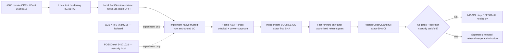

# #300 native root-custody engineering checkpoint — 2026-11-09

**Status: NOT RELEASE READY. No push, merge, deploy, cutover, or #300 Ready transition.**
This is an evidence and roadmap checkpoint; it is not a claim that the
Root.ark SyncEngine or a native Windows CFAPI provider is secure for production.

## Reconciled Git state

| Reference | Exact Git object / state |
| --- | --- |
| Published PR [#300](https://github.com/bielxdh3/Root.ark/pull/300) | `956b2515d3f5262b2bf8c6044be2bfd2db72dc9e`, OPEN/Draft |
| Published `Root/main` | `202146bb73ca8577a0a4017c4556cb8b1e9588a6`, unchanged by this work |
| Previous integrated local candidate | `c01014735a438bf27bf5e2a346af7930993b5f97` |
| Current integrated test-only contract | `48e881c5bff6e67df2a58847e7963dfd7fb5395d`, parent `c0101473` |
| Last locally fast-forwarded integrated HEAD | `a2e57ba8f451ec140e0f757f6c5f418b187260f7`, clean at the start of this continuation |
| New combined candidate with exact physical evidence (not yet fast-forwarded at checkpoint) | `b97328a9749eb7d6e08bb3910564e45faa06da16` — Windows W25, corrected N-API/owner fixtures and LF gate, **local only** |
| Windows NTFS handle-rename lab | `76cfa21e251382ae12d23d742bb921c84c3dde00`, parent `5d5500da`, **isolated** |
| POSIX dirfd/openat2 research lab | `8e0ccba222a713e1807cb9ad9f88217b03a3d3a8`, parent `37b395bd`, **isolated** |

The `RootSession` contract commit was fast-forwarded locally only after
an independent exact-SHA SOURCE GO (P0=0/P1=0/P2=0 in its three-file
test-only scope). It has no runtime callers, never loads an addon and rejects
even `openNativeRootSession(true)` with `root_session_native_unavailable`.
It is not a recovery fix. Its 13 required native operations and independent
parent/rollback/writer-isolation guards are requirements, not implemented
OS authority or a real attestation.

## Physical evidence, keeping SHAs and scopes separate

| Exact SHA / suite | Windows Node 22, local NTFS | WSL Ubuntu Node 22, physical ext4 |
| --- | --- | --- |
| `c0101473` eight CFAPI suites | 21 PASS, 0 FAIL | 14 PASS, 7 Windows SKIP, 0 FAIL |
| `c0101473` required-v2 process-crash before PREPARE with 16,385 real trash entries | 1 PASS, 0 FAIL | 1 PASS, 0 FAIL |
| `48e881c5` same eight CFAPI suites plus RootSession-contract suite | **28 PASS, 0 FAIL** | **21 PASS, 7 Windows SKIP, 0 FAIL** |
| `76cfa21e` isolated native Windows rename/source-identity lab | Author: 5 PASS, 0 FAIL | Author: 5 expected Windows SKIP |
| `8e0ccba2` isolated POSIX native lab | Not applicable | Author: 5 PASS, 1 bind-mount SKIP, 0 FAIL |

The 16,385-entry test validates legitimate crash recovery, **not hostile
ABA**. The new `48e881c5` contract does not alter the SyncEngine or the
recovery implementation; the process-crash test above was run on its exact
parent `c0101473` and is not misattributed to another SHA.

For W25, the source-identity correction stores the original `FileIdInfo`
while its creation handle is alive, then requires that the source opened
for `NtSetInformationFile` has the same volume and file ID before rename.
Deterministic replacement of that source is rejected; independent SOURCE
review gave GO only to this specific improvement, not to first acquisition
of the scratch directory. A same-SID adversary can still substitute that
initial pathname before its trusted-handle acquisition.

The POSIX lab uses `openat2(RESOLVE_BENEATH|RESOLVE_NO_SYMLINKS|
RESOLVE_NO_XDEV)`, `fdopendir` on a retained directory fd, `renameat2`
with `RENAME_NOREPLACE`, byte-exact Unicode and streaming 16,385 entries.
The corrected child eliminates name-based `unlinkat` cleanup of a possibly
replaced entry and uses literal `/usr/bin/gcc` with a reduced environment.
Its physical test is an orderly A→B→A namespace demonstration, **not a
concurrent malicious bind-mount attack**. Real mount replacement was SKIP
because the WSL test identity lacked `CAP_SYS_ADMIN`; actual binary/toolchain
image provenance, initial root trust and concurrent writer isolation remain
unproven. Independent SOURCE review of exact `8e0ccba2` gave **GO only for
the corrected, opt-in test-only experiment** (P0=0/new P1=0/P2=0 in its
stated scope). It does not close image custody or the product-level P1 and
is not authorization to publish or enable native recovery.

## Remaining hard blockers

1. The active `sync-client/rootark-sync-engine.js` still opens leaf handles
   but separately resolves root ancestry, enumerates `.rootark-trash` by
   pathname, reads the genesis marker, scans tracked bytes and promotes
   ledger/journal/snapshot paths by name. A previous physical bind-mount
   A→B→A reproduced false clean recovery. More `lstat` snapshots do not
   constitute an atomic fix. Relevant areas: `readContainedFile` 280-326,
   `stagedEvictionGenesis` 587-655, `scanPhysicalCacheForEvictionRecovery`
   2722-2803, required-v2 checkpoint 1332-1419, and staging/rollback
   2530-2539/3267-3309.
2. A complete native `RootSession` requires acquisition and cold-reopening
   from a parent independently protected from same-principal swaps; every
   read, enumeration, stage, rename, unlink, journal and commit must remain
   bound to that session. An independent monotonic rollback authority and
   same-principal writer exclusion or immutable snapshots are also required.
   The contract currently rejects all activation.
3. Native test executable SHA-256 and a fixed System32 command path do not
   bind bytes actually executed after process launch, loader DLLs, MSVC
   compiler stages or source bytes. The POSIX lab has the same executable
   provenance limitation. Neither test-only lab establishes loader custody.
4. The **published** #300 formal CodeQL check was FAILURE (native ACL
   command-construction annotation); its later local source hardening has
   not been checked by hosted CodeQL at the exact local SHA. Windows 10
   CFAPI provider activation, hostile NTFS/reparse and power-cut durability,
   full native-root I/O integration, rollback and independent release
   SOURCE review are outstanding.

## Roadmap and decision path

**Next engineering step:** implement actual native trusted-parent acquisition,
same-object enumeration/read/rename and durable cold-reopen with a separate
writer/custody authority, then prove both successful 16,385-entry recovery
and hostile root replacement without remote signed DELETE. Keep W25 non-operational,
and prohibit any production call into either experiment until source, image,
root custody and hostile-physical gates are independently satisfied.

## Later local test-only integration (after scoped peer GO)

The corrected POSIX laboratory `8e0ccba2` passed independent **SOURCE GO
strictly for an opt-in research experiment** (zero P0/new P1/P2 for its
corrected claims; no endorsement of executable-image custody or the
SyncEngine). The source was cherry-picked unchanged, with owner attribution
and a single Codex trailer, onto the documentation checkpoint:

- `67b5927632951f6788ca25a4539acec0ad5443c4`: this dated checkpoint
  on `48e881c5`;
- `418d9806`: cherry-pick of original POSIX research `37b395bd`;
- `34d7102187cc115db9222bccee385fdc15551ecd`: cherry-pick of its
  correction `8e0ccba2`.

The composite was conflict-free by `git merge-tree --write-tree`; the
exact `34d71021` source archive ran on WSL Ubuntu physical ext4, Node22,
gcc15: **5 PASS, 1 explicit bind-mount SKIP, 0 FAIL** with the opt-in lab.
On the Windows Node22/NTFS checkout of that same SHA, the CFAPI and
`RootSession` contracts ran **28 PASS, 6 Linux-lab SKIP, 0 FAIL**. The
preceding `48e881c5` integrated candidate ran **28 PASS Windows** and
**21 PASS / 7 Windows SKIP on WSL ext4** for CFAPI + RootSession. No
required-v2 engine files, production entry points, host services, cloud
accounts, or old hostile fixtures were changed by this composition.

All these commits remain **LOCAL ONLY**. The POSIX experiment being present
in a test-only source tree does not activate it and does not close any of the
earlier root/ancestor, same-principal writer, image, code-loading, cold
reopen, crash or rollback gates. Publication remains **NO-GO**.

## 2026-11-09 continuation — exact test-only combined candidate

**Security decision: NO-GO for operational recovery / release.** The following
is a bounded local research/testing integration, not a native OS trust chain.
Neither `sync-client/rootark-sync-engine.js` nor the fail-closed
`sync-client/rootark-sync-native-root-session-contract.js` was changed after
`a2e57ba8`. In particular, `openNativeRootSession(true)` still throws
`root_session_native_unavailable` and no N-API addon is imported by production.

**Combined test-source SHA with physical evidence:**
`b97328a9749eb7d6e08bb3910564e45faa06da16` (child of `844dee94`,
which itself is a local cherry-pick composition on top of `a2e57ba8`).

| Scope | Physically executed on exact `b97328a9` | Meaning |
| --- | --- | --- |
| Windows **11 Pro build 26300** / Node 22 / NTFS test harness with W25 opt-in, CFAPI tests, ACL fixtures, provenance receipts, contract and platform SKIPs | **45 PASS, 16 SKIP, 0 FAIL** | Tests native handle-relative W25 identity/rename and Unicode read, not independent first acquisition or Windows 10 compatibility |
| Ubuntu WSL/Node 22/physical ext4, POSIX labs + N-API + owner-read opt-in, Windows skips | **22 PASS, 9 SKIP, 0 FAIL** | Includes 16,385-entry dirfd enumeration, Node22 N-API and non-root writer denials under existing root-owned test fixture |
| Windows/NTFS `required-v2` process crash before PREPARE with 16,385 retained trash entries | **1 PASS, 0 FAIL** | Legitimate recovery only, NOT hostile A→B→A |
| Ubuntu WSL/ext4 same `required-v2` hard-crash scenario | **1 PASS, 0 FAIL** | Same limited meaning |

The first composite `844dee94` **failed 1 WSL test**: Windows checkout /
Git archive had emitted CRLF for the privileged POSIX validation script.
Commit `b97328a9` adds an exact `.gitattributes` LF constraint and a test
that fails on carriage returns. An independently extracted, fresh ext4
archive of `b97328a9` then passed all stated tests. Both the failure and
subsequent rerun are retained; there is no claim that the first test passed.

### Narrow SOURCE peer gates and actual threat boundaries

- W25 source `77c0b9b3` and its composite `1f659ac3` received independent
  **SOURCE GO for test-only experiments**, P0/P1/P2 new = 0. The original
  Windows source and the local cherry-pick have equal W25 file blobs. Initial
  scratch handle acquisition, same-SID in-place writers, executable image
  custody, cold power-cycle and persistent root ownership remain unproven.
- Linux N-API fix `5c6e082c` received independent **SOURCE GO only for the
  laboratory**, P0/P1/P2 new = 0. It uses private per-callback
  `napi_property_descriptor.data`, one `napi_add_env_cleanup_hook`, and no
  replaceable `napi_get/set_instance_data` slot. The physical Node22 test
  includes two active Workers, cross-token rejection and a second addon in
  the same Node environment. It still uses a same-UID-writable test parent
  and nonattested source/compiler/loaded `.node` image.
- The root-owned ext4 experiment `ada525ba` originally had a **reviewed P1**
  in its privileged shell's line-oriented `grep` check, allowing a malicious
  LF/path argument. Its child `8b778d3f` has **SOURCE GO for the narrow
  validation fix**, with exact 16-char ASCII lowercase hex suffix and
  no-root `--validate-only` negative tests. The root-owned test directory
  was created before that fix; later physical tests only read and attempt
  denied writes, and never re-executed the root script.
- **Unresolved potentially high-impact privilege/custody risk:** the root
  setup shell exists in an ordinary user-writable checkout. It must NOT be
  executed as root under a same-UID malicious-writer threat without a
  separate root-owned, source-attested acquisition/installation mechanism
  and pinned/sanitized privileged tool execution. Its fixture is read-only
  to UID1000, so it proves a narrow owner/read isolation fact, **not a
  writable Root.ark recovery service or a concurrent malicious mount swap**.
- The follow-up commit `715c7f19` removes recursive pathname teardown from
  Windows CFAPI probe tests (RED source regression before / GREEN after,
  5/5 Windows Node22). Fixtures are retained so a same-SID swap cannot
  redirect a test cleanup into a foreign tree. The test still passes a
  pathname to the read-only native CFAPI probe; no full trusted-handle
  imaging or ancestry proof is claimed.

### Formal CodeQL and independent release gates

On the **published** remote PR #300 head
`956b2515d3f5262b2bf8c6044be2bfd2db72dc9e`, GitHub still reports
the **formal CodeQL check as FAILURE** while its separate Analyze
JavaScript/TypeScript job reports SUCCESS. Three reviewer annotations were
reconciled: **#493** potential file race and **#496** generated-source
sanitization are resolved/outdated against prior published source, whereas
**#497** environment-derived shell command remains unresolved. Local code
limits executables to fixed absolute locations, removes writable `build.cmd`
execution, isolates compiler environment and checks build receipts, but
source-level improvements are **not** an equivalent of hosted CodeQL green
for `b97328a9`. No hosted check has run on this local SHA; the CLI is not
installed locally. Do not resolve #497 or mark formal security green by
inference from regular Node tests.

### Outstanding path to a real GO

1. Independently protected, authenticated root-parent acquisition on both
   OSes, including a durable root-owner policy and Windows same-SID threat;
   no user-writable shell/image or namespace may be promoted into authority.
2. End-to-end native handle/dirfd-relative `SyncEngine` recovery reads,
   streamed enumeration, journal/ledger stage/promote/commit/unlink and
   rollback. Remove the active pathname A→B→A gap, do not rely on repeated
   `lstat` snapshots.
3. Concurrent writers and malicious mount/reparse swaps in an isolated
   physical harness; 16,385 entries + Unicode/case aliases; root and
   writer identity across cold reopen; crash/power-loss ordered durability,
   anti-rollback floor and zero unauthorized signed remote DELETE.
4. A final independent P0/P1/P2 source review of the exact production SHA,
   Windows 10 CFAPI real activation/hydration evidence, and fresh hosted
   CodeQL/formal/full CI after explicitly authorized publication.

Do not merge, deploy, cut over, mark Ready or update `Root/main`. All
worktree experiments, fixture directories and previous commits are retained.

## New production-boundary change — required-v2 native recovery fail-closed

**Release decision remains NO-GO.** The subsequent isolated candidate
modifies the actual `sync-client/rootark-sync-engine.js` for the first time
since `a2e57ba8`. This is a **blocking safety fence**, not a native
implementation or a successful adversarial recovery.

- A `SyncEngine` constructed with `filesOnDemand: true` sets a non-writable
  `requireNativeRootRecovery` property; `requireNativeRootRecovery: false`
  cannot opt out of that requirement. Other callers may explicitly set
  `requireNativeRootRecovery: true` without enabling Files On-Demand.
- On cold open, a durable v2 snapshot with `evictionLedgerRequired: true`
  now fails **before path-based ledger/trash examination** with
  `root_session_native_unavailable`. A nonempty replay ledger in the strict
  mode also refuses the legacy path replay; direct calls to
  `recoverUnstartedEvictionLedger` cannot bypass the fence.
- The required-v2 snapshot is intentionally **not disarmed**, its tracked
  cache bytes remain unchanged, no fake JS `nativeRootSession` is read or
  invoked, and no remote sync adapter operation is issued by the blocked
  open. A future `openNativeRootSession` implementation returning an object
  must not silently reenable this legacy replay path.
- Ordinary v1 Files On-Demand startup and existing non-Files-On-Demand
  required-v2 behavior are unchanged by this guard. The latter remains
  **unsafe under the demonstrated hostile A→B→A threat** and must not be
  interpreted as a secure fallback. The gate does not harden non-recovery
  eviction/staging, lock acquisition, owner/DLL custody or remote DELETE.

**TDD + physical Windows Node22/NTFS validation, before final commit:**
the new regression first produced 2 failing assertions (missing strict
flag and erroneous `invalid_snapshot` fallback); after the change it passed
3/3. Files On-Demand + RootSession regressions passed 21/21, then combined
with the new three tests passed **24/24**. The non-Files-On-Demand real
hard-crash `required-v2` with **16,385** entries still passed **1/1**.
The committed candidate is
`dca741770fa71258238857b55813cee207d0fa34` (parent `9b7c3f0f`).
Its exact Git archive was extracted on native WSL ext4 `/dev/sdd` and run
with Ubuntu Node **v22.22.1**: **24/24 PASS** for Files On-Demand, the strict
native recovery gate and RootSession contract, and **1/1 PASS** for the
non-Files-On-Demand real `required-v2` crash with 16,385 entries (two
staging variants). All these tests returned exit 0. The matching Windows
Node22/NTFS results above were on the same committed source.

The published PR #300 still has formal CodeQL **FAILURE** at
`956b2515d3f5262b2bf8c6044be2bfd2db72dc9e`, and the local native-gate
code has not been pushed or assessed by hosted CI. Independent SOURCE GO of
this **product-code delta** is a separate prerequisite for advancing the
local integration. There is no proof of adversarial A→B→A safety outside the
new strict blocking branch, native first-owner authority, durable commit,
malicious same-SID writers, signed DELETE prevention or production readiness.
This does **not** authorize a push of the Draft PR or any release claim.

### Independent SOURCE NO-GO and P1 correction of the native-replay fence

The first code commit `dca741770fa71258238857b55813cee207d0fa34`
was **SOURCE NO-GO, not approved for integration**. Independent review
identified two concrete, independent P1 bypasses: (a) after constructing
the engine with `filesOnDemand:false`, JavaScript could change the mutable
`engine.filesOnDemand` to `true` while the captured strict flag stayed false;
and (b) an attacker controlling a userland engine object could override
`engine.denyUntrustedEvictionReplay` and cause the required-v2 replay to
fall into legacy pathname operations despite a strict constructor.

The next child corrects both defects without enabling native code. The
`filesOnDemand` instance property is non-writable and non-configurable,
matching the separately frozen strict native-recovery requirement. The
recovery deny function is now a **lexically private module function**,
invoked directly from both replay entrances and the direct zero-PREPARE
recovery method, not a mutable instance/prototype hook. A future native
`openNativeRootSession` return still cannot resume the legacy JS path.
The new RED tests reproduced **2 FAIL** on the reviewed defective code;
after repair the Windows Node22/NTFS Files On-Demand, native-gate and
contract suite returned **26 PASS, 0 FAIL**. The new fixture tests also
retain disposable TEMP files instead of recursively removing a pathname
that a hostile same-UID actor could swap before cleanup (peer P2 finding).

### Second SOURCE NO-GO and corrected replay-method bypass

The independent review of `ec781d512bc672bfc4ffdd248afdc5e0c3383881`
confirmed that the two original P1 bypasses were corrected, but found a
third P1: `_open()` still called the public, mutable
`this.replayEvictionLedger()`. Replacing that method on an engine instance
could bypass all checks even though the strict flag and its denial were
private. That commit was therefore **SOURCE NO-GO** for integration.

The subsequent code child `438ca5837d870930699d189908a3b7d4d2d2efff`
blocks the durable required-v2 case **inside `_open()` itself** via the
lexically private denial and calls the original replay implementation
captured when the `SyncEngine` module loaded, rather than a replaceable
instance or prototype method. A RED→GREEN regression explicitly replaces
the public replay method and tries to disarm the on-disk recovery marker;
the committed child refuses startup without writing the snapshot.

The same child adds a concrete **nonempty, valid signed PREPARE** regression
with a stale/inconsistent snapshot flag (`evictionLedgerRequired: false`).
The strict Files On-Demand replay rejects the ledger with
`root_session_native_unavailable`; the physical ledger, exact durable
snapshot bytes, signed store and absence of remote DELETE are checked.
These fixtures are retained, not removed recursively through untrusted
TEMP pathnames. The ledger-only case still has a pathname **read before
denial**, and is **not** an adversarial A→B→A success proof.

| Exact committed source | Physical validation | Result |
| --- | --- | --- |
| `438ca5837d870930699d189908a3b7d4d2d2efff` | Windows Node 22 / NTFS: native gate and RootSession contract | 14 PASS, 0 FAIL |
| same SHA from a clean Git archive on real Ubuntu WSL `/dev/sdd` ext4 | Ubuntu Node v22.22.1: same two suites | 14 PASS, 0 FAIL |
| same SHA | Windows Node 22 / NTFS: non-Files-On-Demand hard-crash `required-v2` with 16,385 trash entries | 1 PASS, 0 FAIL |
| same SHA from Git archive on WSL ext4 | Ubuntu Node v22.22.1: same hard-crash scenario | 1 PASS, 0 FAIL |

**Scope caveat:** these corrections address the three identified JavaScript
configuration/dispatch bypasses; they do not authenticate a hostile
snapshot, protect an arbitrarily compromised JavaScript runtime, establish
independent native root custody, or make older non-Files-On-Demand recovery
safe against A→B→A. This is a narrow **fail-closed production guard**, not
an operational native recovery implementation. Independent SOURCE review
of the exact final composite SHA remains mandatory before local integration.
The remote Draft PR has not been pushed; hosted CodeQL has not run on this
local child and formal CodeQL remains red on the published SHA.
