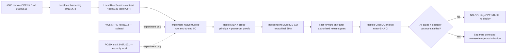

# #300 native root-custody engineering checkpoint — 2026-11-09

**Status: NOT RELEASE READY. No push, merge, deploy, cutover, or #300 Ready transition.**
This is an evidence and roadmap checkpoint; it is not a claim that the
Root.ark SyncEngine or a native Windows CFAPI provider is secure for production.

## Reconciled Git state

| Reference | Exact Git object / state |
| --- | --- |
| Published PR [#300](https://github.com/bielxdh3/Root.ark/pull/300) | `956b2515d3f5262b2bf8c6044be2bfd2db72dc9e`, OPEN/Draft |
| Published `Root/main` | `202146bb73ca8577a0a4017c4556cb8b1e9588a6`, unchanged by this work |
| Previous integrated local candidate | `c01014735a438bf27bf5e2a346af7930993b5f97` |
| Current integrated test-only contract | `48e881c5bff6e67df2a58847e7963dfd7fb5395d`, parent `c0101473` |
| Last locally fast-forwarded integrated HEAD | `a2e57ba8f451ec140e0f757f6c5f418b187260f7`, clean at the start of this continuation |
| New combined candidate with exact physical evidence (not yet fast-forwarded at checkpoint) | `b97328a9749eb7d6e08bb3910564e45faa06da16` — Windows W25, corrected N-API/owner fixtures and LF gate, **local only** |
| Windows NTFS handle-rename lab | `76cfa21e251382ae12d23d742bb921c84c3dde00`, parent `5d5500da`, **isolated** |
| POSIX dirfd/openat2 research lab | `8e0ccba222a713e1807cb9ad9f88217b03a3d3a8`, parent `37b395bd`, **isolated** |

The `RootSession` contract commit was fast-forwarded locally only after
an independent exact-SHA SOURCE GO (P0=0/P1=0/P2=0 in its three-file
test-only scope). It has no runtime callers, never loads an addon and rejects
even `openNativeRootSession(true)` with `root_session_native_unavailable`.
It is not a recovery fix. Its 13 required native operations and independent
parent/rollback/writer-isolation guards are requirements, not implemented
OS authority or a real attestation.

## Physical evidence, keeping SHAs and scopes separate

| Exact SHA / suite | Windows Node 22, local NTFS | WSL Ubuntu Node 22, physical ext4 |
| --- | --- | --- |
| `c0101473` eight CFAPI suites | 21 PASS, 0 FAIL | 14 PASS, 7 Windows SKIP, 0 FAIL |
| `c0101473` required-v2 process-crash before PREPARE with 16,385 real trash entries | 1 PASS, 0 FAIL | 1 PASS, 0 FAIL |
| `48e881c5` same eight CFAPI suites plus RootSession-contract suite | **28 PASS, 0 FAIL** | **21 PASS, 7 Windows SKIP, 0 FAIL** |
| `76cfa21e` isolated native Windows rename/source-identity lab | Author: 5 PASS, 0 FAIL | Author: 5 expected Windows SKIP |
| `8e0ccba2` isolated POSIX native lab | Not applicable | Author: 5 PASS, 1 bind-mount SKIP, 0 FAIL |

The 16,385-entry test validates legitimate crash recovery, **not hostile
ABA**. The new `48e881c5` contract does not alter the SyncEngine or the
recovery implementation; the process-crash test above was run on its exact
parent `c0101473` and is not misattributed to another SHA.

For W25, the source-identity correction stores the original `FileIdInfo`
while its creation handle is alive, then requires that the source opened
for `NtSetInformationFile` has the same volume and file ID before rename.
Deterministic replacement of that source is rejected; independent SOURCE
review gave GO only to this specific improvement, not to first acquisition
of the scratch directory. A same-SID adversary can still substitute that
initial pathname before its trusted-handle acquisition.

The POSIX lab uses `openat2(RESOLVE_BENEATH|RESOLVE_NO_SYMLINKS|
RESOLVE_NO_XDEV)`, `fdopendir` on a retained directory fd, `renameat2`
with `RENAME_NOREPLACE`, byte-exact Unicode and streaming 16,385 entries.
The corrected child eliminates name-based `unlinkat` cleanup of a possibly
replaced entry and uses literal `/usr/bin/gcc` with a reduced environment.
Its physical test is an orderly A→B→A namespace demonstration, **not a
concurrent malicious bind-mount attack**. Real mount replacement was SKIP
because the WSL test identity lacked `CAP_SYS_ADMIN`; actual binary/toolchain
image provenance, initial root trust and concurrent writer isolation remain
unproven. Independent SOURCE review of exact `8e0ccba2` gave **GO only for
the corrected, opt-in test-only experiment** (P0=0/new P1=0/P2=0 in its
stated scope). It does not close image custody or the product-level P1 and
is not authorization to publish or enable native recovery.

## Remaining hard blockers

1. The active `sync-client/rootark-sync-engine.js` still opens leaf handles
   but separately resolves root ancestry, enumerates `.rootark-trash` by
   pathname, reads the genesis marker, scans tracked bytes and promotes
   ledger/journal/snapshot paths by name. A previous physical bind-mount
   A→B→A reproduced false clean recovery. More `lstat` snapshots do not
   constitute an atomic fix. Relevant areas: `readContainedFile` 280-326,
   `stagedEvictionGenesis` 587-655, `scanPhysicalCacheForEvictionRecovery`
   2722-2803, required-v2 checkpoint 1332-1419, and staging/rollback
   2530-2539/3267-3309.
2. A complete native `RootSession` requires acquisition and cold-reopening
   from a parent independently protected from same-principal swaps; every
   read, enumeration, stage, rename, unlink, journal and commit must remain
   bound to that session. An independent monotonic rollback authority and
   same-principal writer exclusion or immutable snapshots are also required.
   The contract currently rejects all activation.
3. Native test executable SHA-256 and a fixed System32 command path do not
   bind bytes actually executed after process launch, loader DLLs, MSVC
   compiler stages or source bytes. The POSIX lab has the same executable
   provenance limitation. Neither test-only lab establishes loader custody.
4. The **published** #300 formal CodeQL check was FAILURE (native ACL
   command-construction annotation); its later local source hardening has
   not been checked by hosted CodeQL at the exact local SHA. Windows 10
   CFAPI provider activation, hostile NTFS/reparse and power-cut durability,
   full native-root I/O integration, rollback and independent release
   SOURCE review are outstanding.

## Roadmap and decision path



**Next engineering step:** implement actual native trusted-parent acquisition,
same-object enumeration/read/rename and durable cold-reopen with a separate
writer/custody authority, then prove both successful 16,385-entry recovery
and hostile root replacement without remote signed DELETE. Keep W25 non-operational,
and prohibit any production call into either experiment until source, image,
root custody and hostile-physical gates are independently satisfied.

## Later local test-only integration (after scoped peer GO)

The corrected POSIX laboratory `8e0ccba2` passed independent **SOURCE GO
strictly for an opt-in research experiment** (zero P0/new P1/P2 for its
corrected claims; no endorsement of executable-image custody or the
SyncEngine). The source was cherry-picked unchanged, with owner attribution
and a single Codex trailer, onto the documentation checkpoint:

- `67b5927632951f6788ca25a4539acec0ad5443c4`: this dated checkpoint
  on `48e881c5`;
- `418d9806`: cherry-pick of original POSIX research `37b395bd`;
- `34d7102187cc115db9222bccee385fdc15551ecd`: cherry-pick of its
  correction `8e0ccba2`.

The composite was conflict-free by `git merge-tree --write-tree`; the
exact `34d71021` source archive ran on WSL Ubuntu physical ext4, Node22,
gcc15: **5 PASS, 1 explicit bind-mount SKIP, 0 FAIL** with the opt-in lab.
On the Windows Node22/NTFS checkout of that same SHA, the CFAPI and
`RootSession` contracts ran **28 PASS, 6 Linux-lab SKIP, 0 FAIL**. The
preceding `48e881c5` integrated candidate ran **28 PASS Windows** and
**21 PASS / 7 Windows SKIP on WSL ext4** for CFAPI + RootSession. No
required-v2 engine files, production entry points, host services, cloud
accounts, or old hostile fixtures were changed by this composition.

All these commits remain **LOCAL ONLY**. The POSIX experiment being present
in a test-only source tree does not activate it and does not close any of the
earlier root/ancestor, same-principal writer, image, code-loading, cold
reopen, crash or rollback gates. Publication remains **NO-GO**.

## 2026-11-09 continuation — exact test-only combined candidate

**Security decision: NO-GO for operational recovery / release.** The following
is a bounded local research/testing integration, not a native OS trust chain.
Neither `sync-client/rootark-sync-engine.js` nor the fail-closed
`sync-client/rootark-sync-native-root-session-contract.js` was changed after
`a2e57ba8`. In particular, `openNativeRootSession(true)` still throws
`root_session_native_unavailable` and no N-API addon is imported by production.

**Combined test-source SHA with physical evidence:**
`b97328a9749eb7d6e08bb3910564e45faa06da16` (child of `844dee94`,
which itself is a local cherry-pick composition on top of `a2e57ba8`).

| Scope | Physically executed on exact `b97328a9` | Meaning |
| --- | --- | --- |
| Windows **11 Pro build 26300** / Node 22 / NTFS test harness with W25 opt-in, CFAPI tests, ACL fixtures, provenance receipts, contract and platform SKIPs | **45 PASS, 16 SKIP, 0 FAIL** | Tests native handle-relative W25 identity/rename and Unicode read, not independent first acquisition or Windows 10 compatibility |
| Ubuntu WSL/Node 22/physical ext4, POSIX labs + N-API + owner-read opt-in, Windows skips | **22 PASS, 9 SKIP, 0 FAIL** | Includes 16,385-entry dirfd enumeration, Node22 N-API and non-root writer denials under existing root-owned test fixture |
| Windows/NTFS `required-v2` process crash before PREPARE with 16,385 retained trash entries | **1 PASS, 0 FAIL** | Legitimate recovery only, NOT hostile A→B→A |
| Ubuntu WSL/ext4 same `required-v2` hard-crash scenario | **1 PASS, 0 FAIL** | Same limited meaning |

The first composite `844dee94` **failed 1 WSL test**: Windows checkout /
Git archive had emitted CRLF for the privileged POSIX validation script.
Commit `b97328a9` adds an exact `.gitattributes` LF constraint and a test
that fails on carriage returns. An independently extracted, fresh ext4
archive of `b97328a9` then passed all stated tests. Both the failure and
subsequent rerun are retained; there is no claim that the first test passed.

### Narrow SOURCE peer gates and actual threat boundaries

- W25 source `77c0b9b3` and its composite `1f659ac3` received independent
  **SOURCE GO for test-only experiments**, P0/P1/P2 new = 0. The original
  Windows source and the local cherry-pick have equal W25 file blobs. Initial
  scratch handle acquisition, same-SID in-place writers, executable image
  custody, cold power-cycle and persistent root ownership remain unproven.
- Linux N-API fix `5c6e082c` received independent **SOURCE GO only for the
  laboratory**, P0/P1/P2 new = 0. It uses private per-callback
  `napi_property_descriptor.data`, one `napi_add_env_cleanup_hook`, and no
  replaceable `napi_get/set_instance_data` slot. The physical Node22 test
  includes two active Workers, cross-token rejection and a second addon in
  the same Node environment. It still uses a same-UID-writable test parent
  and nonattested source/compiler/loaded `.node` image.
- The root-owned ext4 experiment `ada525ba` originally had a **reviewed P1**
  in its privileged shell's line-oriented `grep` check, allowing a malicious
  LF/path argument. Its child `8b778d3f` has **SOURCE GO for the narrow
  validation fix**, with exact 16-char ASCII lowercase hex suffix and
  no-root `--validate-only` negative tests. The root-owned test directory
  was created before that fix; later physical tests only read and attempt
  denied writes, and never re-executed the root script.
- **Unresolved potentially high-impact privilege/custody risk:** the root
  setup shell exists in an ordinary user-writable checkout. It must NOT be
  executed as root under a same-UID malicious-writer threat without a
  separate root-owned, source-attested acquisition/installation mechanism
  and pinned/sanitized privileged tool execution. Its fixture is read-only
  to UID1000, so it proves a narrow owner/read isolation fact, **not a
  writable Root.ark recovery service or a concurrent malicious mount swap**.
- The follow-up commit `715c7f19` removes recursive pathname teardown from
  Windows CFAPI probe tests (RED source regression before / GREEN after,
  5/5 Windows Node22). Fixtures are retained so a same-SID swap cannot
  redirect a test cleanup into a foreign tree. The test still passes a
  pathname to the read-only native CFAPI probe; no full trusted-handle
  imaging or ancestry proof is claimed.

### Formal CodeQL and independent release gates

On the **published** remote PR #300 head
`956b2515d3f5262b2bf8c6044be2bfd2db72dc9e`, GitHub still reports
the **formal CodeQL check as FAILURE** while its separate Analyze
JavaScript/TypeScript job reports SUCCESS. Three reviewer annotations were
reconciled: **#493** potential file race and **#496** generated-source
sanitization are resolved/outdated against prior published source, whereas
**#497** environment-derived shell command remains unresolved. Local code
limits executables to fixed absolute locations, removes writable `build.cmd`
execution, isolates compiler environment and checks build receipts, but
source-level improvements are **not** an equivalent of hosted CodeQL green
for `b97328a9`. No hosted check has run on this local SHA; the CLI is not
installed locally. Do not resolve #497 or mark formal security green by
inference from regular Node tests.

### Outstanding path to a real GO

1. Independently protected, authenticated root-parent acquisition on both
   OSes, including a durable root-owner policy and Windows same-SID threat;
   no user-writable shell/image or namespace may be promoted into authority.
2. End-to-end native handle/dirfd-relative `SyncEngine` recovery reads,
   streamed enumeration, journal/ledger stage/promote/commit/unlink and
   rollback. Remove the active pathname A→B→A gap, do not rely on repeated
   `lstat` snapshots.
3. Concurrent writers and malicious mount/reparse swaps in an isolated
   physical harness; 16,385 entries + Unicode/case aliases; root and
   writer identity across cold reopen; crash/power-loss ordered durability,
   anti-rollback floor and zero unauthorized signed remote DELETE.
4. A final independent P0/P1/P2 source review of the exact production SHA,
   Windows 10 CFAPI real activation/hydration evidence, and fresh hosted
   CodeQL/formal/full CI after explicitly authorized publication.

Do not merge, deploy, cut over, mark Ready or update `Root/main`. All
worktree experiments, fixture directories and previous commits are retained.

## New production-boundary change — required-v2 native recovery fail-closed

**Release decision remains NO-GO.** The subsequent isolated candidate
modifies the actual `sync-client/rootark-sync-engine.js` for the first time
since `a2e57ba8`. This is a **blocking safety fence**, not a native
implementation or a successful adversarial recovery.

- A `SyncEngine` constructed with `filesOnDemand: true` sets a non-writable
  `requireNativeRootRecovery` property; `requireNativeRootRecovery: false`
  cannot opt out of that requirement. Other callers may explicitly set
  `requireNativeRootRecovery: true` without enabling Files On-Demand.
- On cold open, a durable v2 snapshot with `evictionLedgerRequired: true`
  now fails **before path-based ledger/trash examination** with
  `root_session_native_unavailable`. A nonempty replay ledger in the strict
  mode also refuses the legacy path replay; direct calls to
  `recoverUnstartedEvictionLedger` cannot bypass the fence.
- The required-v2 snapshot is intentionally **not disarmed**, its tracked
  cache bytes remain unchanged, no fake JS `nativeRootSession` is read or
  invoked, and no remote sync adapter operation is issued by the blocked
  open. A future `openNativeRootSession` implementation returning an object
  must not silently reenable this legacy replay path.
- Ordinary v1 Files On-Demand startup and existing non-Files-On-Demand
  required-v2 behavior are unchanged by this guard. The latter remains
  **unsafe under the demonstrated hostile A→B→A threat** and must not be
  interpreted as a secure fallback. The gate does not harden non-recovery
  eviction/staging, lock acquisition, owner/DLL custody or remote DELETE.

**TDD + physical Windows Node22/NTFS validation, before final commit:**
the new regression first produced 2 failing assertions (missing strict
flag and erroneous `invalid_snapshot` fallback); after the change it passed
3/3. Files On-Demand + RootSession regressions passed 21/21, then combined
with the new three tests passed **24/24**. The non-Files-On-Demand real
hard-crash `required-v2` with **16,385** entries still passed **1/1**.
The committed candidate is
`dca741770fa71258238857b55813cee207d0fa34` (parent `9b7c3f0f`).
Its exact Git archive was extracted on native WSL ext4 `/dev/sdd` and run
with Ubuntu Node **v22.22.1**: **24/24 PASS** for Files On-Demand, the strict
native recovery gate and RootSession contract, and **1/1 PASS** for the
non-Files-On-Demand real `required-v2` crash with 16,385 entries (two
staging variants). All these tests returned exit 0. The matching Windows
Node22/NTFS results above were on the same committed source.

The published PR #300 still has formal CodeQL **FAILURE** at
`956b2515d3f5262b2bf8c6044be2bfd2db72dc9e`, and the local native-gate
code has not been pushed or assessed by hosted CI. Independent SOURCE GO of
this **product-code delta** is a separate prerequisite for advancing the
local integration. There is no proof of adversarial A→B→A safety outside the
new strict blocking branch, native first-owner authority, durable commit,
malicious same-SID writers, signed DELETE prevention or production readiness.
This does **not** authorize a push of the Draft PR or any release claim.

### Independent SOURCE NO-GO and P1 correction of the native-replay fence

The first code commit `dca741770fa71258238857b55813cee207d0fa34`
was **SOURCE NO-GO, not approved for integration**. Independent review
identified two concrete, independent P1 bypasses: (a) after constructing
the engine with `filesOnDemand:false`, JavaScript could change the mutable
`engine.filesOnDemand` to `true` while the captured strict flag stayed false;
and (b) an attacker controlling a userland engine object could override
`engine.denyUntrustedEvictionReplay` and cause the required-v2 replay to
fall into legacy pathname operations despite a strict constructor.

The next child corrects both defects without enabling native code. The
`filesOnDemand` instance property is non-writable and non-configurable,
matching the separately frozen strict native-recovery requirement. The
recovery deny function is now a **lexically private module function**,
invoked directly from both replay entrances and the direct zero-PREPARE
recovery method, not a mutable instance/prototype hook. A future native
`openNativeRootSession` return still cannot resume the legacy JS path.
The new RED tests reproduced **2 FAIL** on the reviewed defective code;
after repair the Windows Node22/NTFS Files On-Demand, native-gate and
contract suite returned **26 PASS, 0 FAIL**. The new fixture tests also
retain disposable TEMP files instead of recursively removing a pathname
that a hostile same-UID actor could swap before cleanup (peer P2 finding).

### Second SOURCE NO-GO and corrected replay-method bypass

The independent review of `ec781d512bc672bfc4ffdd248afdc5e0c3383881`
confirmed that the two original P1 bypasses were corrected, but found a
third P1: `_open()` still called the public, mutable
`this.replayEvictionLedger()`. Replacing that method on an engine instance
could bypass all checks even though the strict flag and its denial were
private. That commit was therefore **SOURCE NO-GO** for integration.

The subsequent code child `438ca5837d870930699d189908a3b7d4d2d2efff`
blocks the durable required-v2 case **inside `_open()` itself** via the
lexically private denial and calls the original replay implementation
captured when the `SyncEngine` module loaded, rather than a replaceable
instance or prototype method. A RED→GREEN regression explicitly replaces
the public replay method and tries to disarm the on-disk recovery marker;
the committed child refuses startup without writing the snapshot.

The same child adds a concrete **nonempty, valid signed PREPARE** regression
with a stale/inconsistent snapshot flag (`evictionLedgerRequired: false`).
The strict Files On-Demand replay rejects the ledger with
`root_session_native_unavailable`; the physical ledger, exact durable
snapshot bytes, signed store and absence of remote DELETE are checked.
These fixtures are retained, not removed recursively through untrusted
TEMP pathnames. The ledger-only case still has a pathname **read before
denial**, and is **not** an adversarial A→B→A success proof.

| Exact committed source | Physical validation | Result |
| --- | --- | --- |
| `438ca5837d870930699d189908a3b7d4d2d2efff` | Windows Node 22 / NTFS: native gate and RootSession contract | 14 PASS, 0 FAIL |
| same SHA from a clean Git archive on real Ubuntu WSL `/dev/sdd` ext4 | Ubuntu Node v22.22.1: same two suites | 14 PASS, 0 FAIL |
| same SHA | Windows Node 22 / NTFS: non-Files-On-Demand hard-crash `required-v2` with 16,385 trash entries | 1 PASS, 0 FAIL |
| same SHA from Git archive on WSL ext4 | Ubuntu Node v22.22.1: same hard-crash scenario | 1 PASS, 0 FAIL |

**Scope caveat:** these corrections address the three identified JavaScript
configuration/dispatch bypasses; they do not authenticate a hostile
snapshot, protect an arbitrarily compromised JavaScript runtime, establish
independent native root custody, or make older non-Files-On-Demand recovery
safe against A→B→A. This is a narrow **fail-closed production guard**, not
an operational native recovery implementation. Independent SOURCE review
of the exact final composite SHA remains mandatory before local integration.
The remote Draft PR has not been pushed; hosted CodeQL has not run on this
local child and formal CodeQL remains red on the published SHA.

### Third SOURCE NO-GO: mutable cached snapshot and replaceable open dispatcher

Independent SOURCE review of committed `438ca5837d870930699d189908a3b7d4d2d2efff`
(and its docs child `14d3ed03dd21cfe5e605c1e751cff22484088817`)
found two more in-process public-engine bypasses:

1. A strict open could first fail on a durable `required-v2` snapshot,
   leaving `this.snapshot` plus `snapshotDiskRevision` cached. After an
   in-process caller changed the mutable cached required flag to false, a
   retry skipped parsing the still-required disk snapshot because file
   metadata appeared unchanged. With no physical PREPARE, the old code
   incorrectly completed its open. A real RED regression reproduced this
   false-positive restart before the fix.
2. The normal operation lock called the replaceable `this._open()`.
   A caller controlling the instance could shadow that method to bypass
   the new lexical native-replay denial entirely. A second real RED
   regression reproduced this direct public method-dispatch bypass.

Committed child **`b50241ff178da888ba5f13ebbd69ec149c0cd082`**
(parent `14d3ed03`) forces a durable snapshot reparse on every strict
native-recovery open and uses the original `_open` implementation captured
at module initialization for normal mutation and public operation entry
points. The two regressions turned GREEN while preserving the always
closed native `RootSession`. This guard cannot defend arbitrary mutation
of all JavaScript internals by a fully compromised same-process executor;
that requires genuine native process/authority isolation.

| Exact Git source / workload | Physical host | Result |
| --- | --- | --- |
| `b50241ff178da888ba5f13ebbd69ec149c0cd082`: Files On-Demand + strict native gate + RootSession | Windows Node 22 / NTFS | **30 PASS, 0 FAIL** |
| same exact SHA, archive extracted into native `/dev/sdd` ext4 | Ubuntu WSL Node v22.22.1 / ext4 | **30 PASS, 0 FAIL** |
| same SHA: non-Files-On-Demand hard-crash before PREPARE, 16,385 legitimate retained trash entries | Windows Node 22 / NTFS | **1 PASS, 0 FAIL** |
| same SHA from Git archive: same hard-crash scenario | Ubuntu WSL Node v22.22.1 / ext4 | **1 PASS, 0 FAIL** |

The hard-crash positive path is **non-Files-On-Demand legacy behavior**, not
authorization for the strict Files On-Demand native-recovery branch. The
strict branch still rejects the documented required-v2 scenario with
`root_session_native_unavailable`, preserves its ledger/snapshot and
does not issue a remote signed DELETE. The real nonempty ledger test
continues to perform JS path-based ledger reads **before** denying replay
when a stale snapshot falsely says required=false; this does not establish
any atomic root, owner, ancestor, mounted namespace, or image custody.

The published PR #300 is still **OPEN/Draft at `956b2515`** and formal
CodeQL remains **FAILURE** on that published SHA. None of the above local
commits were pushed, and hosted CI has not assessed their exact SHAs.
Keep production native `RootSession` disabled, no merge/deploy/cutover
and no ready-for-merge claim until the missing adversarial OS-level
custody, durability, independent monotonic rollback and CodeQL gates
are actually closed. Exact-SHA independent SOURCE review is required
before even the local fast-forward of this candidate.

## Follow-up safety fence: destructive Files On-Demand eviction

**Operational/release NO-GO persists.** A follow-up source audit of the
reviewed local native-recovery gate `496e7582` confirmed a separate
destructive path **before** any recovery is needed: explicit `evictLocal`
used `_evictLocal` with `batchDurable=false`; after a remote content check,
it persisted an `evicted` marker and ran legacy pathname-based
`stageExisting` (`rename`) followed by `unlink` on the staged name. A hostile
same-SID/UID writer can replace an ancestor between those calls. The
auditor did **not** claim a physically reproduced foreign-file deletion.

Until native root ownership and handle-relative mutation are available,
the new local child rejects **all** `_evictLocal` calls on instances where
`requireNativeRootRecovery` is true, including explicit user eviction and
automatic excluded-path/batch eviction. This is a deliberate **loss of
eviction availability** in Files On-Demand, not a replacement native writer.
The denial occurs before checking paths, consulting remote records,
creating `.rootark-trash`, updating `remoteOnly`, or moving/unlinking
cached bytes. It is a module-private, non-overridable denial, and a future
successful native opener does **not** fall through to the unsafe JS route.

The previous positive test of explicit eviction was **not silently skipped**:
it now exercises the same signed remote object and real materialized cache,
then requires a rejection, unchanged physical Unicode-safe bytes,
unchanged snapshot/remote operation, no additional remote list, no trash or
eviction journal, and successful offline/restart preservation. Direct
`_evictLocal` with a forged `batchDurable=true` also has to reject.
TDD reproduced a **real RED** (unsafe eviction succeeded) before the
fence, then Windows Node22/NTFS tests passed **30/30** across Files
On-Demand, RootSession and native-recovery gate. Independent SOURCE GO
and exact final-SHA Ubuntu Node22/ext4 tests remain prerequisites before
merging this child even locally.

**Not yet solved:** other Files On-Demand mutations, hydration/remote
MOVE/DELETE, pathname-based local reconciliation, same-principal root
replacement, owner-authorized native writer, cold reopen, crash/rollback,
mapped image/DLL provenance or fully adversarial A→B→A. Tests that only
prove legitimate local recovery cannot close these P1 system gates.

### Automatic exclusion preflight — same native custody fence

The first explicit-eviction child `3756cc7ea6dc79dbea33356ada7eeb986ea1c067`
was physically tested on Windows Node22/NTFS (**30 PASS/0 FAIL**) and a
fresh exact-SHA archive on Ubuntu WSL Node22/ext4 (**30 PASS/0 FAIL**).
One uncovered automatic path remained: `_applyExcludedPaths()` could catch
the `_evictLocal()` native denial and proceed to write an exclusion failure,
retry state or remote-only intent. A new RED test used a signed remote cache
entry with Unicode content and a newly configured exclusion; `syncOnce()`
unexpectedly returned instead of rejecting before a snapshot change.

The corrective child now gates exclusion policy changes, pending evictions
and case-fold migration **before** building pending retry objects, scanning
mutable physical paths or persisting snapshot changes when native root
custody is required. An exclusion policy already applied and requiring no
work remains a no-op. The new physical Windows Node22/NTFS combined suites
returned **31 PASS, 0 FAIL**, with the exact cached Unicode bytes, snapshot
bytes, signed store and remote adapter calls unchanged after denial. This is
deliberate fail-closed behavior, **not** a native safe eviction backend.

### Mount namespace adversary — physical kernel semantics, not SyncEngine GO

An additional **manual**, explicitly root-privileged experiment was run in
an **isolated WSL Ubuntu/ext4 mount namespace** using
`wsl.exe --user root --exec /usr/bin/unshare --mount --propagation private
/bin/bash -s`. Bash source was piped through standard input instead of
executing an untrusted shell script from this repository. Preflight checked
that `/var/tmp` was root-owned (`0:1777`) on ext4 (`ef53`). A single
root-owned disposable `0700` directory was created by `mktemp -d`; two
contained directories A and B held different marker bytes.

The kernel was made to bind-mount B over A *only in the child namespace*.
Pathname `A/marker` then returned B's bytes, while **FD 3**, opened on
the original `A/marker` before the mount, continued returning A's bytes.
After unmounting the shadow, pathname A again returned A's exact bytes.
The original B contents remained untouched, and the fixture was retained.

```text
ROOTARK_BIND_NS_V1 PASS original=PINNED foreign=VISIBLE restored=ORIGINAL namespace=ISOLATED fs=EXT4 base=/var/tmp/rootark-issue66-bind-CF30mchs
PRIVATE_BIND_ABA_EXIT=0
```

**Limit of this evidence:** the mounting actor held root/CAP_SYS_ADMIN; this
does not demonstrate successful mounting by UID1000, an operational
RootSession, the `SyncEngine` reading via the original FD, safe concurrent
writers, crash-safe journal/snapshot promotion, cold reboot, trusted native
image provenance or monotonic rollback. The unprivileged bind mount test is
still a truthful SKIP. Nothing was deployed, no host-global mount was
changed, and `Root/main`/the remote Draft #300 were not modified.

**Source-review gate:** the eviction and exclusion-preflight child is kept
in its isolated worktree until a peer reviews its **exact committed SHA**;
passing these Node tests alone must not be reported as SOURCE GO, CodeQL
success or operational recovery readiness.

## 2026-11-09 evening continuation — signed DELETE and staging-source guard

**Status: ISOLATED LOCAL CANDIDATE; FULL PRODUCT/RELEASE NO-GO.** The local
base `7f2de23d7fe621538515109c4fe54021f1dfdae2` (parent `3756cc7e`,
grandparent integrated `496e7582`) contains the current-instance eviction
and automatic-exclusion fences. An independent peer reviewed the two fences
as GO only in that *narrow* sense. A second independent review of the exact
`7f2de23d` instead confirmed a **P1 source NO-GO for a broader, persistent
root-wide guarantee**: a cache originally hydrated under `filesOnDemand:true`
can be reopened by a new engine with `filesOnDemand:false`. The new instance
has no independently authenticated, immutable root-mode commitment, so its
public `evictLocal` and ordinary exclusion migration can still invoke legacy
pathname-based stage/rename/unlink. Freezing properties in the original JS
instance does not defend a second instance, and a mutable same-UID JSON
marker would not fix independent root custody. Do not promote this branch
as safe for adversarial A→B→A, or integrate as an end-to-end security fix.

The further isolated source change in
`mission-20261109-pr300-fod-delete-guard-prime` adds **bounded fail-closed
signed DELETE checks only when `requireNativeRootRecovery` is true**:

- `_reconcileLocal` rejects a missing tracked path before signing/enqueuing a
  remote DELETE; the adversarial input is a materialized Unicode cached file
  moved to another pathname on the physical filesystem, not a fake scanner.
- `translateWebDavMutation` rejects DELETE and MOVE (which may synthesize a
  destination-overwrite tombstone) before scanning and translating.
- `assertOutgoingAuthorized` rejects DELETE/tombstone both for a direct
  enqueue and before a signed operation is dispatched. `_pushPending` rejects
  previously persisted unseen DELETE/tombstone outbox records before remote
  transmission. A regression writes an old signed DELETE through a non-FOD
  engine, then reopens in FOD mode and checks it was not pushed. This does
  **not** block a downgrade to the non-FOD instance: the P1 above remains.
- Public `stageExisting(target)` now checks static source containment before
  creating trash or renaming. A real sibling external file was moved by the
  original source in the RED stage; the corrected source rejects it without
  modifying that file. This remains a pathname TOCTOU check, **not** a
  retained native root/ancestor handle or same-SID writer exclusion.

TDD on Windows Node22 observed missing expected rejection for the vanished
cache, WebDAV DELETE, and external absolute staging source. The old-outbox
test was also observed RED by temporarily disabling its two new guards in
the isolated candidate and rerunning, then restoring both guards; there is
no assertion that these behaviors were safe before the patch.

| Isolated child candidate source / actual workload | Physical result |
| --- | --- |
| FOD suite `test/issue-66-files-on-demand.test.js` / Windows Node v22.23.4, NTFS | **20 PASS / 0 FAIL / 0 SKIP** |
| Same FOD suite / WSL Ubuntu Node v22.22.1, `TMPDIR=/home/bielx` on real `/dev/sdd` ext4 (not `/tmp` tmpfs) | **20 PASS / 0 FAIL / 0 SKIP** |
| `test/phase16-sync-engine.test.js`, native recovery gate, and native RootSession contract / Windows Node22, NTFS | **53 PASS / 0 FAIL / 1 SKIP** |
| Same three adjacent suites / WSL Node22, physical ext4 fixtures | **52 PASS / 0 FAIL / 2 SKIP** |

The old durable index can be rewritten by ordinary FOD opening with an
additional empty `pendingEvictions` field before the stored-outbox denial;
the new regression compares logical `files` and `remoteOnly` plus retained
journal rather than asserting byte-identical snapshot for that case. In the
other rejection paths tests check unchanged cache/remote objects, no adapter
pushes and no new trash. The test harness uses inherited recursive cleanup
of its randomly named temporary parent, so it is *not* an adversarial
same-UID cleanup safety proof. Nothing was executed as root in this change.

**Still blocking any source-wide/production GO:** (1) mode downgrade across
engines, (2) `SyncEngine._apply` and FOD hydration via `stageExisting` and
pathname-based MOVEs/DELETEs without native ancestor custody, (3) independent
owner/root authority and held handles for all I/O, (4) hostile concurrent
writer/mount/reparse A→B→A and 16,385 entries under real native product
recovery, (5) crash/power-loss and monotonic rollback protection, (6)
trusted executable/loader images and Windows 10 CFAPI, and (7) hosted formal
CodeQL still FAILURE on remote Draft PR #300 head `956b2515`. The separate
Analyze JavaScript/TypeScript job was SUCCESS, not the formal gate. No hosted
CI has validated this isolated local SHA. `RootSession` remains disabled.

No push, merge, deploy, cutover or `Root/main` modifications were made.
SOURCE peer review of the exact eventual child SHA is required, and a peer
GO restricted to the new checks cannot override the known **P1 root-mode
downgrade** or authorize integrating the complete branch.

### Physical cross-instance root-mode downgrade reproduction (intentionally RED)

After committing the bounded guards as
`32767a66691c95d8224e553574ecf7bebd74cd93` (parent `7f2de23d`),
a **separate isolated, intentionally dirty** worktree at
`mission-20261109-pr300-crossmode-repro-prime` was detached at that exact
source SHA. Its only worktree change is one test case, named
`issue 66 P1 KNOWN RED: reopening same FOD cache as normal sync must not
authorize legacy eviction`. The test uses the existing disposable real
encrypted-object fixture, hydrates a tracked cached file with
`filesOnDemand:true`, then constructs a new engine over the **same cache
root** with `filesOnDemand:false` and invokes `evictLocal` on its tracked
path. It expects native-custody denial and retention of cached bytes.

The expected denial was **not produced** on either OS:

| Exact `32767a66` source plus isolated uncommitted RED test | Observed |
| --- | --- |
| Windows Node v22.23.4 / disposable NTFS fixture | **1 FAIL**, `Missing expected rejection: same-root mode downgrade must not grant untrusted pathname eviction` |
| Ubuntu WSL Node v22.22.1 / `TMPDIR=/home/bielx` real `/dev/sdd` ext4 | **1 FAIL**, same denial failure |

This is a **verified unresolved P1**, not an incidental test infrastructure
failure, not a GREEN test, and not a proof of a same-SID foreign-file attack.
The uncommitted reproducer and disposable-test setup are preserved; it is
deliberately not part of the passing committed regression suite. The source
code of the committed `32767a66` branch continues to be independently
reviewed only for its narrower new guards. **No publication/integration
should treat this branch as native root custody or as a safe root-wide FOD
mode invariant.**

### Follow-up bounded guard: incoming cached-file DELETE application

The next **isolated** child based on docs-reviewed `2f2644df` responds to an
independent SOURCE finding of another pathname-based destructive path:
`SyncEngine.apply()` and direct `_apply()` accepted an incoming protocol
DELETE/tombstone and called `stageExisting` on locally cached bytes without
rooted native custody. `stageExisting` source containment is lexical and
cannot withstand a hostile concurrent ancestor swap.

A new physical FOD regression first produced an explicit **RED** on Windows
Node22: `Missing expected rejection` when applying a valid encrypted DELETE
operation to a real hydrated cached file. The child then added an internal
fail-closed native-required check inside `_apply` *after normalizing the
envelope and before verify/key/decrypt/journal/staging*. Both public `apply`
and direct `_apply` now reject this DELETE/tombstone while native custody is
unavailable. The test verifies exact cached bytes, unchanged local index and
no `.rootark-trash` staging after denial. The test does **not** assert that
arbitrary remote operation signatures or disk ancestors have been trusted.

A second test covers an existing denial of `translateWebDavMutation` MOVE
before path scanning, preserving the cached file and state. A signed remote
MOVE that **is not** a DELETE still enters legacy `_apply` on hydration and
may perform unsafe pathname rename/stage; that P1 remains entirely open.

| Additional isolated child regression | Observed |
| --- | --- |
| Windows Node v22.23.4 / physical NTFS / FOD suite including 2 new tests | **22 PASS / 0 FAIL** |
| WSL Ubuntu Node v22.22.1 / `/home/bielx` ext4 / same FOD suite | **22 PASS / 0 FAIL** |
| Windows Node22 / 3 adjacent native-gate, RootSession, legacy sync suites | **53 PASS / 0 FAIL / 1 SKIP** |
| WSL Ubuntu Node22 / same 3 adjacent suites with real ext4 fixture | **52 PASS / 0 FAIL / 2 SKIP** |

The earlier **physically reproduced cross-instance FOD-root mode downgrade**
is not fixed by a per-instance `_apply` check. Neither the new guard nor
the older signed DELETE fences confer independent owner-root acquisition,
same-SID writer exclusion, native image custody, cold power-cut recovery or
rollback resistance. Do not integrate/push/release until the source-specific
review, root-wide P1 and published CodeQL gates are resolved. No merge,
deploy, cutover, or `Root/main` modifications have been made.

#### Exact-code follow-up: real 16,385-entry non-FOD recovery on both filesystems

After committing the code and FOD regressions as
`5a1b1f2112bc13bcf53eb3ed86e5fab04b23d65e`, the same exact source
was exercised again against the named physical test
`issue 66 P2: hard crash with >16384 preexisting trash entries recovers
required-v2 before PREPARE` in
`test/issue-66-eviction-empty-ledger-gap-p2.test.js`. That test creates
**16,385 separate legitimate trash files per fixture** and covers both
`staged` and `active` zero-PREPARE recovery scenarios. Both test runs
completed successfully:

- Windows Node v22.23.4 / NTFS, with `TEMP` and `TMP` directed to
  `E:\servidor\.tmp`: **1 PASS / 0 FAIL**, ~24.9s.
- Ubuntu WSL Node v22.22.1 / native `/home/bielx` ext4 on `/dev/sdd`:
  **1 PASS / 0 FAIL**, ~18.1s.

These tests are **non-Files-On-Demand legitimate required-v2 crash
recovery**; they do not provide a safe A→B→A result or authorize the
cross-instance downgrade, and they do not attest a native root writer,
hard-power-loss durability or an external monotonic floor. The deliberately
failing cross-mode reproducer remains outside the committed passing suite.

### Independent SOURCE P1 follow-up: out-of-scope signed MOVE/DELETE reconciliation

The first bounded inbound application guard was committed as
`5a1b1f2112bc13bcf53eb3ed86e5fab04b23d65e` and independently
reviewed. The peer found **another existing P1 inbound route that bypassed
that guard**: `_pullRemote` dispatches records outside `selectedPaths` to
`preflightOutOfScopeMove`/`reconcileOutOfScopeMove`, bypassing `_apply`.
A signed tombstone for an out-of-scope `metadata.path`, while retaining the
object/file identity of an in-scope materialized cache origin, reached
pathname staging/rename, or conflict relocation, without native custody.
This is a real in-process policy bypass; it is not proof of same-SID foreign
file deletion or owner-root A→B→A resistance.

In the isolated child of `5a1b1f21`, a new RED regression reproduced an
**actual missing native denial on Windows Node22** with a valid persisted
remote tombstone, selected tracked original identity, local cached bytes and
an out-of-scope tombstone pathname. The corrective guard is placed inside
`preflightOutOfScopeMove` **after** finding a matching tracked selected origin
and **before** any filesystem read, signature pre-observation or mutation.
This also protects **direct** `reconcileOutOfScopeMove()` callers, and denies
tracked-origin remote MOVE and directory reconciliation when the root requires
native custody. Pure out-of-scope remote-only changes that cannot refer to
a tracked selected origin retain their previous behavior.

Two physical tests cover an out-of-scope DELETE and an out-of-scope MOVE
with a Unicode original filename; each attempts both the public remote pull
and the direct reconciliation route, then checks the exact physical original
bytes, durable snapshot bytes and the absence of trash staging. The native
root is still unavailable by design; source provenance and protection
against hostile concurrent ancestors are **not** established.

| Additional child tests before exact-SHA peer review | Results |
| --- | --- |
| Windows Node v22.23.4 / NTFS full Files On-Demand suite | **24 PASS / 0 FAIL / 0 SKIP** |
| Ubuntu WSL Node v22.22.1 / `/home/bielx` ext4 full Files On-Demand suite | **24 PASS / 0 FAIL / 0 SKIP** |
| Windows Node22 / Phase16, native recovery gate and RootSession contract | **53 PASS / 0 FAIL / 1 SKIP** |
| Ubuntu WSL Node22 / same adjacent suites on ext4 | **52 PASS / 0 FAIL / 2 SKIP** |

This change does not repair same-root mode downgrade to a new non-FOD
`SyncEngine`, pathname-based normal MOVE/UPDATE/hydration, same-UID/SID
ancestor and native image custody, power-cut/rollback, or hosted CodeQL.
Independent SOURCE review of the eventual exact child SHA is mandatory;
these scoped test successes do **not** justify local integration, remote
push, production operation, merge or deploy.

### Follow-up laboratory: reject public in-root Files On-Demand staging

A separate child of `42289bdc` found a source-reachable legacy mutation:
the public `stageExisting()` helper could rename a materialized, contained
Files On-Demand cache file into `.rootark-trash` without a native RootSession,
independent authority or durable required-v2 PREPARE. A new Windows Node22
regression was **RED** (`Missing expected rejection`) before the fix.
The helper now rejects native-required roots **before pathname inspection**.
The revised cached-refresh test expects a native-custody denial rather than
accepting legacy pathname replacement. Windows Node22 FOD suite: **25 PASS,
0 FAIL** after the fix. This is a bounded fail-closed restriction and a
user-visible loss of legacy cached-refresh availability until native support
exists, not an implementation of safe native replacement. Internal/public
method interception, alternate `_apply` rename routes, cross-instance
non-FOD downgrade, same-SID A→B→A, cold recovery and CodeQL remain
subject to separate source review and integration gates.

### Exact local composition 5d6d76ee: independent narrow SOURCE GO

The next isolated child `d92566a10891fe0220a00bfd28736068c0b80f69`
of `42289bdc` denies direct `stageExisting()` for native-required roots
before any pathname lookup. Windows Node22 reproduced **RED** with a
materialized FOD file before the change (`Missing expected rejection`),
then the adjusted entire suite went **GREEN 25/25**. The existing cached
refresh is now deliberately unavailable pending native custody; the
physical cache bytes and durable snapshot remain unchanged on denial.

The independent worker's child `7f9fcc409e67d36dae232cc847ce531b11e8cf8d`
captured the canonical out-of-scope preflight implementation so callers
cannot shadow the public method in direct reconciliation, remote pull or
HTTP 409 conflict handling. It reproduced RED for method interception and
Proxy interception, then GREEN. Cherry-picking this reviewed delta atop
`d92566a1` required a test-only conflict resolution preserving both
families of regressions; the resulting exact composition is
**`5d6d76eed10777d1f521a75ab4be2eb1d98fa3af`**. Both commits have
author/committer `bielxdh3 <bielxdh3@gmail.com>` and exactly one Codex
coauthor trailer. No native RootSession implementation was enabled.

| Exact 5d6d76ee physical run | Result |
| --- | --- |
| Windows Node v22.23.4 on NTFS: full Files On-Demand suite | **27 PASS / 0 FAIL / 0 SKIP** |
| Ubuntu WSL Node v22.22.1 on real `/home/bielx` ext4, `git archive` exact SHA with dependencies supplied read-only via `NODE_PATH`: full FOD suite | **27 PASS / 0 FAIL / 0 SKIP** |
| Windows Node22: `issue-66-eviction-empty-ledger-gap-p2` plus `issue-66-root-session-contract` | **30 PASS / 0 FAIL / 3 SKIP** |
| Windows Node22: legitimate non-FOD hard crash and recovery with more than 16,384 trash entries, included in preceding run | **PASS** |
| Git metadata, worktree cleanliness, and `git diff --check` | **PASS** |

The first ext4 test attempt lacked several archived source directories;
after extending the test-only archive with `public`, `db` and `services`,
the same exact 5d6d76ee source passed. The source worktrees and this ext4
fixture were retained; no cleanup of adversarial fixtures was performed.
Independent **read-only exact-SHA SOURCE GO was restricted to the new
stageExisting and captured-preflight guards** (new P0/P1/P2: zero).
The integrated local worktree fast-forwarded from `496e7582` to
`5d6d76ee` and was clean. These results must not be described as
adversarial root-custody, cold-reboot, power-cut, image, rollback or
production recovery proof.

**Still NO-GO:** a different SyncEngine instance may reopen an existing
FOD root as non-FOD and reach legacy pathname eviction. Physical RED
exists on Windows Node22/NTFS and WSL Node22/ext4 for a later descendant;
the logical mode is not yet protected by an independently trusted root
authority. Existing `_apply` MOVE and replacement paths, same-SID A→B→A,
monotonic custody, complete native handles/fds, and formally hosted CodeQL
also remain unresolved. The remote PR #300 remains OPEN/Draft at
`956b2515`, with CodeQL formally failing in the last check; Root/main
remains untouched. No push, merge, deploy or cutover was performed.

### Additional fail-closed FOD MOVE preflight (isolated candidate)

Review of `_apply` found that a signed MOVE with an existing materialized
source still reached `fsp.rename(source, target)` by pathname, even though
public `stageExisting` was native-gated. A focused Windows Node22 test
reproduced **RED** (`Missing expected rejection`) for a legitimate signed
MOVE of clean cached bytes, including a direct public `apply(move)` call.
The correction denies **all FOD/native-required incoming MOVE operations**
before verification admission, journal observation or path I/O, rather than
attempting to make a pathname rename safe with repeated `lstat` checks.
It intentionally disables legacy MOVE hydration, even when a signed
recovery payload exists, until the native held-root operation is proven.
The full Windows Node22 FOD suite turned **GREEN 27 PASS / 0 FAIL** with
unchanged local bytes, durable snapshot, no trash and no destination.
This narrow guard is not root-wide same-SID custody: first-time hydration
and non-FOD reopens still have other pathname-based risks, so product
recovery and release remain **NO-GO** pending exact-SHA SOURCE review.

### Follow-up: preserve first-time signed MOVE hydration without cached rename

Independent exact-SHA SOURCE review rejected `83e047c9` (**NO-GO P1**)
because its categorical MOVE denial also blocked legitimate first-time
hydration when both the source and destination were absent, despite an
authenticated recovery payload. It also identified incomplete assertions
for journal/remote mutations (**P2**). The original 27/27 GREEN was
therefore insufficient. A focused Windows Node22 regression reproduced
**RED** with `root_session_native_unavailable` on a first-time signed
MOVE whose source had never been materialized. The corrective child
checks both the canonical destination and potential tracked/requested
source path existence **before journal admission**, denying occupied
paths but allowing first-time payload hydration. Windows Node22 full FOD
suite: **28 PASS / 0 FAIL** with cached-source rejection and first-time
positive hydration both covered. This only preserves an existing
cooperative-path behavior; absence checking is not atomic under a hostile
same-SID writer, so native rooted no-replace, authority and rollback
remain unproven. This child needs exact-SHA physical ext4 tests and
independent SOURCE review before local integration.

### Composed logical FOD mode and strict MOVE proof: af23a3f0

The exact clean, isolated candidate
`af23a3f0f9199625678a491596339cfc0ef245e1` contains the first-time
MOVE compatibility repair (`6c3c1358`), a local ever-FOD marker
(`e6517538`, rebased from `d8ae58e5`), a real Ed25519 pinned-key
positive MOVE test (`222eb211`, rebased from `843fc305`), and direct
helper + shared path namespace corrections (`af23a3f0`, rebased from
`76a02b86`). The earlier categorical MOVE parent `83e047c9` was
independently SOURCE **NO-GO** for disabling legitimate absent-source
hydration; its child preserves authenticated recovery-payload hydration
when both requested/tracked source and target are absent, while rejecting
occupied cache and destination before journal admission.

The local fixed-name `.rootark-sync-ever-fod` marker is created with
exclusive file creation, file fsync and supported parent directory fsync
before FOD operations, validated on subsequent opens, and checked before
direct conflict-recovery writes and directory pruning. The shared path
validator reserves this name against sync and WebDAV user data. Earlier
independent SOURCE **NO-GO** for the marker's direct helper bypass and
shared namespace gap was addressed by `af23a3f0`; three TDD regressions
were RED on its parent and GREEN after the correction. This is a logical
cooperative-client downgrade fence, NOT a trusted disk-backed monotonic
custody witness.

| Exact af23a3f0 source validation | Observed result |
| --- | --- |
| Windows Node22.23.4 / NTFS FOD full suite | **34 PASS / 0 FAIL / 0 SKIP** |
| Ubuntu WSL Node22.22.1 / real ext4 FOD full suite, archived exact SHA | **34 PASS / 0 FAIL / 0 SKIP** |
| Windows Node22 required-v2 hard crash with more than 16,384 legitimate non-FOD trash records | **1 PASS / 0 FAIL** |
| WSL Node22 ext4 same hard-crash non-FOD recovery | **1 PASS / 0 FAIL** |
| `git diff --check`, exact Git worktree cleanliness and Codex coauthor metadata | **PASS** |

The strict MOVE fixture proves client-side Ed25519 signed-envelope
verification using a pinned trusted device key, journal `hasSeen` and
persisted snapshot identity on reopen. It injects the signed full envelope
through the adapter while the non-protected disposable store holds the
encrypted unsigned copy. It does **not** prove protected server-side
atomic-registry admission, live revocation or production remote signing.
An independent reviewer issued bounded SOURCE GO for the exact composed
source, without endorsing native custody, cross-process physical attacker
exclusion, rollback resistance or release. No force push, merge, deploy,
Root/main mutation or RootSession enablement is authorized by these runs.

**Release NO-GO persists:** hostile same-SID/UID removal or rollback of
the local marker cannot be distinguished from a virgin root; pathname
`lstat`/`readFile` and absent-source MOVE checks are not native held-root
atomic no-follow operations. Separate process/cold boot, ancestor A→B→A,
independent monotonic authority, image/DLL provenance, power-cut and
hosted formal CodeQL remain outstanding. The PR #300 remote remains
OPEN/Draft and no deployment or cutover was performed.
